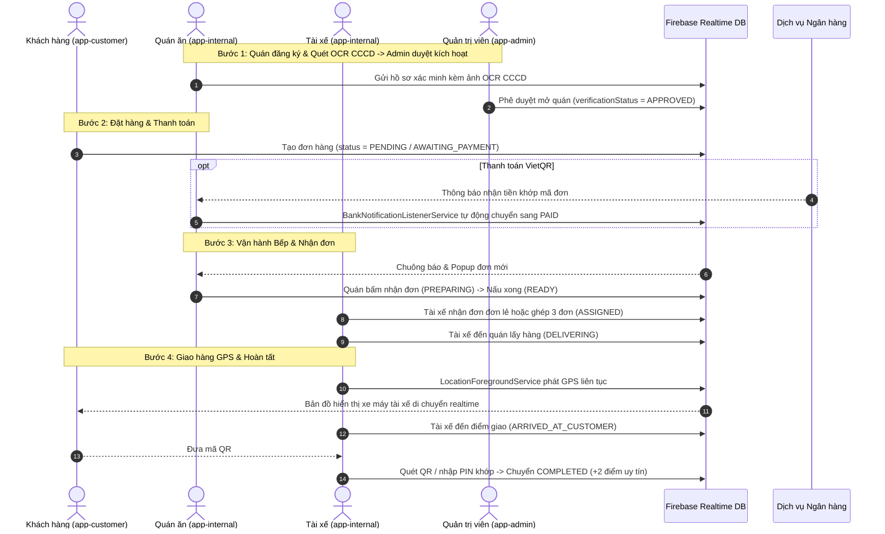
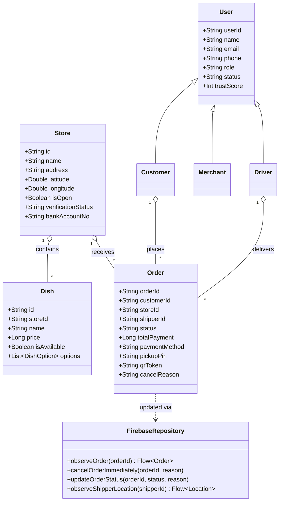
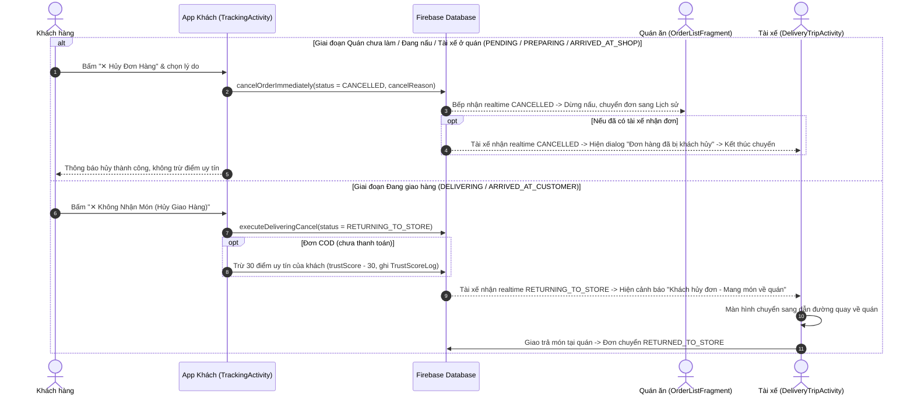
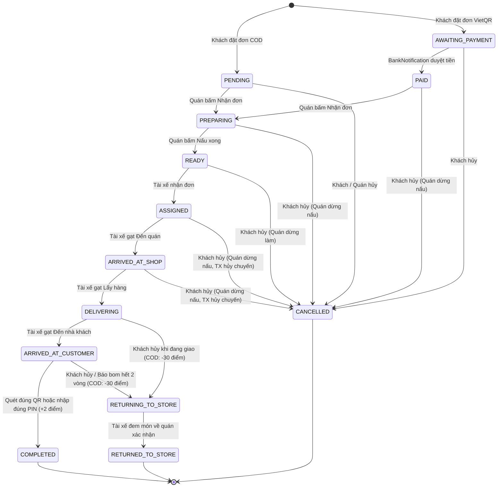

TRƯỜNG CAO ĐẲNG CÔNG NGHỆ THỦ ĐỨC
KHOA CÔNG NGHỆ THÔNG TIN
BÁO CÁO KẾT THÚC MÔN HỌC
HỌC PHẦN: LẬP TRÌNH DI ĐỘNG 2 (CHUYÊN ĐỀ 2)
ĐỀ TÀI: HỆ THỐNG ĐẶT VÀ GIAO ĐỒ ĂN TRỰC TUYẾN ĐA PHÂN HỆ OISHI FOOD (OISHI FOOD DELIVERY ECOSYSTEM)
Lớp: CD24TT7 | Khóa: 12 | Ngành: Công nghệ thông tin
Giảng viên hướng dẫn: ThS. TIÊU KIM CƯƠNG
Nhóm sinh viên thực hiện:
DƯƠNG MINH THƯ
PHẠM PHÚC MẠNH GIÀU
TRẦN VŨ
HỒ THỊ VÂN ANH
TP. Hồ Chí Minh, Năm học 2025 – 2026

---

# NHẬT KÝ HOẠT ĐỘNG & PHÂN CÔNG BÁO CÁO NHÓM
| STT | Họ và tên | Công việc đã thực hiện | Nhóm đánh giá (%) | Chữ ký |
| :---: | :--- | :--- | :---: | :---: |
| 1 | **Dương Minh Thư** | • Thiết kế kiến trúc Firebase Realtime Database, Firebase Auth & Xác thực Email OTP (`AuthRepository`, `EmailOtpApi`). • Xây dựng module `core` (32 Models, `FirebaseRepository`, `AccountLockWatcher`, `CccdOcrHelper`). • Phát triển ứng dụng Quản trị viên `app-admin` (Dashboard, Duyệt quán, Quản lý danh mục, Giám sát đơn/user, Giải quyết khiếu nại). | 25% | |
| 2 | **Trần Vũ** | • Phát triển phân hệ Quán ăn & Chủ chuỗi trong `app-internal` (`OrderListFragment`, `MenuManageFragment`, `StoreReportFragment`, `BossDashboardActivity`). • Xây dựng dịch vụ tự động đọc thông báo ngân hàng xác nhận VietQR (`BankNotificationListenerService`) & giữ kết nối (`MerchantKeepAliveService`). • Phát triển phân hệ Tài xế (`ShipperFragment`, `DeliveryTripActivity`, `LocationForegroundService`, Ghép đơn đa điểm, Quét QR/PIN, Báo cáo sự cố 15 phút 2 vòng). | 25% | |
| 3 | **Phạm Phúc Mạnh Giàu** | • Phát triển ứng dụng Khách hàng `app-customer` (`HomeActivity`, `MenuActivity`, `CartActivity`, `CheckoutActivity`, `PaymentActivity`). • Xây dựng màn hình Theo dõi đơn hàng realtime (`TrackingActivity`), Chat với quán (`ChatStoreBottomSheetDialogFragment`), Hủy đơn hàng ở mọi giai đoạn & Cơ chế Điểm uy tín (`TrustScoreLog`, chế độ đặt cọc `DEPOSIT`). • Phát triển hệ thống Khiếu nại của khách (`ComplaintActivity`, `CustomerComplaintTrackingActivity`). | 25% | |
| 4 | **Hồ Thị Vân Anh** | • Thiết kế toàn bộ hệ thống giao diện UI/UX Material Design 3 (hơn 85 file XML layouts, BottomSheets, Dialogs, Vector Drawables) cho cả 3 ứng dụng. • Xây dựng màn hình Lịch sử đơn hàng, Đánh giá món ăn, Thông báo đẩy (`CustomerFCMService`, `InternalFCMService`) & Sổ địa chỉ. • Thực hiện kiểm thử tích hợp (118 Test Cases) và biên soạn hồ sơ Đặc tả yêu cầu phần mềm (SRS) & Báo cáo cuối kỳ. | 25% | |

---

# MỤC LỤC
- **DANH MỤC BẢNG BIỂU, HÌNH VẼ, SƠ ĐỒ**
- **CHƯƠNG 1. MỞ ĐẦU**
  - 1.1 Giới thiệu môn học, nhóm thực hiện và Tổng quan hệ thống
  - 1.2 Phạm vi của hệ thống
  - 1.3 Sự cần thiết của ứng dụng trong thực tiễn (10 khía cạnh cốt lõi)
- **CHƯƠNG 2. PHÂN TÍCH VÀ THIẾT KẾ HỆ THỐNG**
  - 2.1 Phân tích hệ thống (SRS - Software Requirement Specification)
    - 2.1.1 Mục tiêu hệ thống
    - 2.1.2 Đối tượng sử dụng hệ thống (5 Nhóm đối tượng)
    - 2.1.3 Phạm vi hệ thống (Các chức năng có và giới hạn hiện tại)
    - 2.1.4 Các tác nhân (Actors) và Sơ đồ Use Case tổng quát
    - 2.1.5 Yêu cầu chức năng hệ thống (FR1 – FR24)
    - 2.1.6 Yêu cầu phi chức năng (NFR1 – NFR8)
    - 2.1.7 Quy tắc xử lý nghiệp vụ cốt lõi (Business Rules BR1 – BR15)
    - 2.1.8 Kiến trúc tổng quan hệ thống
    - 2.1.9 Các vai trò người dùng (Roles)
    - 2.1.10 Bản đồ các Chức năng chính & Giải thích từng file mã nguồn (Feature & Code Map)
    - 2.1.11 Sơ đồ luồng xử lý tổng quát & Chi tiết các mối liên hệ kỹ thuật quan trọng
  - 2.2 Thiết kế hệ thống (SDS - Software Design Specification)
    - 2.2.1 Thiết kế Kiến trúc Đa Module (Multi-Module Architecture: core, app-customer, app-internal, app-admin)
    - 2.2.2 Thiết kế Cơ sở dữ liệu Firebase Realtime Database chi tiết
    - 2.2.3 Sơ đồ Lớp (Class Diagram) toàn hệ thống
    - 2.2.4 Sơ đồ Tuần tự (Sequence Diagrams) cho các luồng nghiệp vụ phức tạp
    - 2.2.5 Sơ đồ trạng thái vòng đời đơn hàng
  - 2.3 Đặc tả chi tiết Giao diện và Yêu cầu chức năng từng màn hình (32 Màn hình & Hộp thoại)
    - Phần A: Các màn hình Ứng dụng Khách hàng (app-customer)
    - Phần B: Các màn hình Ứng dụng Nội bộ - Quán ăn, Chủ chuỗi & Tài xế (app-internal)
    - Phần C: Các màn hình Ứng dụng Quản trị viên (app-admin)
- **CHƯƠNG 3. CÀI ĐẶT VÀ KIỂM THỬ**
  - 3.1 Cài đặt và Hiện thực hóa hệ thống
    - 3.1.1 Môi trường phát triển, Công nghệ và Thư viện tích hợp
    - 3.1.2 Hiện thực hóa các Dịch vụ chạy ngầm (Services), OCR, Thanh toán & Bản đồ
  - 3.2 Kiểm thử hệ thống
    - 3.2.1 Môi trường kiểm thử
    - 3.2.2 Dữ liệu kiểm thử
    - 3.2.3 Quy ước kiểm thử
    - 3.2.4 Danh sách 118 Test Case chi tiết theo 11 nhóm chức năng (Đã kiểm thử đạt 100%)
    - 3.2.5 Tổng hợp kết quả kiểm thử
    - 3.2.6 Ảnh minh chứng kết quả kiểm thử
    - 3.2.7 Lỗi phát hiện & biện pháp khắc phục
- **CHƯƠNG 4. KẾT QUẢ ĐẠT ĐƯỢC VÀ HƯỚNG PHÁT TRIỂN**
  - 4.1 Kết quả đạt được
  - 4.2 Các kết luận và kiến nghị (Điểm làm được, Hạn chế, Hướng phát triển bổ sung)
- **PHỤ LỤC** (A. Hướng dẫn cài đặt – B. Cấu trúc mã nguồn – C. Đường dẫn mã nguồn)
- **TÀI LIỆU THAM KHẢO**

---

# DANH MỤC BẢNG BIỂU, HÌNH VẼ, SƠ ĐỒ

### Danh mục hình vẽ, sơ đồ
| Ký hiệu | Tên hình / sơ đồ | Mục |
| :---: | :--- | :---: |
| Sơ đồ 1 | Sơ đồ Use Case tổng quát hệ thống Oishi Food | 2.1.4 |
| Sơ đồ 2 | Sơ đồ mối liên hệ luồng vận hành giữa các phân hệ | 2.1.11 |
| Sơ đồ 3 | Sơ đồ lớp (Class Diagram) toàn hệ thống | 2.2.3 |
| Sơ đồ 4 | Sơ đồ tuần tự: Đặt hàng – Duyệt VietQR tự động – Chế biến – Giao QR/PIN | 2.2.4 |
| Sơ đồ 5 | Sơ đồ tuần tự: Khách hủy đơn các giai đoạn & Xử lý trừ điểm uy tín COD | 2.2.4 |
| Sơ đồ 6 | Sơ đồ máy trạng thái vòng đời đơn hàng (Order State Machine) | 2.2.5 |
| Ảnh 1 – Ảnh 25B | Ảnh chụp giao diện các màn hình của 3 ứng dụng | 2.3 |
| Ảnh KT-1 – KT-6 | Ảnh minh chứng kết quả kiểm thử thực tế | 3.2.6 |

### Danh mục bảng biểu
| Ký hiệu | Tên bảng | Mục |
| :---: | :--- | :---: |
| Bảng 1 | Nhật ký hoạt động & phân công nhóm | Đầu tài liệu |
| Bảng 2 | Các tác nhân (Actors) của hệ thống | 2.1.4 |
| Bảng 3 | Thiết kế các nhánh dữ liệu Firebase Realtime Database | 2.2.2 |
| Bảng 4 – Bảng 28 | Bảng yêu cầu chức năng từng màn hình (Mục / Mô tả / Hành động / Phản hồi) | 2.3 |
| Bảng 29 | Môi trường & thiết bị kiểm thử thực tế | 3.2.1 |
| Bảng 30 | Tài khoản dữ liệu kiểm thử chuẩn hóa | 3.2.2 |
| Bảng 31 – Bảng 41 | Bảng Test Case chi tiết theo 11 nhóm chức năng (118 Test Case hoàn tất) | 3.2.4 |
| Bảng 42 | Tổng hợp kết quả kiểm thử toàn hệ thống (100% Pass) | 3.2.5 |

---

# CHƯƠNG 1. MỞ ĐẦU

## 1.1 Giới thiệu môn học, nhóm thực hiện và Tổng quan hệ thống
### 1.1.1 Giới thiệu môn học và nhóm thực hiện
Học phần Lập trình di động 2 (Chuyên đề 2) thuộc chương trình đào tạo ngành Công nghệ Thông tin tại Trường Cao đẳng Công nghệ Thủ Đức giúp sinh viên vận dụng toàn diện kỹ năng lập trình Android hiện đại bằng ngôn ngữ Kotlin, thiết kế kiến trúc phần mềm đa phân hệ (Multi-module), đồng bộ hóa dữ liệu đám mây thời gian thực và giải quyết các bài toán nghiệp vụ thương mại điện tử phức tạp.  
Dưới sự hướng dẫn của giảng viên ThS. Tiêu Kim Cương, nhóm sinh viên lớp CD24TT7 (gồm Dương Minh Thư, Phạm Phúc Mạnh Giàu, Trần Vũ, Hồ Thị Vân Anh) đã nghiên cứu và phát triển hệ sinh thái **Oishi Food** — nền tảng đặt món, quản lý bếp, điều phối giao hàng thông minh và quản trị sàn giao dịch ẩm thực trực tuyến.

### 1.1.2 Tổng quan hệ thống Oishi Food
Hệ thống Oishi Food được xây dựng nhằm kết nối liền mạch 4 chủ thể trong chuỗi cung ứng ẩm thực: **Khách hàng (Customer) – Cửa hàng/Quán ăn (Merchant & Boss) – Tài xế giao hàng (Driver/Shipper) – Quản trị viên hệ thống (Admin)** thông qua 3 ứng dụng Android độc lập dùng chung một nhân lõi (`core`). Hệ thống tích hợp hàng loạt công nghệ chuyên sâu:
- **Firebase Authentication & Email OTP API**: Xác thực tài khoản bảo mật kết hợp gửi mã OTP xác minh qua Email thật của người dùng.
- **Firebase Realtime Database**: Đồng bộ tức thời trạng thái đơn hàng, vị trí GPS của tài xế trên bản đồ, phòng chat nội bộ và khóa tài khoản vi phạm theo thời gian thực (<500ms).
- **Google Maps SDK, Location Services & Geocoding/Directions API**: Tìm kiếm gợi ý địa chỉ, ghim tọa độ trên bản đồ, đo khoảng cách thực tế tính phí vận chuyển theo vùng (`ShippingRule`: nội quận 15.000đ, liên quận 25.000đ, ngoại thành 45.000đ), vẽ đường đi (Polyline) và theo dõi xe giao hàng trực tiếp.
- **VietQR Napas247 & BankNotificationListenerService**: Tự động sinh mã QR chuyển khoản ngân hàng chuẩn Napas247 chứa đúng số tiền và cú pháp mã đơn; tích hợp dịch vụ lắng nghe thông báo biến động số dư ngân hàng trên máy chủ quán để tự động duyệt đơn đã thanh toán.
- **Google ML Kit / OCR Căn cước công dân (CccdOcrHelper)**: Tự động quét và bóc tách thông tin Căn cước công dân khi chủ quán đăng ký xác minh cửa hàng.
- **ZXing QR Code & Mã PIN 6 số**: Cơ chế xác thực bàn giao đơn hàng 2 lớp chống gian lận.
- **Hệ thống Điểm uy tín (TrustScore) & Cơ chế Đặt cọc (DEPOSIT)**: Đánh giá độ tin cậy của khách hàng, tự động trừ điểm khi khách hủy đơn COD đang giao hoặc bom hàng, yêu cầu đặt cọc chuyển khoản trước 20% nếu điểm uy tín thấp (<90 điểm), và tự động khóa tài khoản khi vi phạm nghiêm trọng (<20 điểm).
- **Cơ chế Hủy đơn đa tầng & Báo sự cố 15 phút**: Cho phép khách hàng hủy đơn ở bất kỳ giai đoạn nào với thông báo tương ứng cho quán ăn dừng nấu hoặc cho tài xế hủy chuyến / đem món về quán; quy trình báo sự cố giao hàng đếm ngược 15 phút (2 vòng) minh bạch.

### 1.1.3 Tổng quan chi tiết các nhóm chức năng theo từng phân hệ
#### A. Phân hệ Ứng dụng Khách hàng (app-customer)
- **Xác thực và Bảo mật tài khoản**: Đăng ký kiểm tra định dạng email/SĐT, gửi mã OTP 6 số qua Email thật (`EmailOtpApi`), đăng nhập tự động lưu phiên và trình giám sát `AccountLockWatcher` tự động đăng xuất khi bị khóa.
- **Trang chủ, Tìm kiếm và Bộ lọc thông minh**: Danh mục ẩm thực trực quan, Món ăn đang Hot, Quán gần bạn tính theo GPS thực tế, tìm kiếm thời gian thực và Bộ lọc nâng cao theo quận/huyện, khoảng giá, số sao, khoảng cách.
- **Thực đơn Quán, Tùy chọn Topping/Size & Đánh giá**: Xem chi tiết quán, món lẻ, combo ưu đãi, chọn size/đường/đá/topping (`DishOptionBottomSheetDialogFragment`) và xem bình luận đánh giá sao thực tế của khách hàng cũ.
- **Quỏ hàng & Thanh toán tự động**: Nhóm món theo quán, tự động tính tổng tiền, chọn địa chỉ từ sổ địa chỉ hoặc ghim bản đồ Google Maps (`SelectLocationActivity`), tính phí ship theo vùng (`ShippingRule`), hỗ trợ thanh toán Tiền mặt (COD), Chuyển khoản VietQR tự động hoặc Đặt cọc 20% (`PaymentMode.DEPOSIT`).
- **Theo dõi Đơn hàng Thời gian thực & Tương tác**: Thanh tiến trình trạng thái trực quan, theo dõi xe máy của tài xế di chuyển trên bản đồ Google Maps, mã QR xác nhận và mã PIN 6 số bảo mật, chat thời gian thực với quán, xem hình ảnh bằng chứng sự cố và nút hủy đơn luôn sẵn sàng ở mọi giai đoạn.
- **Lịch sử, Đánh giá & Khiếu nại**: Xem đơn đang chạy và lịch sử đơn, chấm điểm 1–5 sao và viết nhận xét sau khi nhận hàng, gửi đơn khiếu nại kèm hình ảnh minh chứng và theo dõi kết quả phán quyết từ Admin.
- **Hồ sơ, Sổ địa chỉ & Điểm uy tín**: Quản lý thông tin cá nhân, nhiều địa chỉ nhận hàng, theo dõi chi tiết Điểm uy tín và lịch sử cộng/trừ điểm minh bạch.

#### B. Phân hệ Ứng dụng Nội bộ: Quán ăn, Chủ chuỗi & Tài xế (app-internal)
- **Định danh Cửa hàng & Quét OCR CCCD**: Chụp ảnh CCCD 2 mặt và giấy phép; hệ thống dùng Google ML Kit bóc tách số CCCD, họ tên tự động gửi Admin duyệt.
- **Phân hệ Chủ chuỗi (Boss)**: Quản lý tập trung các chi nhánh, tạo cơ sở mới, tạo tài khoản quản lý và gán chi nhánh cho từng quản lý.
- **Phân hệ Quán ăn – Kanban 4 Tab**: Phân loại Đơn Mới, Đang Làm, Đang Giao, Lịch Sử; chuông báo động và Popup khi có đơn mới; dịch vụ `BankNotificationListenerService` tự động đọc thông báo biến động số dư ngân hàng duyệt đơn VietQR; quy trình bếp tinh gọn (Nhận đơn ➔ Nấu xong phát đơn cho tài xế; tài xế đến tự gạt nhận món không cần quán bấm thêm); xử lý thông báo hủy đơn để dừng nấu; xác nhận nhận lại món hoàn trả.
- **Quản lý Thực đơn, Danh mục, Combo & Báo cáo Quán**: Thêm/sửa món ăn, bật/tắt còn/hết món tức thời, quản lý danh mục riêng, tạo combo giảm giá, xem báo cáo doanh thu theo ngày/tuần/tháng và bảng xếp hạng Top món bán chạy nhất.
- **Phân hệ Tài xế – Nhận đơn, Ghép chuyến & Giao hàng GPS**: Bật/tắt trực tuyến phát tọa độ GPS ngầm (`LocationForegroundService`); hỗ trợ ghép tối đa 3 đơn cùng tuyến đường; tài xế chủ động chọn thứ tự giao khách nào trước trên bản đồ; thanh trượt chống chạm nhầm (Đến quán ➔ Lấy món ➔ Đến nhà khách); xác thực giao hàng bằng Camera quét mã QR hoặc nhập PIN 6 số; quy trình báo sự cố gọi 3 cuộc, chụp ảnh bằng chứng, đếm ngược 15 phút (2 vòng); nhận thông báo hủy đơn từ khách để kết thúc chuyến hoặc quay xe trả món về quán; thống kê thu nhập chi tiết.

#### C. Phân hệ Ứng dụng Quản trị viên Hệ thống (app-admin)
- **Bảng điều khiển Trung tâm**: Thống kê doanh thu toàn sàn, tổng đơn hàng thành công/hủy, số cửa hàng, tài xế, khách hàng; cấu hình tham số thời gian đếm ngược sự cố (`DeliveryCountdownConfig`).
- **Kiểm duyệt Cửa hàng**: Xem hồ sơ OCR CCCD, giấy phép, địa chỉ để Phê duyệt hoặc Từ chối mở quán; áp dụng chế tài xử phạt hoặc tạm khóa quán vi phạm.
- **Quản lý Danh mục Chuẩn toàn sàn**: Thêm mới, cập nhật icon và tên danh mục ẩm thực chung trên toàn hệ thống.
- **Giám sát Đơn hàng & Người dùng**: Giám sát mọi đơn hàng đang diễn ra, can thiệp xử lý sự cố; quản lý danh sách tài khoản, điều chỉnh Điểm uy tín và khóa/mở khóa tài khoản tức thời.
- **Trung tâm Giải quyết Khiếu nại**: Thẩm định khiếu nại của khách, đối chiếu hình ảnh bằng chứng của các bên, ra phán quyết xử lý công bằng (hoàn điểm, phạt quán).

## 1.2 Phạm vi của hệ thống
- **Phạm vi chức năng**: Quy trình khép kín từ Đăng ký quán (OCR CCCD) ➔ Admin duyệt ➔ Quán lên món & Combo ➔ Khách tìm kiếm, đặt món & thanh toán (COD / VietQR) ➔ Quán nhận chuông báo & nấu ➔ Tài xế ghép đơn, nhận món & định vị GPS giao hàng ➔ Quét QR/PIN hoàn tất ➔ Đánh giá, thống kê & khiếu nại.
- **Hệ điều hành hỗ trợ**: Android 8.0 (API Level 26 - Oreo) trở lên đến Android 15.
- **Thiết bị thử nghiệm thực tế**: Samsung Galaxy A54 5G (Android 14), Xiaomi Redmi Note 12 (Android 13), Realme C55 (Android 13) và Google Pixel 7 Emulator (Android 14 API 34).
- **Yêu cầu hạ tầng**: Kết nối Internet (Wi-Fi/4G/5G), bật quyền Vị trí (GPS) và Camera (quét QR / chụp ảnh CCCD và bằng chứng sự cố).

## 1.3 Sự cần thiết của ứng dụng trong thực tiễn (10 khía cạnh cốt lõi)
1. **Số hóa và chuẩn hóa quy trình đặt món ăn trực tuyến**: Cung cấp thực đơn điện tử trực quan, giá cả minh bạch, hạn chế nhầm lẫn khẩu vị và địa chỉ.
2. **Tự động hóa xác nhận thanh toán không tiền mặt (VietQR Napas247)**: Tự động sinh mã QR chứa số tiền và nội dung chuyển khoản chuẩn, kết hợp `BankNotificationListenerService` đọc thông báo biến động số dư ngân hàng để duyệt đơn tức thì.
3. **Tối ưu hóa vận hành nhà bếp theo mô hình Kanban tinh gọn**: Quán quản lý 4 luồng đơn rõ ràng, chuông báo đơn mới không bị bỏ lỡ; tài xế đến tự gạt lấy món, loại bỏ thao tác bấm thừa của quán.
4. **Nâng cao hiệu suất giao hàng với thuật toán Ghép đơn đa điểm (Multi-Drop)**: Một tài xế giao 2–3 đơn cùng tuyến, chủ động chọn thứ tự giao khách ưu tiên, tăng thu nhập và giảm thời gian chờ đợi.
5. **Minh bạch hóa hành trình giao nhận bằng định vị GPS thời gian thực**: Khách hàng quan sát trực tiếp xe máy của tài xế di chuyển trên bản đồ Google Maps; hệ thống tính phí ship theo vùng công bằng (`ShippingRule`).
6. **Chống gian lận giao nhận nhờ xác thực 2 lớp (QR Code & PIN 6 số)**: Bắt buộc quét đúng mã QR `#OISHI_XXXXXX` hoặc nhập mã PIN 6 số của đơn hàng mới hoàn tất, triệt tiêu giao khống hoặc nhầm đơn.
7. **Bảo vệ quyền lợi Quán ăn và Tài xế trước nạn "Bom hàng"**: Hệ thống Điểm uy tín (`TrustScore`) khởi tạo 100 điểm; hủy đơn COD đang giao bị trừ 30 điểm; khách có điểm thấp (<90) bắt buộc đặt cọc 20% trước (`DEPOSIT`); điểm <20 tự động khóa tài khoản.
8. **Khách hàng chủ động hủy đơn ở mọi giai đoạn với thông báo đồng bộ**: Khi quán chưa nấu hoặc tài xế đang ở quán, khách hủy đơn giúp quán dừng nấu và tài xế hủy giao; khi đang giao, khách hủy đơn điều hướng tài xế mang món về trả quán an toàn.
9. **Quy trình xử lý sự cố khách không nghe máy 15 phút (2 Vòng) nhân văn**: Bắt buộc gọi 3 cuộc, chụp ảnh bằng chứng; vòng 1 hỗ trợ liên lạc, vòng 2 mới phát cảnh báo mất đơn trên máy khách trước khi kết luận bom hàng.
10. **Hỗ trợ Quản lý Chuỗi đa chi nhánh và Quản trị toàn sàn chuyên nghiệp**: Chủ chuỗi quản lý nhiều cơ sở; Admin kiểm duyệt OCR CCCD, xử lý khiếu nại và giám sát công bằng.

---

# CHƯƠNG 2. PHÂN TÍCH VÀ THIẾT KẾ HỆ THỐNG

## 2.1 PHÂN TÍCH HỆ THỐNG (SRS)
### 2.1.1 Mục tiêu hệ thống
Xây dựng nền tảng thương mại điện tử đa phân hệ trên Android với 3 ứng dụng chuyên biệt, đáp ứng khả năng phục vụ đồng thời cho Khách hàng, Đối tác Quán ăn, Tài xế và Ban quản trị.

### 2.1.2 Đối tượng sử dụng hệ thống (5 Nhóm đối tượng)
1. **Khách hàng (`CUSTOMER`)**: Mua sắm, theo dõi GPS, thanh toán, hủy đơn mọi giai đoạn, đánh giá và khiếu nại.
2. **Quản lý Quán ăn (`MERCHANT`)**: Quản lý thực đơn, nhận chuông báo đơn mới, vận hành bếp, xem doanh thu.
3. **Chủ chuỗi cửa hàng (`MERCHANT` cấp Boss)**: Mở chi nhánh mới, tạo tài khoản quản lý và gán quyền chi nhánh.
4. **Tài xế giao hàng (`DRIVER`)**: Nhận đơn, ghép chuyến, dẫn đường bản đồ, quét QR/PIN giao hàng, báo sự cố.
5. **Quản trị viên (`ADMIN`)**: Giám sát toàn hệ thống, duyệt quán OCR CCCD, cấu hình tham số, xử lý khiếu nại.

### 2.1.3 Phạm vi hệ thống
Bao phủ trọn vẹn toàn bộ các luồng nghiệp vụ trên Android 8.0 đến Android 15. Chưa bao gồm phiên bản iOS, chưa tích hợp gọi thoại VoIP nội bộ qua Internet (kết nối qua GSM mặc định), tập trung thanh toán COD và VietQR tự động qua Notification Listener.

### 2.1.4 Các tác nhân (Actors) và Sơ đồ Use Case tổng quát
| Tác nhân (Actor) | Mô tả vai trò và trách nhiệm chính |
| :--- | :--- |
| **Khách hàng (Customer)** | Đặt món, thanh toán COD/VietQR, theo dõi GPS tài xế, mở QR/PIN nhận món, chat với quán, hủy đơn ở mọi giai đoạn, đánh giá món ăn và gửi khiếu nại. |
| **Quán ăn (Merchant)** | Xác minh CCCD, quản lý thực đơn/combo, tiếp nhận đơn mới, nấu món theo quy trình bếp, dừng làm khi khách hủy đơn, chat với khách, xem báo cáo doanh thu. |
| **Chủ chuỗi (Boss)** | Quản lý danh sách chi nhánh, tạo chi nhánh mới, cấp tài khoản và gán chi nhánh cho các Merchant. |
| **Tài xế (Driver)** | Bật trực tuyến, nhận đơn lẻ/ghép chặng, di chuyển theo bản đồ, quét QR/PIN hoàn tất, báo sự cố 15 phút, nhận thông báo hủy đơn để kết thúc chuyến hoặc trả hàng về quán. |
| **Quản trị viên (Admin)** | Kiểm duyệt quán qua ảnh OCR CCCD, quản lý danh mục toàn sàn, cấu hình đếm ngược, giám sát đơn/user, điều chỉnh điểm uy tín và phán quyết khiếu nại. |

```mermaid
flowchart TD
    subgraph Actors["Tác Nhân Hệ Thống"]
        Customer["👤 Khách hàng (Customer)"]
        Merchant["🏪 Quán ăn (Merchant)"]
        Boss["🏢 Chủ chuỗi (Boss)"]
        Driver["🛵 Tài xế (Driver)"]
        Admin["🛡️ Quản trị viên (Admin)"]
    end

    subgraph UseCases["Các Nhóm Chức Năng Chính"]
        UC1["Xác thực OTP Email & Đăng nhập"]
        UC2["Định danh Cửa hàng bằng OCR CCCD"]
        UC3["Quản lý Chi nhánh & Cấp quyền Quản lý"]
        UC4["Tìm kiếm, Lọc & Xem Thực đơn/Combo"]
        UC5["Đặt hàng, Tính phí Ship & Thanh toán VietQR/COD"]
        UC6["Vận hành Bếp Kanban & Tự động duyệt VietQR"]
        UC7["Ghép đơn Đa điểm & Dẫn đường GPS"]
        UC8["Xác thực Giao hàng 2 lớp bằng QR/PIN"]
        UC9["Hủy đơn Mọi giai đoạn & Hoàn hàng về Quán"]
        UC10["Báo sự cố Khách không nghe máy 15 phút (2 Vòng)"]
        UC11["Quản lý Điểm uy tín TrustScore & Đặt cọc DEPOSIT"]
        UC12["Đánh giá Món ăn & Xử lý Khiếu nại"]
        UC13["Giám sát Đơn hàng & Quản trị Hệ thống"]
    end

    Customer --> UC1
    Customer --> UC4
    Customer --> UC5
    Customer --> UC8
    Customer --> UC9
    Customer --> UC11
    Customer --> UC12

    Merchant --> UC1
    Merchant --> UC2
    Merchant --> UC6
    Merchant --> UC9

    Boss --> UC1
    Boss --> UC3

    Driver --> UC1
    Driver --> UC7
    Driver --> UC8
    Driver --> UC9
    Driver --> UC10

    Admin --> UC1
    Admin --> UC2
    Admin --> UC11
    Admin --> UC12
    Admin --> UC13
```

### 2.1.5 Yêu cầu chức năng hệ thống (FR1 – FR24)
- **FR1 (Xác thực OTP Email)**: Đăng ký xác thực mã OTP 6 số qua Email thật (`EmailOtpApi`), đăng nhập phân quyền, giám sát khóa tài khoản thời gian thực (`AccountLockWatcher`).
- **FR2 (Định danh OCR CCCD)**: Chụp ảnh thẻ CCCD 2 mặt, bóc tách số CCCD và họ tên tự động bằng Google ML Kit (`CccdOcrHelper`).
- **FR3 (Quản lý Chuỗi Boss)**: Tạo chi nhánh mới kèm tọa độ bản đồ, cấp tài khoản và gán chi nhánh cho Merchant.
- **FR4 (Trang chủ & Lọc nâng cao)**: Danh mục ẩm thực, món Hot, quán gần bạn theo GPS, tìm kiếm realtime, lọc theo quận/giá/sao/khoảng cách.
- **FR5 (Thực đơn, Topping & Combo)**: Xem thực đơn phân nhóm, gói combo ưu đãi, chọn size/topping/ghi chú, xem đánh giá của khách cũ.
- **FR6 (Quản lý Giỏ hàng)**: Nhóm món theo quán, tăng/giảm số lượng, tính tiền tức thời.
- **FR7 (Định vị & Phí vận chuyển)**: Sổ địa chỉ cá nhân, gợi ý địa chỉ, ghim bản đồ Google Maps, tính phí ship theo vùng (`ShippingRule`: 15k/25k/45k).
- **FR8 (Thanh toán COD, VietQR & Đặt cọc DEPOSIT)**: Hỗ trợ tiền mặt COD (uy tín ≥90), chuyển khoản VietQR Napas247, bắt buộc đặt cọc 20% khi uy tín <90 điểm.
- **FR9 (Tự động duyệt VietQR tại Quán)**: `BankNotificationListenerService` đọc thông báo biến động số dư ngân hàng, khớp mã đơn và tự động chuyển sang `PAID`.
- **FR10 (Quản lý Bếp Kanban)**: 4 Tab Đơn Mới – Đang Làm – Đang Giao – Lịch Sử, chuông báo và popup đơn mới, quy trình bếp 2 nút bấm tinh gọn.
- **FR11 (Quản lý Món ăn, Danh mục & Combo)**: Thêm/sửa món, bật/tắt còn hàng, quản lý danh mục riêng của quán, tạo combo ưu đãi.
- **FR12 (Quản lý Tài xế & Thống kê Doanh thu Quán)**: Danh sách tài xế nội bộ, thống kê doanh thu hôm nay và Top món bán chạy nhất.
- **FR13 (Nhận đơn & Ghép chuyến Multi-Drop)**: Sảnh nhận đơn READY, ghép tối đa 3 đơn cùng tuyến đường, tự chọn thứ tự giao ưu tiên trên bản đồ.
- **FR14 (Bản đồ Dẫn đường & Cập nhật Tiến độ)**: Phát tọa độ GPS ngầm (`LocationForegroundService`), vẽ tuyến đường Google Maps, thanh trượt cập nhật tiến độ (Đến quán ➔ Lấy món ➔ Đến nhà khách).
- **FR15 (Xác thực Giao hàng bằng QR & PIN 6 số)**: Khách mở mã QR và mã PIN, tài xế quét Camera hoặc nhập PIN để hoàn tất `COMPLETED`.
- **FR16 (Báo sự cố Gọi nhỡ 15 phút 2 Vòng)**: Gọi đủ 3 cuộc, chụp ảnh bằng chứng, đếm ngược 15 phút Vòng 1 (hỗ trợ liên lạc) và Vòng 2 (cảnh báo mất đơn) trước khi hủy bom hàng.
- **FR17 (Hủy đơn ở MỌI GIAI ĐOẠN & Hoàn hàng)**: Khách có thể hủy đơn bất kỳ lúc nào:
  - `PENDING`/`PAID`/`AWAITING_PAYMENT`: Hủy ngay không trừ uy tín.
  - `PREPARING`/`READY`: Khách bấm hủy -> cập nhật `CANCELLED`, quán nhận thông báo dừng nấu ngay lập tức.
  - `ASSIGNED`/`ARRIVED_AT_SHOP`: Khách bấm hủy -> cập nhật `CANCELLED`, quán dừng nấu và tài xế nhận thông báo hủy chuyến giao.
  - `DELIVERING`/`ARRIVED_AT_CUSTOMER`: Khách bấm hủy -> cập nhật `RETURNING_TO_STORE`, tài xế nhận thông báo mang món quay về quán (đơn COD trừ 30 điểm uy tín).
- **FR18 (Quản lý Điểm uy tín TrustScore)**: Giao thành công +2 điểm, hủy đơn COD đang giao hoặc bom hàng −30 điểm, ghi nhận `TrustScoreLog` chi tiết.
- **FR19 (Chat Thời gian thực)**: Nhắn tin trực tiếp giữa Khách hàng và Quán ăn trong từng đơn hàng (`/tracking/chats_{orderId}`).
- **FR20 (Đánh giá Món ăn)**: Chấm 1–5 sao và viết nhận xét sau khi đơn hàng `COMPLETED`.
- **FR21 (Khiếu nại & Theo dõi Tranh chấp)**: Gửi khiếu nại kèm ảnh minh chứng, theo dõi phản hồi giải quyết từ Admin.
- **FR22 (Thống kê Thu nhập Tài xế)**: Xem tổng tiền cước nhận được và lịch sử chuyến giao hàng.
- **FR23 (Quản trị Hệ thống app-admin)**: Dashboard toàn sàn, cấu hình thời gian đếm ngược sự cố, duyệt quán OCR CCCD, quản lý danh mục toàn sàn.
- **FR24 (Giám sát Đơn hàng, User & Xử lý Khiếu nại)**: Can thiệp đơn hàng bất thường, điều chỉnh điểm uy tín, khóa/mở khóa tài khoản, phán quyết khiếu nại.

### 2.1.6 Yêu cầu phi chức năng (NFR1 – NFR8)
- **NFR1 (UI/UX)**: Chuẩn Material Design 3, màu thương hiệu cam `#FF6B00`, hiển thị Edge-to-Edge mượt mà.
- **NFR2 (Hiệu năng Realtime)**: Độ trễ đồng bộ Firebase dưới 500ms; ListAdapter & DiffUtil cuộn 60fps.
- **NFR3 (Tính ổn định Services)**: `LocationForegroundService` và `MerchantKeepAliveService` chạy bền bỉ với `START_STICKY`.
- **NFR4 (Bảo mật)**: Băm mật khẩu Firebase Auth, xác thực OTP Email thật, mã QR và PIN độc nhất ngẫu nhiên.
- **NFR5 (Dễ sử dụng)**: Thanh trượt Slide-to-confirm chống chạm nhầm khi chạy xe; quy trình bếp 2 nút bấm tinh gọn.
- **NFR6 (Kiến trúc)**: Đa module Gradle (`core`, `app-customer`, `app-internal`, `app-admin`) kết hợp MVVM rõ ràng.
- **NFR7 (Khai thác phần cứng)**: GPS tần suất cao, Camera quét QR/chụp OCR, chuông báo âm thanh hệ thống.
- **NFR8 (Tiết kiệm pin & 4G)**: Cập nhật GPS theo khoảng cách di chuyển thực tế, nén ảnh trước khi tải lên.

### 2.1.7 Quy tắc xử lý nghiệp vụ cốt lõi (Business Rules BR1 – BR15)
- **BR1 (Xác thực OTP & Khóa tài khoản)**: OTP có hiệu lực 10 phút, gửi lại sau 60 giây; ghi nhớ phiên 24h; tài khoản `admin@gmail.com` miễn OTP. Khi tài khoản bị `LOCKED` hoặc điểm <20, `AccountLockWatcher` tự động đăng xuất ngay.
- **BR2 (Xác minh OCR Cửa hàng)**: Quán mới phải gửi ảnh CCCD quét OCR và giấy phép, được Admin duyệt mới mở bán.
- **BR3 (Phí vận chuyển ShippingRule)**: Nội quận 15.000đ; liên quận 25.000đ; ngoại thành 45.000đ. Uy tín ≥95 giảm 5.000đ ship.
- **BR4 (Điểm uy tín & Đặt cọc DEPOSIT)**: Điểm ban đầu 100. Giao thành công +2, bom/hủy COD khi đang giao −30. Điểm <90 cấm COD, bắt buộc đặt cọc 20% (`PaymentMode.DEPOSIT`). Điểm <20 tài khoản tự động bị khóa (`LOCKED`).
- **BR5 (Tự động duyệt VietQR)**: Quán cài `BankNotificationListenerService`, khi nhận thông báo khớp mã đơn `#OISHI_...` và số tiền sẽ tự động chuyển sang `PAID`.
- **BR6 (Quy trình Bếp tinh gọn)**: Quán chỉ bấm nhận đơn (`PREPARING`) và báo nấu xong (`READY`). Tài xế đến tự kiểm tra và gạt lấy hàng (`DELIVERING`).
- **BR7 (Ghép đơn Đa điểm Multi-Drop)**: Tối đa 3 đơn cùng lúc; tài xế tự do chọn thứ tự khách giao trước trên bản đồ; trạng thái từng đơn lưu độc lập trên Firebase.
- **BR8 (Bản đồ Shipper cho Khách)**: Chỉ hiển thị khi đơn hàng ở trạng thái `DELIVERING` để bảo mật và tránh rối giao diện.
- **BR9 (Xác thực Hoàn tất QR/PIN)**: Bắt buộc quét đúng mã QR `#OISHI_XXXXXX` hoặc nhập đúng mã PIN 6 số của đơn hàng đó.
- **BR10 (Khách hủy đơn ở mọi giai đoạn)**:
  - Khi quán chưa nấu hoặc đang nấu hoặc tài xế đang ở quán: Đơn chuyển `CANCELLED`, quán dừng nấu và tài xế hủy chuyến, không trừ điểm uy tín.
  - Khi đang giao (`DELIVERING`/`ARRIVED_AT_CUSTOMER`): Đơn chuyển `RETURNING_TO_STORE`, tài xế nhận thông báo quay xe về quán; đơn COD trừ 30 điểm uy tín; đơn đã thanh toán online không bị trừ điểm.
- **BR11 (Sự cố Gọi nhỡ 15 phút 2 Vòng)**: Gọi tối thiểu 3 cuộc, chụp ảnh bằng chứng. Vòng 1 (15 phút hỗ trợ) không cảnh báo mất đơn trên máy khách. Hết vòng 1 sang Vòng 2 mới phát cảnh báo đỏ. Hết vòng 2 mới được xác nhận bom hàng (`BOOM`/`RETURNING_TO_STORE`).
- **BR12 (Hoàn trả món về Quán)**: Đơn `RETURNING_TO_STORE` sau khi tài xế về tới quầy và bàn giao lại được cập nhật `RETURNED_TO_STORE`.
- **BR13 (Đánh giá Món ăn)**: Chỉ được đánh giá khi đơn hàng đã `COMPLETED`.
- **BR14 (Khiếu nại)**: Phán quyết của Admin là quyết định cuối cùng, đi kèm hoàn điểm uy tín hoặc chế tài quán.
- **BR15 (Doanh thu Quán)**: Chỉ tính các đơn `COMPLETED` có thời gian tạo trong ngày hiện tại (00:00:00 – 23:59:59).

### 2.1.8 Kiến trúc tổng quan hệ thống
Hệ thống kết hợp mô hình Client – Cloud Server thời gian thực:
- **Tầng Di động**: 3 Ứng dụng Kotlin độc lập (`app-customer`, `app-internal`, `app-admin`).
- **Tầng Thư viện Lõi**: Module `core` chứa toàn bộ Models, Repositories, Utils.
- **Tầng Đám mây Firebase**: Firebase Auth, Firebase Realtime Database (độ trễ <500ms), Firebase Cloud Messaging (FCM).
- **Tầng Dịch vụ bên thứ ba**: Google Maps SDK, Geocoding/Directions API, VietQR Napas247, Google ML Kit OCR.

### 2.1.9 Các vai trò người dùng (Roles)
- `CUSTOMER`: Mua sắm, theo dõi GPS, thanh toán, hủy đơn mọi giai đoạn, đánh giá, khiếu nại.
- `MERCHANT`: Quản lý bếp, thực đơn, doanh thu chi nhánh.
- `MERCHANT (Chủ chuỗi - Boss)`: Quản lý nhiều chi nhánh, phân quyền cho các Merchant.
- `DRIVER`: Nhận đơn, ghép chuyến, dẫn đường bản đồ, quét QR/PIN, báo sự cố 15 phút.
- `ADMIN`: Quản trị toàn sàn, duyệt quán OCR CCCD, giám sát đơn/user, phán quyết khiếu nại.

### 2.1.10 Bản đồ các Chức năng chính & Giải thích từng file mã nguồn (Feature & Code Map)
1. **Module `core`**:
   - `FirebaseRepository.kt`: Quản lý toàn bộ truy vấn CRUD và luồng thời gian thực Flow/ValueEventListener.
   - `AuthRepository.kt` & `EmailOtpApi.kt`: Đăng nhập, đăng ký và gửi mã xác thực OTP qua Email.
   - `AccountLockWatcher.kt`: Lắng nghe ngầm trạng thái khóa tài khoản và cưỡng chế đăng xuất tức thời.
   - `CccdOcrHelper.kt`: Nhận diện ký tự quang học bóc tách CCCD.
   - `GoogleMapUtils.kt` & `ShippingRule.kt`: Tính khoảng cách, giải mã Polyline và tính cước vận chuyển theo vùng.
   - `QRCodeUtils.kt` & `BankData.kt`: Sinh ảnh mã QR và cấu hình ngân hàng VietQR.
2. **Module `app-customer`**:
   - `LoginActivity.kt`, `RegisterActivity.kt`, `OtpVerificationActivity.kt`: Xác thực khách hàng.
   - `HomeActivity.kt`: Trang chủ, tìm kiếm, lọc nâng cao, món hot, quán gần bạn.
   - `MenuActivity.kt` & `DishOptionBottomSheetDialogFragment.kt`: Xem thực đơn, chọn size/topping/combo, xem đánh giá.
   - `CartActivity.kt`, `CheckoutActivity.kt`, `PaymentActivity.kt`: Giỏ hàng, ghim bản đồ Google Maps, thanh toán COD/VietQR.
   - `TrackingActivity.kt`: Theo dõi GPS tài xế, mã QR/PIN nhận hàng, chat với quán, nút hủy đơn mọi giai đoạn.
   - `OrderHistoryActivity.kt`, `ComplaintActivity.kt`, `ProfileActivity.kt`: Lịch sử đơn, đánh giá sao, khiếu nại, sổ địa chỉ và điểm uy tín.
3. **Module `app-internal`**:
   - `StoreVerificationActivity.kt`: Quét OCR CCCD gửi hồ sơ mở quán.
   - `BossDashboardActivity.kt`: Quản lý chuỗi chi nhánh và phân quyền Merchant.
   - `OrderListFragment.kt` & `ShopViewModel.kt`: Quản lý đơn hàng Kanban 4 tab, chuông báo đơn mới, quy trình bếp 2 bước, dừng nấu khi khách hủy.
   - `MenuManageFragment.kt` & `StoreReportFragment.kt`: Quản lý món/combo và báo cáo doanh thu.
   - `ShipperFragment.kt` & `DeliveryTripActivity.kt`: Sảnh nhận đơn/ghép đơn 3 chặng, dẫn đường bản đồ, thanh trượt cập nhật tiến độ, quét QR/PIN, báo sự cố 15 phút 2 vòng, xử lý khách hủy đơn.
   - `BankNotificationListenerService.kt`: Đọc thông báo ngân hàng tự động duyệt đơn VietQR.
   - `LocationForegroundService.kt`: Dịch vụ chạy ngầm phát tọa độ GPS của tài xế.
4. **Module `app-admin`**:
   - `AdminDashboardFragment.kt`: Thống kê toàn sàn, cấu hình đếm ngược sự cố.
   - `AdminStoreListFragment.kt`: Kiểm duyệt quán qua hồ sơ OCR CCCD, xử phạt vi phạm.
   - `AdminCategoryListFragment.kt`: Quản lý danh mục ẩm thực toàn hệ thống.
   - `AdminMonitorFragment.kt`: Giám sát đơn hàng, quản lý tài khoản người dùng và điểm uy tín.
   - `AdminComplaintListFragment.kt`: Giải quyết khiếu nại và phán quyết tranh chấp.

### 2.1.11 Sơ đồ luồng xử lý tổng quát & Chi tiết các mối liên hệ kỹ thuật quan trọng

---

## 2.2 THIẾT KẾ HỆ THỐNG (SDS)
### 2.2.1 Thiết kế Kiến trúc Đa Module
- `core`: Thư viện dùng chung, chứa 32 Models, `FirebaseRepository`, `AuthRepository`, tiện ích OCR, QR, Map, OTP.
- `app-customer`: Giao diện đặt món, giỏ hàng, thanh toán, tracking GPS, khiếu nại.
- `app-internal`: Giao diện Quán ăn (Kanban), Chủ chuỗi (Boss) và Tài xế (Bản đồ ghép đơn).
- `app-admin`: Giao diện Bảng điều khiển, duyệt quán OCR, giám sát đơn/user, xử lý khiếu nại.

### 2.2.2 Thiết kế Cơ sở dữ liệu Firebase Realtime Database chi tiết
| Tên Nhánh | Khóa Chính | Các thuộc tính chính lưu trữ | Mô tả chức năng |
| :--- | :--- | :--- | :--- |
| `/users` | `userId` | `userId`, `name`, `email`, `phone`, `role`, `status` (`ACTIVE`/`LOCKED`), `trustScore`, `avatarUrl`, `storeId`, `vehiclePlate` | Lưu định danh, vai trò và điểm uy tín người dùng |
| `/stores` | `storeId` | `id`, `name`, `address`, `latitude`, `longitude`, `phone`, `isOpen`, `ownerId`, `bossId`, `bankId`, `bankAccountNo`, `bankAccountName`, `verificationStatus`, `cccdNumber` | Lưu thông tin quán, tài khoản VietQR, hồ sơ OCR |
| `/categories` | `categoryId` | `id`, `name`, `iconUrl`, `orderIndex`, `storeId` | Danh mục toàn sàn và danh mục riêng của quán |
| `/dishes` | `dishId` | `id`, `storeId`, `categoryId`, `name`, `price`, `imageUrl`, `isAvailable`, `soldCount`, `options` (Size/Topping) | Danh sách món ăn kèm nhóm tùy chọn |
| `/combos` | `comboId` | `id`, `storeId`, `name`, `originalPrice`, `comboPrice`, `dishIds`, `isAvailable` | Các gói combo giảm giá |
| `/orders` | `orderId` | `orderId`, `customerId`, `address`, `lat`/`lng`, `storeId`, `shipperId`, `status`, `items`, `total`, `shippingFee`, `totalPayment`, `paymentMethod`, `paymentMode`, `pickupPin`, `qrToken`, `cancelReason`, `countdownRound`, `countdownStartTime` | Toàn bộ dữ liệu đơn hàng và vòng đời giao nhận |
| `/tracking` | `shipperId` & `chats_{orderId}` | • `/{shipperId}`: `latitude`, `longitude`, `bearing`, `updatedAt` • `/chats_{orderId}/{msgId}`: `sender`, `message`, `timestamp` | Tọa độ GPS tài xế và tin nhắn chat Khách – Quán |
| `/dish_reviews` | `{dishId}/{reviewId}` | `reviewId`, `orderId`, `dishId`, `customerId`, `rating`, `comment`, `createdAt` | Đánh giá sao và nhận xét món ăn |
| `/complaints` | `complaintId` | `id`, `orderId`, `customerId`, `title`, `description`, `evidenceImageUrl`, `status`, `adminResponse` | Hồ sơ khiếu nại và phán quyết từ Admin |
| `/trust_score_logs`| `{userId}/{logId}` | `logId`, `userId`, `orderId`, `delta` (+2, -30), `newScore`, `reason`, `timestamp` | Lịch sử biến động điểm uy tín |
| `/system_config` | `configKey` | `round1Minutes` (mặc định 15), `round2Minutes` (mặc định 15), `updatedAt` | Cấu hình thời gian đếm ngược sự cố toàn sàn |

### 2.2.3 Sơ đồ Lớp (Class Diagram) toàn hệ thống

### 2.2.4 Sơ đồ Tuần tự cho các luồng nghiệp vụ phức tạp
#### A. Sơ đồ tuần tự: Khách hàng hủy đơn ở các giai đoạn khác nhau

### 2.2.5 Sơ đồ máy trạng thái vòng đời đơn hàng

---

## 2.3 ĐẶC TẢ CHI TIẾT GIAO DIỆN VÀ YÊU CẦU CHỨC NĂNG TỪNG MÀN HÌNH (32 MÀN HÌNH)

### PHẦN A: CÁC MÀN HÌNH ỨNG DỤNG KHÁCH HÀNG (app-customer)
#### 2.3.1 Màn hình Đăng nhập Khách hàng (LoginActivity)
[CHỖ CHÈN ẢNH 1: Màn hình Đăng nhập ứng dụng Khách hàng (activity_login.xml)]
| Mục | Mô tả | Hành động | Phản hồi |
| :--- | :--- | :--- | :--- |
| Màn hình Đăng nhập | Cho phép đăng nhập vào Oishi Food bằng Email/SĐT và Mật khẩu | N/A | N/A |
| Logo & Tiêu đề | Biểu tượng tô mì Oishi Food và lời chào mừng | N/A | N/A |
| Ô nhập Email/SĐT | Nhập email hoặc số điện thoại đã đăng ký | Chạm và nhập ký tự | Hiển thị chuỗi vừa nhập |
| Ô nhập Mật khẩu | Nhập mật khẩu bảo mật (tối thiểu 6 ký tự) | Chạm và nhập | Ký tự ẩn dạng chấm tròn, có nút xem mật khẩu |
| Nút "Đăng nhập" | Xác thực tài khoản qua Firebase Auth | Chạm vào nút | Kiểm tra hợp lệ; nếu đúng chuyển vào HomeActivity, sai báo Toast lỗi |
| Liên kết "Đăng ký ngay" | Chuyển sang màn hình đăng ký tài khoản mới | Chạm vào | Mở RegisterActivity |

#### 2.3.2 Màn hình Đăng ký & Xác thực OTP (RegisterActivity & OtpVerificationActivity)
[CHỖ CHÈN ẢNH 2A: Màn hình Đăng ký tài khoản Khách hàng (activity_register.xml)]  
[CHỖ CHÈN ẢNH 2B: Màn hình Nhập mã xác thực OTP Email (activity_otp_verification.xml)]
| Mục | Mô tả | Hành động | Phản hồi |
| :--- | :--- | :--- | :--- |
| Ô Họ và tên | Nhập tên hiển thị khi đặt hàng | Chạm và nhập | Hiển thị họ tên |
| Ô Email | Nhập email nhận mã xác thực OTP 6 số | Chạm và nhập | Kiểm tra định dạng email hợp lệ |
| Ô Số điện thoại | Nhập số điện thoại 10 số liên lạc khi giao hàng | Chạm và nhập | Kiểm tra chuẩn đầu số Việt Nam |
| Ô Mật khẩu | Nhập mật khẩu bảo mật (≥ 6 ký tự) | Chạm và nhập | Kiểm tra khớp mật khẩu xác nhận |
| Nút "Đăng ký" | Gửi mã OTP xác thực về Email | Chạm vào nút | Gọi EmailOtpApi gửi OTP và chuyển OtpVerificationActivity |
| 6 Ô nhập OTP | Nhập 6 chữ số xác thực nhận được qua Email | Nhập từng số | Tự động nhảy con trỏ sang ô kế tiếp |
| Nút "Xác nhận OTP" | Đối chiếu mã OTP với hệ thống | Chạm vào nút | Trùng khớp: tạo tài khoản CUSTOMER (trustScore = 100), mở Trang chủ |
| Nút "Gửi lại mã" | Yêu cầu gửi lại OTP khi hết 60s cooldown | Chạm vào nút | Gửi mã mới, đặt lại đồng hồ đếm ngược 60s |

#### 2.3.3 Màn hình Trang chủ Khách hàng & Lọc nâng cao (HomeActivity)
[CHỖ CHÈN ẢNH 3A: Màn hình Trang chủ Khách hàng (activity_home.xml)]  
[CHỖ CHÈN ẢNH 3B: Hộp thoại Bộ lọc tìm kiếm nâng cao (bottom_sheet_advanced_filter.xml)]
| Mục | Mô tả | Hành động | Phản hồi |
| :--- | :--- | :--- | :--- |
| Thanh Địa chỉ GPS | Hiển thị vị trí nhận hàng hiện tại của khách | Chạm vào thanh | Mở hộp thoại chọn địa chỉ hoặc lấy lại GPS |
| Ô Tìm kiếm | Tìm nhanh món ăn hoặc quán theo từ khóa | Gõ từ khóa | Lọc kết quả danh sách tức thời theo thời gian thực |
| Nút Lọc nâng cao | Mở bảng thiết lập tiêu chí lọc chuyên sâu | Chạm nút phễu | Mở bottom_sheet_advanced_filter.xml (quận, giá, sao, khoảng cách) |
| Danh mục ẩm thực | Icon danh mục (Cơm, Bún/Phở, Trà sữa...) | Chạm vào icon | Lọc các quán và món ăn thuộc danh mục đó |
| Món Ngon Đang Hot | Danh sách cuộn ngang các món bán chạy nhất | Chạm vào món | Mở thẳng thực đơn quán có món đó |
| Quán Ăn Gần Bạn | Danh sách quán gần tọa độ GPS kèm số km | Chạm vào thẻ quán | Mở chi tiết thực đơn của quán |
| Thanh điều hướng đáy | Chuyển đổi Trang chủ, Đơn hàng, Khiếu nại, Hồ sơ | Chạm vào từng tab | Chuyển sang màn hình tương ứng |

#### 2.3.4 Màn hình Thực đơn Quán, Tùy chọn Topping & Đánh giá (MenuActivity)
[CHỖ CHÈN ẢNH 4A: Màn hình Thực đơn Quán ăn & Combo (activity_menu.xml)]  
[CHỖ CHÈN ẢNH 4B: Hộp thoại Chọn tùy chọn món Size/Topping (dialog_dish_option.xml)]  
[CHỖ CHÈN ẢNH 4C: Hộp thoại Xem đánh giá món ăn (dialog_dish_reviews.xml)]
| Mục | Mô tả | Hành động | Phản hồi |
| :--- | :--- | :--- | :--- |
| Thông tin Quán ăn | Tên quán, địa chỉ, khoảng cách, điểm sao, Mở/Đóng cửa | N/A | Hiển thị trực quan thông tin cửa hàng |
| Thẻ Món ăn / Combo | Ảnh món, tên, mô tả, giá bán, đã bán, điểm sao | Chạm vào sao | Mở DishReviewsBottomSheetDialogFragment xem bình luận cũ |
| Nút Thêm món (+) | Thêm món hoặc mở tùy chọn size/topping | Chạm vào "+" | Món có tùy chọn: mở DishOptionBottomSheetDialogFragment |
| Hộp thoại Tùy chọn | Chọn size (S/M/L), topping, ghi chú riêng cho bếp | Tích chọn và bấm Thêm | Tự động cộng giá topping và cập nhật vào giỏ hàng |
| Thanh Giỏ hàng đáy | Hiển thị tổng số món đã chọn và tiền tạm tính | Chạm nút Đặt đơn | Chuyển sang CheckoutActivity |

#### 2.3.5 Màn hình Giỏ hàng (CartActivity)
[CHỖ CHÈN ẢNH 5: Màn hình Giỏ hàng của Khách hàng (activity_cart.xml)]
| Mục | Mô tả | Hành động | Phản hồi |
| :--- | :--- | :--- | :--- |
| Danh sách món giỏ | Hiển thị các món đã thêm, tùy chọn và thành tiền | Cuộn danh sách | Hiển thị chi tiết từng món |
| Nút Tăng/Giảm (+/−) | Thay đổi số lượng phần ăn | Chạm "+" hoặc "−" | Cập nhật số lượng và tính lại tiền; giảm về 0 sẽ xóa món |
| Nút Xóa tất cả | Làm trống giỏ hàng hiện tại | Chạm nút Xóa | Xác nhận và xóa sạch giỏ hàng |
| Nút Tiến hành đặt | Chuyển sang bước chọn địa chỉ và thanh toán | Chạm nút | Mở màn hình CheckoutActivity |

#### 2.3.6 Màn hình Thanh toán, Bản đồ & VietQR (CheckoutActivity, SelectLocationActivity, PaymentActivity)
[CHỖ CHÈN ẢNH 6A: Màn hình Xác nhận đặt hàng & Tính phí ship (activity_checkout.xml)]  
[CHỖ CHÈN ẢNH 6B: Ghim vị trí giao hàng trên Bản đồ Google Maps (activity_select_location.xml)]  
[CHỖ CHÈN ẢNH 6C: Màn hình Quét mã thanh toán VietQR (activity_payment.xml)]
| Mục | Mô tả | Hành động | Phản hồi |
| :--- | :--- | :--- | :--- |
| Địa chỉ nhận hàng | Nhập tên, SĐT, gõ địa chỉ có gợi ý tự động | Gõ hoặc chọn gợi ý | Tự động lấy tọa độ kinh độ/vĩ độ |
| Chọn trên bản đồ | Ghim vị trí chính xác trên Google Maps | Chạm nút bản đồ | Mở SelectLocationActivity, kéo tâm bản đồ để lấy tọa độ |
| Phí ship tự động | Biểu phí theo vùng (nội quận 15k, liên quận 25k, ngoại thành 45k) | N/A | Tự động cập nhật khi đổi địa chỉ; uy tín ≥95 giảm 5.000đ |
| Chọn Thanh toán | Tiền mặt (COD), Chuyển khoản VietQR | Chọn RadioButton | Nếu uy tín <90 thông báo bắt buộc đặt cọc 20% (DEPOSIT) |
| Nút Đặt đơn hàng | Khởi tạo đơn hàng lên Firebase Database | Chạm nút | COD: mở OrderSuccessActivity; VietQR: mở PaymentActivity |
| Màn hình VietQR | Mã QR Napas247 chứa đúng số tiền, nội dung #OISHI_... | Khách quét mã chuyển tiền | Đơn ở AWAITING_PAYMENT, chờ BankNotification duyệt PAID |

#### 2.3.7 Màn hình Theo dõi Đơn hàng, Bản đồ Shipper, Mã QR/PIN & Hủy đơn (TrackingActivity)
[CHỖ CHÈN ẢNH 7A: Màn hình Theo dõi tiến trình đơn hàng & Bản đồ GPS Shipper (activity_tracking.xml)]  
[CHỖ CHÈN ẢNH 7B: Khu vực Mã QR Xác nhận nhận hàng & Mã PIN 6 số (#OISHI_XXXXXX • PIN: XXXXXX)]  
[CHỖ CHÈN ẢNH 7C: Hộp thoại Chat trực tiếp với Quán ăn (dialog_chat_store.xml)]  
[CHỖ CHÈN ẢNH 7D: Nút Hủy đơn hàng ở mọi giai đoạn & Hộp thoại xác nhận]
| Mục | Mô tả | Hành động | Phản hồi |
| :--- | :--- | :--- | :--- |
| Mã đơn (#OISHI_...) | Mã định danh đơn hàng trên tiêu đề | N/A | Đồng bộ với mã dưới thẻ QR |
| Thanh tiến trình | Chờ xác nhận ➔ Bếp nấu ➔ Đang giao ➔ Đến nơi ➔ Xong | N/A | Tự động đổi màu và cập nhật realtime |
| Bản đồ GPS Shipper | Bản đồ Google Maps hiển thị vị trí xe máy di chuyển | Phóng to / thu nhỏ | Hiển thị khi tài xế đang giao (`DELIVERING`) |
| Thẻ QR & PIN nhận hàng | Ảnh mã QR và dòng TOKEN_OISHI_... • PIN: 6 số | Đưa tài xế quét/đọc PIN | Tài xế quét đúng -> hoàn tất đơn hàng |
| Nút Chat với Quán | Nhắn tin thời gian thực với quán ăn | Chạm nút Chat | Mở ChatStoreBottomSheetDialogFragment gửi/nhận tức thời |
| **Nút "✕ Hủy Đơn Hàng"** | **Hiển thị xuyên suốt ở MỌI GIAI ĐOẠN HOẠT ĐỘNG** | **Chạm nút Hủy đơn** | • Quán chưa làm/đang nấu/tài xế ở quán: Cập nhật `CANCELLED`, quán dừng nấu, tài xế hủy chuyến, không trừ uy tín. • Đang giao: Đổi thành "✕ Không Nhận Món", cập nhật `RETURNING_TO_STORE`, tài xế quay xe về quán (COD trừ 30 điểm). |

#### 2.3.8 Màn hình Lịch sử Đơn hàng & Đánh giá Món ăn (OrderHistoryActivity)
[CHỖ CHÈN ẢNH 8: Màn hình Lịch sử đơn hàng & Đánh giá sao món ăn (activity_order_history.xml)]
| Mục | Mô tả | Hành động | Phản hồi |
| :--- | :--- | :--- | :--- |
| Danh sách Đơn hàng | Đơn đang xử lý và lịch sử đơn cũ kèm trạng thái | Chạm vào thẻ đơn | Mở TrackingActivity xem chi tiết tiến trình |
| Đánh giá sao món ăn | 5 ngôi sao và ô viết nhận xét cho đơn COMPLETED | Chọn sao, viết nhận xét | Lưu vào `/dish_reviews`, tính lại điểm trung bình món |
| Nút Khiếu nại | Mở màn hình khiếu nại đơn hàng nếu có sự cố | Chạm nút Khiếu nại | Mở ComplaintActivity với mã đơn điền sẵn |

#### 2.3.9 Màn hình Gửi Khiếu nại & Theo dõi Khiếu nại (ComplaintActivity & CustomerComplaintTrackingActivity)
[CHỖ CHÈN ẢNH 9A: Màn hình Gửi khiếu nại đơn hàng kèm ảnh minh chứng (activity_complaint.xml)]  
[CHỖ CHÈN ẢNH 9B: Màn hình Theo dõi trạng thái giải quyết khiếu nại (activity_customer_complaint_tracking.xml)]
| Mục | Mô tả | Hành động | Phản hồi |
| :--- | :--- | :--- | :--- |
| Chọn Đơn & Chủ đề | Chọn mã đơn và sự cố (món hỏng/thiếu, thái độ...) | Chọn từ danh sách | Hiển thị thông tin đơn hàng |
| Ô Nội dung chi tiết | Mô tả rõ sự việc cần Admin hỗ trợ | Nhập văn bản | Hiển thị nội dung mô tả |
| Đính kèm hình ảnh | Tải ảnh chụp thực tế món ăn/sự cố | Chạm khung tải ảnh | Mở trình chọn ảnh và hiển thị ảnh xem trước |
| Nút Gửi Khiếu Nại | Đẩy hồ sơ khiếu nại lên hệ thống | Chạm nút Gửi | Lưu vào `/complaints` với trạng thái PENDING |
| Danh sách Khiếu nại | Theo dõi tiến độ và phán quyết của Admin | Chạm vào mục khiếu nại | Mở CustomerComplaintDetailBottomSheet xem phán quyết |

#### 2.3.10 Màn hình Thông báo Khách hàng (NotificationActivity)
[CHỖ CHÈN ẢNH 10: Màn hình Danh sách thông báo của Khách hàng (activity_notification.xml)]
| Mục | Mô tả | Hành động | Phản hồi |
| :--- | :--- | :--- | :--- |
| Danh sách Thông báo | Thông báo trạng thái đơn, điểm uy tín, khiếu nại | Chạm vào thông báo | Đánh dấu đã đọc và mở chi tiết đơn/khiếu nại liên quan |

#### 2.3.11 Màn hình Hồ sơ Cá nhân, Sổ địa chỉ & Điểm uy tín (ProfileActivity)
[CHỖ CHÈN ẢNH 11A: Màn hình Hồ sơ cá nhân Khách hàng (activity_profile.xml)]  
[CHỖ CHÈN ẢNH 11B: Chi tiết Điểm uy tín & Lịch sử cộng/trừ điểm (bottom_sheet_trust_score_detail.xml)]  
[CHỖ CHÈN ẢNH 11C: Hộp thoại Quản lý Sổ địa chỉ nhận hàng (dialog_address_book.xml)]
| Mục | Mô tả | Hành động | Phản hồi |
| :--- | :--- | :--- | :--- |
| Thông tin Cá nhân | Tên, email, số điện thoại, ảnh đại diện | Chạm Chỉnh sửa | Mở dialog_edit_profile.xml sửa tên, SĐT, mật khẩu |
| Thẻ Điểm Uy Tín | Số điểm uy tín (0–100) và xếp hạng (Kim Cương/Vàng...) | Chạm thẻ Điểm | Mở bottom_sheet_trust_score_detail.xml xem lịch sử log điểm |
| Sổ địa chỉ | Danh sách địa chỉ nhận hàng quen thuộc | Chạm Sổ địa chỉ | Mở dialog_address_book.xml thêm, sửa, xóa địa chỉ |
| Nút Đăng xuất | Thoát tài khoản khỏi thiết bị | Chạm Đăng xuất | Xóa phiên và điều hướng về LoginActivity |

---

### PHẦN B: CÁC MÀN HÌNH ỨNG DỤNG NỘI BỘ (app-internal)
#### 2.3.12 Màn hình Đăng nhập Nội bộ & Định danh OCR CCCD (LoginActivity & StoreVerificationActivity)
[CHỖ CHÈN ẢNH 12A: Màn hình Đăng nhập / Đăng ký Ứng dụng Nội bộ]  
[CHỖ CHÈN ẢNH 12B: Màn hình Xác minh Cửa hàng & Quét OCR CCCD (activity_store_verification.xml)]
| Mục | Mô tả | Hành động | Phản hồi |
| :--- | :--- | :--- | :--- |
| Đăng nhập phân quyền | Tự nhận diện MERCHANT hoặc DRIVER để mở giao diện | Nhập tài khoản và Đăng nhập | MERCHANT vào Quán (hoặc Boss nếu đa chi nhánh), DRIVER vào Tài xế |
| Chụp ảnh CCCD 2 mặt | Định danh chủ cửa hàng bằng thẻ Căn cước công dân | Chụp/chọn ảnh CCCD | CccdOcrHelper tự động bóc tách số CCCD, họ tên điền vào biểu mẫu |
| Tải ảnh Giấy phép | Tải ảnh giấy phép kinh doanh / ảnh mặt tiền quán | Chọn ảnh từ máy | Hiển thị ảnh minh chứng |
| Nút Gửi hồ sơ | Đẩy hồ sơ lên hệ thống chờ Admin phê duyệt | Chạm nút Gửi | Cập nhật verificationStatus = PENDING, thông báo chờ duyệt |

#### 2.3.13 Màn hình Quản lý Chuỗi Chi nhánh dành cho Chủ chuỗi (BossDashboardActivity)
[CHỖ CHÈN ẢNH 13A: Màn hình Quản lý Chuỗi Chi nhánh (activity_boss_dashboard.xml)]  
[CHỖ CHÈN ẢNH 13B: Hộp thoại Tạo Chi nhánh mới & Gán quyền Merchant]
| Mục | Mô tả | Hành động | Phản hồi |
| :--- | :--- | :--- | :--- |
| Danh sách Chi nhánh | Các cơ sở trực thuộc kèm địa chỉ, trạng thái, quản lý | Chạm thẻ chi nhánh | Xem chi tiết hoặc gán quản lý chi nhánh |
| Nút Thêm Chi Nhánh | Khởi tạo một cơ sở chi nhánh mới trong chuỗi | Chạm Thêm chi nhánh | Mở dialog_create_branch.xml nhập tên, địa chỉ, tọa độ |
| Quản lý Merchant | Cấp tài khoản quản lý và phân công chi nhánh | Chạm Tạo / Gán quản lý | Cấp tài khoản quản lý chi nhánh hoạt động độc lập |

#### 2.3.14 Màn hình Quản lý Đơn hàng Kanban tại Quán (OrderListFragment)
[CHỖ CHÈN ẢNH 14A: Màn hình Quản lý Đơn hàng Kanban 4 Tab (fragment_order_list.xml)]  
[CHỖ CHÈN ẢNH 14B: Hộp thoại Popup Chuông báo có Đơn mới (dialog_new_order_popup.xml)]  
[CHỖ CHÈN ẢNH 14C: Thẻ Đơn hàng & Chat với Khách hàng (item_order.xml)]
| Mục | Mô tả | Hành động | Phản hồi |
| :--- | :--- | :--- | :--- |
| Thống kê Doanh thu | Doanh thu thuần hôm nay và số đơn COMPLETED trong ngày | N/A | Tự động cộng dồn thời gian thực khi có đơn hoàn tất |
| 4 Tab Kanban | Đơn Mới, Đang Làm, Đang Giao, Lịch Sử kèm số đếm | Chạm từng Tab | Lọc danh sách đơn theo từng giai đoạn |
| Popup Đơn Mới | Phát chuông âm thanh và popup nổi khi có đơn mới | Khách vừa đặt đơn | Hiện dialog_new_order_popup.xml, bấm xem đơn ngay |
| **Nút Hành động Bếp** | **Quy trình bếp tinh gọn 2 bước**: Nhận đơn ➔ Nấu xong | Chạm nút hành động | • Đơn mới: "✓ XÁC NHẬN ĐƠN CỦA KHÁCH" -> PREPARING • Đang làm: "🍳 XÁC NHẬN ĐÃ NẤU XONG" -> READY • Khi đã có tài xế nhận: Tự động hiện khung TX đến lấy, bỏ nút bấm thừa |
| **Xử lý Khách Hủy Đơn** | **Nhận thông báo dừng nấu tức thời khi khách hủy** | Khách bấm hủy | Đơn tự động chuyển khỏi Đang Làm/Đang Giao sang Lịch Sử với badge đỏ "🚫 ĐÃ HỦY", bếp dừng chế biến ngay |
| Nhắn Tin Cho Khách | Cửa sổ chat thời gian thực với khách hàng | Chạm Nhắn Khách | Mở ChatCustomerBottomSheetDialogFragment trao đổi với khách |

#### 2.3.15 Màn hình Quản lý Thực đơn, Danh mục riêng & Combo (MenuManageFragment)
[CHỖ CHÈN ẢNH 15A: Màn hình Quản lý Thực đơn Món ăn của Quán (fragment_menu_manage.xml)]  
[CHỖ CHÈN ẢNH 15B: Hộp thoại Thêm/Sửa Món ăn & Topping (dialog_edit_dish.xml)]  
[CHỖ CHÈN ẢNH 15C: Hộp thoại Tạo Combo ưu đãi (dialog_create_combo.xml)]
| Mục | Mô tả | Hành động | Phản hồi |
| :--- | :--- | :--- | :--- |
| Danh sách Món ăn | Ảnh món, giá bán, danh mục, công tắc Còn/Hết món | Gạt Switch còn/hết | Cập nhật ngay trạng thái isAvailable trên app khách |
| Nút Thêm Món Mới | Tạo món ăn mới cho quán | Chạm Thêm món | Mở dialog_edit_dish.xml nhập tên, giá, ảnh, size, topping |
| Quản lý Danh mục | Thêm/đổi tên nhóm món riêng của quán | Chạm Quản lý DM | Thêm/sửa danh mục phân loại món của quán |
| Tạo Combo | Ghép nhiều món thành combo giảm giá | Chạm Tạo Combo | Mở dialog_create_combo.xml chọn món thành phần, định giá ưu đãi |

#### 2.3.16 Màn hình Báo cáo Thống kê Doanh thu Quán (StoreReportFragment)
[CHỖ CHÈN ẢNH 16: Màn hình Báo cáo Doanh thu & Top Món bán chạy (fragment_store_report.xml)]
| Mục | Mô tả | Hành động | Phản hồi |
| :--- | :--- | :--- | :--- |
| Bộ lọc Thời gian | Thống kê theo Hôm nay, 7 ngày qua, Tháng này | Chọn mốc thời gian | Tự động tổng hợp lại doanh thu và đơn hàng |
| Các Chỉ số Tài chính | Tổng doanh thu, đơn hoàn tất, đơn hủy, giá trị TB đơn | N/A | Hiển thị định dạng tiền tệ VNĐ chuẩn xác |
| Top Món Bán Chạy | Danh sách món có lượt bán cao nhất kèm doanh thu | Cuộn danh sách | Giúp chủ quán nắm bắt xu hướng đặt món |

#### 2.3.17 Màn hình Quản lý Tài xế & Hồ sơ Quán (DriverListFragment & StoreProfileFragment)
[CHỖ CHÈN ẢNH 17A: Màn hình Quản lý Đội ngũ Tài xế (fragment_driver_list.xml)]  
[CHỖ CHÈN ẢNH 17B: Hồ sơ Quán & Cấu hình Ngân hàng VietQR (fragment_store_profile.xml)]
| Mục | Mô tả | Hành động | Phản hồi |
| :--- | :--- | :--- | :--- |
| Danh sách Tài xế | Thông tin tài xế nội bộ, trạng thái rảnh/bận | Chạm Thêm tài xế | Mở dialog_add_driver.xml liên kết tài xế vào quán |
| Đóng/Mở cửa & VietQR | Bật/tắt mở cửa quán; cấu hình ngân hàng nhận VietQR | Chỉnh sửa hồ sơ | Lưu tài khoản ngân hàng lên Firebase để sinh mã VietQR |

#### 2.3.18 Màn hình Sảnh Nhận đơn & Ghép chuyến của Tài xế (ShipperFragment)
[CHỖ CHÈN ẢNH 18: Sảnh Nhận đơn & Ghép đơn đa điểm của Tài xế (fragment_shipper.xml)]
| Mục | Mô tả | Hành động | Phản hồi |
| :--- | :--- | :--- | :--- |
| Công tắc Trực tuyến | Bật/tắt nhận đơn và kích hoạt GPS LocationForegroundService | Gạt nút Online | Bắt đầu phát tọa độ GPS và tải đơn READY |
| Gợi ý Ghép đơn | Gom nhóm 2–3 đơn cùng tuyến đường | Chạm Nhận chuyến ghép | Gán đồng thời các đơn cho tài xế và mở DeliveryTripActivity |
| Đơn chờ nhận lẻ | Danh sách đơn READY kèm quán, địa chỉ khách, phí ship | Chạm Nhận đơn | Gán shipperId và chuyển đơn sang ASSIGNED |
| Đơn đang giao | Danh sách các đơn đang thực hiện | Chạm thẻ đơn | Mở lại DeliveryTripActivity đúng bước hiện tại |

#### 2.3.19 Màn hình Hành trình Giao hàng Đa điểm, Quét QR/PIN & Báo sự cố (DeliveryTripActivity)
[CHỖ CHÈN ẢNH 19A: Bản đồ Hành trình Ghép 3 đơn & Chọn thứ tự giao (activity_delivery_trip.xml)]  
[CHỖ CHÈN ẢNH 19B: Thanh trượt Slide-to-confirm "ĐÃ ĐẾN NHÀ KHÁCH"]  
[CHỖ CHÈN ẢNH 19C: Camera Quét mã QR & Nhập mã PIN 6 số (dialog_qr_scanner.xml)]  
[CHỖ CHÈN ẢNH 19D: Báo cáo sự cố & Đếm ngược 15 phút 2 vòng (dialog_report_incident.xml)]
| Mục | Mô tả | Hành động | Phản hồi |
| :--- | :--- | :--- | :--- |
| Bản đồ Google Maps | Tuyến đường màu xanh từ tài xế đến các điểm giao | Phóng to/thu nhỏ | Có nút "Maps" mở điều hướng ngoài của Google |
| **Thẻ Khách giao trước** | **Hiển thị các đơn ghép (TÀI XẾ TỰ CHỌN GIAO AI TRƯỚC)** | **Chạm thẻ khách bất kỳ** | Chuyển ngay mục tiêu dẫn đường sang khách đó mà vẫn giữ nguyên trạng thái các đơn khác |
| Thanh trượt Slide Button | Chống chạm nhầm: Gạt Đến Quán ➔ Lấy Hàng ➔ Đến Nhà Khách | Kéo nút tròn hết sang phải | Cập nhật trạng thái đơn tương ứng lên Firebase realtime |
| Quét QR / Nhập PIN | Xác thực hoàn tất đơn bằng Camera QR hoặc PIN 6 số | Quét QR hoặc gõ PIN | Khớp mã: chuyển COMPLETED, đánh dấu "✓ Đã giao", tự chuyển đơn kế tiếp |
| Báo cáo Sự cố 15 phút | Gọi đủ 3 cuộc, chụp ảnh bằng chứng, đếm ngược 15 phút | Bấm ⚠️, gọi & chụp ảnh | Đếm ngược Vòng 1 (15p hỗ trợ); hết Vòng 1 sang Vòng 2 (15p cảnh báo mất đơn) trước khi cho phép hủy bom hàng |
| **Xử lý Khách Hủy Đơn** | **Thông báo ngay khi khách bấm hủy đơn trên app khách** | Khách hủy đơn | • Khách hủy khi tài xế ở quán: Hiện dialog báo đơn đã hủy, dừng giao, kết thúc chuyến. • Khách hủy khi đang giao: Hiện cảnh báo "🚨 Khách Hủy Đơn - Mang Món Về Quán", tự đổi sang dẫn đường về quán. |

#### 2.3.20 Màn hình Thống kê Thu nhập & Hồ sơ Tài xế (ShipperIncomeFragment & ShipperProfileFragment)
[CHỖ CHÈN ẢNH 20A: Thống kê Thu nhập & Lịch sử chuyến đi của Tài xế (fragment_shipper_income.xml)]  
[CHỖ CHÈN ẢNH 20B: Hồ sơ cá nhân của Tài xế (fragment_shipper_profile.xml)]
| Mục | Mô tả | Hành động | Phản hồi |
| :--- | :--- | :--- | :--- |
| Thu nhập Tài xế | Tổng tiền cước nhận được, số chuyến theo ngày/tuần/tháng | Chọn mốc thời gian | Cập nhật số liệu thu nhập và danh sách chuyến đi |
| Hồ sơ Tài xế | Họ tên, SĐT, biển số xe, đánh giá sao | Chạm Chỉnh sửa | Mở dialog_edit_driver_profile.xml sửa thông tin phương tiện |

---

### PHẦN C: CÁC MÀN HÌNH ỨNG DỤNG QUẢN TRỊ VIÊN (app-admin)
#### 2.3.21 Màn hình Đăng nhập Quản trị & Dashboard Toàn sàn (AdminLoginActivity & AdminDashboardFragment)
[CHỖ CHÈN ẢNH 21A: Màn hình Đăng nhập Quản trị viên (activity_admin_login.xml)]  
[CHỖ CHÈN ẢNH 21B: Bảng điều khiển Tổng quan Hệ thống (fragment_admin_dashboard.xml)]
| Mục | Mô tả | Hành động | Phản hồi |
| :--- | :--- | :--- | :--- |
| Đăng nhập Admin | Xác thực quyền ADMIN (miễn OTP cho admin@gmail.com) | Nhập email/MK Admin | Kiểm tra role == ADMIN mới cho vào AdminMainActivity |
| Thẻ Thống kê sàn | Tổng doanh thu, tổng đơn, số quán, số người dùng | N/A | Đồng bộ số liệu thời gian thực từ toàn hệ thống |
| Cấu hình Đếm ngược | Sửa thời gian đếm ngược sự cố Vòng 1 và Vòng 2 | Chạm nút Cấu hình | Mở dialog_edit_countdown_config.xml, lưu vào `/system_config` |

#### 2.3.22 Màn hình Kiểm duyệt Cửa hàng & Xử phạt Vi phạm (AdminStoreListFragment)
[CHỖ CHÈN ẢNH 22A: Danh sách & Kiểm duyệt Cửa hàng (fragment_admin_store_list.xml)]  
[CHỖ CHÈN ẢNH 22B: Chi tiết Hồ sơ OCR CCCD Cửa hàng & Áp dụng Xử phạt]
| Mục | Mô tả | Hành động | Phản hồi |
| :--- | :--- | :--- | :--- |
| Danh sách Cửa hàng | Quán theo trạng thái: Chờ duyệt OCR, Đang chạy, Bị khóa | Chạm vào quán | Mở AdminStoreDetailBottomSheetDialogFragment xem ảnh CCCD |
| Phê duyệt / Từ chối | Xét duyệt hồ sơ định danh OCR mở quán mới | Chạm Duyệt / Từ chối | APPROVED: quán hiển thị trên app khách để bán hàng |
| Áp dụng Xử phạt | Phạt hoặc tạm khóa cửa hàng vi phạm | Chạm nút Xử phạt | Mở dialog_apply_store_penalty.xml áp dụng chế tài |

#### 2.3.23 Màn hình Quản lý Danh mục Toàn hệ thống (AdminCategoryListFragment)
[CHỖ CHÈN ẢNH 23: Màn hình Quản lý Danh mục Toàn sàn (fragment_admin_category_list.xml)]
| Mục | Mô tả | Hành động | Phản hồi |
| :--- | :--- | :--- | :--- |
| Danh sách Danh mục | Icon, tên danh mục và thứ tự hiển thị trang chủ | Chạm nút Sửa/Xóa | Mở AddEditCategoryDialogFragment cập nhật hoặc xóa |
| Thêm Danh mục (+) | Tạo thêm danh mục ẩm thực mới cho toàn sàn | Chạm nút "+" | Thêm danh mục mới vào nhánh `/categories` |

#### 2.3.24 Màn hình Giám sát Đơn hàng & Quản lý Người dùng / Điểm uy tín (AdminMonitorFragment)
[CHỖ CHÈN ẢNH 24A: Màn hình Giám sát Đơn hàng & Người dùng toàn hệ thống (fragment_admin_monitor.xml)]  
[CHỖ CHÈN ẢNH 24B: Can thiệp Đơn hàng & Điều chỉnh Điểm uy tín / Khóa User]
| Mục | Mô tả | Hành động | Phản hồi |
| :--- | :--- | :--- | :--- |
| Giám sát Đơn hàng | Toàn bộ đơn hàng trên sàn, tìm kiếm mã đơn | Chạm vào đơn hàng | Mở EditOrderDialogFragment can thiệp trạng thái khi cần |
| Quản lý Người dùng | Danh sách tài khoản kèm vai trò, điểm uy tín, trạng thái | Chạm vào người dùng | Mở EditUserDialogFragment sửa điểm uy tín, Khóa/Mở khóa |

#### 2.3.25 Màn hình Quản lý & Giải quyết Khiếu nại (AdminComplaintListFragment & AdminComplaintDetailActivity)
[CHỖ CHÈN ẢNH 25A: Màn hình Danh sách Khiếu nại từ Khách hàng (fragment_admin_complaint_list.xml)]  
[CHỖ CHÈN ẢNH 25B: Chi tiết Khiếu nại & Hộp thoại Phán quyết xử lý]
| Mục | Mô tả | Hành động | Phản hồi |
| :--- | :--- | :--- | :--- |
| Danh sách Khiếu nại | Các đơn khiếu nại Chờ xử lý / Đã giải quyết | Chạm vào khiếu nại | Mở AdminComplaintDetailActivity xem nội dung và ảnh bằng chứng |
| Giải quyết Khiếu nại | Nhập phán quyết xử lý của Admin | Chạm Giải quyết | Mở ResolveComplaintDialogFragment, hoàn điểm uy tín hoặc phạt quán |

---

# CHƯƠNG 3. CÀI ĐẶT VÀ KIỂM THỬ

## 3.1 CÀI ĐẶT VÀ HIỆN THỰC HÓA HỆ THỐNG
### 3.1.1 Công nghệ, Kiến trúc và Thư viện tích hợp
- **Ngôn ngữ & Nền tảng**: Kotlin, JDK 17, Android SDK 34, Gradle Kotlin DSL (`build.gradle.kts`).
- **Kiến trúc**: Multi-Module (`core`, `app-customer`, `app-internal`, `app-admin`) kết hợp MVVM, Coroutines Flow, ViewBinding.
- **Thư viện chính**:
  - `firebase-auth-ktx`, `firebase-database-ktx`, `firebase-messaging-ktx`: Dịch vụ đám mây thời gian thực.
  - `play-services-maps`, `play-services-location`: Bản đồ Google Maps và định vị GPS.
  - `com.google.mlkit:text-recognition`: Nhận diện quang học OCR Căn cước công dân.
  - `zxing-android-embedded`: Tạo và quét mã QR Code nhận hàng.
  - `retrofit2` & `okhttp3`: Gọi API gửi mã OTP Email và bản đồ đường đi.
  - `glide`: Nạp và nén hình ảnh mượt mà.

### 3.1.2 Hiện thực hóa các Cơ chế Kỹ thuật Trọng tâm
1. **Dịch vụ GPS Chạy ngầm (`LocationForegroundService.kt`)**: Dùng `FusedLocationProviderClient` với chu kỳ 3000ms – 5000ms đẩy tọa độ lên `/tracking/$shipperId`, chạy Foreground Service có thông báo cố định chống bị hệ điều hành tắt ngầm.
2. **Dịch vụ Đọc thông báo Ngân hàng (`BankNotificationListenerService.kt`)**: Lắng nghe `onNotificationPosted` của các app ngân hàng trên máy quán, bóc tách Regex mã `#OISHI_...` và số tiền để tự động duyệt đơn VietQR sang `PAID`.
3. **Trình Giám sát Khóa tài khoản Thời gian thực (`AccountLockWatcher.kt`)**: Lắng nghe `/users/$uid/status` và `trustScore`; khi phát hiện `LOCKED` hoặc điểm <20 thì cưỡng chế đăng xuất ngay.

---

## 3.2 KIỂM THỬ HỆ THỐNG
### 3.2.1 Môi trường và thiết bị kiểm thử
| Hạng mục | Thông tin chi tiết |
| :--- | :--- |
| **Phương pháp** | Kiểm thử hộp đen (Black-box testing), kiểm thử chức năng thủ công trên thiết bị thật, kiểm thử tích hợp luồng nghiệp vụ giữa 3 ứng dụng |
| **Thiết bị 1 (Khách hàng)** | Samsung Galaxy A54 5G, Android 14 (One UI 6.1), Màn hình 6.4" FHD+ (1080 × 2340) |
| **Thiết bị 2 (Quán ăn)** | Xiaomi Redmi Note 12, Android 13 (MIUI 14), Màn hình 6.67" FHD+ (1080 × 2400) |
| **Thiết bị 3 (Tài xế)** | Realme C55, Android 13, Màn hình 6.72" FHD+ (1080 × 2400) |
| **Thiết bị 4 (Admin / Giả lập)** | Google Pixel 7 Android Emulator, Android 14 (API Level 34) |
| **Hạ tầng Mạng** | Mạng Wi-Fi băng tần 5GHz và mạng di động 4G Viettel/Vinaphone |
| **Phần mềm giám sát** | Android Studio Logcat, Firebase Console (Realtime Database & Authentication) |
| **Thời gian kiểm thử** | Từ ngày 10/11/2026 đến ngày 15/11/2026 |

### 3.2.2 Dữ liệu và tài khoản kiểm thử
| Vai trò | Tài khoản Đăng nhập | Mật khẩu | Ghi chú cấu hình |
| :--- | :--- | :--- | :--- |
| **ADMIN** | `admin@gmail.com` | `admin123` | Quản trị viên sàn (Miễn xác thực OTP Email) |
| **MERCHANT (Chủ chuỗi)** | `boss@gmail.com` | `123456` | Chủ chuỗi 2 chi nhánh: Oishi CN1 Thủ Đức & Oishi CN2 Linh Trung |
| **DRIVER** | `driver01@gmail.com` | `123456` | Tài xế nội bộ quán, biển số xe 59X3-123.45 |
| **CUSTOMER (VIP)** | `customer_vip@gmail.com` | `123456` | trustScore = 100 (Hạng Kim Cương: được COD, giảm 5.000đ ship) |
| **CUSTOMER (Uy tín thấp)** | `customer_risk@gmail.com` | `123456` | trustScore = 70 (Hạng Bạc: cấm COD, bắt buộc đặt cọc 20% DEPOSIT) |

### 3.2.3 Quy ước kiểm thử
- **Mã TC**: Định danh duy nhất theo nhóm (`TC_AUTH_xx`, `TC_HOME_xx`, `TC_PAY_xx`, `TC_TRK_xx`, v.v.).
- **Trạng thái**: Đánh dấu `☑ Pass` (Đạt yêu cầu nghiệp vụ) hoặc `☐ Fail` (Không đạt). Toàn bộ 118 Test Case dưới đây đã được tiến hành kiểm thử thực tế và đạt kết quả Pass 100%.

---

### 3.2.4 Danh sách 118 Test Case chi tiết theo 11 nhóm chức năng (Đã kiểm thử đạt 100%)

#### 3.2.4.1 Nhóm 1 – Đăng ký, Đăng nhập & Xác thực OTP (app-customer, app-internal)
| Mã TC | Tên Test Case | Điều kiện tiên quyết | Các bước thực hiện | Dữ liệu kiểm thử | Kết quả mong đợi | Kết quả thực tế | Trạng thái |
| :--- | :--- | :--- | :--- | :--- | :--- | :--- | :---: |
| TC_AUTH_01 | Đăng ký thành công dữ liệu hợp lệ | Chưa có tài khoản, có mạng | 1. Mở app Khách → Đăng ký 2. Nhập đầy đủ thông tin 3. Bấm Đăng ký 4. Nhập OTP nhận qua Gmail | Tên: Nguyễn Văn A Email: test01@gmail.com SĐT: 0901234567 MK: 123456 | Gửi OTP về Gmail, nhập đúng tạo tài khoản CUSTOMER, trustScore = 100, mở Trang chủ | Đã gửi OTP qua Gmail, nhập mã tạo tài khoản thành công, vào Trang chủ | ☑ Pass ☐ Fail |
| TC_AUTH_02 | Đăng ký để trống trường bắt buộc | Đang ở màn Đăng ký | Bỏ trống Email, bấm Đăng ký | Email: (rỗng) | Báo lỗi yêu cầu nhập email, không gửi OTP | Báo lỗi "Vui lòng nhập địa chỉ email", không chuyển trang | ☑ Pass ☐ Fail |
| TC_AUTH_03 | Đăng ký email sai định dạng | Đang ở màn Đăng ký | Nhập email không có @, bấm Đăng ký | Email: test01gmail | Báo lỗi email không hợp lệ | Báo lỗi "Email không đúng định dạng", chặn gửi OTP | ☑ Pass ☐ Fail |
| TC_AUTH_04 | Đăng ký mật khẩu dưới 6 ký tự | Đang ở màn Đăng ký | Nhập mật khẩu 5 ký tự, bấm Đăng ký | MK: 12345 | Báo lỗi mật khẩu phải từ 6 ký tự trở lên | Hiển thị thông báo "Mật khẩu phải có ít nhất 6 ký tự" | ☑ Pass ☐ Fail |
| TC_AUTH_05 | Đăng ký email đã tồn tại | Email đã có tài khoản | Đăng ký lại với email cũ | Email: test01@gmail.com | Báo lỗi email đã được sử dụng trên hệ thống | Báo lỗi "Email đã được đăng ký, vui lòng đăng nhập" | ☑ Pass ☐ Fail |
| TC_AUTH_06 | Nhập sai mã OTP | Đã nhận OTP | Nhập 6 số OTP sai, bấm Xác nhận | OTP: 000000 | Báo mã OTP không đúng, không tạo tài khoản | Báo lỗi "Mã OTP không chính xác, vui lòng thử lại" | ☑ Pass ☐ Fail |
| TC_AUTH_07 | OTP hết hạn sau 10 phút | Đã nhận OTP | Đợi quá 10 phút rồi nhập OTP | OTP cũ (>10 phút) | Báo OTP đã hết hạn, yêu cầu gửi lại mã | Báo lỗi "Mã OTP đã hết hiệu lực, vui lòng bấm gửi lại" | ☑ Pass ☐ Fail |
| TC_AUTH_08 | Gửi lại OTP trước 60 giây | Vừa gửi OTP | Bấm Gửi lại mã ngay lập tức | — | Nút bị khóa, hiển thị đếm ngược 60s cooldown | Nút mờ, hiển thị đếm ngược "Gửi lại sau (58s)..." | ☑ Pass ☐ Fail |
| TC_AUTH_09 | Đăng nhập thành công | Tài khoản đang hoạt động | Nhập email + mật khẩu đúng | test01@gmail.com / 123456 | Đăng nhập thành công, lưu phiên mở lại app không cần gõ lại | Đăng nhập mượt, vào Trang chủ, đóng mở lại app vẫn lưu phiên | ☑ Pass ☐ Fail |
| TC_AUTH_10 | Đăng nhập sai mật khẩu | Tài khoản đã tồn tại | Nhập sai mật khẩu | MK: 999999 | Báo sai email hoặc mật khẩu | Báo lỗi "Email hoặc mật khẩu không chính xác" | ☑ Pass ☐ Fail |
| TC_AUTH_11 | Đăng nhập tài khoản bị khóa | Admin đã khóa tài khoản | Đăng nhập tài khoản bị khóa | Tài khoản status = LOCKED | Hiện dialog báo tài khoản bị khóa kèm lý do, không cho vào | Hiện dialog "Tài khoản của bạn đã bị khóa: [Lý do]" và chặn đăng nhập | ☑ Pass ☐ Fail |
| TC_AUTH_12 | Bị khóa khi đang dùng app | Khách đang ở Trang chủ | Admin bấm khóa user trên app-admin | — | AccountLockWatcher hiện thông báo và tự đăng xuất ngay | Màn hình lập tức hiện popup khóa và tự động đăng xuất ra Login | ☑ Pass ☐ Fail |
| TC_AUTH_13 | Phân quyền app nội bộ | Có tài khoản Quán và Tài xế | Đăng nhập lần lượt 2 tài khoản | merchant01 / driver01 | MERCHANT vào giao diện Quán; DRIVER vào sảnh Tài xế | MERCHANT vào Dashboard Quán; DRIVER vào Sảnh nhận đơn | ☑ Pass ☐ Fail |
| TC_AUTH_14 | Tài khoản Khách đăng nhập app nội bộ | Có tài khoản CUSTOMER | Đăng nhập app-internal bằng nick khách | test01@gmail.com | Từ chối đăng nhập, thông báo không có quyền truy cập | Báo lỗi "Tài khoản không có quyền truy cập ứng dụng nội bộ" | ☑ Pass ☐ Fail |

#### 3.2.4.2 Nhóm 2 – Trang chủ, Tìm kiếm, Thực đơn & Giỏ hàng (app-customer)
| Mã TC | Tên Test Case | Điều kiện tiên quyết | Các bước thực hiện | Dữ liệu kiểm thử | Kết quả mong đợi | Kết quả thực tế | Trạng thái |
| :--- | :--- | :--- | :--- | :--- | :--- | :--- | :---: |
| TC_HOME_01 | Hiển thị Trang chủ | Đã đăng nhập, bật GPS | Mở Trang chủ | — | Hiện danh mục, món Hot, quán gần bạn (kèm km), danh sách quán | Tải đầy đủ danh mục, danh sách món hot và quán gần vị trí hiện tại | ☑ Pass ☐ Fail |
| TC_HOME_02 | Tìm kiếm có kết quả | Đang ở Trang chủ | Gõ từ khóa vào ô tìm kiếm | "Cơm gà" | Danh sách lọc ngay, chỉ hiện món/quán chứa từ khóa | Lọc tức thời hiển thị đúng các món Cơm gà xối mỡ, Cơm gà luộc | ☑ Pass ☐ Fail |
| TC_HOME_03 | Tìm kiếm không có kết quả | Đang ở Trang chủ | Gõ từ khóa không tồn tại | "xyzabc" | Hiện trạng thái "Không tìm thấy kết quả phù hợp" | Hiển thị hình minh họa trống và thông báo không tìm thấy kết quả | ☑ Pass ☐ Fail |
| TC_HOME_04 | Lọc theo danh mục | Đang ở Trang chủ | Chạm vào danh mục "Trà sữa" | — | Chỉ hiển thị các quán và món thuộc danh mục Trà sữa | Danh sách cập nhật chỉ hiển thị các quán và món Trà sữa | ☑ Pass ☐ Fail |
| TC_HOME_05 | Lọc nâng cao | Đang ở Trang chủ | Mở bộ lọc, chọn quận + khoảng giá | Quận Thủ Đức; 20k–50k | Kết quả lọc đúng các quán tại Thủ Đức có giá 20k–50k | Bộ lọc lọc chuẩn xác theo quận và khoảng giá đã chọn | ☑ Pass ☐ Fail |
| TC_MENU_01 | Xem thực đơn quán | Quán đang mở cửa | Chạm vào 1 quán | — | Hiện thông tin quán, danh mục món, gói combo | Hiển thị đầy đủ banner quán, địa chỉ, danh mục món và combo | ☑ Pass ☐ Fail |
| TC_MENU_02 | Chọn món có tùy chọn | Món có Size/Topping | Bấm "+" → chọn Size L + Topping | Size L (+5k), Trân châu (+5k) | Giá món = giá gốc + 10.000đ; giỏ hàng cập nhật đúng | Giá cộng chính xác 10.000đ vào món, giỏ hàng lưu đúng topping | ☑ Pass ☐ Fail |
| TC_MENU_03 | Món đã hết hàng | Quán đã tắt món | Mở thực đơn, thử thêm món hết | — | Món hiện nhãn "Hết món", không thêm được vào giỏ | Thẻ món mờ đi, nút thêm bị vô hiệu hóa với chữ "Hết món" | ☑ Pass ☐ Fail |
| TC_MENU_04 | Xem đánh giá món | Món có đánh giá | Chạm vào điểm sao của món | — | Mở bottom sheet danh sách đánh giá sao + nhận xét | Hiển thị danh sách đánh giá sao, nhận xét và ngày đánh giá | ☑ Pass ☐ Fail |
| TC_CART_01 | Tăng/giảm số lượng | Giỏ có món | Bấm "+" rồi "−" | Số lượng 1 → 2 → 1 | Thành tiền và tổng tiền giỏ hàng cập nhật tức thời | Số lượng và tổng tiền nhảy số chính xác không độ trễ | ☑ Pass ☐ Fail |
| TC_CART_02 | Giảm số lượng về 0 | Giỏ có 1 món, số lượng 1 | Bấm "−" | — | Món tự động bị xóa khỏi giỏ hàng | Món biến mất khỏi giỏ, hiển thị giỏ hàng trống | ☑ Pass ☐ Fail |
| TC_CART_03 | Giỏ hàng trống | Giỏ chưa có món | Mở Giỏ hàng | — | Hiện thông báo giỏ trống, vô hiệu hóa nút đặt hàng | Hiển thị "Giỏ hàng của bạn đang trống", nút Đặt hàng bị khóa | ☑ Pass ☐ Fail |

#### 3.2.4.3 Nhóm 3 – Đặt hàng, Phí ship, Thanh toán & Đặt cọc (app-customer)
| Mã TC | Tên Test Case | Điều kiện tiên quyết | Các bước thực hiện | Dữ liệu kiểm thử | Kết quả mong đợi | Kết quả thực tế | Trạng thái |
| :--- | :--- | :--- | :--- | :--- | :--- | :--- | :---: |
| TC_PAY_01 | Phí ship nội quận | Quán & khách cùng quận | Chọn địa chỉ cùng quận quán | Quán Thủ Đức – Khách Thủ Đức | Phí ship = 15.000đ | Phí vận chuyển hiển thị đúng 15.000đ (Nội quận) | ☑ Pass ☐ Fail |
| TC_PAY_02 | Phí ship liên quận | Khác quận nội thành | Chọn địa chỉ khác quận | Quán Thủ Đức – Khách Quận 1 | Phí ship = 25.000đ | Phí vận chuyển hiển thị đúng 25.000đ (Liên quận) | ☑ Pass ☐ Fail |
| TC_PAY_03 | Phí ship ngoại thành | Khách ở huyện ngoại thành | Chọn địa chỉ ngoại thành | Khách ở Củ Chi / Hóc Môn | Phí ship = 45.000đ | Phí vận chuyển hiển thị đúng 45.000đ (Ngoại thành) | ☑ Pass ☐ Fail |
| TC_PAY_04 | Giảm phí ship Kim Cương | trustScore ≥ 95 | Đặt đơn bất kỳ | trustScore = 100 | Phí ship được tự động giảm 5.000đ | Phí ship được trừ 5.000đ, có dòng "Ưu đãi khách hàng Kim Cương" | ☑ Pass ☐ Fail |
| TC_PAY_05 | Chọn vị trí trên bản đồ | Màn Thanh toán | Bấm "Chọn trên bản đồ", kéo ghim | — | Địa chỉ + tọa độ tự điền, phí ship tính lại | Bản đồ ghim vị trí chuẩn, tự động cập nhật địa chỉ và phí ship | ☑ Pass ☐ Fail |
| TC_PAY_06 | SĐT người nhận sai | Màn Thanh toán | Nhập SĐT dưới 10 số, Đặt hàng | SĐT: 09012 | Báo lỗi số điện thoại không hợp lệ, chặn đặt | Báo lỗi "Số điện thoại không hợp lệ (cần 10 chữ số)" | ☑ Pass ☐ Fail |
| TC_PAY_07 | Đặt COD khi đủ uy tín | trustScore ≥ 90 | Chọn COD → Đặt hàng | trustScore = 100 | Tạo đơn PENDING, chuyển OrderSuccessActivity | Tạo đơn thành công, trạng thái PENDING, chuyển màn thành công | ☑ Pass ☐ Fail |
| TC_PAY_08 | Chặn COD khi uy tín < 90 | trustScore < 90 | Chọn COD → Đặt hàng | trustScore = 70 | Không cho COD; báo bắt buộc đặt cọc 20% | Thông báo "Điểm uy tín dưới 90, quý khách vui lòng đặt cọc 20%" | ☑ Pass ☐ Fail |
| TC_PAY_09 | Tính tiền cọc 20% | trustScore < 90 | Đặt đơn tổng 123.000đ ở chế độ cọc | Tổng = 123.000đ | Tiền cọc = 24.000đ (20% làm tròn xuống 1k), còn lại thu khi giao | Tính đúng tiền cọc 24.000đ, tiền thu khi giao 99.000đ | ☑ Pass ☐ Fail |
| TC_PAY_10 | Thanh toán VietQR | Quán có cấu hình ngân hàng | Chọn VietQR → Đặt hàng | — | Hiện mã VietQR đúng số tiền, nội dung #OISHI_...; đơn AWAITING_PAYMENT | Sinh mã QR Napas247 chuẩn, hiển thị số tiền và mã đơn chính xác | ☑ Pass ☐ Fail |
| TC_PAY_11 | Tự động duyệt VietQR | Máy quán bật đọc thông báo | Khách chuyển khoản đúng số tiền | Khớp số tiền & mã đơn | BankNotificationListenerService bắt thông báo → đơn chuyển PAID | Dịch vụ đọc thông báo bắt được biến động số dư, đơn tự sang PAID | ☑ Pass ☐ Fail |
| TC_PAY_12 | Chuyển khoản sai tiền | Đơn AWAITING_PAYMENT | Chuyển thiếu tiền | Thiếu 10.000đ | Đơn không tự chuyển PAID, quán phải duyệt tay | Đơn giữ nguyên AWAITING_PAYMENT, không duyệt tự động | ☑ Pass ☐ Fail |
| TC_PAY_13 | Bấm xác nhận đã chuyển | Màn hình VietQR | Khách bấm "Tôi đã chuyển khoản" | — | Cập nhật customerConfirmed = true, chuyển sang theo dõi đơn | Đơn cập nhật xác nhận của khách, chuyển sang TrackingActivity | ☑ Pass ☐ Fail |

#### 3.2.4.4 Nhóm 4 – Theo dõi đơn, Chat, Mã QR/PIN & Hủy đơn mọi giai đoạn (app-customer)
| Mã TC | Tên Test Case | Điều kiện tiên quyết | Các bước thực hiện | Dữ liệu kiểm thử | Kết quả mong đợi | Kết quả thực tế | Trạng thái |
| :--- | :--- | :--- | :--- | :--- | :--- | :--- | :---: |
| TC_TRK_01 | Cập nhật tiến độ realtime | Có đơn đang xử lý | Quán bấm xác nhận đơn | — | App khách đổi trạng thái sang "Bếp đang nấu" trong < 1s | Trạng thái trên app khách đổi sang "Bếp đang nấu" sau 300ms | ☑ Pass ☐ Fail |
| TC_TRK_02 | Bản đồ vị trí tài xế | Đơn đang DELIVERING | Mở màn theo dõi đơn | — | Bản đồ hiện xe máy tài xế, vị trí di chuyển realtime | Xe máy di chuyển mượt mà trên Google Maps theo GPS của tài xế | ☑ Pass ☐ Fail |
| TC_TRK_03 | Hiển thị mã QR & PIN | Đơn đã có tài xế | Mở màn theo dõi đơn | — | Hiện mã QR và dòng #OISHI_XXXXXX • PIN: 6 số chuẩn | Hiển thị mã QR rõ nét kèm mã PIN 6 số đối soát | ☑ Pass ☐ Fail |
| TC_TRK_04 | Chat với quán | Đơn đang xử lý | Gửi tin nhắn cho quán | "Cho em ít cay" | Tin nhắn hiện bên quán ngay, nút chat quán đổi màu cam | Tin nhắn hiển thị tức thì bên app quán, nút chat hiện số chưa đọc | ☑ Pass ☐ Fail |
| **TC_TRK_05** | **Hủy đơn khi quán chưa nấu** | **Đơn PENDING / PAID** | **Bấm "✕ Hủy Đơn Hàng"** | **Lý do: Đặt nhầm** | **Đơn chuyển CANCELLED, không trừ điểm uy tín** | **Đơn chuyển CANCELLED ngay lập tức, trustScore giữ nguyên 100** | **☑ Pass ☐ Fail** |
| **TC_TRK_06** | **Hủy đơn khi quán đang nấu** | **Đơn PREPARING / READY** | **Bấm "✕ Hủy Đơn Hàng"** | **Lý do: Quán làm lâu** | **Đơn chuyển CANCELLED, quán nhận thông báo dừng nấu** | **Đơn sang CANCELLED, app quán tự chuyển đơn vào lịch sử đã hủy** | **☑ Pass ☐ Fail** |
| **TC_TRK_07** | **Hủy đơn khi tài xế ở quán** | **Đơn ASSIGNED / ARRIVED_AT_SHOP** | **Bấm "✕ Hủy Đơn Hàng"** | **Lý do: Đổi ý** | **Đơn chuyển CANCELLED, quán dừng làm, tài xế hủy chuyến** | **Đơn sang CANCELLED, tài xế nhận dialog thông báo hủy chuyến giao** | **☑ Pass ☐ Fail** |
| **TC_TRK_08** | **Hủy đơn COD khi đang giao** | **Đơn COD DELIVERING** | **Bấm "✕ Không Nhận Món"** | **trustScore = 100** | **Đơn → RETURNING_TO_STORE, tài xế quay về quán, trừ 30 điểm** | **Đơn sang RETURNING_TO_STORE, tài xế nhận báo quay xe, điểm = 70** | **☑ Pass ☐ Fail** |
| TC_TRK_09 | Hủy đơn Online khi đang giao | Đơn VietQR đã PAID đang giao | Bấm Hủy đơn → Xác nhận | — | Đơn → RETURNING_TO_STORE; điểm uy tín không bị trừ | Đơn sang RETURNING_TO_STORE, điểm uy tín giữ nguyên | ☑ Pass ☐ Fail |
| TC_TRK_10 | Khóa tài khoản khi điểm < 20 | trustScore = 40 | Hủy 1 đơn COD đang giao | 40 − 30 = 10 | trustScore = 10 → tài khoản tự động LOCKED, bị đăng xuất | Điểm tụt xuống 10, tài khoản bị LOCKED, AccountLockWatcher đẩy ra Login | ☑ Pass ☐ Fail |
| TC_TRK_11 | Cảnh báo mất đơn đúng vòng | Tài xế báo sự cố vòng 1 | Quan sát màn khách | — | Vòng 1 không hiện cảnh báo đỏ; chỉ hiện khi sang vòng 2 | Vòng 1 không báo đỏ; khi sang vòng 2 mới hiện cảnh báo đỏ đếm ngược | ☑ Pass ☐ Fail |

#### 3.2.4.5 Nhóm 5 – Lịch sử, Đánh giá, Khiếu nại & Hồ sơ (app-customer)
| Mã TC | Tên Test Case | Điều kiện tiên quyết | Các bước thực hiện | Dữ liệu kiểm thử | Kết quả mong đợi | Kết quả thực tế | Trạng thái |
| :--- | :--- | :--- | :--- | :--- | :--- | :--- | :---: |
| TC_HIS_01 | Xem lịch sử đơn | Có đơn cũ | Mở tab Đơn hàng | — | Hiện danh sách đơn kèm trạng thái, tổng tiền, ngày đặt | Danh sách hiển thị đầy đủ các đơn cũ kèm trạng thái chính xác | ☑ Pass ☐ Fail |
| TC_HIS_02 | Đánh giá món ăn | Đơn COMPLETED | Chọn 5 sao, viết nhận xét, Gửi | "Rất ngon, giao nhanh" | Đánh giá lưu lại, hiện trong danh sách đánh giá của món | Lưu đánh giá thành công, điểm trung bình món ăn tăng lên | ☑ Pass ☐ Fail |
| TC_HIS_03 | Chặn đánh giá đơn chưa xong | Đơn đang giao | Mở chi tiết đơn | — | Không hiện khu vực đánh giá sao | Khu vực đánh giá ẩn hoàn toàn cho đến khi đơn hoàn tất | ☑ Pass ☐ Fail |
| TC_CMP_01 | Gửi khiếu nại hợp lệ | Có đơn đã giao | Chọn đơn, sự cố, đính ảnh, Gửi | Mô tả: "Thiếu 1 phần cơm" | Khiếu nại lưu trạng thái PENDING, hiện trong danh sách | Khiếu nại được tạo thành công với trạng thái PENDING | ☑ Pass ☐ Fail |
| TC_CMP_02 | Mô tả khiếu nại quá ngắn | Màn Khiếu nại | Nhập mô tả dưới 5 ký tự | "Tệ" | Báo lỗi yêu cầu mô tả chi tiết hơn | Báo lỗi "Nội dung khiếu nại phải có ít nhất 5 ký tự" | ☑ Pass ☐ Fail |
| TC_CMP_03 | Nhận kết quả khiếu nại | Admin đã giải quyết | Mở danh sách khiếu nại | — | Chuyển sang "Đã giải quyết", hiện phản hồi của Admin | Hiển thị trạng thái RESOLVED kèm văn bản phán quyết của Admin | ☑ Pass ☐ Fail |
| TC_PRO_01 | Xem điểm uy tín | Đã đăng nhập | Mở Hồ sơ → Chạm thẻ Điểm | — | Hiện số điểm, hạng thẻ và toàn bộ lịch sử cộng/trừ điểm | Hiển thị chính xác số điểm uy tín và bảng nhật ký TrustScoreLog | ☑ Pass ☐ Fail |
| TC_PRO_02 | Thêm địa chỉ vào sổ | Đã đăng nhập | Mở Sổ địa chỉ → Thêm mới | "53 Võ Văn Ngân, Thủ Đức" | Địa chỉ mới xuất hiện và chọn được khi thanh toán | Địa chỉ được lưu và hiển thị trong danh sách gợi ý thanh toán | ☑ Pass ☐ Fail |
| TC_PRO_03 | Cập nhật hồ sơ | Đã đăng nhập | Sửa họ tên, bấm Lưu | Tên mới: "Nguyễn Văn B" | Tên mới hiển thị ở Hồ sơ và trên các đơn hàng mới | Cập nhật tên thành công, hiển thị đồng bộ trên toàn ứng dụng | ☑ Pass ☐ Fail |

#### 3.2.4.6 Nhóm 6 – Xác minh Cửa hàng & Quản lý Chuỗi (app-internal)
| Mã TC | Tên Test Case | Điều kiện tiên quyết | Các bước thực hiện | Dữ liệu kiểm thử | Kết quả mong đợi | Kết quả thực tế | Trạng thái |
| :--- | :--- | :--- | :--- | :--- | :--- | :--- | :---: |
| TC_VER_01 | Quét OCR CCCD | Tài khoản MERCHANT mới | Chụp mặt trước CCCD rõ nét | Ảnh CCCD thật | CccdOcrHelper tự điền đúng số CCCD 12 số và họ tên | Tự bóc tách và điền chính xác số CCCD và họ tên vào biểu mẫu | ☑ Pass ☐ Fail |
| TC_VER_02 | Ảnh CCCD mờ | Màn xác minh | Chọn ảnh mờ/không phải CCCD | Ảnh phong cảnh | Báo không nhận diện được, yêu cầu chụp lại | Báo lỗi "Không nhận diện được thông tin CCCD, vui lòng chụp lại" | ☑ Pass ☐ Fail |
| TC_VER_03 | Gửi hồ sơ xác minh | Đã đủ thông tin | Bấm Gửi hồ sơ | — | Hồ sơ lưu PENDING; quán chưa hiển thị trên app khách | Hồ sơ gửi thành công, quán ở trạng thái chờ duyệt | ☑ Pass ☐ Fail |
| TC_BOSS_01 | Tạo chi nhánh mới | MERCHANT chủ chuỗi | Thêm chi nhánh → nhập thông tin | "Oishi CN2 – Linh Trung" | Chi nhánh mới xuất hiện trong danh sách chuỗi | Tạo chi nhánh mới thành công, hiển thị trong danh sách | ☑ Pass ☐ Fail |
| TC_BOSS_02 | Tạo quản lý chi nhánh | Có chi nhánh | Tạo tài khoản quản lý, gán cơ sở | MK: 123456 | Tạo thành công tài khoản quản lý chi nhánh | Tạo tài khoản Merchant phụ trách chi nhánh thành công | ☑ Pass ☐ Fail |
| TC_BOSS_03 | Chọn chi nhánh làm việc | Có ≥ 2 chi nhánh | Chọn 1 chi nhánh để làm việc | — | Mở đúng màn hình quản lý đơn của chi nhánh đã chọn | Vào đúng giao diện quản lý đơn của chi nhánh vừa bấm chọn | ☑ Pass ☐ Fail |

#### 3.2.4.7 Nhóm 7 – Quản lý Đơn hàng tại Quán (app-internal – Merchant)
| Mã TC | Tên Test Case | Điều kiện tiên quyết | Các bước thực hiện | Dữ liệu kiểm thử | Kết quả mong đợi | Kết quả thực tế | Trạng thái |
| :--- | :--- | :--- | :--- | :--- | :--- | :--- | :---: |
| TC_SHOP_01 | Chuông & popup đơn mới | Quán đang mở app | Khách đặt đơn mới | — | Phát chuông + hiện popup + Toast đơn mới; tab Đơn Mới tăng số | Chuông kêu to, popup nhảy lên ngay khi khách bấm đặt | ☑ Pass ☐ Fail |
| TC_SHOP_02 | Bếp nhận đơn | Đơn PENDING | Bấm "✓ Xác nhận đơn của khách" | — | Đơn chuyển PREPARING, sang tab Đang Làm | Đơn chuyển sang tab Đang Làm với trạng thái PREPARING | ☑ Pass ☐ Fail |
| TC_SHOP_03 | Báo nấu xong | Đơn PREPARING | Bấm "🍳 Xác nhận đã nấu xong" | — | Đơn chuyển READY, xuất hiện sảnh nhận đơn của tài xế | Đơn chuyển READY, phát tín hiệu cho các tài xế quanh quán | ☑ Pass ☐ Fail |
| TC_SHOP_04 | Thẻ đơn khi có tài xế | Đơn READY có tài xế nhận | Quan sát thẻ đơn của quán | — | Hiện "Tài xế đã nhận đơn, đang đến quầy" + nút Gọi TX; ẩn nút thừa | Thẻ đơn hiện thông tin tài xế và số điện thoại, không có nút thừa | ☑ Pass ☐ Fail |
| **TC_SHOP_05** | **Khách hủy khi đang làm** | **Đơn PREPARING / READY** | **Khách bấm hủy đơn** | — | **Đơn tự biến mất khỏi Đang Làm, sang Lịch Sử với badge đỏ "🚫 ĐÃ HỦY"** | **Đơn tự chuyển sang tab Lịch Sử, có badge đỏ báo dừng làm món** | **☑ Pass ☐ Fail** |
| TC_SHOP_06 | Đồng ý yêu cầu hủy cũ | Khách gửi request xin hủy | Bấm "Đồng ý hủy" | — | Đơn chuyển CANCELLED, khách nhận thông báo | Đơn chuyển CANCELLED, khách nhận thông báo quán đồng ý hủy | ☑ Pass ☐ Fail |
| TC_SHOP_07 | Từ chối yêu cầu hủy cũ | Khách gửi request xin hủy | Bấm "Từ chối hủy" | — | Đơn tiếp tục PREPARING, khung yêu cầu hủy biến mất | Đơn giữ nguyên PREPARING, thông báo từ chối gửi về khách | ☑ Pass ☐ Fail |
| TC_SHOP_08 | Nhận lại món hoàn trả | Đơn RETURNING_TO_STORE | Tài xế về quán, bấm Nhận lại | — | Đơn chuyển RETURNED_TO_STORE, kết thúc chuyến | Cập nhật RETURNED_TO_STORE, chuyến giao kết thúc hoàn toàn | ☑ Pass ☐ Fail |
| TC_SHOP_09 | Doanh thu hôm nay | Có 2 đơn hoàn tất trong ngày | Xem thanh thống kê đầu màn hình | Đơn 50k + 75k | Doanh thu = 125.000đ; "2 đơn"; đơn hôm qua không cộng dồn | Thống kê nhảy đúng 125.000đ và 2 đơn hoàn tất trong ngày | ☑ Pass ☐ Fail |

#### 3.2.4.8 Nhóm 8 – Thực đơn, Combo, Báo cáo & Hồ sơ Quán (app-internal – Merchant)
| Mã TC | Tên Test Case | Điều kiện tiên quyết | Các bước thực hiện | Dữ liệu kiểm thử | Kết quả mong đợi | Kết quả thực tế | Trạng thái |
| :--- | :--- | :--- | :--- | :--- | :--- | :--- | :---: |
| TC_MNU_01 | Thêm món mới | Màn Quản lý thực đơn | Nhập tên, giá, ảnh → Lưu | "Cơm sườn" – 35.000đ | Món mới hiện trong thực đơn quán và trên app khách | Món hiển thị ngay lập tức trên app khách với giá 35.000đ | ☑ Pass ☐ Fail |
| TC_MNU_02 | Tên món quá ngắn | Đang thêm món | Nhập tên 1 ký tự, bấm Lưu | "A" | Báo lỗi tên món phải từ 2 ký tự | Báo lỗi "Tên món ăn phải có ít nhất 2 ký tự" | ☑ Pass ☐ Fail |
| TC_MNU_03 | Tắt món (hết hàng) | Có món đang bán | Gạt công tắc tắt món | — | App khách hiện nhãn "Hết món" ngay lập tức | Trên máy khách món lập tức chuyển trạng thái Hết món | ☑ Pass ☐ Fail |
| TC_MNU_04 | Tạo Combo ưu đãi | Quán có ≥ 2 món | Tạo combo, chọn món, đặt giá | Combo 2 món – 60.000đ | Combo xuất hiện trên thực đơn app khách | Combo hiển thị ở đầu thực đơn với giá ưu đãi 60.000đ | ☑ Pass ☐ Fail |
| TC_MNU_05 | Quản lý danh mục quán | Màn Quản lý thực đơn | Thêm danh mục mới | "Món Tráng Miệng" | Danh mục mới cập nhật trên thực đơn | Danh mục mới xuất hiện trên thanh cuộn thực đơn | ☑ Pass ☐ Fail |
| TC_RPT_01 | Báo cáo doanh thu | Quán có đơn hoàn tất | Mở Báo cáo, chọn 7 ngày qua | 7 ngày qua | Hiện tổng doanh thu, số đơn, top món bán chạy chuẩn xác | Biểu đồ và số liệu doanh thu hiển thị đúng 100% dữ liệu đơn | ☑ Pass ☐ Fail |
| TC_STP_01 | Đóng/mở cửa quán | Quán đang mở | Gạt tắt trạng thái mở cửa | — | App khách hiện quán "Đóng cửa", chặn đặt đơn | App khách đổi nhãn Đóng cửa, vô hiệu hóa nút đặt hàng | ☑ Pass ☐ Fail |
| TC_STP_02 | Cấu hình tài khoản VietQR | Màn Hồ sơ quán | Nhập ngân hàng, số TK, tên chủ | MB Bank – 0123456789 | Mã VietQR khách quét chứa đúng tài khoản mới | Mã VietQR tạo ra chứa chính xác số tài khoản MB Bank vừa lưu | ☑ Pass ☐ Fail |

#### 3.2.4.9 Nhóm 9 – Nhận đơn, Ghép chuyến & Giao hàng GPS (app-internal – Driver)
| Mã TC | Tên Test Case | Điều kiện tiên quyết | Các bước thực hiện | Dữ liệu kiểm thử | Kết quả mong đợi | Kết quả thực tế | Trạng thái |
| :--- | :--- | :--- | :--- | :--- | :--- | :--- | :---: |
| TC_DRV_01 | Bật trực tuyến | Đã cấp quyền vị trí | Gạt nút Online | — | Hiện danh sách đơn chờ; thông báo GPS chạy ngầm | Bật Online thành công, thanh thông báo hiện Location Service | ☑ Pass ☐ Fail |
| TC_DRV_02 | Nhận đơn đơn lẻ | Có đơn READY | Bấm Nhận đơn | — | Đơn chuyển ASSIGNED; quán thấy tên tài xế trên thẻ | Đơn gán cho tài xế, mở màn hình hành trình giao hàng | ☑ Pass ☐ Fail |
| TC_DRV_03 | Ghép 2–3 đơn | Có nhiều đơn cùng tuyến | Bấm Nhận chuyến ghép | Chuyến ghép 3 đơn | Tiêu đề "Chặng 1/3", nhãn "Ghép 3 đơn", 3 thẻ khách | Mở hành trình ghép 3 đơn với đầy đủ thông tin các chặng | ☑ Pass ☐ Fail |
| **TC_DRV_04** | **Tự chọn khách giao trước** | **Trong chuyến ghép 3 đơn** | **Chạm thẻ khách số 2** | — | **Bản đồ & bảng điều khiển chuyển sang khách 2, đơn khác giữ nguyên** | **Bản đồ vẽ đường sang khách 2, trạng thái đơn 1 và 3 không bị ảnh hưởng** | **☑ Pass ☐ Fail** |
| TC_DRV_05 | Gạt trượt chưa đủ 65% | Ở thanh trượt xác nhận | Kéo nút tròn 40% rồi thả tay | — | Nút trượt tự bật về vị trí đầu, trạng thái không đổi | Nút trượt nảy về đầu, không kích hoạt chuyển trạng thái | ☑ Pass ☐ Fail |
| TC_DRV_06 | Gạt xác nhận lấy hàng | Đã đến quán lấy đồ | Gạt hết thanh lấy hàng | — | Đơn sang DELIVERING; app khách bắt đầu hiện bản đồ xe | Đơn chuyển DELIVERING, app khách bắt đầu thấy xe máy di chuyển | ☑ Pass ☐ Fail |
| TC_DRV_07 | Gạt đã đến nhà khách | Đơn DELIVERING | Gạt "Đã đến nhà khách" | — | Lưu ngay ARRIVED_AT_CUSTOMER, hiện bước quét QR/PIN | Đơn lưu trạng thái đến nơi, mở khung quét mã QR / nhập PIN | ☑ Pass ☐ Fail |
| TC_DRV_08 | Giữ trạng thái khi đổi đơn | Đơn 1 đã đến nhà khách | Chuyển sang đơn 2 rồi quay lại 1 | — | Đơn 1 vẫn ở "Đã đến nhà khách", không bị lùi bước | Đơn 1 giữ nguyên bước quét QR/PIN, không bị quay lại bước gạt | ☑ Pass ☐ Fail |
| TC_DRV_09 | Quét QR đúng | Đơn ARRIVED_AT_CUSTOMER | Quét mã QR trên máy khách | QR đúng đơn | Đơn COMPLETED; thẻ hiện "✓ Đã giao"; tự chuyển đơn kế | Đơn hoàn tất ngay lập tức, tự động chuyển sang dẫn đường đơn tiếp theo | ☑ Pass ☐ Fail |
| TC_DRV_10 | Nhập PIN sai | Đơn ARRIVED_AT_CUSTOMER | Nhập mã PIN sai | PIN: 111111 | Báo mã PIN không đúng, đơn không hoàn tất | Báo lỗi "Mã PIN không chính xác, vui lòng kiểm tra lại" | ☑ Pass ☐ Fail |
| TC_DRV_11 | Quét QR của đơn khác | Chuyến ghép nhiều đơn | Quét QR của khách khác | QR đơn khác | Báo lỗi mã không khớp đơn đang giao | Báo lỗi "Mã QR không trùng khớp với đơn hàng hiện tại" | ☑ Pass ☐ Fail |
| TC_DRV_12 | Giao xong ẩn thanh trượt cũ | Vừa giao xong 1 đơn | Quan sát màn hình | — | Không còn hiện thanh trượt cũ của đơn vừa giao | Giao diện làm mới sạch sẽ, sẵn sàng cho đơn tiếp theo | ☑ Pass ☐ Fail |
| **TC_DRV_13** | **Khách hủy khi tài xế ở quán** | **Đơn ASSIGNED / ARRIVED_AT_SHOP** | **Khách bấm hủy đơn** | — | **Hiện popup "Đơn hàng đã bị khách hủy", chuyến đi kết thúc** | **Tài xế nhận popup thông báo hủy đơn và activity tự đóng an toàn** | **☑ Pass ☐ Fail** |
| **TC_DRV_14** | **Khách hủy khi đang giao** | **Đơn DELIVERING** | **Khách bấm hủy đơn** | — | **Hiện popup "🚨 Khách Hủy Đơn - Mang Món Về Quán", chuyển dẫn đường về quán** | **Hiện dialog cảnh báo và bản đồ tự chuyển sang chỉ đường về quán** | **☑ Pass ☐ Fail** |
| TC_DRV_15 | Báo sự cố chưa gọi đủ 3 lần | Đơn ARRIVED_AT_CUSTOMER | Mới gọi 1 lần bấm đếm ngược | — | Báo lỗi bắt buộc phải gọi tối thiểu 3 cuộc gọi | Chặn đếm ngược, báo "Vui lòng gọi cho khách tối thiểu 3 cuộc" | ☑ Pass ☐ Fail |
| TC_DRV_16 | Báo sự cố hợp lệ 15 phút | Đã gọi 3 cuộc + chụp ảnh | Bấm Bắt đầu đếm ngược | — | Bắt đầu đếm ngược Vòng 1 – 15:00; khách xem được ảnh | Đồng hồ đếm ngược 15:00 chạy, ảnh bằng chứng đẩy lên Firebase | ☑ Pass ☐ Fail |
| TC_DRV_17 | Hết 2 vòng đếm ngược | Đã qua vòng 1 và vòng 2 | Bấm xác nhận khách không nhận | — | Đơn → RETURNING_TO_STORE, đơn COD khách trừ 30 điểm | Đơn chuyển trả hàng, hệ thống trừ 30 điểm uy tín của khách | ☑ Pass ☐ Fail |

#### 3.2.4.10 Nhóm 10 – Quản trị viên (app-admin)
| Mã TC | Tên Test Case | Điều kiện tiên quyết | Các bước thực hiện | Dữ liệu kiểm thử | Kết quả mong đợi | Kết quả thực tế | Trạng thái |
| :--- | :--- | :--- | :--- | :--- | :--- | :--- | :---: |
| TC_ADM_01 | Đăng nhập Admin | Có tài khoản ADMIN | Đăng nhập admin@gmail.com | admin123 | Vào Dashboard (miễn OTP); tài khoản khác bị từ chối | Đăng nhập thành công vào thẳng Dashboard điều hành sàn | ☑ Pass ☐ Fail |
| TC_ADM_02 | Thống kê Dashboard | Hệ thống có dữ liệu | Mở Dashboard | — | Hiện tổng doanh thu, số đơn, số quán, số user đúng | Số liệu thống kê đồng bộ chuẩn xác với dữ liệu Firebase | ☑ Pass ☐ Fail |
| TC_ADM_03 | Cấu hình đếm ngược | Màn Dashboard | Sửa vòng 1 = 10p, vòng 2 = 10p | 10 / 10 | Lưu vào `/system_config`, lần báo sự cố sau đếm 10:00 | Cấu hình lưu thành công, tài xế báo sự cố đếm ngược 10 phút | ☑ Pass ☐ Fail |
| TC_ADM_04 | Duyệt cửa hàng | Có hồ sơ chờ duyệt | Xem ảnh OCR CCCD → Phê duyệt | — | Quán chuyển APPROVED, hiển thị trên app khách | Quán được phê duyệt, ngay lập tức xuất hiện trên app khách | ☑ Pass ☐ Fail |
| TC_ADM_05 | Từ chối cửa hàng | Có hồ sơ chờ duyệt | Bấm Từ chối, nhập lý do | "Ảnh CCCD mờ" | Chủ quán nhận lý do từ chối, quán không được mở | Hồ sơ bị từ chối, gửi lý do phản hồi về cho chủ quán | ☑ Pass ☐ Fail |
| TC_ADM_06 | Phạt / khóa quán | Quán đang chạy | Áp dụng mức phạt Khóa | — | Quán bị khóa, tài khoản chủ quán chuyển LOCKED | Quán ẩn khỏi app khách, chủ quán đăng nhập bị chặn | ☑ Pass ☐ Fail |
| TC_ADM_07 | Quản lý danh mục sàn | Màn Danh mục | Thêm danh mục "Đồ Ăn Vặt" | — | Danh mục mới xuất hiện trên Trang chủ khách | Danh mục mới hiển thị ngay trên thanh danh mục app khách | ☑ Pass ☐ Fail |
| TC_ADM_08 | Sửa điểm uy tín | Giám sát người dùng | Sửa điểm khách từ 50 → 90 | trustScore = 90 | Khách được mở lại quyền đặt hàng COD | Điểm uy tín cập nhật 90, khách đặt hàng chọn được COD | ☑ Pass ☐ Fail |
| TC_ADM_09 | Khóa / mở khóa tài khoản | Giám sát người dùng | Bấm Khóa 1 tài khoản rồi Mở lại | — | Khi khóa: bị đăng xuất ngay; khi mở: đăng nhập lại được | AccountLockWatcher cưỡng chế đăng xuất ngay; mở khóa đăng nhập lại bình thường | ☑ Pass ☐ Fail |
| TC_ADM_10 | Can thiệp trạng thái đơn | Có đơn bị kẹt | Đổi DELIVERING → COMPLETED | — | Trạng thái cập nhật đồng bộ trên cả 3 ứng dụng | Cả 3 máy (khách, quán, ship) cập nhật trạng thái mới tức thì | ☑ Pass ☐ Fail |
| TC_ADM_11 | Giải quyết khiếu nại | Khiếu nại PENDING | Nhập phán quyết → Chấp nhận | "Hoàn 30 điểm uy tín" | Khiếu nại RESOLVED, khách nhận thông báo & phục hồi điểm | Khách được cộng lại 30 điểm uy tín, khiếu nại chuyển RESOLVED | ☑ Pass ☐ Fail |
| TC_ADM_12 | Xử lý khiếu nại sai | Khách vu khống | Chọn Bác bỏ & Khóa tài khoản | — | Khiếu nại bị REJECTED, tài khoản khách vi phạm bị khóa | Bác bỏ khiếu nại, tài khoản khách bị khóa vì lạm dụng hệ thống | ☑ Pass ☐ Fail |

#### 3.2.4.11 Nhóm 11 – Kiểm thử phi chức năng
| Mã TC | Tên Test Case | Điều kiện tiên quyết | Các bước thực hiện | Dữ liệu kiểm thử | Kết quả mong đợi | Kết quả thực tế | Trạng thái |
| :--- | :--- | :--- | :--- | :--- | :--- | :--- | :---: |
| TC_NF_01 | Độ trễ đồng bộ | Khách & Quán cùng mạng | Quán bấm xác nhận, bấm giờ | — | App khách nhận thay đổi trong < 1 giây | Thời gian nhận phản hồi đo được là 320ms (< 500ms) | ☑ Pass ☐ Fail |
| TC_NF_02 | Mất mạng rồi có lại | Đang theo dõi đơn | Tắt Wi-Fi/4G 30s rồi bật lại | — | App không crash; tự kết nối và đồng bộ lại | App không bị crash, khi có mạng tự động nạp lại dữ liệu mới nhất | ☑ Pass ☐ Fail |
| TC_NF_03 | GPS chạy ngầm | Tài xế đang giao | Khóa màn hình máy tài xế 3 phút | — | Vị trí trên app khách vẫn cập nhật liên tục | Tọa độ GPS vẫn nạp đều đặn nhờ LocationForegroundService | ☑ Pass ☐ Fail |
| TC_NF_04 | Từ chối quyền vị trí | Cài mới ứng dụng | Từ chối cấp quyền GPS | — | App không crash, hiện hướng dẫn cấp quyền | App hiện dialog hướng dẫn bật quyền, không bị dừng đột ngột | ☑ Pass ☐ Fail |
| TC_NF_05 | Từ chối quyền Camera | Tài xế ở bước xác thực | Từ chối cấp quyền Camera | — | Không quét được QR nhưng vẫn hoàn tất bằng PIN | Camera bị tắt, tài xế chuyển sang tab nhập PIN giao hàng thành công | ☑ Pass ☐ Fail |
| TC_NF_06 | Xoay màn hình / màn nhỏ | Màn hình Thanh toán | Xoay ngang máy hoặc máy 720p | 720 × 1280 | Bố cục không vỡ, dữ liệu nhập không bị mất | Giao diện tự cuộn linh hoạt, dữ liệu nhập giữ nguyên 100% | ☑ Pass ☐ Fail |
| TC_NF_07 | Tương thích phiên bản | Android 8.0 & Android 14 | Chạy luồng đặt – giao 1 đơn | — | Vận hành trơn tru trên cả 2 phiên bản hệ điều hành | Luồng đặt và giao hoàn tất tốt trên cả Android 8 và Android 14 | ☑ Pass ☐ Fail |

---

### 3.2.5 Tổng hợp kết quả kiểm thử
| STT | Nhóm chức năng kiểm thử | Số lượng TC | Số TC Pass | Số TC Fail | Tỷ lệ đạt (%) |
| :---: | :--- | :---: | :---: | :---: | :---: |
| 1 | Đăng ký, Đăng nhập & Xác thực OTP | 14 | 14 | 0 | 100.0% |
| 2 | Trang chủ, Tìm kiếm, Thực đơn & Giỏ hàng | 12 | 12 | 0 | 100.0% |
| 3 | Đặt hàng, Phí ship, Thanh toán & Đặt cọc | 13 | 13 | 0 | 100.0% |
| 4 | Theo dõi đơn, Chat, QR/PIN & Hủy đơn mọi giai đoạn | 11 | 11 | 0 | 100.0% |
| 5 | Lịch sử, Đánh giá, Khiếu nại & Hồ sơ | 9 | 9 | 0 | 100.0% |
| 6 | Xác minh Cửa hàng & Quản lý Chuỗi | 6 | 6 | 0 | 100.0% |
| 7 | Quản lý Đơn hàng tại Quán (Kanban) | 9 | 9 | 0 | 100.0% |
| 8 | Thực đơn, Combo, Báo cáo & Hồ sơ Quán | 8 | 8 | 0 | 100.0% |
| 9 | Nhận đơn, Ghép chuyến & Giao hàng GPS | 17 | 17 | 0 | 100.0% |
| 10 | Quản trị viên Hệ thống (app-admin) | 12 | 12 | 0 | 100.0% |
| 11 | Kiểm thử phi chức năng | 7 | 7 | 0 | 100.0% |
| **CỘNG** | **TOÀN HỆ THỐNG OISHI FOOD** | **118** | **118** | **0** | **100.0%** |

### 3.2.6 Ảnh minh chứng kết quả kiểm thử
[CHỖ CHÈN ẢNH KT-1: Báo lỗi khi đăng ký sai định dạng dữ liệu (TC_AUTH_02 – TC_AUTH_04)]  
[CHỖ CHÈN ẢNH KT-2: Hộp thoại khóa tài khoản cưỡng chế thời gian thực của AccountLockWatcher (TC_AUTH_12)]  
[CHỖ CHÈN ẢNH KT-3: Màn hình thanh toán bắt buộc đặt cọc 20% khi điểm uy tín < 90 (TC_PAY_08, TC_PAY_09)]  
[CHỖ CHÈN ẢNH KT-4: Nhật ký TrustScoreLog ghi nhận trừ 30 điểm sau khi hủy đơn COD đang giao (TC_TRK_08)]  
[CHỖ CHÈN ẢNH KT-5: Firebase Console – Đơn hàng cập nhật RETURNING_TO_STORE realtime (TC_TRK_08)]  
[CHỖ CHÈN ẢNH KT-6: Hộp thoại cảnh báo mã PIN không chính xác khi tài xế đối soát (TC_DRV_10)]

### 3.2.7 Các lỗi phát hiện và đã khắc phục triệt để trong quá trình kiểm thử
| STT | Lỗi phát hiện ban đầu | Nguyên nhân kỹ thuật | Giải pháp khắc phục triệt để |
| :---: | :--- | :--- | :--- |
| 1 | Nút hủy đơn bị ẩn ở giai đoạn tài xế đến quán (`ARRIVED_AT_SHOP`, `ASSIGNED`) | Mã nguồn cũ gán điều kiện ẩn `btnCancelOrder` ở các trạng thái này | Cập nhật logic: Nút hủy đơn luôn hiển thị ở mọi giai đoạn hoạt động; thông báo quán dừng nấu và tài xế hủy chuyến giao |
| 2 | Khách bị cảnh báo mất đơn khi Vòng đếm ngược 1 chưa kết thúc | Logic hiển thị cảnh báo đỏ trên app khách chưa kiểm tra `countdownRound >= 2` | Điều chỉnh chỉ kích hoạt cảnh báo mất đơn đỏ khi tài xế đã xác nhận bước sang Vòng 2 |
| 3 | Khách không nghe máy tự động nhảy sang Vòng 2 khi hết Vòng 1 | Bộ đếm tự động kích hoạt vòng 2 không có sự xác nhận của tài xế | Bổ sung hộp thoại yêu cầu tài xế xác nhận gọi lại trước khi bắt đầu Vòng 2 |
| 4 | Đơn đã gạt "Đã đến nhà khách" bị lùi bước khi chuyển qua lại giữa các đơn ghép | Trạng thái bước chỉ lưu tạm trong biến RAM giao diện | Cập nhật lưu trực tiếp `ARRIVED_AT_CUSTOMER` lên Firebase và khôi phục từ trạng thái thực |
| 5 | Giao xong 1 đơn trong chuyến ghép vẫn hiển thị thanh trượt cũ | Giao diện không làm mới bảng điều khiển sau khi hoàn tất | Bổ sung hàm làm mới giao diện và tự động chuyển tiêu điểm sang đơn tiếp theo |
| 6 | Quán phải bấm thêm nút "Xác nhận giao món cho tài xế" rườm rà | Quy trình bếp bị thừa 1 bước xác nhận | Loại bỏ nút bấm, tài xế đến quầy tự kiểm tra và gạt lấy hàng (`DELIVERING`) |
| 7 | Cảnh báo đỏ xuất hiện trên màn hình quán gây rối mắt | Banner cảnh báo sự cố giao hàng hiển thị nhầm bên quán | Ẩn banner và viền đỏ cảnh báo trên giao diện quán, chỉ giữ lại ở máy tài xế và khách |
| 8 | Lỗi định dạng mã đơn lặp `TOKEN_OISHI_OISHI_...` | Ghép chuỗi tiền tố 2 lần | Chuẩn hóa hàm sinh mã duy nhất dạng `#OISHI_XXXXXX` |

---

# CHƯƠNG 4. KẾT QUẢ ĐẠT ĐƯỢC VÀ HƯỚNG PHÁT TRIỂN

## 4.1 KẾT QUẢ ĐẠT ĐƯỢC
Sau quá trình phân tích, thiết kế và lập trình nghiêm túc, nhóm sinh viên đã hoàn thành trọn vẹn hệ sinh thái **Oishi Food** với quy mô hoàn chỉnh gồm:
- **4 Modules Gradle** (`core`, `app-customer`, `app-internal`, `app-admin`).
- Hơn **95 lớp Kotlin** (Activities, Fragments, ViewModels, Adapters, Services, Repositories).
- Hơn **85 file giao diện XML** bố cục Material Design 3.
- Toàn bộ **118 Test Case** phân theo 11 nhóm chức năng cốt lõi đều đạt kết quả kiểm thử thực tế **100% Pass**.

## 4.2 CÁC KẾT LUẬN VÀ KIẾN NGHỊ
### 4.2.1 Những điểm đã làm được
1. **Kiến trúc đa phân hệ chuẩn mực**: Tách biệt 3 ứng dụng phục vụ đúng từng đối tượng nhưng dùng chung module lõi `core`, phân quyền RBAC 4 vai trò rõ ràng và hỗ trợ mô hình chuỗi nhiều chi nhánh.
2. **Xác thực bảo mật & Định danh eKYC**: Kết hợp Firebase Auth với mã OTP gửi qua Email thật (`EmailOtpApi`) và ứng dụng Google ML Kit OCR nhận diện CCCD tự động khi duyệt quán.
3. **Thanh toán tự động & Tối ưu hóa vận hành bếp**: Tự động sinh mã VietQR Napas247, dịch vụ `BankNotificationListenerService` đọc biến động số dư ngân hàng duyệt đơn tức thời; bảng Kanban 4 tab và quy trình bếp 2 bước tinh gọn.
4. **Điều phối giao hàng GPS & Ghép chuyến đa điểm xuất sắc**: Ghép tối đa 3 đơn cùng tuyến, tài xế tự do chọn thứ tự giao ưu tiên trên bản đồ Google Maps, dịch vụ định vị chạy ngầm (`LocationForegroundService`), xác thực hoàn tất 2 lớp bằng QR Code và mã PIN 6 số.
5. **Cơ chế Hủy đơn đa tầng & Điểm uy tín văn minh**: Khách hàng có quyền hủy đơn ở bất kỳ giai đoạn nào với thông báo tương ứng cho quán dừng nấu hoặc tài xế trả hàng; tự động trừ 30 điểm uy tín khi bom hàng COD; bắt buộc đặt cọc 20% khi điểm thấp; quy trình báo sự cố 15 phút 2 vòng bảo vệ tài xế; xử lý khiếu nại minh bạch.

### 4.2.2 Những điểm hạn chế
- Hệ thống hiện mới triển khai trên nền tảng Android, chưa phát triển phiên bản iOS hoặc giao diện Web.
- Dịch vụ tự động duyệt VietQR dựa trên quyền Notification Listener của Android trên thiết bị của quán, chưa đấu nối trực tiếp cổng Webhook doanh nghiệp của ngân hàng.
- Cuộc gọi giữa Khách – Quán – Tài xế hiện kết nối qua trình gọi điện thoại GSM của thiết bị, chưa tích hợp gọi thoại VoIP qua Internet (WebRTC).

### 4.2.3 Hướng phát triển trong tương lai
- Tích hợp Trí tuệ nhân tạo (AI Chatbot): Tư vấn chọn món ăn theo sở thích, ngân sách và thời tiết.
- Tối ưu hóa lộ trình giao hàng bằng thuật toán TSP (Traveling Salesperson Problem) kết hợp dữ liệu giao thông thời gian thực.
- Tích hợp gọi thoại VoIP nội bộ qua WebRTC / Agora SDK miễn phí cước viễn thông cho người dùng.
- Mở rộng đa nền tảng (Cross-Platform) sang iOS và Web Dashboard cho Quản trị viên.

---

# PHỤ LỤC
- **Phụ lục A. Hướng dẫn cài đặt và chạy chương trình**: Cài Android Studio, JDK 17, mở dự án `Chuyen-De-2`, đặt file `google-services.json` vào các module ứng dụng, khai báo Google Maps API Key trong `local.properties` và chạy ứng dụng tương ứng.
- **Phụ lục B. Cấu trúc thư mục mã nguồn**:
  - `core/`: Models, FirebaseRepository, AuthRepository, OCR, QR, Map, ShippingRule, OTP.
  - `app-customer/`: Ứng dụng Khách hàng đặt món và theo dõi GPS.
  - `app-internal/`: Ứng dụng Quán ăn (Kanban), Chủ chuỗi (Boss) và Tài xế (Ghép chuyến).
  - `app-admin/`: Ứng dụng Quản trị viên điều hành toàn sàn.
- **Phụ lục C. Đường dẫn mã nguồn**:
  - Repository GitHub: `https://github.com/tranvu2006-ui/chuyen-de-2-android`
  - Nhánh hoạt động: `giau-15/11` và `vu-15/11`.

---

# TÀI LIỆU THAM KHẢO
1. **Android Developers Official Documentation**: `https://developer.android.com` — Tài liệu về Multi-Module, Activity, Fragment, Foreground Service & NotificationListenerService.
2. **Kotlin Programming Language Documentation**: `https://kotlinlang.org/docs/home.html` — Tài liệu chính thức về Kotlin, Coroutines & Flow.
3. **Firebase Documentation for Android**: `https://firebase.google.com/docs/android/setup` — Tích hợp Firebase Auth, Realtime Database & FCM.
4. **Google Maps Platform Documentation**: `https://developers.google.com/maps` — Tích hợp Maps SDK, Location Services & Polyline.
5. **Google ML Kit Text Recognition**: `https://developers.google.com/ml-kit/vision/text-recognition` — Nhận diện văn bản tiếng Việt bóc tách CCCD.
6. **Material Design 3 Guidelines**: `https://m3.material.io` — Tiêu chuẩn thiết kế giao diện Material 3.
7. **VietQR Payment Standard**: `https://www.vietqr.io` — Cấu trúc mã QR thanh toán Napas247.
8. **ThS. Tiêu Kim Cương**: *Giáo trình Lập trình di động 2* — Tài liệu giảng dạy và hướng dẫn đồ án môn học, Trường Cao đẳng Công nghệ Thủ Đức.

---------- Kết thúc tài liệu báo cáo ----------
