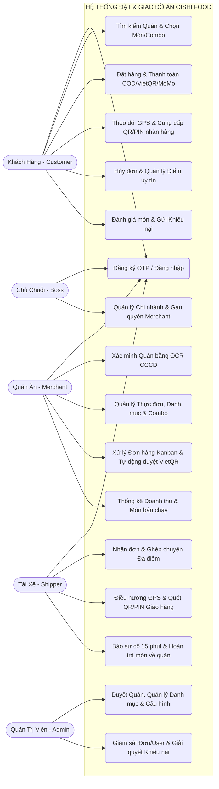
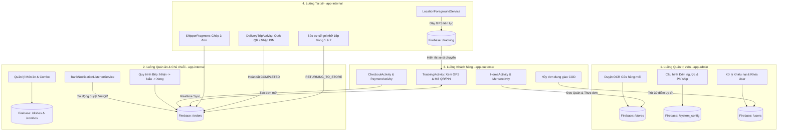
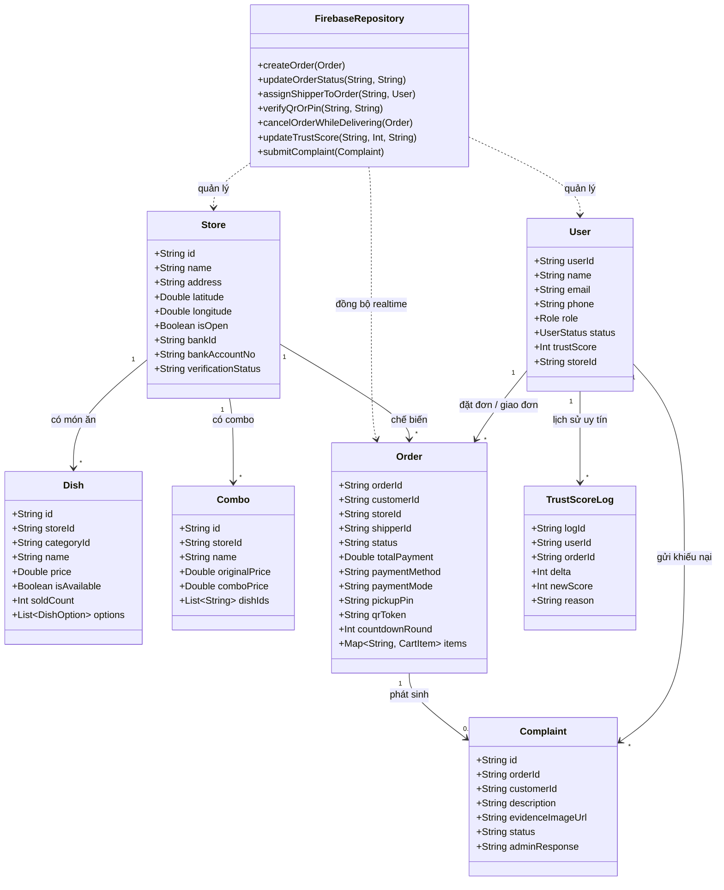
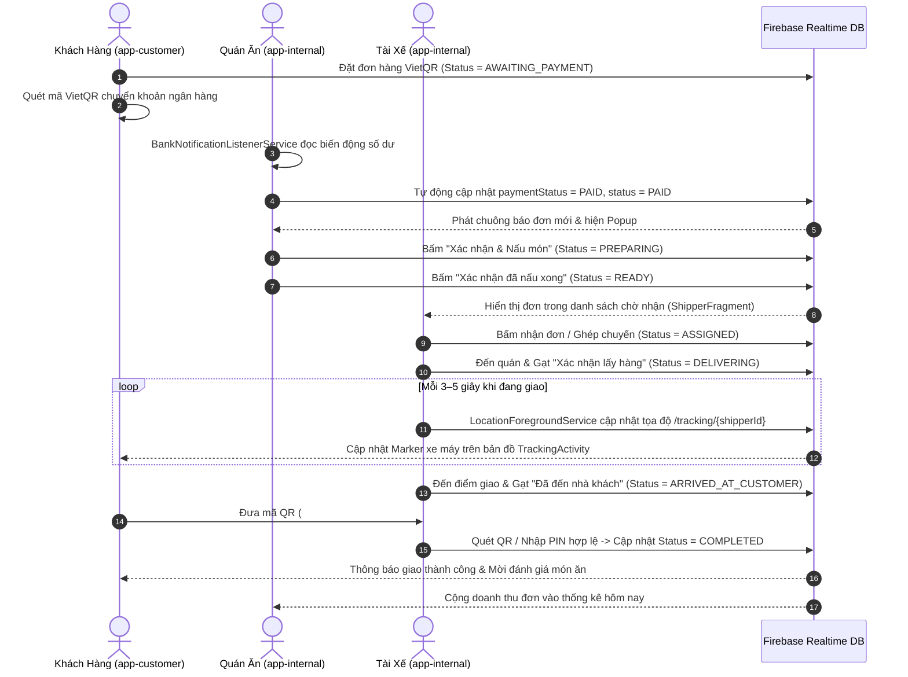
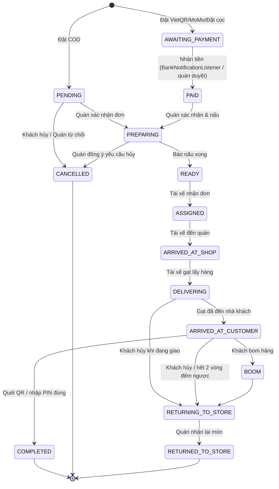

# TRƯỜNG CAO ĐẲNG CÔNG NGHỆ THỦ ĐỨC
## KHOA CÔNG NGHỆ THÔNG TIN
---

# BÁO CÁO KẾT THÚC MÔN HỌC
## HỌC PHẦN: LẬP TRÌNH DI ĐỘNG 2 (CHUYÊN ĐỀ 2)

# ĐỀ TÀI: HỆ THỐNG ĐẶT VÀ GIAO ĐỒ ĂN TRỰC TUYẾN ĐA PHÂN HỆ OISHI FOOD (OISHI FOOD DELIVERY ECOSYSTEM)

- **Lớp:** CD24TT7 | **Khóa:** 12 | **Ngành:** Công nghệ thông tin
- **Giảng viên hướng dẫn:** ThS. TIÊU KIM CƯƠNG
- **Nhóm sinh viên thực hiện:**
  1. **DƯƠNG MINH THƯ**
  2. **PHẠM PHÚC MẠNH GIÀU**
  3. **TRẦN VŨ**
  4. **HỒ THỊ VÂN ANH**

*TP. Hồ Chí Minh, Năm học 2025 – 2026*

---

## NHẬT KÝ HOẠT ĐỘNG & PHÂN CÔNG BÁO CÁO NHÓM

| STT | Họ và tên | Công việc đã thực hiện | Nhóm đánh giá (%) | Chữ ký |
|:---:|:---|:---|:---:|:---:|
| 1 | **Phạm Phúc Mạnh Giàu**<br>*(MSSV: 24211TT3571)* | • **Chủ trì xây dựng toàn diện Ứng dụng Khách hàng (`app-customer`)**:<br>  - Màn hình Trang chủ (`HomeActivity`), tìm kiếm, duyệt menu món ăn và biến thể topping (`DishOptionBottomSheetDialogFragment`).<br>  - Giỏ hàng (`CartActivity`), tính cước vận chuyển theo cự ly thực tế và thanh toán VietQR động (`PaymentActivity`) đếm ngược 10 phút.<br>• Xây dựng màn hình Theo dõi đơn hàng GPS thời gian thực (`TrackingActivity`) & Trò chuyện trực tuyến với quán (`ChatStoreBottomSheetDialogFragment`).<br>• Thiết kế giải pháp Chống bùng hàng qua Điểm uy tín (`TrustScore` 0-100), tự động khóa COD và kích hoạt chế độ bắt buộc đặt cọc (`DEPOSIT`), xây dựng phân hệ Khiếu nại đơn hàng (`ComplaintActivity`). | **33%** | |
| 2 | **Trần Vũ**<br>*(MSSV: 24211TT2515)* | • **Chủ trì xây dựng toàn diện Ứng dụng Vận hành Nội bộ (`app-internal`)**:<br>  - Phân hệ Quán ăn: Bảng điều phối đơn hàng Kanban 4 cột (`OrderListFragment`), Quản lý thực đơn (`MenuManageFragment`), Gói Combo (`ComboManageFragment`), Báo cáo doanh thu (`StoreReportFragment`) và Quản lý chuỗi đa chi nhánh (`BossDashboardActivity`).<br>  - Xây dựng dịch vụ chạy ngầm tự động đọc biến động số dư ngân hàng (`BankNotificationListenerService`) tự động xác nhận đơn VietQR trong 1 giây.<br>• **Phân hệ Tài xế (`ShipperFragment`, `DeliveryTripActivity`)**:<br>  - Thuật toán nhận đơn chuỗi quán, ghép tối đa 3 đơn cùng tuyến đường.<br>  - Dịch vụ định vị ngầm GPS liên tục (`LocationForegroundService`), bảo mật giao nhận kép bằng QR Code và mã PIN 4 số, xử lý sự cố và luồng hoàn trả món về quán (`RETURNING_TO_STORE`). | **33%** | |
| 3 | **Dương Minh Thư** | • **Chủ trì thiết kế Kiến trúc Dữ liệu Nền tảng (`core`)**:<br>  - Thiết kế cấu trúc CSDL Firebase Realtime Database gồm 14 root nodes chuẩn hóa quan hệ thực thể.<br>  - Xây dựng 32 Data Models, lớp kho dữ liệu trung tâm `FirebaseRepository` tích hợp StateFlow, Coroutines bất đồng bộ.<br>  - Thiết lập hệ thống bảo mật Firebase Auth 4 nhóm Role, quy tắc kiểm tra bảo mật (Rules) và xác thực Email OTP qua Supabase REST API (`EmailOtpApi`).<br>• **Xây dựng phân hệ Quản trị viên sàn (`app-admin` & Web Admin)**:<br>  - Dashboard thống kê KPI doanh thu toàn sàn, duyệt hồ sơ mở quán mới bằng công nghệ OCR Căn cước công dân (CCCD), quản lý danh mục toàn sàn và chế tài xử phạt quán vi phạm. | **33%** | |
| 4 | **Hồ Thị Vân Anh** | • Hỗ trợ thiết kế đồ họa, thu thập và biên tập bộ hình ảnh món ăn chất lượng cao, icon đồ họa đồng bộ nhận diện thương hiệu.<br>• Hỗ trợ rà soát định dạng văn bản báo cáo và kiểm tra chính tả tài liệu dự án. | **1%** | |

---

## MỤC LỤC

- **DANH MỤC BẢNG BIỂU, HÌNH VẼ, SƠ ĐỒ**
- **CHƯƠNG 1. MỞ ĐẦU**
  - 1.1 Giới thiệu môn học, nhóm thực hiện và Tổng quan hệ thống
  - 1.2 Phạm vi của hệ thống
  - 1.3 Sự cần thiết của ứng dụng trong thực tiễn (10 khía cạnh cốt lõi)
- **CHƯƠNG 2. PHÂN TÍCH VÀ THIẾT KẾ HỆ THỐNG**
  - 2.1 Phân tích hệ thống (SRS - Software Requirement Specification)
    - 2.1.1 Mục tiêu hệ thống
    - 2.1.2 Đối tượng sử dụng hệ thống (5 Nhóm đối tượng)
    - 2.1.3 Phạm vi hệ thống (Các chức năng có và giới hạn hiện tại)
    - 2.1.4 Các tác nhân (Actors) và Sơ đồ Use Case tổng quát
    - 2.1.5 Yêu cầu chức năng hệ thống (FR1 – FR24)
    - 2.1.6 Yêu cầu phi chức năng (NFR1 – NFR8)
    - 2.1.7 Quy tắc xử lý nghiệp vụ cốt lõi (Business Rules BR1 – BR15)
    - 2.1.8 Kiến trúc tổng quan hệ thống
    - 2.1.9 Các vai trò người dùng (Roles)
    - 2.1.10 Bản đồ các Chức năng chính & Giải thích từng file mã nguồn (Feature & Code Map)
    - 2.1.11 Sơ đồ luồng xử lý tổng quát & Chi tiết các mối liên hệ kỹ thuật quan trọng
  - 2.2 Thiết kế hệ thống (SDS - Software Design Specification)
    - 2.2.1 Thiết kế Kiến trúc Đa Module (Multi-Module Architecture: `core`, `app-customer`, `app-internal`, `app-admin`)
    - 2.2.2 Thiết kế Cơ sở dữ liệu Firebase Realtime Database chi tiết
    - 2.2.3 Sơ đồ Lớp (Class Diagram) toàn hệ thống
    - 2.2.4 Sơ đồ Tuần tự (Sequence Diagrams) cho các luồng nghiệp vụ phức tạp
    - 2.2.5 Sơ đồ trạng thái vòng đời đơn hàng
  - 2.3 Đặc tả chi tiết Giao diện và Yêu cầu chức năng từng màn hình (32 Màn hình & Hộp thoại)
    - *Phần A: Các màn hình Ứng dụng Khách hàng (`app-customer`)*
    - *Phần B: Các màn hình Ứng dụng Nội bộ - Quán ăn, Chủ chuỗi & Tài xế (`app-internal`)*
    - *Phần C: Các màn hình Ứng dụng Quản trị viên (`app-admin`)*
- **CHƯƠNG 3. CÀI ĐẶT VÀ KIỂM THỬ**
  - 3.1 Cài đặt và Hiện thực hóa hệ thống
    - 3.1.1 Môi trường phát triển, Công nghệ và Thư viện tích hợp
    - 3.1.2 Hiện thực hóa các Dịch vụ chạy ngầm (Services), OCR, Thanh toán & Bản đồ
  - 3.2 Kiểm thử hệ thống
    - 3.2.1 Môi trường kiểm thử
    - 3.2.2 Dữ liệu kiểm thử
    - 3.2.3 Quy ước
    - 3.2.4 Danh sách 118 Test Case theo 11 nhóm chức năng
    - 3.2.5 Tổng hợp kết quả
    - 3.2.6 Ảnh minh chứng
    - 3.2.7 Lỗi phát hiện & khắc phục
- **CHƯƠNG 4. KẾT QUẢ ĐẠT ĐƯỢC VÀ HƯỚNG PHÁT TRIỂN**
  - 4.1 Kết quả đạt được
  - 4.2 Các kết luận và kiến nghị (Điểm làm được, Hạn chế, Hướng phát triển bổ sung)
- **PHỤ LỤC** (A. Hướng dẫn cài đặt – B. Cấu trúc mã nguồn – C. Đường dẫn mã nguồn)
- **TÀI LIỆU THAM KHẢO**

---


## DANH MỤC BẢNG BIỂU, HÌNH VẼ, SƠ ĐỒ

### Danh mục hình vẽ, sơ đồ
| Ký hiệu | Tên hình / sơ đồ | Mục |
|:---:|:---|:---:|
| Sơ đồ 1 | Sơ đồ Use Case tổng quát hệ thống Oishi Food | 2.1.4 |
| Sơ đồ 2 | Sơ đồ mối liên hệ luồng vận hành giữa các phân hệ | 2.1.11 |
| Sơ đồ 3 | Sơ đồ lớp (Class Diagram) | 2.2.3 |
| Sơ đồ 4 | Sơ đồ tuần tự: Đặt hàng – Duyệt VietQR – Chế biến – Giao QR/PIN | 2.2.4 |
| Sơ đồ 5 | Sơ đồ tuần tự: Khách hủy đơn khi đang giao & trừ điểm uy tín | 2.2.4 |
| Sơ đồ 6 | Sơ đồ trạng thái vòng đời đơn hàng (Order State Machine) | 2.2.5 |
| Ảnh 1 – Ảnh 25B | Ảnh chụp giao diện các màn hình của 3 ứng dụng | 2.3 |
| Ảnh KT-1 – KT-6 | Ảnh minh chứng kết quả kiểm thử | 3.2.6 |

### Danh mục bảng biểu
| Ký hiệu | Tên bảng | Mục |
|:---:|:---|:---:|
| Bảng 1 | Nhật ký hoạt động & phân công nhóm | Đầu tài liệu |
| Bảng 2 | Các tác nhân (Actors) của hệ thống | 2.1.4 |
| Bảng 3 | Thiết kế các nhánh dữ liệu Firebase Realtime Database | 2.2.2 |
| Bảng 4 – Bảng 28 | Bảng yêu cầu chức năng từng màn hình (Mục / Mô tả / Hành động / Phản hồi) | 2.3 |
| Bảng 29 | Môi trường & thiết bị kiểm thử | 3.2.1 |
| Bảng 30 | Tài khoản dữ liệu kiểm thử | 3.2.2 |
| Bảng 31 – Bảng 41 | Bảng Test Case chi tiết theo từng nhóm chức năng | 3.2.4 |
| Bảng 42 | Tổng hợp kết quả kiểm thử | 3.2.5 |

---

# CHƯƠNG 1. MỞ ĐẦU

## 1.1 Giới thiệu môn học, nhóm thực hiện và Tổng quan hệ thống

### 1.1.1 Giới thiệu môn học và nhóm thực hiện
Học phần **Lập trình di động 2 (Chuyên đề 2)** thuộc chương trình đào tạo ngành Công nghệ Thông tin tại **Trường Cao đẳng Công nghệ Thủ Đức** giúp sinh viên vận dụng toàn diện kỹ năng lập trình Android hiện đại bằng ngôn ngữ Kotlin, thiết kế kiến trúc phần mềm đa phân hệ (Multi-module), đồng bộ hóa dữ liệu đám mây thời gian thực và giải quyết các bài toán nghiệp vụ thương mại điện tử phức tạp.

Dưới sự hướng dẫn của giảng viên **ThS. Tiêu Kim Cương**, nhóm sinh viên lớp **CD24TT7** (gồm Dương Minh Thư, Phạm Phúc Mạnh Giàu, Trần Vũ, Hồ Thị Vân Anh) đã nghiên cứu và phát triển hệ sinh thái **Oishi Food** — nền tảng đặt món, quản lý bếp, điều phối giao hàng thông minh và quản trị sàn giao dịch ẩm thực trực tuyến.

### 1.1.2 Tổng quan hệ thống Oishi Food
**Mục tiêu:** Hệ thống **Oishi Food** được xây dựng nhằm kết nối liền mạch 4 chủ thể trong chuỗi cung ứng ẩm thực: **Khách hàng (Customer) – Cửa hàng/Quán ăn (Merchant & Boss) – Tài xế giao hàng (Driver/Shipper) – Quản trị viên hệ thống (Admin)** thông qua 3 ứng dụng Android độc lập dùng chung một nhân lõi (`core`). Hệ thống tích hợp hàng loạt công nghệ chuyên sâu như:
- **Firebase Authentication & Email OTP API:** Xác thực tài khoản bảo mật kết hợp gửi mã OTP xác minh qua Email.
- **Firebase Realtime Database:** Đồng bộ tức thời trạng thái đơn hàng, vị trí GPS của tài xế trên bản đồ, phòng chat nội bộ và khóa tài khoản vi phạm theo thời gian thực.
- **Google Maps SDK, Location Services & Geocoding/Directions API:** Tìm kiếm gợi ý địa chỉ, ghim tọa độ trên bản đồ, đo khoảng cách thực tế tính phí vận chuyển theo vùng (`ShippingRule`: nội quận 15.000đ, liên quận 25.000đ, ngoại thành 45.000đ), vẽ đường đi (Polyline) và theo dõi xe giao hàng trực tiếp.
- **VietQR Napas247 & BankNotificationListenerService:** Tự động sinh mã QR chuyển khoản ngân hàng chuẩn Napas247 chứa đúng số tiền và cú pháp mã đơn; tích hợp dịch vụ lắng nghe thông báo biến động số dư ngân hàng trên máy chủ quán để tự động duyệt đơn đã thanh toán; tự động hủy đếm ngược và thoát màn hình VietQR nếu đơn bị hủy.
- **Google ML Kit / OCR Căn cước công dân (`CccdOcrHelper`):** Tự động quét và bóc tách thông tin Căn cước công dân khi chủ quán đăng ký xác minh cửa hàng.
- **ZXing QR Code & Mã PIN 6 số:** Cơ chế xác thực bàn giao đơn hàng 2 lớp chống gian lận.
- **Hệ thống Điểm uy tín (`TrustScore`) & Cơ chế Đặt cọc (`DEPOSIT`):** Đánh giá độ tin cậy của khách hàng, tự động trừ điểm khi khách hủy đơn COD đang giao hoặc bom hàng, yêu cầu đặt cọc chuyển khoản trước nếu điểm uy tín thấp, và tự động khóa tài khoản khi vi phạm ngưỡng cho phép.

---

### 1.1.3 Tổng quan chi tiết các nhóm chức năng theo từng phân hệ

#### A. Phân hệ Ứng dụng Khách hàng (`app-customer`)
1. **Xác thực và Bảo mật tài khoản (`LoginActivity`, `RegisterActivity`, `OtpVerificationActivity`):**
   - Đăng ký tài khoản mới với kiểm tra định dạng số điện thoại, email và mật khẩu.
   - Gửi mã OTP 6 chữ số về Email thật của người dùng thông qua `EmailOtpApi` và xác nhận qua `OtpVerificationActivity`.
   - Đăng nhập tự động lưu phiên và tích hợp trình giám sát `AccountLockWatcher` tự động đăng xuất ngay lập tức nếu tài khoản bị Admin khóa hoặc điểm uy tín tụt xuống mức cấm.
2. **Trang chủ, Tìm kiếm và Bộ lọc thông minh (`HomeActivity`):**
   - Hiển thị danh mục món ăn trực quan (`HomeCategoryAdapter` với bộ nhớ đệm icon `CategoryIconCache`).
   - Hiển thị danh sách **Món ăn đang Hot (`HotDishAdapter`)**, **Quán ăn gần bạn (`NearbyStoreAdapter`)** tính theo khoảng cách GPS thực tế và danh sách toàn bộ cửa hàng (`RestaurantAdapter`).
   - Tìm kiếm tức thời theo tên món ăn hoặc tên quán; hỗ trợ **Bộ lọc nâng cao (`bottom_sheet_advanced_filter.xml`)** theo khoảng giá, đánh giá sao, khoảng cách và khu vực quận/huyện.
3. **Xem Thực đơn Quán, Chọn Topping/Size & Xem Đánh giá (`MenuActivity`):**
   - Hiển thị thông tin chi tiết quán ăn, trạng thái Đang mở cửa / Đóng cửa, danh sách món lẻ và các gói **Combo tiết kiệm**.
   - Cho phép chọn tùy chọn món ăn (Size S/M/L, mức đá, mức đường, topping thêm) qua `DishOptionBottomSheetDialogFragment`.
   - Cho phép xem chi tiết điểm đánh giá sao và nhận xét kèm hình ảnh của những khách hàng đã mua trước đó qua `DishReviewsBottomSheetDialogFragment`.
4. **Quản lý Giỏ hàng & Thanh toán đa phương thức (`CartActivity`, `CheckoutActivity`, `PaymentActivity`):**
   - Quản lý giỏ hàng theo từng cửa hàng, điều chỉnh số lượng món, tự động tính tổng tiền tạm tính.
   - Chọn địa chỉ giao hàng từ **Sổ địa chỉ (`AddressBookAdapter`)**, tìm kiếm gợi ý địa chỉ tự động (`AddressSuggestionAdapter`) hoặc ghim trực tiếp trên bản đồ Google Maps (`SelectLocationActivity`).
   - Tự động tính cước phí vận chuyển theo vùng giao hàng (`ShippingRule`: nội quận 15.000đ – liên quận 25.000đ – ngoại thành 45.000đ); khách hạng Kim Cương (≥ 95 điểm) được giảm 5.000đ phí ship.
   - Hỗ trợ 3 chế độ thanh toán chuẩn hóa: **Tiền mặt khi nhận hàng (COD)**, **Chuyển khoản ngân hàng 100% (VietQR Napas247)** và **Đặt cọc trước 20% qua VietQR (`PaymentMode.DEPOSIT`)**.
   - Tự động kích hoạt chế độ **Bắt buộc đặt cọc (`PaymentMode.DEPOSIT`)** nếu hệ thống phát hiện khách hàng có điểm uy tín thấp.
5. **Theo dõi Đơn hàng Thời gian thực & Tương tác Giao nhận (`TrackingActivity`):**
   - Hiển thị thanh tiến trình vòng đời đơn hàng trực quan theo thời gian thực.
   - Tích hợp Google Maps hiển thị lộ trình và biểu tượng xe máy của Shipper di chuyển trực tiếp khi đơn đang giao.
   - Cung cấp **Mã QR xác nhận nhận hàng** và **Mã PIN 6 số** bảo mật (`#OISHI_XXXXXX • PIN: XXXXXX`) để tài xế đối chiếu khi giao món.
   - Hỗ trợ **Chat thời gian thực với Quán (`ChatStoreBottomSheetDialogFragment`)** kèm bộ đếm tin nhắn chưa đọc và gọi điện trực tiếp cho Shipper.
   - Cho phép khách hàng **hủy đơn ở bất kỳ giai đoạn nào** trước khi đơn hoàn tất: hủy khi quán chưa nấu, hủy khi bếp đang nấu (báo động đỏ dừng nấu tại bếp & quán), hủy khi tài xế đang đến quán (giải phóng tài xế ngay), hoặc **hủy khi tài xế đã lấy món đang chạy giao** (chuyển đơn sang `RETURNING_TO_STORE` để tài xế mang món quay về quán). Quy tắc uy tín khi khách hủy: **Đơn COD hoặc Đặt cọc bị trừ 10 điểm uy tín**, còn **Đơn đã trả hết 100% không bị trừ điểm**.
   - Xem hình ảnh bằng chứng sự cố do Shipper chụp lại (`IncidentProofBottomSheetDialogFragment`) nếu đơn hàng gặp sự cố liên lạc.
6. **Lịch sử Đơn hàng, Đánh giá Món ăn & Khiếu nại (`OrderHistoryActivity`, `ComplaintActivity`, `CustomerComplaintTrackingActivity`):**
   - Theo dõi danh sách đơn đang xử lý và lịch sử đơn đã hoàn tất / đã hủy.
   - Chấm điểm sao và viết nhận xét đánh giá cho từng món ăn sau khi đơn hoàn tất.
   - Gửi đơn **Khiếu nại (`ComplaintActivity`)** kèm ảnh chụp minh chứng lên Admin khi món ăn có vấn đề hoặc thái độ phục vụ không tốt, và theo dõi tiến độ giải quyết khiếu nại (`CustomerComplaintTrackingActivity`).
7. **Quản lý Hồ sơ, Sổ địa chỉ & Điểm uy tín (`ProfileActivity`):**
   - Cập nhật thông tin cá nhân, ảnh đại diện, quản lý danh sách địa chỉ nhận hàng thường dùng.
   - Xem chi tiết **Điểm uy tín cá nhân (`TrustScore`)** cùng toàn bộ nhật ký cộng/trừ điểm (`TrustScoreLog`) minh bạch.

#### B. Phân hệ Ứng dụng Nội bộ: Quán ăn, Chủ chuỗi & Tài xế (`app-internal`)
1. **Định danh Cửa hàng & Quét OCR Căn cước công dân (`StoreVerificationActivity`, `CccdOcrHelper`):**
   - Chủ quán mới đăng ký thực hiện tải lên ảnh chụp **mặt trước và mặt sau thẻ CCCD (`cccdFrontUrl`, `cccdBackUrl`)**, nhập thông tin định danh chủ hộ kinh doanh và tài khoản ngân hàng VietQR (đã tinh gọn bỏ trường giờ mở cửa `openHours`, thời gian làm món `prepTime` và bỏ khung AI tự động điền) để gửi hồ sơ chờ Admin phê duyệt; tự động đồng bộ hồ sơ pháp lý cho các chi nhánh của Chủ chuỗi.
2. **Phân hệ Chủ chuỗi / Tổng quản lý (`BossDashboardActivity`):**
   - Dành cho chủ sở hữu chuỗi nhiều cửa hàng: tạo chi nhánh mới (`dialog_create_branch.xml`), tạo tài khoản quản lý quán (`dialog_create_merchant.xml`), phân quyền và gán quản lý phụ trách từng chi nhánh (`dialog_assign_branch_to_merchant.xml`).
3. **Phân hệ Quán ăn – Quản lý Đơn hàng Kanban (`OrderListFragment`, `OrderAdapter`):**
   - Phân loại đơn hàng thông minh theo 4 Tab: **Đơn Mới**, **Đang Làm**, **Đang Giao**, **Lịch Sử** kèm bộ đếm số lượng đơn trên từng tab.
   - Phát âm thanh chuông báo động và hiển thị hộp thoại **Popup Đơn hàng mới (`dialog_new_order_popup.xml`)** ngay khi khách đặt món.
   - Tích hợp dịch vụ **`BankNotificationListenerService`** tự động lắng nghe thông báo biến động số dư từ ứng dụng ngân hàng trên máy chủ quán để tự động xác nhận các đơn chuyển khoản VietQR.
   - Vận hành **Quy trình Bếp tinh gọn**: Duyệt đơn của khách ➔ Bếp chế biến ➔ Báo nấu xong để phát đơn cho tài xế nhận. Khi tài xế đã nhận đơn và đến quầy, quán theo dõi trạng thái tài xế trực tiếp và tài xế tự gạt xác nhận lấy món nhanh chóng.
   - Duyệt hoặc từ chối yêu cầu hủy đơn từ khách hàng; nhắn tin trao đổi trực tiếp với khách (`ChatCustomerBottomSheetDialogFragment`); xác nhận nhận lại túi món ăn khi Shipper mang trả về quán (`dialog_bom_return_flow.xml`).
4. **Phân hệ Quán ăn – Quản lý Thực đơn, Danh mục, Combo & Báo cáo (`MenuManageFragment`, `StoreReportFragment`, `DriverListFragment`):**
   - Thêm mới, chỉnh sửa giá, hình ảnh, tùy chọn món ăn (Options/Toppings) và bật/tắt trạng thái hết món tức thời (`ManageDishAdapter`).
   - Quản lý danh mục món ăn riêng của quán (`ManageStoreCategoryAdapter`) và thiết lập các gói **Combo khuyến mãi (`dialog_create_combo.xml`)**.
   - Xem báo cáo thống kê doanh thu theo ngày/tuần/tháng và biểu đồ xếp hạng **Top món ăn bán chạy nhất (`BestSellerDishAdapter`)**.
   - Quản lý tập trung **Đội Tài Xế (`drivers`)** và **Đội Đầu Bếp (`chefs`)** của cửa hàng trên 2 tab trực quan, hỗ trợ thêm mới và xóa tài khoản tài xế/đầu bếp (`DriverListFragment`, `ChefFragment`).
5. **Phân hệ Tài xế – Nhận đơn, Ghép chuyến & Giao hàng GPS (`ShipperFragment`, `DeliveryTripActivity`):**
   - Bật/tắt trạng thái trực tuyến nhận đơn, phát tín hiệu định vị GPS liên tục qua `LocationForegroundService`.
   - Hỗ trợ **Ghép đơn thông minh (Multi-drop Bundle)** lên đến 3 đơn hàng cùng tuyến đường; cho phép tài xế chủ động chọn thứ tự giao khách nào trước ngay trên bản đồ (`DeliveryTripActivity`).
   - Thao tác bằng thanh trượt chống chạm nhầm (Slide-to-confirm): *Đã đến quán* ➔ *Xác nhận đã lấy món* ➔ *Đã đến nhà khách*.
   - Xác thực hoàn tất giao hàng bằng **Camera quét mã QR (`dialog_qr_scanner.xml`)** hoặc nhập **Mã PIN 6 số**.
   - Quy trình **Xử lý sự cố khách không nhận hàng / gọi nhỡ (`dialog_report_incident.xml`)**: Bắt buộc gọi đủ 3 cuộc gọi, gửi ảnh chụp bằng chứng tại điểm giao, kích hoạt đồng hồ đếm ngược 15 phút Lần 1 và Lần 2 trước khi chuyển trạng thái hoàn trả món về quán (`RETURNING_TO_STORE`).
   - Thống kê chi tiết **Thu nhập tài xế (`ShipperIncomeFragment`)** và lịch sử các chuyến đi hoàn tất.

#### C. Phân hệ Ứng dụng Quản trị viên Hệ thống (`app-admin`)
1. **Bảng điều khiển Trung tâm (`AdminDashboardFragment`):**
   - Thống kê toàn cảnh hệ thống: Tổng doanh thu toàn sàn, tổng đơn hàng thành công/hủy, số lượng cửa hàng đang hoạt động, số lượng tài xế và khách hàng.
   - Cấu hình tham số hệ thống động như thời gian đếm ngược chờ khách (`DeliveryCountdownConfig` qua `dialog_edit_countdown_config.xml`).
2. **Kiểm duyệt & Quản lý Cửa hàng (`AdminStoreListFragment`, `AdminStoreDetailBottomSheetDialogFragment`):**
   - Kiểm tra hồ sơ đăng ký quán mới (đối chiếu ảnh CCCD, giấy phép, địa chỉ bản đồ) để Phê duyệt hoặc Từ chối mở quán.
   - Áp dụng chế tài xử phạt hoặc tạm khóa cửa hàng vi phạm chất lượng (`dialog_apply_store_penalty.xml`).
3. **Quản lý Danh mục Chuẩn toàn sàn (`AdminCategoryListFragment`):**
   - Thêm mới, cập nhật icon và tên các danh mục ẩm thực chung trên toàn hệ thống (`AddEditCategoryDialogFragment`).
4. **Giám sát Đơn hàng & Quản lý Người dùng (`AdminMonitorFragment`):**
   - Theo dõi mọi đơn hàng đang diễn ra trên hệ thống, hỗ trợ can thiệp cập nhật trạng thái đơn hàng khi xảy ra sự cố kỹ thuật (`EditOrderDialogFragment`).
   - Quản lý danh sách người dùng (Customer, Merchant, Driver), xem lịch sử vi phạm, điều chỉnh **Điểm uy tín (`TrustScore`)** và khóa/mở khóa tài khoản tức thời (`EditUserDialogFragment`).
5. **Trung tâm Giải quyết Khiếu nại & Tranh chấp (`AdminComplaintListFragment`, `AdminComplaintDetailActivity`, `ResolveComplaintDialogFragment`):**
   - Tiếp nhận khiếu nại từ khách hàng, xem xét hình ảnh bằng chứng của cả Khách và Tài xế/Quán, đưa ra phán quyết xử lý công bằng và gửi thông báo kết quả tự động cho các bên.

---

## 1.2 Phạm vi của hệ thống
- **Phạm vi chức năng:** Bao phủ trọn vẹn quy trình khép kín từ lúc Chủ quán đăng ký mở cửa hàng (OCR CCCD) ➔ Admin phê duyệt ➔ Quán đăng thực đơn & Combo ➔ Khách hàng tìm kiếm, đặt món & thanh toán (COD / VietQR 100% / Đặt cọc VietQR 20%) ➔ Quán nhận chuông báo & chế biến ➔ Tài xế ghép đơn, nhận món & điều hướng GPS giao hàng ➔ Quét QR/PIN hoàn tất ➔ Đánh giá món ăn, thống kê doanh thu & giải quyết khiếu nại.
- **Hệ điều hành hỗ trợ:** Android 8.0 (API Level 26 - Oreo) trở lên đến Android 15.
- **Thiết bị thử nghiệm thực tế:** Điện thoại Samsung Galaxy, Xiaomi Redmi/POCO, Oppo, Vivo, Realme và máy ảo Android Emulator (Pixel).
- **Độ phân giải màn hình:** Tối ưu hóa hiển thị từ HD+ (720x1280) đến Full HD+ (1080x2400) và 2K, hỗ trợ Edge-to-Edge Insets (`InsetUtils`).
- **Yêu cầu hạ tầng:** Thiết bị kết nối Internet (Wi-Fi/4G/5G) để đồng bộ dữ liệu Firebase Realtime Database, tải bản đồ Google Maps và xác thực giao dịch thanh toán; bật quyền Vị trí (GPS) đối với Khách hàng và Tài xế; cấp quyền Camera khi quét mã QR hoặc chụp ảnh CCCD/bằng chứng.

---

## 1.3 Sự cần thiết của ứng dụng trong thực tiễn

### 1.3.1 Số hóa và chuẩn hóa quy trình đặt món ăn trực tuyến
- Thay thế phương thức gọi điện thoại hoặc nhắn tin đặt đồ ăn thủ công vốn dễ xảy ra sai sót về tên món, ghi chú khẩu vị (ít cay, không hành, thêm topping) và địa chỉ giao hàng.
- Cung cấp thực đơn điện tử trực quan kèm hình ảnh, giá bán minh bạch và trạng thái "Còn món / Hết món" được cập nhật theo thời gian thực.

### 1.3.2 Tự động hóa xác nhận thanh toán không tiền mặt (VietQR Napas247 & Đặt cọc 20%)
- Giải quyết triệt để tình trạng nhân viên thu ngân phải chụp màn hình hoặc kiểm tra thủ công từng giao dịch chuyển khoản ngân hàng vào giờ cao điểm.
- Tích hợp tạo mã VietQR động chứa sẵn số tiền và nội dung chuyển khoản chuẩn xác theo mã đơn, kết hợp `BankNotificationListenerService` tự động đọc thông báo biến động số dư để duyệt đơn tức thì.

### 1.3.3 Tối ưu hóa vận hành nhà bếp theo mô hình Kanban 3 bước
- Giúp quán ăn phân tách rõ ràng các luồng đơn: *Đơn mới chờ duyệt – Đơn bếp đang nấu – Đơn đã xong chờ giao – Lịch sử đơn*.
- Chuông báo âm thanh kết hợp Popup nổi giúp quán không bao giờ bỏ lỡ đơn hàng mới ngay cả khi nhân viên đang bận chế biến.
- Loại bỏ thao tác bấm xác nhận giao món rườm rà bên phía quán: khi bếp báo nấu xong, tài xế đến quầy kiểm tra và tự gạt nhận túi món trên ứng dụng tài xế, rút ngắn 40% thời gian chờ tại quầy.

### 1.3.4 Nâng cao hiệu suất giao hàng với thuật toán Ghép đơn đa điểm (Multi-Drop)
- Cho phép một tài xế nhận và giao đồng thời từ 2 đến 3 đơn hàng cùng tuyến đường trong một chuyến đi (`DeliveryTripActivity`).
- Hỗ trợ tài xế linh hoạt chọn thứ tự giao khách hàng nào trước tùy theo tình hình giao thông thực tế, giúp tăng thu nhập cho tài xế và giảm thời gian chờ đợi của khách.

### 1.3.5 Minh bạch hóa hành trình giao nhận bằng định vị GPS thời gian thực
- Khách hàng theo dõi trực tiếp vị trí di chuyển của tài xế trên bản đồ Google Maps ngay khi đơn hàng bước sang trạng thái đang giao (`DELIVERING`).
- Hệ thống tự động xác định vùng giao hàng và cước phí công bằng, rõ ràng ngay từ bước thanh toán.

### 1.3.6 Chống gian lận giao nhận nhờ xác thực 2 lớp (QR Code & PIN 6 số)
- Khắc phục tình trạng tài xế bấm "Đã giao hàng" khống khi chưa thực sự giao đồ ăn đến tay khách, hoặc giao nhầm đơn hàng trong chặng ghép nhiều đơn.
- Tài xế bắt buộc phải quét đúng mã QR `#OISHI_XXXXXX` hoặc nhập đúng mã PIN 6 số hiển thị trên màn hình điện thoại của khách hàng thì hệ thống mới cho phép hoàn tất đơn.

### 1.3.7 Bảo vệ quyền lợi Quán ăn và Tài xế trước nạn "Bom hàng" & Hủy đơn giữa chừng
- Xây dựng hệ thống **Điểm uy tín (`TrustScore`)** khởi tạo 100 điểm cho mỗi khách hàng.
- Khách hàng có thể hủy đơn bất cứ lúc nào khi đơn chưa kết thúc. Nếu hủy đơn **COD hoặc Đặt cọc**, khách bị trừ **10 điểm uy tín** (nếu bom hàng không nghe máy sau 2 vòng đếm ngược 15 phút thì trừ **30 điểm**); ngược lại nếu đơn **đã trả hết 100% qua VietQR thì không bị trừ điểm uy tín**. Đặc biệt, khi tài xế đã lấy món và đang chạy tới nhà khách mà khách hủy đơn, hệ thống tự động chuyển đơn sang `RETURNING_TO_STORE` để tài xế dẫn đường mang món về trả cho quán (`RETURNED_TO_STORE`).

### 1.3.8 Quy trình xử lý sự cố khách không nghe máy bài bản, nhân văn
- Khi tài xế đến điểm giao nhưng không liên lạc được với khách, ứng dụng cung cấp quy trình chuẩn: kiểm tra đủ 3 cuộc gọi nhỡ, chụp ảnh minh chứng tại chỗ và kích hoạt đồng hồ đếm ngược 15 phút (Lần 1) để khách có thời gian phản hồi.
- Chỉ khi hết 15 phút Lần 1 bước sang Lần 2 mà khách vẫn không nhận, hệ thống mới phát cảnh báo mất đơn và cho phép hoàn hàng về quán, vừa bảo vệ tài xế không phải chờ vô thời hạn, vừa tránh hủy nhầm đơn của khách bận đột xuất.

### 1.3.9 Hỗ trợ mô hình Quản lý Chuỗi đa chi nhánh (Boss – Branch – Merchant)
- Không chỉ phục vụ quán ăn đơn lẻ, hệ thống còn hỗ trợ chủ thương hiệu lớn (`BossDashboardActivity`) quản lý tập trung nhiều chi nhánh, khởi tạo tài khoản cửa hàng trưởng và theo dõi hiệu quả kinh doanh toàn chuỗi.

### 1.3.10 Đảm bảo trật tự và công bằng trên toàn sàn thông qua Phân hệ Admin
- Định danh chủ quán bằng công nghệ quét OCR Căn cước công dân (`CccdOcrHelper`) trước khi cho phép mở bán.
- Cung cấp công cụ để Quản trị viên giải quyết khiếu nại, đối chất bằng chứng giữa Khách – Quán – Shipper và áp dụng chế tài xử phạt minh bạch.

---

# CHƯƠNG 2. PHÂN TÍCH VÀ THIẾT KẾ HỆ THỐNG

## 2.1 PHÂN TÍCH HỆ THỐNG (SRS - SOFTWARE REQUIREMENT SPECIFICATION)

### 2.1.1 Mục tiêu hệ thống
Hệ thống **Oishi Food** được xây dựng nhằm cung cấp một nền tảng thương mại điện tử đặt và giao đồ ăn toàn diện trên hệ điều hành Android, cho phép:
1. Đăng ký tài khoản có xác thực mã OTP qua Email thật và đăng nhập phân quyền tự động.
2. Định danh cửa hàng mới bằng công nghệ nhận diện ký tự quang học OCR trên Căn cước công dân.
3. Hiển thị danh sách quán ăn, món ăn đang Hot, quán ăn gần vị trí GPS của khách và tìm kiếm/lọc đa tiêu chí.
4. Xem thực đơn chi tiết của quán, các gói Combo ưu đãi, chọn tùy chọn món (size, topping) và xem đánh giá thực tế.
5. Quản lý giỏ hàng thông minh, ghim vị trí nhận hàng trên Google Maps và tự động tính phí giao hàng theo vùng (nội quận / liên quận / ngoại thành).
6. Thanh toán đa chế độ: Tiền mặt (COD), Chuyển khoản VietQR Napas247 toàn bộ (`FULL`) và Đặt cọc trước 20% (`DEPOSIT`), tự động thoát màn hình thanh toán nếu đơn bị hủy.
7. Tự động lắng nghe thông báo biến động số dư ngân hàng trên máy chủ quán để duyệt thanh toán VietQR.
8. Quản lý đơn hàng tại quán theo bảng Kanban 4 trạng thái kèm chuông báo động và hộp thoại đơn mới.
9. Quản lý danh mục riêng của quán, thêm/sửa/xóa món ăn, tạo Combo và xem thống kê doanh thu/món bán chạy.
10. Hỗ trợ Chủ chuỗi (Boss) tạo chi nhánh mới và phân quyền tài khoản quản lý cho từng chi nhánh.
11. Hỗ trợ Tài xế nhận đơn lẻ hoặc ghép tối đa 3 đơn cùng tuyến đường, tự chọn thứ tự giao hàng ưu tiên.
12. Theo dõi lộ trình và vị trí xe máy của Tài xế trực tiếp trên bản đồ Google Maps theo thời gian thực.
13. Xác thực giao nhận hàng hóa bằng Camera quét mã QR hoặc nhập mã PIN 6 chữ số.
14. Nhắn tin Chat thời gian thực giữa Khách hàng và Quán ăn trong suốt quá trình thực hiện đơn.
15. Cho phép khách hủy đơn khi đang giao kèm luồng hoàn trả món về quán và tự động trừ điểm uy tín đối với đơn COD.
16. Hỗ trợ Tài xế báo cáo sự cố khách không liên lạc được (yêu cầu gọi 3 lần, chụp ảnh bằng chứng, đếm ngược 15 phút 2 vòng).
17. Quản lý Điểm uy tín (`TrustScore`), lịch sử biến động điểm và tự động khóa tài khoản vi phạm tức thời (`AccountLockWatcher`).
18. Gửi khiếu nại kèm hình ảnh minh chứng và theo dõi tiến độ giải quyết tranh chấp từ Ban quản trị (Admin).

---

### 2.1.2 Đối tượng sử dụng hệ thống
Hệ thống phân quyền theo **4 vai trò (RBAC – `Role.kt`)**: ADMIN (1), CUSTOMER (2), MERCHANT (3), DRIVER (4); trong đó MERCHANT có thêm chế độ Chủ chuỗi. Cụ thể gồm 5 nhóm đối tượng:
1. **Khách hàng (`CUSTOMER` - Sử dụng `app-customer`):**
   - Đăng ký (xác thực OTP Email), đăng nhập, quản lý hồ sơ và sổ địa chỉ nhận hàng.
   - Tìm kiếm món ăn/quán ăn, lọc theo quận/huyện/giá/đánh giá, xem thực đơn, chọn topping/combo.
   - Đặt hàng, thanh toán COD / VietQR / Đặt cọc 20%, theo dõi GPS tài xế, chat với quán, mở mã QR/PIN nhận hàng.
   - Hủy đơn hàng, đánh giá món ăn sau khi nhận, gửi khiếu nại và theo dõi điểm uy tín cá nhân.
2. **Quản lý Quán ăn (`MERCHANT` / `MANAGER` - Sử dụng `app-internal`):**
   - Đăng ký mở quán, gửi ảnh CCCD quét OCR để xác minh cửa hàng.
   - Nhận đơn hàng mới qua chuông báo, duyệt đơn, báo bếp nấu, báo nấu xong phát đơn cho tài xế.
   - Quản lý món ăn, danh mục quán, tạo gói Combo, quản lý tài xế của quán, xem báo cáo doanh thu và món bán chạy.
   - Duyệt/từ chối yêu cầu hủy đơn, chat với khách hàng, xác nhận nhận lại món hoàn trả.
3. **Chủ chuỗi cửa hàng (tài khoản `MERCHANT` chủ sở hữu – Sử dụng `app-internal`):**
   - Tạo và quản lý danh sách các chi nhánh cửa hàng trong chuỗi.
   - Tạo tài khoản Merchant và gán quyền quản lý cho từng chi nhánh cụ thể.
4. **Tài xế giao hàng (`DRIVER` / `SHIPPER` - Sử dụng `app-internal`):**
   - Bật/tắt chế độ trực tuyến, phát tọa độ GPS chạy ngầm, nhận đơn lẻ hoặc ghép chặng 2–3 đơn.
   - Xem bản đồ dẫn đường Google Maps, gạt thanh trượt cập nhật tiến độ (Đến quán ➔ Lấy món ➔ Đến nhà khách).
   - Quét mã QR hoặc nhập mã PIN từ khách để hoàn tất đơn; báo cáo sự cố gọi nhỡ đếm ngược 15 phút; đem hàng trả lại quán khi đơn bị hủy/bom; xem thống kê thu nhập.
5. **Quản trị viên hệ thống (`ADMIN` - Sử dụng `app-admin`):**
   - Giám sát số liệu toàn sàn trên Dashboard, cấu hình thời gian đếm ngược sự cố.
   - Kiểm duyệt hồ sơ mở quán mới, phạt hoặc khóa cửa hàng vi phạm.
   - Quản lý danh mục ẩm thực toàn hệ thống, giám sát/can thiệp đơn hàng, quản lý tài khoản người dùng & điểm uy tín, giải quyết khiếu nại.

---

### 2.1.3 Phạm vi hệ thống
- **Các chức năng đã hoàn thiện trong hệ thống:**
  1. Hệ thống xác thực đa tầng (Firebase Auth + Email OTP + Kiểm tra khóa tài khoản thời gian thực).
  2. Hệ thống định danh cửa hàng bằng OCR Căn cước công dân (`CccdOcrHelper`).
  3. Hệ thống tìm kiếm, gợi ý địa chỉ, ghim bản đồ và tính phí giao hàng tự động theo vùng (`ShippingRule`).
  4. Hệ thống giỏ hàng, tùy chọn món ăn (Topping/Size), gói Combo và thanh toán COD / VietQR / Đặt cọc 20%.
  5. Dịch vụ tự động đọc thông báo ngân hàng xác nhận thanh toán VietQR (`BankNotificationListenerService`).
  6. Hệ thống điều phối đơn hàng Kanban cho quán và ghép đơn đa điểm (Multi-drop) cho tài xế.
  7. Hệ thống dẫn đường và theo dõi vị trí tài xế thời gian thực trên Google Maps (`LocationForegroundService`).
  8. Hệ thống xác thực giao hàng 2 lớp bằng QR Code & Mã PIN 6 số.
  9. Hệ thống xử lý sự cố giao hàng đếm ngược 15 phút (2 vòng), hủy đơn đang giao và hoàn trả món về quán.
  10. Hệ thống Điểm uy tín (`TrustScore`), chế độ bắt buộc đặt cọc (`DEPOSIT`) và quản trị khiếu nại toàn sàn (`app-admin`).
- **Các giới hạn hiện tại (Chưa bao gồm):**
  1. Chưa hỗ trợ phiên bản trên hệ điều hành iOS (hiện tập trung tối ưu sâu cho nền tảng Android).
  2. Chưa tích hợp gọi thoại VoIP trực tiếp trong ứng dụng (hiện kết nối qua trình gọi điện thoại mặc định của hệ điều hành).
  3. Chưa hỗ trợ thanh toán thẻ tín dụng quốc tế Visa/Mastercard.

---

### 2.1.4 Các tác nhân (Actors) và Sơ đồ Use Case tổng quát

| Tác nhân (Actor) | Mô tả vai trò và trách nhiệm chính |
|:---|:---|
| **Khách hàng (Customer)** | Người dùng sử dụng `app-customer` để tìm kiếm quán ăn, chọn món/combo, đặt hàng, thanh toán (COD/VietQR/MoMo), theo dõi vị trí tài xế, cung cấp mã QR/PIN khi nhận món, chat với quán, hủy đơn, đánh giá món ăn và gửi khiếu nại. |
| **Quán ăn (Merchant / Manager)** | Đối tác cửa hàng sử dụng `app-internal` để xác minh quán (OCR CCCD), quản lý danh mục/món ăn/combo, tiếp nhận và chế biến đơn hàng theo quy trình bếp, chat với khách, xử lý yêu cầu hủy và theo dõi báo cáo doanh thu. |
| **Chủ chuỗi (Boss)** | Cấp quản lý cao nhất của chuỗi nhà hàng trên `app-internal`, chịu trách nhiệm mở thêm chi nhánh mới, tạo tài khoản quản lý (Merchant) và phân công quản lý từng chi nhánh. |
| **Tài xế (Driver / Shipper)** | Nhân viên giao hàng sử dụng `app-internal` để nhận đơn (đơn lẻ hoặc ghép chuyến), di chuyển theo lộ trình Google Maps, lấy món tại quán, quét mã QR/nhập PIN giao hàng cho khách, báo cáo sự cố liên lạc và theo dõi thu nhập. |
| **Quản trị viên (Admin)** | Người vận hành hệ thống sử dụng `app-admin` để duyệt cửa hàng mới, quản lý danh mục toàn sàn, giám sát toàn bộ đơn hàng và tài khoản người dùng, điều chỉnh điểm uy tín, cấu hình hệ thống và phán quyết khiếu nại. |

**[CHỖ CHÈN ẢNH SƠ ĐỒ 1: Hình Sơ đồ Use Case Tổng quát của Hệ thống Oishi Food]**



---

### 2.1.5 Yêu cầu chức năng hệ thống (Functional Requirements: FR1 – FR24)

- **FR1. Xác thực tài khoản & Bảo mật OTP:**
  - Đăng ký tài khoản mới theo vai trò (`CUSTOMER`, `MERCHANT`, `DRIVER`).
  - Gửi mã xác thực OTP 6 chữ số qua Email (`EmailOtpApi`) và kiểm tra tính hợp lệ (`RegistrationOtpManager`).
  - Đăng nhập bằng Email/Số điện thoại và Mật khẩu qua Firebase Authentication.
  - Tự động lắng nghe trạng thái khóa tài khoản thời gian thực (`AccountLockWatcher`).
- **FR2. Định danh Cửa hàng bằng OCR Căn cước công dân:**
  - Chụp hoặc tải ảnh CCCD hai mặt và giấy phép kinh doanh của chủ quán.
  - Quét nhận diện văn bản tự động (`CccdOcrHelper`) để trích xuất thông tin định danh gửi Admin duyệt.
- **FR3. Quản lý Chuỗi chi nhánh (Boss Management):**
  - Tạo mới các chi nhánh cửa hàng kèm tọa độ địa lý.
  - Tạo tài khoản quản lý chi nhánh (Merchant) và gán/thu hồi quyền quản lý chi nhánh.
- **FR4. Duyệt Trang chủ, Tìm kiếm & Lọc nâng cao:**
  - Hiển thị danh mục ẩm thực, món ăn đang Hot, quán ăn gần vị trí GPS hiện tại và danh sách nhà hàng.
  - Tìm kiếm theo từ khóa tên món hoặc tên quán theo thời gian thực.
  - Lọc nâng cao theo quận/huyện, mức giá, khoảng cách và số sao đánh giá.
- **FR5. Xem Thực đơn, Tùy chọn Món (Options) & Gói Combo:**
  - Hiển thị danh sách món ăn theo phân nhóm danh mục của quán và các gói Combo tiết kiệm.
  - Chọn kích cỡ (Size), mức đường/đá, topping đi kèm và ghi chú riêng cho từng món.
  - Xem danh sách đánh giá sao và nhận xét của khách hàng đối với từng món ăn.
- **FR6. Quản lý Giỏ hàng (Cart Management):**
  - Thêm món vào giỏ hàng, tự động nhóm theo cửa hàng, tăng/giảm số lượng hoặc xóa món.
  - Đồng bộ giỏ hàng và tính toán tổng tiền món ăn tức thời.
- **FR7. Định vị Địa chỉ & Tính phí Vận chuyển tự động:**
  - Quản lý sổ địa chỉ cá nhân (`CustomerAddress`), gợi ý địa chỉ khi gõ (`AddressSuggestionAdapter`) hoặc chọn trực tiếp trên bản đồ (`SelectLocationActivity`).
  - Xác định vùng giao hàng (quận/huyện của quán và của khách) và áp dụng biểu phí `ShippingRule`: INTRA_DISTRICT 15.000đ, INTER_DISTRICT 25.000đ, SUBURBAN 45.000đ.
- **FR8. Đặt hàng & Thanh toán Đa chế độ (COD, VietQR 100%, Đặt cọc 20%):**
  - Tạo đơn hàng với chế độ Tiền mặt (COD), Chuyển khoản ngân hàng VietQR 100% (`FULL`) hoặc Đặt cọc 20% (`DEPOSIT`).
  - Tự động sinh mã QR chuyển khoản ngân hàng chuẩn VietQR chứa đúng số tiền và mã đơn.
  - Chỉ khách có điểm uy tín **≥ 90** mới được chọn COD; khách **< 90 điểm** bắt buộc **Đặt cọc trước 20% giá trị đơn (`PaymentMode.DEPOSIT`, làm tròn đến 1.000đ)** qua chuyển khoản VietQR, phần còn lại (80%) thu tiền mặt khi giao hàng.
- **FR9. Tự động Xác nhận Chuyển khoản Ngân hàng tại Quán:**
  - Dịch vụ `BankNotificationListenerService` chạy ngầm đọc thông báo biến động số dư ngân hàng trên thiết bị của quán, tự động khớp mã đơn và chuyển trạng thái đơn sang Đã thanh toán (`PAID`).
- **FR10. Quản lý Đơn hàng tại Quán theo mô hình Kanban:**
  - Phân luồng đơn hàng theo 4 tab: *Đơn Mới – Đang Làm – Đang Giao – Lịch Sử*.
  - Phát chuông cảnh báo âm thanh và hiển thị Popup khi có đơn hàng mới.
  - Cập nhật trạng thái bếp: Xác nhận đơn (`PREPARING`) ➔ Báo nấu xong (`READY`) để phát đơn cho tài xế.
- **FR11. Quản lý Thực đơn, Danh mục riêng & Combo tại Quán:**
  - Thêm mới, chỉnh sửa, xóa món ăn; bật/tắt trạng thái còn hàng/hết hàng.
  - Tạo, đổi tên, sắp xếp danh mục món ăn riêng của từng quán; tạo gói Combo nhiều món giá ưu đãi.
- **FR12. Quản lý Đội ngũ Tài xế & Thống kê Doanh thu Quán:**
  - Thêm và quản lý danh sách tài xế thuộc quán (`DriverListFragment`).
  - Thống kê doanh thu hôm nay, tổng số đơn hoàn tất và xếp hạng các món bán chạy nhất (`StoreReportFragment`).
- **FR13. Nhận đơn & Ghép chuyến Đa điểm cho Tài xế (Multi-Drop):**
  - Hiển thị danh sách đơn hàng đã nấu xong (`READY`) đang chờ tài xế nhận.
  - Cho phép tài xế nhận đơn lẻ hoặc ghép tối đa 3 đơn hàng cùng khu vực vào một hành trình giao hàng.
  - Cho phép tài xế chủ động bấm chọn thứ tự ưu tiên giao khách hàng nào trước trên bản đồ.
- **FR14. Điều hướng Bản đồ & Cập nhật Tiến độ Giao hàng:**
  - Phát tọa độ GPS thời gian thực của tài xế lên Firebase thông qua `LocationForegroundService`.
  - Vẽ lộ trình đường đi trên Google Maps từ vị trí tài xế đến quán và đến từng khách hàng.
  - Cập nhật trạng thái qua thanh trượt: *Đã đến quán (`ARRIVED_AT_SHOP`)* ➔ *Đã lấy món (`DELIVERING`)* ➔ *Đã đến nhà khách (`ARRIVED_AT_CUSTOMER`)*.
- **FR15. Xác thực Giao hàng bằng Mã QR & Mã PIN 6 số:**
  - Khách hàng hiển thị mã QR (`#OISHI_XXXXXX`) và mã PIN 6 số trên màn hình theo dõi đơn.
  - Tài xế dùng Camera quét mã QR hoặc nhập mã PIN để hệ thống xác thực và chuyển đơn sang Hoàn tất (`COMPLETED`).
- **FR16. Xử lý Sự cố Giao hàng & Đồng hồ Đếm ngược 15 phút (2 Vòng):**
  - Khi khách không nghe máy, tài xế bấm báo cáo sự cố, thực hiện đủ 3 cuộc gọi và chụp ảnh bằng chứng tại địa chỉ giao.
  - Hệ thống kích hoạt đếm ngược 15 phút Lần 1 (hỗ trợ liên lạc) và 15 phút Lần 2 (cảnh báo mất đơn) trước khi cho phép hủy đơn bom (`BOOM`) và mang hàng về quán.
- **FR17. Hủy đơn khi Đang giao & Luồng Hoàn trả Món về Quán:**
  - Khách hàng có thể bấm hủy đơn ngay cả khi tài xế đang trên đường giao.
  - Đơn hàng lập tức chuyển sang trạng thái `RETURNING_TO_STORE`, thông báo cho tài xế quay đầu mang đồ ăn về trả cho quán; khi quán nhận lại đồ ăn sẽ xác nhận `RETURNED_TO_STORE`.
- **FR18. Quản lý Điểm uy tín (`TrustScore`) & Nhật ký Điểm:**
  - Tự động trừ 30 điểm uy tín khi khách hàng hủy đơn COD đang giao hoặc bom hàng (không trừ điểm nếu đơn đã thanh toán Online).
  - Ghi nhận lịch sử chi tiết từng lần cộng/trừ điểm (`TrustScoreLog`) và hiển thị trực quan trong hồ sơ khách hàng.
- **FR19. Nhắn tin Chat Thời gian thực (Khách hàng – Quán ăn):**
  - Cho phép Khách hàng và Quán ăn nhắn tin trao đổi trực tiếp trong từng đơn hàng (`tracking/chats_{orderId}`), hiển thị thông báo tin nhắn mới tức thời.
- **FR20. Đánh giá Món ăn & Xem Lịch sử Đơn hàng:**
  - Sau khi đơn hàng hoàn tất, khách hàng chấm điểm từ 1–5 sao và viết nhận xét cho từng món ăn.
  - Tự động tính lại điểm trung bình sao của món ăn và cửa hàng.
- **FR21. Gửi Khiếu nại & Theo dõi Giải quyết Khiếu nại:**
  - Khách hàng tạo yêu cầu khiếu nại kèm lý do và hình ảnh minh chứng gửi lên hệ thống.
  - Theo dõi trạng thái xử lý khiếu nại (Đang chờ xử lý / Đã giải quyết / Từ chối) và phản hồi từ Admin.
- **FR22. Thống kê Thu nhập & Lịch sử Chuyến đi của Tài xế:**
  - Tài xế theo dõi tổng tiền cước vận chuyển kiếm được theo ngày/tuần/tháng và danh sách các đơn đã giao.
- **FR23. Quản trị Hệ thống, Duyệt Quán & Quản lý Danh mục (`app-admin`):**
  - Xem bảng điều khiển thống kê toàn sàn, chỉnh sửa cấu hình thời gian đếm ngược sự cố.
  - Duyệt hoặc từ chối hồ sơ xác minh cửa hàng mới, áp dụng hình phạt đối với cửa hàng vi phạm.
  - Thêm, sửa, xóa danh mục ẩm thực chuẩn của hệ thống.
- **FR24. Giám sát Đơn hàng, Quản lý Người dùng & Phán quyết Khiếu nại (`app-admin`):**
  - Giám sát và can thiệp chỉnh sửa trạng thái đơn hàng bất thường.
  - Quản lý tài khoản người dùng, điều chỉnh điểm uy tín và khóa/mở khóa tài khoản.
  - Xem xét bằng chứng và ra quyết định giải quyết các khiếu nại của khách hàng.

---

### 2.1.6 Yêu cầu phi chức năng (Non-Functional Requirements: NFR1 – NFR8)
- **NFR1. Giao diện người dùng (UI/UX):** Thiết kế đồng nhất theo chuẩn **Material Design 3**, bảng màu thương hiệu cam năng động (`#FF6B00`), bố cục rõ ràng, hỗ trợ hiển thị tràn viền (Edge-to-Edge) và tương thích hoàn hảo trên nhiều kích thước màn hình Android.
- **NFR2. Hiệu năng và Độ trễ thời gian thực:** Đồng bộ trạng thái đơn hàng, tin nhắn chat và tọa độ GPS trên Firebase Realtime Database với độ trễ dưới 500ms; tối ưu hóa `RecyclerView` bằng `ListAdapter` & `DiffUtil` giúp cuộn danh sách mượt mà 60fps.
- **NFR3. Tính ổn định và Phục hồi trạng thái (Resilience):** Các dịch vụ nền như `LocationForegroundService` và `MerchantKeepAliveService` hoạt động bền bỉ với cơ chế `START_STICKY`; lưu giữ chính xác trạng thái từng chặng giao hàng ngay cả khi tài xế thoát ứng dụng hoặc chuyển đổi qua lại giữa các đơn ghép.
- **NFR4. Bảo mật và Toàn vẹn dữ liệu:** Mật khẩu được băm bảo mật qua Firebase Auth; xác thực đăng ký bằng OTP Email thật; mã QR và mã PIN 6 số sinh ngẫu nhiên độc nhất cho từng đơn hàng; các thao tác cộng/trừ điểm uy tín và doanh thu đảm bảo tính nguyên vẹn.
- **NFR5. Tính dễ sử dụng (Usability):** Các thao tác quan trọng của tài xế khi đang chạy xe được thiết kế dạng thanh trượt lớn (Slide-to-confirm) chống bấm nhầm; quy trình bếp của quán rút gọn tối đa chỉ còn các nút hành động chính theo từng bước.
- **NFR6. Khả năng bảo trì và Mở rộng (Maintainability):** Mã nguồn tổ chức theo kiến trúc **Multi-Module (`core`, `app-customer`, `app-internal`, `app-admin`)** kết hợp mẫu thiết kế **MVVM (Model-View-ViewModel)**, giúp tách biệt hoàn toàn logic nghiệp vụ khỏi giao diện và dễ dàng mở rộng.
- **NFR7. Tương thích phần cứng:** Khai thác hiệu quả cảm biến GPS, Camera (quét QR & chụp CCCD/bằng chứng), Chuông âm thanh hệ thống (`RingtoneManager`) và Notification Listener.
- **NFR8. Quản lý tài nguyên mạng và Pin:** Tối ưu hóa tần suất cập nhật GPS theo khoảng cách di chuyển thực tế và nén hình ảnh trước khi tải lên đám mây, giúp tiết kiệm dung lượng 4G và pin cho thiết bị của tài xế.

---

### 2.1.7 Quy tắc xử lý nghiệp vụ cốt lõi (Business Rules: BR1 – BR15)
1. **BR1 (Xác thực OTP & Khóa tài khoản):** Mọi tài khoản đăng ký mới phải xác thực đúng mã OTP gửi qua Email trong **10 phút** (`OTP_VALIDITY_DURATION_MS`), chỉ được gửi lại mã sau **60 giây** (`RESEND_COOLDOWN_MS`); phiên xác minh OTP được ghi nhớ **24 giờ** trên thiết bị (`OtpSessionManager`), riêng tài khoản `admin@gmail.com` được miễn OTP. Nếu tài khoản bị Admin chuyển sang trạng thái khóa (`LOCKED`) hoặc điểm uy tín giảm xuống ngưỡng khóa, `AccountLockWatcher` sẽ lập tức cưỡng chế đăng xuất trên mọi thiết bị.
2. **BR2 (Xác minh Cửa hàng trước khi mở bán):** Tài khoản `MERCHANT` mới tạo phải hoàn tất gửi hồ sơ xác minh (`StoreVerificationActivity` gồm ảnh CCCD quét OCR và thông tin quán) và được `ADMIN` phê duyệt thì cửa hàng mới hiển thị cho khách đặt món.
3. **BR3 (Quy tắc tính phí vận chuyển `ShippingRule`):** Phí giao hàng tính theo vùng: giao trong cùng quận (`INTRA_DISTRICT`) 15.000đ; giao khác quận nội thành (`INTER_DISTRICT`) 25.000đ; giao ra ngoại thành (`SUBURBAN`) 45.000đ. Khách có điểm uy tín ≥ 95 được giảm 5.000đ phí ship.
4. **BR4 (Quy tắc Điểm uy tín & Đặt cọc `DEPOSIT`):** Mỗi khách hàng khởi đầu với `trustScore = 100` (thang 0–100). Mỗi đơn nhận hàng thành công **+2 điểm** (tối đa 100); mỗi lần bom/hủy đơn COD khi đang giao **−30 điểm** (tối thiểu 0). Xếp hạng: ≥ 95 Kim Cương (COD + giảm 5.000đ ship), ≥ 90 Vàng (COD), 50–89 Bạc (cấm COD), 20–49 Hạn chế. Khách **< 90 điểm** bắt buộc đặt cọc **20%** (`PaymentMode.DEPOSIT`). Điểm **< 20** ➔ tài khoản tự động bị khóa (`status = LOCKED`).
5. **BR5 (Tự động duyệt thanh toán VietQR):** Khi khách chọn thanh toán VietQR, đơn hàng ở trạng thái `AWAITING_PAYMENT`. Khi `BankNotificationListenerService` tại quán phát hiện thông báo nhận tiền khớp mã đơn (hoặc chủ quán kiểm tra và bấm xác nhận), đơn hàng chuyển sang `PAID` và đưa vào bếp.
6. **BR6 (Quy trình Bếp 3 bước & Bàn giao cho Tài xế):** Quán chỉ thực hiện bấm xác nhận ở các bước: Nhận đơn (`PENDING` ➔ `PREPARING`) và Báo nấu xong (`PREPARING` ➔ `READY`). Khi đơn đã `READY` và có tài xế nhận (`ASSIGNED` / `ARRIVED_AT_SHOP`), quán không cần bấm nút bàn giao mà tài xế sẽ tự kiểm tra túi món tại quầy và gạt thanh trượt lấy hàng để chuyển đơn sang `DELIVERING`.
7. **BR7 (Quy tắc Ghép đơn Tài xế - Multi-Drop):** Một tài xế chỉ được ghép tối đa 3 đơn hàng đang hoạt động cùng lúc. Tài xế có toàn quyền chạm chọn đơn hàng nào trong danh sách ghép để ưu tiên giao trước; trạng thái từng đơn (như `ARRIVED_AT_CUSTOMER`) được lưu độc lập trên Firebase, không bị mất trạng thái khi chuyển đổi qua lại giữa các đơn.
8. **BR8 (Hiển thị vị trí Shipper cho Khách hàng):** Để bảo mật và tránh gây rối giao diện, khung bản đồ vị trí Shipper trên màn hình của khách (`TrackingActivity`) được ẩn ở giai đoạn chuẩn bị và chỉ hiển thị theo dõi lộ trình khi tài xế đang thực hiện giao hàng.
9. **BR9 (Xác thực hoàn tất đơn bằng QR hoặc PIN):** Tài xế chỉ có thể hoàn tất đơn hàng (`COMPLETED`) khi đã ở bước "Đã đến nhà khách" (`ARRIVED_AT_CUSTOMER`) và quét đúng mã QR `#OISHI_XXXXXX` hoặc nhập đúng mã `pickupPin` 6 số của đơn hàng đó.
10. **BR10 (Quy tắc Khách hủy đơn ở mọi giai đoạn, Điểm uy tín & Hoàn trả món về quán):**
    - Khách hàng được quyền bấm **"✕ Hủy Đơn Hàng"** ở bất kỳ trạng thái nào khi đơn chưa kết thúc (`PENDING`, `AWAITING_PAYMENT`, `PAID`, `PREPARING`, `READY`, `ASSIGNED`, `ARRIVED_AT_SHOP`, `DELIVERING`, `ARRIVED_AT_CUSTOMER`).
    - **Quy tắc trừ điểm uy tín khi khách hủy đơn:** Nếu đơn là **COD (Tiền mặt)** hoặc **Đặt cọc (`DEPOSIT`)**, hệ thống tự động trừ **10 điểm uy tín** và ghi `TrustScoreLog`. Nếu đơn **Đã thanh toán đủ 100% (`FULL` / `isPaid == true`)**, khách hàng **không bị trừ điểm uy tín**.
    - **Thông báo cho Bếp & Quán:** Khi khách hủy đơn lúc đang chế biến (`PREPARING`), cả màn hình Đội Bếp (`ChefFragment`) và Quán (`OrderListFragment`) đều nhận hộp thoại cảnh báo dừng nấu ngay lập tức; thẻ đơn tại Bếp chuyển sang viền đỏ `🚫 KHÁCH ĐÃ HỦY • DỪNG NẤU` (không tự mất đơn cho đến khi đầu bếp bấm xác nhận xóa).
    - **Luồng Tài xế mang món về quán:** Nếu khách hủy khi tài xế chưa lấy món (`ASSIGNED`, `ARRIVED_AT_SHOP`), đơn chuyển sang `CANCELLED` và giải phóng tài xế ngay. Nếu tài xế **đã lấy món và đang chạy giao (`DELIVERING`, bước >= 3)**, đơn chuyển sang `RETURNING_TO_STORE` (`bomStatus = "RETURNING_TO_STORE"`), màn hình `DeliveryTripActivity` của tài xế lập tức bật cảnh báo `🚨 KHÁCH HỦY ĐƠN - MANG MÓN VỀ QUÁN` và dẫn đường quay về quán trả món (`RETURNED_TO_STORE`).
11. **BR11 (Quy tắc Sự cố Gọi nhỡ Khách hàng 15 phút – 2 Vòng):**
    - Khi tài xế đến nhà khách nhưng không liên lạc được, tài xế phải gọi tối thiểu 3 lần và gửi ảnh bằng chứng để bắt đầu đếm ngược **Vòng 1 (15 phút hỗ trợ)**. Trong Vòng 1, đơn hàng của khách chưa bị gắn nhãn cảnh báo mất đơn.
    - Chỉ khi hết 15 phút Vòng 1 mà khách vẫn không phản hồi, hệ thống mới chuyển sang **Vòng 2 (`countdownRound >= 2`)**, hiển thị cảnh báo mất đơn trên máy khách. Hết Vòng 2, tài xế được quyền xác nhận khách bom hàng (`BOOM`) và đem món về quán (`RETURNING_TO_STORE`).
12. **BR12 (Hoàn trả món ăn về Quán):** Đối với mọi đơn hàng ở trạng thái `RETURNING_TO_STORE`, sau khi tài xế mang đồ ăn về tới quầy và bàn giao lại, đơn hàng được cập nhật thành `RETURNED_TO_STORE` để kết thúc chuyến đi của tài xế.
13. **BR13 (Đánh giá món ăn):** Khách hàng chỉ được phép đánh giá sao và viết nhận xét cho món ăn sau khi đơn hàng đã đạt trạng thái `COMPLETED`.
14. **BR14 (Giải quyết Khiếu nại):** Mọi khiếu nại từ khách hàng phải đính kèm mã đơn hàng và nội dung/hình ảnh. Quyết định của Admin (`ResolveComplaintDialogFragment`) là quyết định cuối cùng và có thể đi kèm hoàn điểm uy tín hoặc phạt cửa hàng.
15. **BR15 (Tính doanh thu trong ngày của Quán):** Doanh thu hiển thị trên bảng thống kê của quán chỉ cộng dồn các đơn hàng đã hoàn tất (`status == COMPLETED`) có thời gian tạo nằm trong ngày hiện tại (từ 00:00:00 đến 23:59:59).

---

### 2.1.8 Kiến trúc tổng quan hệ thống
Hệ thống vận hành theo kiến trúc **Client – Cloud Server thời gian thực** kết hợp **Multi-Module Android**:
- **Tầng Ứng dụng Di động (3 Android Apps chạy mã nguồn Kotlin, ViewBinding & MVVM):**
  1. `app-customer`: Ứng dụng phục vụ Khách hàng đặt món.
  2. `app-internal`: Ứng dụng phục vụ Nội bộ vận hành (Chủ quán, Chủ chuỗi chi nhánh và Tài xế giao hàng).
  3. `app-admin`: Ứng dụng phục vụ Quản trị viên vận hành sàn.
- **Tầng Thư viện Lõi (`core` module):** Chứa toàn bộ Models, `FirebaseRepository`, `AuthRepository`, các trình tiện ích bản đồ, thanh toán, OCR và bảo mật dùng chung cho cả 3 ứng dụng.
- **Tầng Đám mây & Cơ sở dữ liệu (Firebase Platform):**
  - *Firebase Authentication:* Quản lý định danh tài khoản người dùng.
  - *Firebase Realtime Database:* Cơ sở dữ liệu NoSQL thời gian thực lưu trữ toàn bộ nhánh `users`, `stores`, `orders`, `dishes`, `categories`, `combos`, `tracking`, `complaints`, `notifications`, `trust_score_logs`, `system_config`.
  - *Firebase Cloud Messaging (FCM):* Dịch vụ gửi thông báo đẩy (`CustomerFCMService`, `InternalFCMService`).
- **Tầng Dịch vụ & APIs bên thứ ba:**
  - *Google Maps SDK, Location & Directions API:* Hiển thị bản đồ số, định vị GPS, gợi ý địa chỉ và vẽ lộ trình giao hàng.
  - *VietQR & MoMo Payment API:* Tạo mã thanh toán ngân hàng và ví điện tử.
  - *Email OTP Service (`EmailOtpApi`):* Gửi mã xác thực OTP về hộp thư điện tử.
  - *Google ML Kit Text Recognition (`CccdOcrHelper`):* Nhận diện ký tự quang học trên thẻ CCCD.

---

### 2.1.9 Các vai trò người dùng (Roles)
Hệ thống phân quyền chặt chẽ thông qua thuộc tính `role` (enum `Role.kt`) lưu tại nhánh `/users/$uid` trên Firebase:
1. **`CUSTOMER` (Khách hàng):** Truy cập `app-customer`, thực hiện toàn bộ luồng khám phá ẩm thực, đặt món, thanh toán, theo dõi đơn, nhận hàng bằng QR/PIN, đánh giá và khiếu nại.
2. **`MERCHANT` / `MANAGER` (Quản lý Quán ăn):** Truy cập giao diện Cửa hàng trên `app-internal`, quản lý thực đơn, xử lý đơn hàng của quán, chat với khách và xem báo cáo doanh thu chi nhánh.
3. **Chủ chuỗi (tài khoản `MERCHANT` chủ sở hữu nhiều chi nhánh – không phải role riêng):** Khi đăng nhập chưa chọn chi nhánh, `DashboardActivity` chuyển sang `BossDashboardActivity` trên `app-internal`, khởi tạo chi nhánh mới và phân bổ tài khoản quản lý cho từng cơ sở.
4. **`DRIVER` / `SHIPPER` (Tài xế giao hàng):** Truy cập giao diện Tài xế trên `app-internal`, nhận đơn, ghép chuyến, dẫn đường GPS, quét QR/PIN giao hàng và báo cáo sự cố.
5. **`ADMIN` (Quản trị viên hệ thống):** Truy cập `app-admin`, kiểm duyệt cửa hàng, quản lý danh mục, giám sát toàn bộ đơn hàng/người dùng và xử lý khiếu nại.

---

### 2.1.10 Bản đồ các Chức năng chính & Giải thích từng file mã nguồn (Feature & Code Map)

#### I. Module `core` (Thư viện nền tảng dùng chung)
- **Tầng Dữ liệu & Firebase (`core/data/firebase/`):**
  - `FirebaseRepository.kt`: Trái tim giao tiếp dữ liệu của toàn dự án (hơn 1.200 dòng code), cung cấp đầy đủ các hàm CRUD và lắng nghe thời gian thực (`ValueEventListener`, `Flow`) cho đơn hàng, quán ăn, món ăn, tài xế, tọa độ GPS, chat, đánh giá, khiếu nại và điểm uy tín.
  - `AuthRepository.kt` & `FirebaseAuthChecker.kt`: Xử lý đăng nhập, đăng ký, kiểm tra phân quyền vai trò và phiên đăng nhập.
  - `EmailOtpApi.kt`: Giao tiếp API gửi mã xác thực OTP 6 chữ số đến địa chỉ Email người dùng khi đăng ký.
- **Tầng Mô hình Thực thể (`core/data/model/` – 27 Models):**
  - `Order.kt`: Thực thể đơn hàng với đầy đủ các hằng số trạng thái (`Status`), phương thức thanh toán (`PaymentMethod`), chế độ đặt cọc (`PaymentMode`), trạng thái hủy (`CancelRequestStatus`), thông tin món, tọa độ và đếm ngược sự cố.
  - `Store.kt` & `Restaurant.kt`: Thông tin cửa hàng, tọa độ GPS, trạng thái mở cửa, thông tin ngân hàng VietQR, trạng thái xác minh CCCD.
  - `Dish.kt`, `DishOption.kt`, `MenuItem.kt`, `Combo.kt`, `Category.kt`: Cấu trúc món ăn, nhóm tùy chọn topping/size, gói combo giảm giá và danh mục ẩm thực.
  - `User.kt`, `Customer.kt`, `Merchant.kt`, `Driver.kt`, `Admin.kt`, `Role.kt`, `UserStatus.kt`: Cấu trúc hồ sơ người dùng theo từng vai trò và trạng thái hoạt động.
  - `Cart.kt`, `CartItem.kt`, `CustomerAddress.kt`, `AddressSuggestion.kt`, `ShippingRule.kt`: Mô hình giỏ hàng, sổ địa chỉ và quy tắc tính cước phí vận chuyển.
  - `TrackingLocation.kt`, `DeliveryCountdownConfig.kt`, `TrustScoreLog.kt`, `Complaint.kt`, `DishReview.kt`, `Notification.kt`: Mô hình tọa độ GPS thời gian thực, cấu hình đếm ngược 15 phút, nhật ký điểm uy tín, khiếu nại và đánh giá.
- **Tầng Tiện ích Chuyên sâu (`core/util/`):**
  - `AccountLockWatcher.kt`: Lắng nghe trạng thái khóa tài khoản thời gian thực, tự động hiển thị cảnh báo và đăng xuất ngay nếu tài khoản bị khóa.
  - `CccdOcrHelper.kt`: Quét và bóc tách số CCCD, họ tên từ ảnh chụp thẻ Căn cước công dân.
  - `GoogleMapUtils.kt`: Tính khoảng cách địa lý (công thức Haversine & lộ trình thực tế), giải mã Polyline vẽ đường đi trên Google Maps.
  - `MomoPaymentGatewayClient.kt`, `BankData.kt`, `QRCodeUtils.kt`: Xử lý thanh toán ví MoMo, tra cứu mã ngân hàng tạo VietQR và sinh ảnh Bitmap mã QR nhận hàng.
  - `RegistrationOtpManager.kt`, `OtpSessionManager.kt`, `OtpNotificationHelper.kt`: Quản lý vòng đời mã OTP xác thực.

#### II. Module `app-customer` (Ứng dụng Khách hàng)
- **Xác thực (`ui/auth/`):**
  - `LoginActivity.kt`: Đăng nhập tài khoản khách hàng, kiểm tra khóa tài khoản.
  - `RegisterActivity.kt`: Nhập thông tin đăng ký tài khoản mới và kích hoạt gửi OTP.
  - `OtpVerificationActivity.kt`: Nhập mã OTP 6 số xác nhận hoàn tất đăng ký.
- **Trang chủ & Khám phá (`ui/home/`):**
  - `HomeActivity.kt` & `HomeViewModel.kt`: Màn hình chính tích hợp tìm kiếm, lọc nâng cao, hiển thị danh mục (`HomeCategoryAdapter`), món Hot (`HotDishAdapter`), quán gần bạn (`NearbyStoreAdapter`) và danh sách nhà hàng (`RestaurantAdapter`).
- **Thực đơn & Chi tiết Quán (`ui/menu/`):**
  - `MenuActivity.kt` & `MenuViewModel.kt`: Hiển thị thông tin quán, danh sách món ăn & Combo (`MenuAdapter`).
  - `DishOptionBottomSheetDialogFragment.kt`: Hộp thoại chọn size, topping, số lượng trước khi thêm vào giỏ.
  - `DishReviewsBottomSheetDialogFragment.kt`: Hộp thoại xem danh sách đánh giá sao và bình luận của món ăn (`DishReviewsAdapter`).
- **Giỏ hàng, Đặt hàng & Thanh toán (`ui/cart/`, `ui/checkout/`, `ui/payment/`):**
  - `CartActivity.kt` & `CartAdapter.kt`: Xem và chỉnh sửa các món đã chọn trong giỏ.
  - `CheckoutActivity.kt` & `CheckoutViewModel.kt`: Chọn địa chỉ, tính phí ship, chọn thanh toán COD / VietQR / Đặt cọc 20%, xử lý đặt cọc `DEPOSIT`.
  - `SelectLocationActivity.kt`: Bản đồ Google Maps cho phép khách kéo ghim chọn chính xác tọa độ giao hàng.
  - `PaymentActivity.kt`: Hiển thị mã QR chuyển khoản ngân hàng VietQR / MoMo kèm đếm ngược thanh toán.
  - `OrderSuccessActivity.kt`: Thông báo đặt hàng thành công và chuyển hướng theo dõi đơn.
- **Theo dõi Đơn hàng & Tương tác (`ui/tracking/`, `ui/order/`):**
  - `TrackingActivity.kt` & `TrackingViewModel.kt`: Theo dõi tiến trình đơn hàng thời gian thực, bản đồ GPS Shipper, hiển thị mã QR `#OISHI_XXXXXX` và mã PIN 6 số, nút hủy đơn (bao gồm hủy khi đang giao kèm trừ điểm uy tín COD).
  - `ChatStoreBottomSheetDialogFragment.kt`: Hộp thoại nhắn tin thời gian thực giữa Khách hàng và Quán ăn.
  - `IncidentProofBottomSheetDialogFragment.kt`: Xem hình ảnh bằng chứng sự cố do tài xế gửi lên.
  - `OrderHistoryActivity.kt` & `OrderHistoryFragment.kt`: Danh sách đơn hàng đang giao và lịch sử đơn cũ, tích hợp chấm sao đánh giá món ăn.
- **Khiếu nại, Thông báo & Hồ sơ (`ui/complaint/`, `ui/notification/`, `ui/profile/`):**
  - `ComplaintActivity.kt`: Form gửi khiếu nại đơn hàng kèm ảnh chụp minh chứng.
  - `CustomerComplaintTrackingActivity.kt` & `CustomerComplaintDetailBottomSheet.kt`: Theo dõi danh sách và kết quả xử lý khiếu nại.
  - `NotificationActivity.kt` & `CustomerFCMService.kt`: Quản lý danh sách thông báo và nhận Push Notification.
  - `ProfileActivity.kt` & `ProfileFragment.kt`: Quản lý thông tin cá nhân, sổ địa chỉ (`AddressBookAdapter`) và xem chi tiết Điểm uy tín (`bottom_sheet_trust_score_detail.xml`).

#### III. Module `app-internal` (Ứng dụng Nội bộ: Quán ăn, Chủ chuỗi & Tài xế)
- **Xác thực & Định danh (`ui/auth/`):**
  - `LoginActivity.kt`, `RegisterActivity.kt`, `OtpVerificationActivity.kt`, `SelectLocationActivity.kt`: Đăng nhập/đăng ký phân quyền nội bộ (Merchant, Boss, Driver) và ghim tọa độ quán.
  - `StoreVerificationActivity.kt`: Tải ảnh CCCD (quét OCR tự động) và giấy phép để xác minh mở quán.
- **Phân hệ Chủ chuỗi (`ui/boss/`):**
  - `BossDashboardActivity.kt`, `BossBranchAdapter.kt`, `BossMerchantAdapter.kt`: Quản lý danh sách chi nhánh, tạo chi nhánh mới, tạo tài khoản quản lý và gán quyền vận hành từng chi nhánh.
- **Phân hệ Quán ăn (`ui/shop/`, `ui/driver/`):**
  - `DashboardActivity.kt`: Màn hình điều hướng chính của Quán ăn và Tài xế.
  - `OrderListFragment.kt`, `OrderAdapter.kt`, `ShopViewModel.kt`: Quản lý đơn hàng theo 4 tab Kanban, chuông báo đơn mới, quy trình bếp, xử lý yêu cầu hủy đơn và nhận lại hàng hoàn trả.
  - `ChatCustomerBottomSheetDialogFragment.kt`: Cửa sổ chat trực tiếp từ phía Quán tới Khách hàng.
  - `MenuManageFragment.kt`, `ManageDishAdapter.kt`, `ManageStoreCategoryAdapter.kt`, `SelectComboDishAdapter.kt`: Quản lý toàn bộ món ăn, danh mục quán và tạo gói Combo.
  - `StoreReportFragment.kt` & `BestSellerDishAdapter.kt`: Thống kê doanh thu, số lượng đơn và xếp hạng món bán chạy nhất.
  - `StoreProfileFragment.kt`: Chỉnh sửa hồ sơ quán, trạng thái đóng/mở cửa và tài khoản ngân hàng nhận VietQR.
  - `DriverListFragment.kt` & `DriverAdapter.kt`: Quản lý danh sách tài xế nội bộ của cửa hàng.
- **Phân hệ Tài xế (`ui/ship/`):**
  - `ShipperFragment.kt`, `ShipperViewModel.kt`, `DriverPendingOrdersAdapter.kt`, `DriverActiveOrdersAdapter.kt`: Sảnh nhận đơn của tài xế, hỗ trợ nhận đơn lẻ hoặc ghép chặng đa đơn hàng.
  - `DeliveryTripActivity.kt`: Màn hình bản đồ dẫn đường giao hàng đa điểm, chọn đơn giao trước/sau, thanh trượt cập nhật trạng thái, quét mã QR / nhập PIN hoàn tất đơn, báo cáo sự cố khách không liên lạc được (đếm ngược 15 phút 2 vòng) và luồng trả món về quán.
  - `ShipperIncomeFragment.kt` & `ShipperIncomeAdapter.kt`: Thống kê thu nhập tài xế và lịch sử chuyến giao.
  - `ShipperProfileFragment.kt`: Quản lý hồ sơ cá nhân và phương tiện của tài xế.
- **Các Dịch vụ Chạy ngầm (`service/`):**
  - `BankNotificationListenerService.kt`: Tự động đọc thông báo nhận tiền ngân hàng để xác nhận thanh toán VietQR.
  - `LocationForegroundService.kt`: Dịch vụ chạy nền phát tọa độ GPS của tài xế liên tục lên Firebase.
  - `MerchantKeepAliveService.kt` & `InternalFCMService.kt`: Giữ kết nối nhận đơn tức thời cho quán ăn và nhận thông báo đẩy.

#### IV. Module `app-admin` (Ứng dụng Quản trị viên Hệ thống)
- `AdminLoginActivity.kt` & `AdminMainActivity.kt`: Đăng nhập quản trị viên và điều hướng 5 phân mục quản trị.
- `AdminDashboardFragment.kt`: Bảng thống kê toàn hệ thống và hộp thoại cấu hình thời gian đếm ngược sự cố (`dialog_edit_countdown_config.xml`).
- `AdminStoreListFragment.kt`, `AdminStoreDetailBottomSheetDialogFragment.kt`, `EditStoreDialogFragment.kt`: Kiểm duyệt hồ sơ mở quán mới, chỉnh sửa thông tin và áp dụng chế tài phạt quán (`dialog_apply_store_penalty.xml`).
- `AdminCategoryListFragment.kt` & `AddEditCategoryDialogFragment.kt`: Quản lý danh mục ẩm thực toàn hệ thống.
- `AdminMonitorFragment.kt`, `EditOrderDialogFragment.kt`, `EditUserDialogFragment.kt`: Giám sát toàn bộ đơn hàng và tài khoản người dùng, điều chỉnh điểm uy tín (`TrustScore`) và khóa/mở khóa tài khoản.
- `AdminComplaintListFragment.kt`, `AdminComplaintDetailActivity.kt`, `ResolveComplaintDialogFragment.kt`: Tiếp nhận, thẩm tra bằng chứng và giải quyết khiếu nại của khách hàng.

---

### 2.1.11 Sơ đồ luồng xử lý tổng quát & Chi tiết các mối liên hệ kỹ thuật quan trọng

#### A. Các bước luồng xử lý tổng quát toàn hệ thống
1. **Chủ quán** đăng ký tài khoản trên `app-internal`, quét OCR Căn cước công dân (`StoreVerificationActivity`) gửi yêu cầu mở quán.
2. **Admin** đăng nhập `app-admin`, kiểm tra hồ sơ và phê duyệt kích hoạt cửa hàng.
3. **Chủ quán** thiết lập danh mục món, đăng tải các món ăn, tùy chọn Topping/Size và gói Combo (`MenuManageFragment`).
4. **Khách hàng** mở `app-customer`, duyệt quán ăn gần vị trí GPS, chọn món/combo vào giỏ hàng (`CartActivity`).
5. **Khách hàng** chọn địa chỉ giao hàng trên bản đồ (`SelectLocationActivity`), hệ thống tính phí ship tự động; khách chọn thanh toán COD, VietQR hoặc MoMo (`CheckoutActivity`).
6. Nếu khách thanh toán VietQR, `BankNotificationListenerService` tại máy của quán tự động nhận diện biến động số dư và duyệt đơn sang `PAID`.
7. **Quán ăn** nhận chuông báo động đơn mới (`OrderListFragment`), bấm xác nhận chế biến (`PREPARING`) và khi nấu xong bấm báo hoàn tất bếp (`READY`).
8. **Tài xế** đang bật trực tuyến trên `app-internal` (`ShipperFragment`) nhìn thấy đơn `READY`, bấm nhận đơn (hoặc ghép 2–3 đơn cùng tuyến) và bắt đầu hành trình (`DeliveryTripActivity`).
9. **Tài xế** di chuyển đến quán, kiểm tra túi món ăn và gạt thanh trượt *"Xác nhận đã lấy hàng"*, chuyển trạng thái đơn sang `DELIVERING`.
10. `LocationForegroundService` trên máy tài xế liên tục đẩy tọa độ GPS lên nhánh `/tracking/$shipperId`; **Khách hàng** nhìn thấy xe máy của tài xế di chuyển trực tiếp trên bản đồ (`TrackingActivity`).
11. Khi đến địa chỉ giao, **Tài xế** gạt thanh trượt *"Đã đến nhà khách"* (`ARRIVED_AT_CUSTOMER`).
12. **Trường hợp 1 (Giao thành công):** Khách hàng đưa mã QR `#OISHI_XXXXXX` hoặc đọc mã PIN 6 số; Tài xế quét QR / nhập PIN trùng khớp ➔ Đơn hàng chuyển sang `COMPLETED` ➔ Cộng doanh thu cho Quán & Thu nhập cho Tài xế ➔ Khách hàng đánh giá sao cho món ăn.
13. **Trường hợp 2 (Khách chủ động bấm Hủy khi đang giao):** Khách bấm nút Hủy đơn trên `TrackingActivity` ➔ Đơn chuyển sang `RETURNING_TO_STORE` (nếu đơn COD thì trừ ngay 30 điểm uy tín của khách) ➔ Tài xế nhận thông báo quay đầu mang món về trả cho quán (`RETURNED_TO_STORE`).
14. **Trường hợp 3 (Khách không liên lạc được):** Tài xế bấm Báo sự cố, gọi 3 cuộc, chụp ảnh bằng chứng ➔ Hệ thống đếm ngược 15 phút Vòng 1 và Vòng 2 ➔ Nếu hết giờ khách vẫn không nhận, chuyển trạng thái bom hàng (`BOOM` / `RETURNING_TO_STORE`), trừ điểm uy tín khách và hoàn món về quán.

#### B. Sơ đồ Mối liên hệ và Luồng vận hành giữa các phân hệ


#### C. Chi tiết các mối liên hệ kỹ thuật quan trọng trong mã nguồn
1. **Mối liên hệ giữa `BankNotificationListenerService` và Tự động duyệt đơn VietQR:**
   - Khi khách hàng đặt đơn chọn phương thức `BANKING` (VietQR), đơn hàng được tạo với `status = AWAITING_PAYMENT` và mã định danh `#OISHI_XXXXXX`.
   - Trên thiết bị của chủ quán, `BankNotificationListenerService` kế thừa `NotificationListenerService` của Android để lắng nghe các thông báo đẩy từ ứng dụng ngân hàng (MBBank, Vietcombank, BIDV, Techcombank...).
   - Khi phát hiện nội dung thông báo có chứa mã đơn và số tiền khớp với `totalPayment`, dịch vụ tự động gọi `FirebaseRepository` cập nhật `paymentStatus = PAID` và chuyển `status = PAID`, giúp quán ăn đưa đơn vào bếp nấu ngay mà không cần kiểm tra thủ công.
2. **Mối liên hệ giữa Hành trình Ghép đơn (`DeliveryTripActivity`) và Đồng bộ trạng thái độc lập từng đơn:**
   - Khi tài xế nhận ghép nhiều đơn (ví dụ 3 đơn hàng trong cùng chuyến đi), tài xế có thể chạm vào thẻ của bất kỳ khách hàng nào để giao trước.
   - Ngay khi tài xế gạt thanh trượt *"Đã đến nhà khách"* ở Đơn 1, hệ thống lập tức lưu `status = ARRIVED_AT_CUSTOMER` lên nhánh `/orders/$orderId1` và ghi nhớ bước hiện tại (`step = 4`) trong bộ nhớ phiên làm việc.
   - Nhờ đó, nếu tài xế chuyển sang xem Đơn 2 rồi quay lại Đơn 1, hoặc khi hoàn tất Đơn 1 và hệ thống tự động chuyển sang Đơn 2, trạng thái của từng đơn luôn được khôi phục chính xác từ trạng thái thực tế trên Firebase, tuyệt đối không xảy ra lỗi lùi bước hay nhảy sai màn hình.
3. **Mối liên hệ giữa Hủy đơn đang giao, Điểm uy tín (`TrustScore`) và Trình giám sát Khóa tài khoản (`AccountLockWatcher`):**
   - Khi khách hàng bấm nút hủy đơn lúc đơn đang ở trạng thái `DELIVERING` hoặc `ARRIVED_AT_CUSTOMER`, hàm xử lý trong `TrackingActivity` cập nhật trạng thái đơn sang `RETURNING_TO_STORE`.
   - Phía máy tài xế (`DeliveryTripActivity`) nhận được sự kiện thay đổi trạng thái tức thời, lập tức hiển thị thông báo yêu cầu tài xế dừng giao và mang món ăn quay về quán.
   - Đồng thời, nếu đơn hàng là `COD`, hệ thống truy cập nhánh `/users/$customerId`, giảm `trustScore` đi 30 điểm và ghi một bản ghi `TrustScoreLog` vào `/trust_score_logs/$customerId`.
   - Nếu `trustScore` giảm xuống dưới 20 điểm (hệ thống tự gán `status = LOCKED`, `lockReason = "Điểm uy tín dưới 20 điểm do bom hàng COD"`) hoặc Admin bấm khóa tài khoản trong `AdminMonitorFragment`, `AccountLockWatcher` đang lắng nghe ngầm trên máy khách sẽ lập tức hiển thị hộp thoại thông báo khóa tài khoản và xóa phiên đăng nhập.

---

## 2.2 THIẾT KẾ HỆ THỐNG (SDS - SOFTWARE DESIGN SPECIFICATION)

### 2.2.1 Thiết kế Kiến trúc Đa Module (Multi-Module Architecture)
Hệ thống được thiết kế theo kiến trúc phân tầng **MVVM (Model – View – ViewModel)** kết hợp tổ chức **4 Modules Gradle độc lập**:
- **`core` (Android Library Module):** Chứa toàn bộ logic nghiệp vụ nền tảng, Models, Repositories và Utilities. Cả 3 ứng dụng đều phụ thuộc (`implementation(project(":core"))`) vào module này, đảm bảo tính nhất quán dữ liệu 100% trên toàn hệ thống.
- **`app-customer` (Android Application Module - Package `com.chuyen_de_2.foodorder.customer`):** Đóng gói thành file APK dành riêng cho Khách hàng với dung lượng nhẹ, giao diện tối ưu cho trải nghiệm mua sắm.
- **`app-internal` (Android Application Module - Package `com.chuyen_de_2.foodorder.internal`):** Đóng gói thành file APK dành cho Đối tác vận hành (Quán ăn, Chủ chuỗi và Tài xế giao hàng).
- **`app-admin` (Android Application Module - Package `com.chuyen_de_2.foodorder.admin`):** Đóng gói thành file APK chuyên dụng cho Ban quản trị sàn.

### 2.2.2 Thiết kế Cơ sở dữ liệu Firebase Realtime Database chi tiết

| Tên Nhánh (Node) | Khóa Chính (Key) | Các thuộc tính chính lưu trữ | Mô tả chức năng của nhánh |
|:---|:---|:---|:---|
| **`/users`** | `userId` (UID) | `userId`, `name`, `email`, `phone`, `role` (`ADMIN`/`CUSTOMER`/`MERCHANT`/`DRIVER` – theo `Role.DEFAULT_ROLES`), `status` (`ACTIVE`/`LOCKED`), `trustScore`, `avatarUrl`, `storeId`, `vehiclePlate` | Lưu trữ thông tin định danh, phân quyền vai trò và điểm uy tín của toàn bộ người dùng. |
| **`/stores`** | `storeId` | `id`, `name`, `address`, `latitude`, `longitude`, `phone`, `imageUrl`, `isOpen`, `rating`, `reviewCount`, `ownerId`, `bossId`, `bankId`, `bankAccountNo`, `bankAccountName`, `verificationStatus`, `cccdNumber`, `penaltyCount` | Lưu trữ thông tin các cửa hàng/chi nhánh, tọa độ bản đồ, cấu hình tài khoản nhận tiền VietQR và trạng thái duyệt OCR. |
| **`/categories`** | `categoryId` | `id`, `name`, `iconUrl`, `orderIndex`, `storeId` (nếu là danh mục riêng của quán) | Lưu trữ danh mục ẩm thực toàn hệ thống và danh mục phân loại món riêng của từng quán. |
| **`/dishes`** | `dishId` | `id`, `storeId`, `categoryId`, `name`, `description`, `price`, `imageUrl`, `isAvailable`, `soldCount`, `rating`, `options` (List `DishOption`) | Lưu trữ danh sách món ăn của các cửa hàng kèm các nhóm tùy chọn Size, Đá, Đường, Topping. |
| **`/combos`** | `comboId` | `id`, `storeId`, `name`, `description`, `originalPrice`, `comboPrice`, `imageUrl`, `dishIds`, `isAvailable` | Lưu trữ các gói Combo nhiều món ăn giảm giá do quán thiết lập. |
| **`/orders`** | `orderId` (`OISHI_...`) | `orderId`, `customerId`, `customerName`, `customerPhone`, `address`, `latitude`, `longitude`, `storeId`, `storeName`, `shipperId`, `shipperName`, `shipperPhone`, `status`, `items`, `total`, `shippingFee`, `totalPayment`, `paymentMethod`, `paymentMode`, `paymentStatus`, `pickupPin`, `qrToken`, `cancelRequested`, `cancelReason`, `countdownRound`, `countdownStartTime`, `incidentProofUrl`, `createdAt` | Lưu trữ toàn bộ thông tin đơn hàng, trạng thái vận chuyển, mã xác thực QR/PIN và dữ liệu xử lý sự cố. |
| **`/tracking`** | `shipperId` & `chats_{orderId}` | • Nhánh `/{shipperId}`: `latitude`, `longitude`, `bearing`, `updatedAt`<br>• Nhánh `/chats_{orderId}/{msgId}`: `sender`, `senderName`, `message`, `timestamp` | Lưu trữ tọa độ GPS di chuyển thời gian thực của tài xế và phòng tin nhắn chat giữa Khách và Quán. |
| **`/dish_reviews`** | `{dishId}/{reviewId}` | `reviewId`, `orderId`, `dishId`, `customerId`, `customerName`, `rating`, `comment`, `createdAt` | Lưu trữ đánh giá sao và nhận xét của khách hàng cho từng món ăn. |
| **`/complaints`** | `complaintId` | `id`, `orderId`, `customerId`, `customerName`, `storeId`, `shipperId`, `title`, `description`, `evidenceImageUrl`, `status` (`PENDING`/`RESOLVED`/`REJECTED`), `adminResponse`, `createdAt` | Lưu trữ hồ sơ khiếu nại của khách hàng và phán quyết xử lý từ Admin. |
| **`/trust_score_logs`** | `{userId}/{logId}` | `logId`, `userId`, `orderId`, `delta` (ví dụ `-30`, `+5`), `newScore`, `reason`, `timestamp` | Lưu trữ nhật ký biến động cộng/trừ điểm uy tín của khách hàng. |
| **`/notifications`** | `{userId}/{notifId}` | `id`, `title`, `body`, `type`, `orderId`, `isRead`, `createdAt` | Lưu trữ danh sách thông báo của từng người dùng. |
| **`/system_config`** | `configKey` | `round1Minutes` (mặc định 15), `round2Minutes` (mặc định 15), `updatedAt` (theo model `DeliveryCountdownConfig`) | Lưu trữ các tham số cấu hình động của toàn hệ thống do Admin thiết lập. |

---

### 2.2.3 Sơ đồ Lớp (Class Diagram) toàn hệ thống

**[CHỖ CHÈN ẢNH SƠ ĐỒ 2: Hình Sơ đồ Lớp (Class Diagram) của Hệ thống Oishi Food]**



---

### 2.2.4 Sơ đồ Tuần tự (Sequence Diagrams) cho các luồng nghiệp vụ phức tạp

#### A. Sơ đồ tuần tự 1: Luồng Đặt hàng, Tự động duyệt VietQR, Chế biến và Giao hàng QR/PIN


#### B. Sơ đồ tuần tự 2: Luồng Khách hàng hủy đơn khi đang giao & Trừ điểm uy tín COD
```mermaid
sequenceDiagram
    autonumber
    actor C as Khách Hàng (TrackingActivity)
    participant FB as Firebase Realtime DB
    actor S as Tài Xế (DeliveryTripActivity)
    actor M as Quán Ăn (OrderListFragment)

    Note over C,S: Đơn hàng đang ở trạng thái DELIVERING hoặc ARRIVED_AT_CUSTOMER
    C->>C: Bấm nút "Hủy Đơn Hàng (Không nhận nữa)"
    C->>C: Hiển thị hộp thoại cảnh báo (Trừ 10 điểm nếu COD/Cọc; Không trừ nếu đã trả hết 100%)
    C->>FB: Xác nhận hủy -> Nếu đang giao (DELIVERING) đổi Status = RETURNING_TO_STORE
    alt Đơn hàng là COD hoặc Đặt cọc (DEPOSIT)
        C->>FB: Giảm trustScore đi 10 điểm & Ghi TrustScoreLog
    else Đơn hàng Đã trả hết 100% (VietQR FULL)
        Note over C,FB: Không trừ điểm uy tín của khách
    end
    FB-->>S: Báo động đơn bị hủy! Yêu cầu quay về quán trả món
    FB-->>M: Cập nhật thẻ đơn sang "🚨 ĐANG TRẢ MÓN VỀ QUÁN"
    S->>M: Di chuyển mang túi đồ ăn quay về bàn giao cho quán
    M->>FB: Xác nhận đã nhận lại món -> Đổi Status = RETURNED_TO_STORE
```

---


### 2.2.5 Sơ đồ trạng thái vòng đời đơn hàng (Order State Machine)

**[CHỖ CHÈN ẢNH SƠ ĐỒ 6: Sơ đồ trạng thái vòng đời đơn hàng]**



| Trạng thái | Ý nghĩa | Ai chuyển sang trạng thái này |
|:---|:---|:---|
| `PENDING` | Đơn COD mới, chờ quán xác nhận | Khách hàng |
| `AWAITING_PAYMENT` | Chờ khách chuyển khoản VietQR/MoMo hoặc tiền cọc | Khách hàng |
| `PAID` | Đã nhận tiền, chờ quán nấu | Dịch vụ đọc thông báo ngân hàng / Quán |
| `PREPARING` | Bếp đang chế biến | Quán |
| `READY` | Nấu xong, phát đơn cho tài xế | Quán |
| `ASSIGNED` / `ARRIVED_AT_SHOP` | Tài xế đã nhận / đã đến quầy | Tài xế |
| `DELIVERING` | Tài xế đã lấy món, đang giao | Tài xế |
| `ARRIVED_AT_CUSTOMER` | Tài xế đã đến điểm giao | Tài xế |
| `COMPLETED` | Giao thành công (+2 điểm uy tín cho khách) | Tài xế (quét QR/PIN) |
| `CANCELLED` | Đơn bị hủy trước khi giao | Khách / Quán |
| `RETURNING_TO_STORE` / `BOOM` | Đang mang món về quán (đơn COD: −30 điểm) | Khách hủy / Tài xế báo bom |
| `RETURNED_TO_STORE` | Quán đã nhận lại món | Quán |

---

## 2.3 ĐẶC TẢ CHI TIẾT GIAO DIỆN VÀ YÊU CẦU CHỨC NĂNG TỪNG MÀN HÌNH (32 MÀN HÌNH)

> **HƯỚNG DẪN CHÈN ẢNH:** Trong mục này, mỗi màn hình đều đã được phân tích chi tiết theo đúng chuẩn bảng **4 cột (`Mục | Mô tả | Hành động | Phản hồi`)** của tài liệu mẫu và chừa sẵn vị trí **`[CHỖ CHÈN ẢNH ...]`** để bạn dán ảnh chụp màn hình tương ứng vào.

---

### PHẦN A: CÁC MÀN HÌNH ỨNG DỤNG KHÁCH HÀNG (`app-customer`)

---

#### 2.3.1 Tính năng / Thành phần #1: Màn hình Đăng nhập Khách hàng (`LoginActivity`)
##### 2.3.1.1 Giao diện người dùng
- **[CHỖ CHÈN ẢNH 1: Màn hình Đăng nhập ứng dụng Khách hàng (`activity_login.xml`)]**

##### 2.3.1.2 Yêu cầu chức năng
| Mục | Mô tả | Hành động | Phản hồi |
|:---|:---|:---|:---|
| **Màn hình Đăng nhập** | Giao diện cho phép khách hàng đăng nhập vào ứng dụng Oishi Food bằng Email/SĐT và Mật khẩu | N/A | N/A |
| **Logo & Tiêu đề thương hiệu** | Hiển thị biểu tượng tô mì Oishi Food và tiêu đề chào mừng người dùng quay trở lại | N/A | N/A |
| **Ô nhập "Email hoặc Số điện thoại"** | Cho phép người dùng nhập địa chỉ email hoặc số điện thoại đã đăng ký | Chạm vào ô nhập và gõ bàn phím | Hiển thị chuỗi ký tự email/số điện thoại vừa nhập |
| **Ô nhập "Mật khẩu"** | Cho phép người dùng nhập mật khẩu bảo mật của tài khoản | Chạm vào ô mật khẩu và nhập dữ liệu | Hiển thị ký tự ẩn dạng dấu chấm tròn và nút bật/tắt xem mật khẩu |
| **Nút "Đăng nhập"** | Thực hiện xác thực thông tin tài khoản với Firebase Authentication | Chạm vào nút "Đăng nhập" | Kiểm tra hợp lệ; nếu đúng và tài khoản không bị khóa sẽ chuyển sang `HomeActivity`, nếu sai báo lỗi Toast |
| **Liên kết "Chưa có tài khoản? Đăng ký ngay"** | Điều hướng người dùng mới sang màn hình tạo tài khoản | Chạm vào dòng chữ "Đăng ký ngay" | Mở màn hình `RegisterActivity` |

---

#### 2.3.2 Tính năng / Thành phần #2: Màn hình Đăng ký & Xác thực OTP (`RegisterActivity` & `OtpVerificationActivity`)
##### 2.3.2.1 Giao diện người dùng
- **[CHỖ CHÈN ẢNH 2A: Màn hình Đăng ký tài khoản Khách hàng (`activity_register.xml`)]**
- **[CHỖ CHÈN ẢNH 2B: Màn hình Nhập mã xác thực OTP Email (`activity_otp_verification.xml`)]**

##### 2.3.2.2 Yêu cầu chức năng
| Mục | Mô tả | Hành động | Phản hồi |
|:---|:---|:---|:---|
| **Ô nhập "Họ và tên"** | Cho phép người dùng nhập tên hiển thị khi đặt hàng | Chạm và nhập họ tên | Hiển thị nội dung họ tên đã nhập |
| **Ô nhập "Địa chỉ Email"** | Nhập email dùng để đăng nhập và nhận mã xác thực OTP 6 số | Chạm và nhập địa chỉ email | Kiểm tra định dạng email hợp lệ |
| **Ô nhập "Số điện thoại"** | Nhập số điện thoại liên lạc khi giao hàng | Chạm và nhập số điện thoại 10 số | Kiểm tra chuẩn đầu số điện thoại Việt Nam (`PhoneNumberUtils`) |
| **Ô nhập "Mật khẩu" & "Xác nhận mật khẩu"** | Thiết lập mật khẩu bảo vệ tài khoản (tối thiểu 6 ký tự) | Chạm và nhập mật khẩu | Kiểm tra khớp mật khẩu giữa 2 ô |
| **Nút "Tiếp tục / Nhận mã OTP"** | Gửi yêu cầu sinh mã OTP và gửi về hộp thư Email đã nhập | Chạm vào nút "Đăng ký" | Gọi `EmailOtpApi`, gửi thông báo mã OTP và chuyển sang màn hình `OtpVerificationActivity` |
| **6 Ô nhập mã "OTP"** | Cho phép nhập 6 chữ số xác thực nhận được từ Email | Nhập 6 chữ số OTP | Tự động nhảy con trỏ sang ô kế tiếp khi nhập từng số |
| **Nút "Xác nhận OTP"** | Kiểm tra mã OTP người dùng nhập với phiên `OtpSessionManager` | Chạm vào nút "Xác nhận" | Nếu trùng khớp sẽ khởi tạo tài khoản trên Firebase với `role = CUSTOMER`, `trustScore = 100` và vào trang chủ |
| **Nút "Gửi lại mã OTP"** | Yêu cầu gửi lại mã mới khi hết thời gian đếm ngược 60 giây | Chạm vào "Gửi lại mã" | Gửi mã OTP mới và đặt lại đồng hồ đếm ngược |

---

#### 2.3.3 Tính năng / Thành phần #3: Màn hình Trang chủ Khách hàng & Lọc nâng cao (`HomeActivity`)
##### 2.3.3.1 Giao diện người dùng
- **[CHỖ CHÈN ẢNH 3A: Màn hình Trang chủ Khách hàng hiển thị Danh mục, Món Hot & Quán gần bạn (`activity_home.xml`)]**
- **[CHỖ CHÈN ẢNH 3B: Hộp thoại Bộ lọc tìm kiếm nâng cao (`bottom_sheet_advanced_filter.xml`)]**

##### 2.3.3.2 Yêu cầu chức năng
| Mục | Mô tả | Hành động | Phản hồi |
|:---|:---|:---|:---|
| **Thanh Địa chỉ hiện tại & GPS** | Hiển thị vị trí nhận hàng hiện tại của khách hàng ở đầu trang | Chạm vào thanh địa chỉ | Mở hộp thoại chọn địa chỉ hoặc lấy lại tọa độ GPS hiện tại |
| **Ô Tìm kiếm món ăn / quán ăn** | Tìm kiếm nhanh món ăn hoặc tên cửa hàng theo từ khóa | Gõ từ khóa vào thanh tìm kiếm | Lọc và hiển thị danh sách món ăn/cửa hàng khớp từ khóa theo thời gian thực |
| **Nút "Lọc nâng cao" (Biểu tượng phễu)** | Mở bảng thiết lập các tiêu chí lọc chuyên sâu | Chạm vào nút Lọc | Hiển thị `bottom_sheet_advanced_filter.xml` (lọc theo Quận/Huyện, Khoảng giá, Đánh giá sao, Khoảng cách) |
| **Danh sách "Danh mục ẩm thực"** | Hiển thị các icon danh mục (Cơm, Bún/Phở, Trà sữa, Ăn vặt, Gà rán...) | Chạm vào một danh mục | Lọc các cửa hàng và món ăn thuộc danh mục vừa chọn |
| **Khu vực "Món Ngon Đang Hot"** | Cuộn ngang các món ăn bán chạy nhất toàn hệ thống (`HotDishAdapter`) | Vuốt ngang hoặc chạm vào món ăn | Mở thẳng màn hình thực đơn của quán có món ăn đó |
| **Khu vực "Quán Ăn Gần Bạn"** | Hiển thị các cửa hàng gần tọa độ GPS của khách kèm số km (`NearbyStoreAdapter`) | Chạm vào thẻ quán hoặc nút "Xem tất cả" | Mở chi tiết thực đơn quán hoặc mở `bottom_sheet_nearby_stores.xml` |
| **Danh sách "Tất cả Quán ăn"** | Danh sách dọc các quán ăn kèm ảnh bìa, số sao, thời gian chuẩn bị và trạng thái mở cửa | Vuốt cuộn dọc, chạm vào một quán | Chuyển sang màn hình thực đơn chi tiết `MenuActivity` của quán đó |
| **Nút Giỏ hàng nổi & Thanh điều hướng đáy** | Chuyển đổi nhanh giữa Trang chủ, Đơn hàng, Thông báo, Khiếu nại và Hồ sơ cá nhân | Chạm vào từng tab điều hướng | Chuyển sang màn hình chức năng tương ứng |

---

#### 2.3.4 Tính năng / Thành phần #4: Màn hình Thực đơn Quán, Chọn Topping & Xem Đánh giá (`MenuActivity`)
##### 2.3.4.1 Giao diện người dùng
- **[CHỖ CHÈN ẢNH 4A: Màn hình Thực đơn Quán ăn & Gói Combo (`activity_menu.xml`)]**
- **[CHỖ CHÈN ẢNH 4B: Hộp thoại Chọn tùy chọn món Size/Topping (`dialog_dish_option.xml`)]**
- **[CHỖ CHÈN ẢNH 4C: Hộp thoại Xem đánh giá & nhận xét món ăn (`dialog_dish_reviews.xml`)]**

##### 2.3.4.2 Yêu cầu chức năng
| Mục | Mô tả | Hành động | Phản hồi |
|:---|:---|:---|:---|
| **Ảnh bìa & Thông tin Quán ăn** | Hiển thị tên quán, địa chỉ, khoảng cách km, điểm sao trung bình và trạng thái Mở/Đóng cửa | N/A | Hiển thị trực quan thông tin cửa hàng |
| **Thanh Chip Danh mục của Quán** | Hiển thị các nhóm món của quán (Combo ưu đãi, Món chính, Món thêm, Giải khát...) | Chạm vào từng Chip danh mục | Cuộn hoặc lọc danh sách món theo nhóm đã chọn |
| **Thẻ Món ăn / Combo (`item_menu.xml`)** | Hiển thị ảnh món, tên món, mô tả, giá tiền, số lượt đã bán và điểm sao đánh giá | Chạm vào khu vực điểm sao của món | Mở hộp thoại `DishReviewsBottomSheetDialogFragment` hiển thị các bình luận đánh giá của khách cũ |
| **Nút Thêm món (+)** | Mở bảng tùy chọn cấu hình món ăn hoặc thêm nhanh vào giỏ | Chạm vào nút "+" trên thẻ món | Nếu món có tùy chọn (Size/Topping) sẽ mở `DishOptionBottomSheetDialogFragment`, nếu không sẽ thêm vào giỏ |
| **Hộp thoại Tùy chọn món (`dialog_dish_option.xml`)** | Cho phép chọn kích cỡ, topping thêm, điều chỉnh số lượng và nhập ghi chú riêng cho bếp | Tích chọn các tùy chọn và bấm "Thêm vào giỏ" | Tự động cộng giá topping vào đơn giá món và cập nhật vào giỏ hàng |
| **Thanh Giỏ hàng tóm tắt dưới đáy** | Hiển thị tổng số món đã chọn trong quán và tổng tiền tạm tính | Chạm vào nút "Xem giỏ hàng / Đặt đơn" | Mở màn hình `CartActivity` hoặc `CheckoutActivity` |

---

#### 2.3.5 Tính năng / Thành phần #5: Màn hình Giỏ hàng (`CartActivity`)
##### 2.3.5.1 Giao diện người dùng
- **[CHỖ CHÈN ẢNH 5: Màn hình Giỏ hàng của Khách hàng (`activity_cart.xml`)]**

##### 2.3.5.2 Yêu cầu chức năng
| Mục | Mô tả | Hành động | Phản hồi |
|:---|:---|:---|:---|
| **Danh sách món trong giỏ (`item_cart.xml`)** | Hiển thị các món ăn đã thêm kèm ảnh, tên món, các tùy chọn topping đã chọn và thành tiền | Vuốt cuộn danh sách | Hiển thị đầy đủ các món trong giỏ |
| **Nút Tăng (+) / Giảm (-) số lượng** | Điều chỉnh số lượng phần ăn cho từng món | Chạm vào nút "+" hoặc "-" | Cập nhật số lượng món và tính lại tổng tiền tức thời; nếu giảm về 0 sẽ xóa món khỏi giỏ |
| **Nút "Xóa tất cả"** | Làm trống toàn bộ giỏ hàng hiện tại | Chạm vào biểu tượng thùng rác / Xóa | Hiển thị xác nhận và xóa sạch giỏ hàng |
| **Nút "Tiến hành đặt hàng"** | Chuyển sang bước xác nhận địa chỉ và thanh toán | Chạm vào nút "Tiến hành đặt hàng" | Chuyển sang màn hình `CheckoutActivity` |

---

#### 2.3.6 Tính năng / Thành phần #6: Màn hình Thanh toán, Chọn bản đồ & Cổng Thanh toán VietQR (`CheckoutActivity`, `SelectLocationActivity`, `PaymentActivity`)
##### 2.3.6.1 Giao diện người dùng
- **[CHỖ CHÈN ẢNH 6A: Màn hình Xác nhận đặt hàng & Tính phí ship (`activity_checkout.xml`)]**
- **[CHỖ CHÈN ẢNH 6B: Màn hình Ghim vị trí giao hàng trên Bản đồ Google Maps (`activity_select_location.xml`)]**
- **[CHỖ CHÈN ẢNH 6C: Màn hình Quét mã thanh toán VietQR Napas247 (`activity_payment.xml`)]**

##### 2.3.6.2 Yêu cầu chức năng
| Mục | Mô tả | Hành động | Phản hồi |
|:---|:---|:---|:---|
| **Khu vực Địa chỉ nhận hàng** | Cho phép nhập tên người nhận, SĐT, gõ tìm địa chỉ có gợi ý tự động (`AddressSuggestionAdapter`) | Gõ địa chỉ hoặc chọn từ gợi ý | Tự động lấy tọa độ vĩ độ/kinh độ của địa chỉ giao hàng |
| **Nút "Chọn trên bản đồ"** | Mở bản đồ Google Maps để ghim chính xác vị trí nhà khách | Chạm vào nút "Chọn trên bản đồ" | Mở `SelectLocationActivity`, kéo tâm bản đồ đến vị trí mong muốn để lấy địa chỉ và tọa độ GPS |
| **Bảng chi tiết thanh toán** | Hiển thị Tổng tiền món, Vùng giao hàng (nội quận / liên quận / ngoại thành), Phí giao hàng tự động, Tiền cọc 20% (nếu uy tín < 90) và Tổng thanh toán cuối cùng | N/A | Tự động tính toán lại phí vận chuyển ngay khi địa chỉ nhận hàng thay đổi |
| **Lựa chọn Phương thức thanh toán** | Cho phép chọn: Tiền mặt (COD), Chuyển khoản Ngân hàng 100% (VietQR) hoặc Đặt cọc 20% (VietQR) | Chạm chọn RadioButton phương thức | Thay đổi phương thức thanh toán; nếu điểm uy tín thấp sẽ thông báo chế độ bắt buộc đặt cọc (`DEPOSIT`) |
| **Ô nhập "Ghi chú cho quán / tài xế"** | Nhập lời nhắn dặn dò thêm cho đơn hàng | Chạm và nhập văn bản | Lưu ghi chú vào thuộc tính `note` của đơn hàng |
| **Nút "Đặt đơn hàng"** | Khởi tạo đơn hàng lên Firebase Realtime Database | Chạm vào nút "Đặt đơn hàng" | Nếu chọn COD sẽ mở `OrderSuccessActivity`; nếu chọn VietQR hoặc Đặt cọc sẽ mở `PaymentActivity` hiển thị mã QR chuyển khoản (tự động hủy đếm ngược và thông báo về trang chủ nếu quán hủy đơn) |
| **Màn hình Mã QR Thanh toán (`PaymentActivity`)** | Hiển thị mã QR VietQR ngân hàng của quán kèm số tiền, nội dung chuyển khoản `#OISHI_...` | Khách quét mã chuyển khoản và bấm "Tôi đã chuyển khoản" | Cập nhật trạng thái chờ duyệt/đã thanh toán và chuyển sang màn hình theo dõi đơn hàng |

---

#### 2.3.7 Tính năng / Thành phần #7: Màn hình Theo dõi Đơn hàng, Bản đồ Shipper, Mã QR/PIN & Hủy đơn (`TrackingActivity`)
##### 2.3.7.1 Giao diện người dùng
- **[CHỖ CHÈN ẢNH 7A: Màn hình Theo dõi tiến trình đơn hàng & Bản đồ GPS Shipper (`activity_tracking.xml`)]**
- **[CHỖ CHÈN ẢNH 7B: Khu vực Mã QR Xác nhận nhận hàng & Mã PIN 6 số (`#OISHI_XXXXXX • PIN: XXXXXX`)]**
- **[CHỖ CHÈN ẢNH 7C: Hộp thoại Chat trực tiếp với Quán ăn (`dialog_chat_store.xml`)]**
- **[CHỖ CHÈN ẢNH 7D: Nút Hủy đơn hàng khi đang giao & Hộp thoại cảnh báo trừ 30 điểm uy tín COD]**

##### 2.3.7.2 Yêu cầu chức năng
| Mục | Mô tả | Hành động | Phản hồi |
|:---|:---|:---|:---|
| **Mã đơn hàng (`#OISHI_XXXXXX`)** | Hiển thị mã định danh chuẩn hóa của đơn hàng trên thanh tiêu đề | N/A | Đồng bộ nhất quán với mã bên dưới thẻ QR |
| **Thanh tiến trình trạng thái đơn** | Hiển thị trực quan các bước: Chờ xác nhận ➔ Bếp đang nấu ➔ Đang giao hàng ➔ Đã đến nơi ➔ Hoàn tất | N/A | Tự động đổi màu và cập nhật nội dung ngay khi Quán hoặc Tài xế thao tác |
| **Bản đồ Vị trí Shipper & Lộ trình** | Hiển thị bản đồ Google Maps vẽ đường đi và vị trí xe máy của tài xế theo thời gian thực | Phóng to / thu nhỏ bản đồ | Chỉ hiển thị khi tài xế đang giao; cập nhật vị trí xe máy mượt mà theo nhánh `/tracking/$shipperId` |
| **Khung Mã QR & Mã PIN Nhận hàng** | Hiển thị ảnh mã QR và dòng chữ `TOKEN_OISHI_XXXXXX • PIN: 6 số` để đưa cho tài xế khi nhận đồ ăn | Đưa màn hình cho tài xế quét hoặc đọc mã PIN | Tài xế quét khớp mã sẽ hoàn tất đơn hàng |
| **Thẻ Thông tin Tài xế & Nút Gọi điện** | Hiển thị tên nhân viên giao hàng, biển số xe và nút gọi điện thoại màu xanh | Chạm vào biểu tượng Điện thoại | Mở trình quay số điện thoại gọi trực tiếp cho tài xế |
| **Nút "Nhắn tin với Quán"** | Mở cửa sổ trao đổi tin nhắn thời gian thực với cửa hàng | Chạm vào nút Chat với quán | Mở `ChatStoreBottomSheetDialogFragment`, gửi/nhận tin nhắn tức thời |
| **Nút "Hủy Đơn Hàng"** | Cho phép hủy ngay (khi quán chưa nấu), gửi yêu cầu xin hủy (khi bếp đang nấu), hoặc **Hủy đơn khi đang giao (Không nhận nữa)** | Chạm vào nút Hủy đơn và xác nhận lý do | Khi đang giao: đổi đơn sang `RETURNING_TO_STORE` để báo Shipper đem món về quán; nếu đơn COD sẽ trừ 30 điểm uy tín của khách |

---

#### 2.3.8 Tính năng / Thành phần #8: Màn hình Lịch sử Đơn hàng & Đánh giá Món ăn (`OrderHistoryActivity`)
##### 2.3.8.1 Giao diện người dùng
- **[CHỖ CHÈN ẢNH 8: Màn hình Lịch sử đơn hàng & Đánh giá sao món ăn (`activity_order_history.xml`)]**

##### 2.3.8.2 Yêu cầu chức năng
| Mục | Mô tả | Hành động | Phản hồi |
|:---|:---|:---|:---|
| **Danh sách Đơn hàng (`item_order_history.xml`)** | Hiển thị toàn bộ các đơn hàng của khách kèm tên quán, ngày giờ đặt, danh sách món, tổng tiền và nhãn trạng thái | Chạm vào một thẻ đơn hàng | Mở màn hình `TrackingActivity` để xem chi tiết tiến trình của đơn hàng đó |
| **Khu vực Đánh giá sao món ăn (`item_order_dish_rating.xml`)** | Hiển thị thanh 5 ngôi sao và ô viết nhận xét đối với các đơn hàng đã giao thành công (`COMPLETED`) | Chạm chọn số sao (1–5) và bấm "Gửi đánh giá" | Lưu đánh giá vào nhánh `/dish_reviews` và cập nhật điểm trung bình của món ăn |
| **Nút "Khiếu nại đơn hàng"** | Chuyển sang màn hình gửi khiếu nại nếu đơn hàng gặp vấn đề | Chạm vào nút Khiếu nại | Mở màn hình `ComplaintActivity` với mã đơn hàng được điền sẵn |

---

#### 2.3.9 Tính năng / Thành phần #9: Màn hình Gửi Khiếu nại & Theo dõi Khiếu nại (`ComplaintActivity` & `CustomerComplaintTrackingActivity`)
##### 2.3.9.1 Giao diện người dùng
- **[CHỖ CHÈN ẢNH 9A: Màn hình Gửi khiếu nại đơn hàng kèm ảnh minh chứng (`activity_complaint.xml`)]**
- **[CHỖ CHÈN ẢNH 9B: Màn hình Theo dõi trạng thái giải quyết khiếu nại (`activity_customer_complaint_tracking.xml`)]**

##### 2.3.9.2 Yêu cầu chức năng
| Mục | Mô tả | Hành động | Phản hồi |
|:---|:---|:---|:---|
| **Chọn Đơn hàng & Chủ đề khiếu nại** | Chọn mã đơn hàng cần phản ánh và loại sự cố (Món ăn hỏng/thiếu, Thái độ tài xế, Trừ điểm uy tín sai...) | Chạm chọn từ danh sách | Hiển thị thông tin đơn hàng liên quan |
| **Ô nhập "Nội dung chi tiết"** | Mô tả rõ sự việc cần Ban quản trị hỗ trợ giải quyết | Nhập văn bản mô tả | Hiển thị nội dung đã nhập |
| **Mục "Đính kèm hình ảnh bằng chứng"** | Tải ảnh chụp thực tế món ăn hoặc sự cố từ thư viện máy | Chạm vào khung tải ảnh | Mở trình chọn ảnh (`ImagePickerUtils`) và hiển thị ảnh xem trước |
| **Nút "Gửi Khiếu Nại"** | Đẩy hồ sơ khiếu nại lên hệ thống chờ Admin thẩm định | Chạm vào nút "Gửi Khiếu Nại" | Lưu vào nhánh `/complaints` với trạng thái `PENDING` và thông báo gửi thành công |
| **Danh sách Theo dõi Khiếu nại** | Hiển thị các khiếu nại đã gửi kèm trạng thái (`Chờ xử lý`, `Đã giải quyết`, `Từ chối`) và phản hồi của Admin | Chạm vào một mục khiếu nại | Mở `CustomerComplaintDetailBottomSheet` xem chi tiết kết quả phán quyết của Admin |

---

#### 2.3.10 Tính năng / Thành phần #10: Màn hình Thông báo Khách hàng (`NotificationActivity`)
##### 2.3.10.1 Giao diện người dùng
- **[CHỖ CHÈN ẢNH 10: Màn hình Danh sách thông báo của Khách hàng (`activity_notification.xml`)]**

##### 2.3.10.2 Yêu cầu chức năng
| Mục | Mô tả | Hành động | Phản hồi |
|:---|:---|:---|:---|
| **Danh sách Thông báo (`item_notification.xml`)** | Hiển thị các thông báo về thay đổi trạng thái đơn hàng, biến động điểm uy tín, phản hồi khiếu nại | Chạm vào một thông báo | Đánh dấu đã đọc và mở trực tiếp đơn hàng hoặc nội dung liên quan |

---

#### 2.3.11 Tính năng / Thành phần #11: Màn hình Hồ sơ Cá nhân, Sổ địa chỉ & Điểm uy tín (`ProfileActivity`)
##### 2.3.11.1 Giao diện người dùng
- **[CHỖ CHÈN ẢNH 11A: Màn hình Hồ sơ cá nhân Khách hàng (`activity_profile.xml`)]**
- **[CHỖ CHÈN ẢNH 11B: Hộp thoại Chi tiết Điểm uy tín & Lịch sử cộng/trừ điểm (`bottom_sheet_trust_score_detail.xml`)]**
- **[CHỖ CHÈN ẢNH 11C: Hộp thoại Quản lý Sổ địa chỉ nhận hàng (`dialog_address_book.xml`)]**

##### 2.3.11.2 Yêu cầu chức năng
| Mục | Mô tả | Hành động | Phản hồi |
|:---|:---|:---|:---|
| **Thông tin Cá nhân & Ảnh đại diện** | Hiển thị tên khách hàng, email, số điện thoại và nút chỉnh sửa hồ sơ | Chạm vào "Chỉnh sửa thông tin" | Mở `dialog_edit_profile.xml` cho phép cập nhật tên, SĐT, mật khẩu |
| **Thẻ "Điểm Uy Tín (Trust Score)"** | Hiển thị số điểm uy tín hiện tại (ví dụ: `100 điểm` hoặc `70 điểm`) và xếp loại khách hàng | Chạm vào thẻ Điểm uy tín | Mở `bottom_sheet_trust_score_detail.xml` hiển thị quy chế điểm và danh sách lịch sử cộng/trừ điểm (`item_trust_score_log_row.xml`) |
| **Mục "Sổ địa chỉ nhận hàng"** | Quản lý các địa chỉ giao hàng quen thuộc (Nhà riêng, Công ty, Trường học...) | Chạm vào "Sổ địa chỉ" | Mở `dialog_address_book.xml` cho phép thêm, sửa, xóa hoặc đặt địa chỉ mặc định |
| **Nút "Đăng xuất"** | Thoát tài khoản hiện tại khỏi thiết bị | Chạm vào nút "Đăng xuất" | Xóa phiên đăng nhập và quay về màn hình `LoginActivity` |

---

### PHẦN B: CÁC MÀN HÌNH ỨNG DỤNG NỘI BỘ – QUÁN ĂN, CHỦ CHUỖI & TÀI XẾ (`app-internal`)

---

#### 2.3.12 Tính năng / Thành phần #12: Màn hình Đăng nhập, Đăng ký Nội bộ & Định danh OCR CCCD (`LoginActivity`, `RegisterActivity`, `StoreVerificationActivity`)
##### 2.3.12.1 Giao diện người dùng
- **[CHỖ CHÈN ẢNH 12A: Màn hình Đăng nhập / Đăng ký Ứng dụng Nội bộ (`activity_login_internal.xml` & `activity_register_internal.xml`)]**
- **[CHỖ CHÈN ẢNH 12B: Màn hình Xác minh Cửa hàng & Quét OCR Căn cước công dân (`activity_store_verification.xml`)]**

##### 2.3.12.2 Yêu cầu chức năng
| Mục | Mô tả | Hành động | Phản hồi |
|:---|:---|:---|:---|
| **Đăng nhập phân quyền Nội bộ** | Xác thực tài khoản và tự động nhận diện vai trò (`MERCHANT` hoặc `DRIVER`) để mở giao diện tương ứng | Nhập tài khoản và bấm Đăng nhập | Mở `DashboardActivity`; nếu tài khoản `MERCHANT` sở hữu nhiều chi nhánh mà chưa chọn chi nhánh thì chuyển sang `BossDashboardActivity` để chọn |
| **Chụp / Tải ảnh CCCD Mặt trước & Mặt sau** | Cho phép chủ quán chụp ảnh thẻ Căn cước công dân để định danh chủ cửa hàng | Chạm vào khung ảnh CCCD và chọn ảnh | Kích hoạt `CccdOcrHelper` tự động nhận diện và điền Số CCCD, Họ tên chủ quán vào biểu mẫu |
| **Tải ảnh Giấy phép kinh doanh / Ảnh mặt tiền quán** | Cung cấp hình ảnh thực tế của quán ăn | Chọn ảnh từ thiết bị | Hiển thị ảnh minh chứng trên màn hình |
| **Nút "Gửi hồ sơ xác minh"** | Gửi toàn bộ dữ liệu định danh cửa hàng lên Firebase chờ Admin xét duyệt | Chạm vào nút "Gửi hồ sơ" | Cập nhật `verificationStatus = PENDING` và thông báo chờ quản trị viên phê duyệt |

---

#### 2.3.13 Tính năng / Thành phần #13: Màn hình Quản lý Chuỗi Chi nhánh dành cho Chủ chuỗi (`BossDashboardActivity`)
##### 2.3.13.1 Giao diện người dùng
- **[CHỖ CHÈN ẢNH 13A: Màn hình Tổng quan Quản lý Chuỗi Chi nhánh (`activity_boss_dashboard.xml`)]**
- **[CHỖ CHÈN ẢNH 13B: Hộp thoại Tạo Chi nhánh mới & Gán quyền Quản lý Merchant (`dialog_create_branch.xml` & `dialog_assign_branch_to_merchant.xml`)]**

##### 2.3.13.2 Yêu cầu chức năng
| Mục | Mô tả | Hành động | Phản hồi |
|:---|:---|:---|:---|
| **Danh sách Chi nhánh (`item_boss_branch.xml`)** | Hiển thị các cơ sở cửa hàng thuộc chuỗi kèm địa chỉ, trạng thái hoạt động và tên quản lý phụ trách | Chạm vào thẻ chi nhánh | Xem chi tiết hoặc gán người quản lý cho chi nhánh đó |
| **Nút "Thêm Chi Nhánh Mới"** | Khởi tạo một cơ sở cửa hàng mới trong chuỗi | Chạm vào nút Thêm chi nhánh | Mở `dialog_create_branch.xml` nhập tên cơ sở, địa chỉ, chọn tọa độ bản đồ |
| **Danh sách Quản lý (`item_boss_merchant.xml`) & Tạo Merchant** | Quản lý các tài khoản cửa hàng trưởng (`MERCHANT`) dưới quyền | Chạm vào "Tạo quản lý mới" hoặc "Gán chi nhánh" | Mở `dialog_create_merchant.xml` để cấp tài khoản hoặc `dialog_assign_branch_to_merchant.xml` để phân công chi nhánh |

---

#### 2.3.14 Tính năng / Thành phần #14: Màn hình Quản lý Đơn hàng Kanban tại Quán (`OrderListFragment`)
##### 2.3.14.1 Giao diện người dùng
- **[CHỖ CHÈN ẢNH 14A: Màn hình Quản lý Đơn hàng Quán ăn với 4 Tab Kanban & Thống kê nhanh (`fragment_order_list.xml`)]**
- **[CHỖ CHÈN ẢNH 14B: Hộp thoại Popup Chuông báo có Đơn hàng mới (`dialog_new_order_popup.xml`)]**
- **[CHỖ CHÈN ẢNH 14C: Thẻ Đơn hàng khi Tài xế đã nhận đơn & Hộp thoại Chat với Khách (`item_order.xml` & `dialog_store_chat_customer.xml`)]**

##### 2.3.14.2 Yêu cầu chức năng
| Mục | Mô tả | Hành động | Phản hồi |
|:---|:---|:---|:---|
| **Thanh Thống kê Doanh thu & Đơn hoàn tất hôm nay** | Hiển thị tổng tiền doanh thu trong ngày và số đơn đã giao thành công ngay đầu màn hình | N/A | Tự động cộng dồn thời gian thực mỗi khi có đơn chuyển sang `COMPLETED` |
| **4 Tab lọc trạng thái Kanban** | Gồm: **Đơn Mới**, **Đang Làm**, **Đang Giao**, **Lịch Sử** kèm con số đếm số lượng đơn ở mỗi tab | Chạm vào từng Tab | Lọc danh sách đơn hàng tương ứng với giai đoạn chế biến/giao nhận |
| **Thẻ Đơn hàng (`item_order.xml`)** | Hiển thị mã đơn, danh sách món ăn, tổng tiền, nhãn thanh toán (`Đã thanh toán Ngân hàng` / `Thu tiền mặt COD`), địa chỉ khách | N/A | Hiển thị rõ ràng, trực quan, không hiển thị các cảnh báo đỏ gây rối |
| **Nút Hành động Bếp (`btnMainAction`)** | • Đơn mới: *"✓ XÁC NHẬN ĐƠN CỦA KHÁCH ➔"*<br>• Đang nấu: *"🍳 XÁC NHẬN ĐÃ NẤU XONG ➔"*<br>• Khi đã nấu xong & có tài xế: Ẩn nút bấm thừa, chỉ hiện khung trạng thái tài xế đến lấy món | Chạm vào nút hành động chính | Chuyển trạng thái đơn từ `PENDING` ➔ `PREPARING` ➔ `READY` và phát thông báo cho tài xế tới nhận |
| **Khung Trạng thái Tài xế & Nút "Gọi TX"** | Hiển thị tên tài xế đã nhận đơn (ví dụ: *"🛵 Thư đã nhận đơn, đang đến quầy lấy món"*) và nút gọi nhanh | Chạm vào nút "Gọi TX" | Mở trình gọi điện thoại liên hệ trực tiếp với tài xế |
| **Nút "Nhắn Khách / Tin nhắn Khách (1)"** | Mở cửa sổ chat với khách đặt đơn; tự động đổi màu cam khi có tin nhắn mới từ khách | Chạm vào nút Nhắn Khách | Mở `ChatCustomerBottomSheetDialogFragment` trao đổi trực tiếp với khách |
| **Khung Duyệt Yêu cầu Hủy đơn (`boxCancelRequest`)** | Xuất hiện khi khách xin hủy đơn lúc bếp đang nấu, gồm 2 nút: *"Từ Chối Hủy"* và *"Đồng Ý Hủy"* | Chạm chọn Đồng ý hoặc Từ chối | Cập nhật trạng thái hủy đơn hoặc tiếp tục chế biến |

---

#### 2.3.15 Tính năng / Thành phần #15: Màn hình Quản lý Thực đơn, Danh mục riêng & Tạo Combo (`MenuManageFragment`)
##### 2.3.15.1 Giao diện người dùng
- **[CHỖ CHÈN ẢNH 15A: Màn hình Quản lý Thực đơn Món ăn của Quán (`fragment_menu_manage.xml`)]**
- **[CHỖ CHÈN ẢNH 15B: Hộp thoại Thêm / Chỉnh sửa Món ăn & Tùy chọn Topping (`dialog_edit_dish.xml`)]**
- **[CHỖ CHÈN ẢNH 15C: Hộp thoại Tạo gói Combo ưu đãi & Quản lý danh mục quán (`dialog_create_combo.xml` & `dialog_manage_store_categories.xml`)]**

##### 2.3.15.2 Yêu cầu chức năng
| Mục | Mô tả | Hành động | Phản hồi |
|:---|:---|:---|:---|
| **Danh sách Món ăn của Quán (`item_manage_dish.xml`)** | Hiển thị ảnh món, tên món, giá bán, danh mục, công tắc gạt Còn món/Hết món, nút Sửa và Xóa | Gạt công tắc Switch trên thẻ món | Cập nhật ngay trạng thái `isAvailable` của món ăn trên ứng dụng khách hàng |
| **Nút "Thêm Món Mới"** | Mở biểu mẫu tạo món ăn mới cho cửa hàng | Chạm vào nút Thêm món | Mở `dialog_edit_dish.xml` cho phép nhập tên, giá, mô tả, chọn ảnh, cấu hình nhóm Topping/Size |
| **Nút "Quản lý Danh mục"** | Tạo hoặc đổi tên các nhóm thực đơn riêng của quán | Chạm vào nút Quản lý danh mục | Mở `dialog_manage_store_categories.xml` để thêm/sửa/xóa danh mục |
| **Nút "Tạo Combo"** | Ghép nhiều món ăn thành một gói Combo giảm giá | Chạm vào nút Tạo Combo | Mở `dialog_create_combo.xml`, tích chọn các món thành phần (`item_select_combo_dish.xml`) và nhập giá ưu đãi |

---

#### 2.3.16 Tính năng / Thành phần #16: Màn hình Báo cáo Thống kê Doanh thu & Món bán chạy (`StoreReportFragment`)
##### 2.3.16.1 Giao diện người dùng
- **[CHỖ CHÈN ẢNH 16: Màn hình Báo cáo Doanh thu & Bảng xếp hạng Món bán chạy của Quán (`fragment_store_report.xml`)]**

##### 2.3.16.2 Yêu cầu chức năng
| Mục | Mô tả | Hành động | Phản hồi |
|:---|:---|:---|:---|
| **Bộ lọc Thời gian Báo cáo** | Chọn xem thống kê theo Hôm nay, 7 ngày qua, Tháng này hoặc Toàn thời gian | Chạm chọn mốc thời gian | Tự động tổng hợp lại số liệu doanh thu và số lượng đơn hàng |
| **Các Thẻ Chỉ số Tài chính** | Hiển thị Tổng doanh thu thuần, Tổng số đơn hoàn tất, Số đơn bị hủy và Giá trị trung bình mỗi đơn | N/A | Hiển thị số liệu định dạng tiền tệ VNĐ chính xác |
| **Danh sách "Món Ăn Bán Chạy Nhất" (`item_best_seller_dish.xml`)** | Xếp hạng các món ăn có số lượng bán ra cao nhất kèm doanh thu đóng góp của từng món | Cuộn xem danh sách | Giúp chủ quán nắm bắt xu hướng ẩm thực của khách hàng |

---

#### 2.3.17 Tính năng / Thành phần #17: Màn hình Quản lý Đội Tài xế, Đội Đầu bếp, Màn hình Bếp (`ChefFragment`) & Hồ sơ Quán (`DriverListFragment`, `ChefFragment` & `StoreProfileFragment`)
##### 2.3.17.1 Giao diện người dùng
- **[CHỖ CHÈN ẢNH 17A: Màn hình Quản lý Đội ngũ Tài xế (`fragment_driver_list.xml`)]**
- **[CHỖ CHÈN ẢNH 17B: Màn hình Hồ sơ Cửa hàng & Cấu hình Ngân hàng VietQR (`fragment_store_profile.xml` & `dialog_edit_store_profile.xml`)]**

##### 2.3.17.2 Yêu cầu chức năng
| Mục | Mô tả | Hành động | Phản hồi |
|:---|:---|:---|:---|
| **2 Tab Quản lý Nhân sự (`🛵 Đội Tài Xế` & `👨‍🍳 Đội Đầu Bếp`)** | Chuyển đổi quản lý giữa danh sách Tài xế nội bộ (`item_driver.xml`) và Đầu bếp nội bộ (`item_chef_manage.xml`), hỗ trợ Thêm mới và Xóa tài khoản | Chạm chọn Tab, bấm "+ Thêm TX" / "+ Thêm Bếp" hoặc nút "Xóa" | Tạo tài khoản nhân sự gắn với `storeId` hoặc xóa sạch tài khoản khỏi Firebase |
| **Màn hình Bếp Nhận & Chế biến Món (`ChefFragment`)** | Hiển thị 2 danh sách: **Đơn chờ bếp nhận (`PREPARING` chưa có `chefId`)** và **Đơn tôi đang nấu**. Khi khách hủy đơn lúc đang nấu, hiện Popup cảnh báo dừng nấu và giữ thẻ đơn viền đỏ `🚫 KHÁCH ĐÃ HỦY • DỪNG NẤU` | Đầu bếp bấm "Nhận nấu", "🍳 ĐÃ NẤU XONG ➔" hoặc "✓ ĐÃ BIẾT (XÓA ĐƠN)" khi đơn bị hủy | Gán `chefId` khóa nguyên tử chống nhận trùng; khi nấu xong chuyển sang `READY` cho tài xế nhận giao; khi đơn hủy chỉ xóa khỏi màn hình bếp sau khi đầu bếp xác nhận đã biết |
| **Công tắc Đóng / Mở cửa Quán & Cấu hình VietQR** | Cho phép bật/tắt trạng thái nhận khách của quán; cập nhật tên ngân hàng, số tài khoản, tên chủ thẻ nhận tiền VietQR | Chạm vào "Chỉnh sửa hồ sơ quán" | Lưu thông tin lên nhánh `/stores/$storeId` để sinh mã VietQR chính xác khi khách thanh toán |

---

#### 2.3.18 Tính năng / Thành phần #18: Màn hình Sảnh Nhận đơn & Ghép chuyến của Tài xế (`ShipperFragment`)
##### 2.3.18.1 Giao diện người dùng
- **[CHỖ CHÈN ẢNH 18: Màn hình Sảnh Nhận đơn & Ghép đơn đa điểm của Tài xế (`fragment_shipper.xml`)]**

##### 2.3.18.2 Yêu cầu chức năng
| Mục | Mô tả | Hành động | Phản hồi |
|:---|:---|:---|:---|
| **Công tắc Trực tuyến (Online / Offline)** | Bật hoặc tắt chế độ sẵn sàng nhận đơn giao hàng và kích hoạt dịch vụ GPS `LocationForegroundService` | Gạt nút Trực tuyến | Bắt đầu phát tọa độ GPS và tải danh sách các đơn hàng đang chờ giao |
| **Thẻ Gợi ý Ghép đơn (`item_bundle_order_card.xml`)** | Tự động gom nhóm 2–3 đơn hàng cùng tuyến đường để gợi ý tài xế nhận cả chặng | Chạm vào nút "Nhận chuyến ghép" | Gán đồng thời các đơn trong nhóm cho tài xế và mở màn hình hành trình `DeliveryTripActivity` |
| **Danh sách Đơn chờ nhận (`item_driver_pending_order.xml`)** | Hiển thị các đơn lẻ đã nấu xong (`READY`) kèm địa chỉ quán, địa chỉ khách, khoảng cách và phí ship | Chạm vào nút "Nhận đơn" | Gán `shipperId` của tài xế vào đơn hàng và chuyển sang trạng thái `ASSIGNED` |
| **Danh sách Đơn đang giao (`item_driver_active_order.xml`)** | Hiển thị các đơn tài xế đã nhận nhưng chưa hoàn tất để tiếp tục hành trình | Chạm vào thẻ đơn đang giao | Mở lại màn hình `DeliveryTripActivity` tại đúng bước hiện tại của đơn đó |

---

#### 2.3.19 Tính năng / Thành phần #19: Màn hình Hành trình Giao hàng Đa điểm, Quét QR/PIN & Báo sự cố 15 phút (`DeliveryTripActivity`)
##### 2.3.19.1 Giao diện người dùng
- **[CHỖ CHÈN ẢNH 19A: Màn hình Bản đồ Hành trình Giao hàng Ghép 3 đơn & Chọn thứ tự giao (`activity_delivery_trip.xml`)]**
- **[CHỖ CHÈN ẢNH 19B: Màn hình Thanh trượt "Gạt sang phải ĐÃ ĐẾN NHÀ KHÁCH" & Trạng thái thẻ đơn]**
- **[CHỖ CHÈN ẢNH 19C: Hộp thoại Camera Quét mã QR & Nhập mã PIN 6 số xác nhận giao hàng (`dialog_qr_scanner.xml`)]**
- **[CHỖ CHÈN ẢNH 19D: Hộp thoại Báo cáo sự cố khách không nghe máy & Đồng hồ đếm ngược 15 phút (`dialog_report_incident.xml`)]**

##### 2.3.19.2 Yêu cầu chức năng
| Mục | Mô tả | Hành động | Phản hồi |
|:---|:---|:---|:---|
| **Thanh Tiêu đề Chặng & Nhãn Ghép đơn** | Hiển thị mã đơn hiện tại `#OISHI_XXXXXX (Chặng 1/3)` và nhãn `Ghép 3 đơn` | N/A | Giúp tài xế nắm rõ tiến độ tổng thể của chuyến đi |
| **Bản đồ Google Maps & Hộp Chỉ đường** | Vẽ tuyến đường màu xanh từ vị trí xe máy của tài xế đến điểm tiếp theo, kèm nút mở Google Maps ngoài | Chạm vào nút "Maps" | Mở ứng dụng Google Maps điều hướng giọng nói chi tiết |
| **Danh sách Thẻ chọn Khách giao trước (`TÀI XẾ TỰ CHỌN GIAO AI TRƯỚC`)** | Hiển thị các thẻ đơn hàng trong chuyến ghép (kèm trạng thái: *Đang giao*, *Đã đến nhà khách*, *Đã giao* và số tiền cần thu) | Chạm vào thẻ của một khách hàng bất kỳ | Chuyển ngay mục tiêu dẫn đường và bảng điều khiển bên dưới sang khách hàng vừa chọn mà vẫn giữ nguyên trạng thái các đơn khác |
| **Thông tin Khách hàng & Các nút Liên lạc / Sự cố** | Hiển thị tên/email khách, SĐT, địa chỉ, số tiền cần thu (hoặc báo *ĐÃ THANH TOÁN ONLINE - KHÔNG THU TIỀN*), nút Gọi điện, Chat và nút **Tam giác Cảnh báo sự cố** | Chạm vào nút Gọi, Chat hoặc nút Cảnh báo (`⚠️`) | Gọi điện cho khách, nhắn tin hoặc mở hộp thoại báo cáo sự cố liên lạc |
| **Thanh trượt Hành động chính (Slide Button)** | Thay đổi theo từng bước: *Gạt ĐÃ ĐẾN QUÁN* ➔ *Gạt XÁC NHẬN LẤY HÀNG* ➔ *Gạt ĐÃ ĐẾN NHÀ KHÁCH* ➔ *Bấm QUÉT MÃ QR / NHẬP PIN* | Gạt nút tròn từ trái sang hết bên phải | Cập nhật trạng thái đơn hàng tương ứng lên Firebase theo thời gian thực |
| **Hộp thoại Quét QR / Nhập PIN (`dialog_qr_scanner.xml`)** | Mở Camera quét mã QR trên màn hình máy khách hoặc nhập 6 chữ số PIN nhận hàng | Quét mã QR hoặc nhập PIN rồi bấm Xác nhận | Nếu khớp mã: chuyển đơn sang `COMPLETED`, đánh dấu *"✓ Đã giao"* trên thẻ đơn và tự động chuyển sang đơn chưa giao tiếp theo |
| **Hộp thoại Báo cáo Sự cố (`dialog_report_incident.xml`)** | Kiểm tra điều kiện gọi đủ 3 cuộc gọi nhỡ, chụp ảnh bằng chứng tại điểm giao và chạy đồng hồ đếm ngược 15 phút (Lần 1 & Lần 2) | Bấm gọi khách, chụp ảnh và kích hoạt đếm ngược | Đếm ngược 15 phút hỗ trợ; khi hết giờ cho phép xác nhận khách bom hàng và kích hoạt luồng mang món về trả quán (`RETURNING_TO_STORE`) |

---

#### 2.3.20 Tính năng / Thành phần #20: Màn hình Thống kê Thu nhập & Hồ sơ Tài xế (`ShipperIncomeFragment` & `ShipperProfileFragment`)
##### 2.3.20.1 Giao diện người dùng
- **[CHỖ CHÈN ẢNH 20A: Màn hình Thống kê Thu nhập & Lịch sử chuyến đi của Tài xế (`fragment_shipper_income.xml`)]**
- **[CHỖ CHÈN ẢNH 20B: Màn hình Hồ sơ cá nhân của Tài xế (`fragment_shipper_profile.xml`)]**

##### 2.3.20.2 Yêu cầu chức năng
| Mục | Mô tả | Hành động | Phản hồi |
|:---|:---|:---|:---|
| **Tổng quan Thu nhập Tài xế** | Hiển thị tổng tiền cước giao hàng nhận được, tổng số chuyến hoàn tất theo ngày/tuần/tháng | Chọn bộ lọc thời gian | Cập nhật số liệu thu nhập và danh sách chuyến đi (`item_shipper_trip.xml`) |
| **Thông tin Hồ sơ Tài xế** | Hiển thị họ tên, SĐT, biển số xe, đánh giá và nút chỉnh sửa thông tin (`dialog_edit_driver_profile.xml`) | Chạm vào Chỉnh sửa hoặc Đăng xuất | Cập nhật thông tin phương tiện hoặc đăng xuất tài khoản |

---

### PHẦN C: CÁC MÀN HÌNH ỨNG DỤNG QUẢN TRỊ VIÊN (`app-admin`)

---

#### 2.3.21 Tính năng / Thành phần #21: Màn hình Đăng nhập Quản trị viên & Dashboard Toàn sàn (`AdminLoginActivity` & `AdminDashboardFragment`)
##### 2.3.21.1 Giao diện người dùng
- **[CHỖ CHÈN ẢNH 21A: Màn hình Đăng nhập Quản trị viên (`activity_admin_login.xml`)]**
- **[CHỖ CHÈN ẢNH 21B: Màn hình Bảng điều khiển Tổng quan Hệ thống & Cấu hình Đếm ngược (`fragment_admin_dashboard.xml` & `dialog_edit_countdown_config.xml`)]**

##### 2.3.21.2 Yêu cầu chức năng
| Mục | Mô tả | Hành động | Phản hồi |
|:---|:---|:---|:---|
| **Đăng nhập Admin (`AdminLoginActivity`)** | Xác thực quyền `ADMIN` trước khi cho phép truy cập trung tâm điều hành | Nhập email/mật khẩu Admin và bấm Đăng nhập | Kiểm tra đúng `role == ADMIN` mới chuyển vào `AdminMainActivity` |
| **Các Thẻ Thống kê Toàn hệ thống** | Hiển thị Tổng doanh thu toàn sàn, Tổng đơn hàng, Tổng cửa hàng đối tác, Tổng người dùng và Số khiếu nại chờ xử lý | N/A | Đồng bộ số liệu thời gian thực từ toàn bộ nhánh dữ liệu Firebase |
| **Nút "Cấu hình Thời gian Đếm ngược Sự cố"** | Cho phép Admin thay đổi thời gian chờ Lần 1 và Lần 2 khi khách không nghe máy | Chạm vào nút Cấu hình đếm ngược | Mở `dialog_edit_countdown_config.xml`, lưu cấu hình mới vào `/system_config` |

---

#### 2.3.22 Tính năng / Thành phần #22: Màn hình Kiểm duyệt Cửa hàng & Xử phạt Vi phạm (`AdminStoreListFragment`)
##### 2.3.22.1 Giao diện người dùng
- **[CHỖ CHÈN ẢNH 22A: Màn hình Danh sách & Kiểm duyệt Cửa hàng (`fragment_admin_store_list.xml`)]**
- **[CHỖ CHÈN ẢNH 22B: Hộp thoại Chi tiết Hồ sơ OCR Cửa hàng & Áp dụng Xử phạt (`bottom_sheet_admin_store_detail.xml` & `dialog_apply_store_penalty.xml`)]**

##### 2.3.22.2 Yêu cầu chức năng
| Mục | Mô tả | Hành động | Phản hồi |
|:---|:---|:---|:---|
| **Danh sách Cửa hàng (`item_admin_store.xml`)** | Hiển thị các quán ăn theo trạng thái: *Chờ duyệt xác minh*, *Đang hoạt động*, *Bị khóa* | Chạm vào một cửa hàng | Mở `AdminStoreDetailBottomSheetDialogFragment` xem ảnh CCCD, số CCCD, giấy phép và vị trí quán |
| **Nút "Phê duyệt" / "Từ chối" mở quán** | Xét duyệt hồ sơ định danh OCR của chủ quán mới | Chạm vào nút Phê duyệt hoặc Từ chối | Cập nhật `verificationStatus = APPROVED`, cho phép quán bắt đầu kinh doanh trên sàn |
| **Nút "Chỉnh sửa" / "Áp dụng Xử phạt"** | Sửa thông tin quán (`dialog_edit_store.xml`) hoặc phạt/đóng cửa quán vi phạm (`dialog_apply_store_penalty.xml`) | Chạm vào nút Xử phạt và chọn mức phạt | Ghi nhận lỗi vi phạm hoặc khóa trạng thái hiển thị của cửa hàng |

---

#### 2.3.23 Tính năng / Thành phần #23: Màn hình Quản lý Danh mục Toàn hệ thống (`AdminCategoryListFragment`)
##### 2.3.23.1 Giao diện người dùng
- **[CHỖ CHÈN ẢNH 23: Màn hình Quản lý Danh mục Món ăn Toàn sàn (`fragment_admin_category_list.xml` & `dialog_add_edit_category.xml`)]**

##### 2.3.23.2 Yêu cầu chức năng
| Mục | Mô tả | Hành động | Phản hồi |
|:---|:---|:---|:---|
| **Danh sách Danh mục (`item_admin_category.xml`)** | Hiển thị icon, tên danh mục ẩm thực và thứ tự hiển thị trên trang chủ khách hàng | Chạm vào nút Sửa hoặc Xóa | Mở `AddEditCategoryDialogFragment` cập nhật tên/icon hoặc xóa danh mục |
| **Nút Thêm Danh mục mới (+)** | Tạo thêm danh mục món ăn mới cho toàn hệ thống | Chạm vào nút "+" | Thêm danh mục mới vào nhánh `/categories` trên Firebase |

---

#### 2.3.24 Tính năng / Thành phần #24: Màn hình Giám sát Đơn hàng & Quản lý Người dùng / Điểm uy tín (`AdminMonitorFragment`)
##### 2.3.24.1 Giao diện người dùng
- **[CHỖ CHÈN ẢNH 24A: Màn hình Giám sát Đơn hàng & Người dùng toàn hệ thống (`fragment_admin_monitor.xml`)]**
- **[CHỖ CHÈN ẢNH 24B: Hộp thoại Can thiệp Đơn hàng & Điều chỉnh Điểm uy tín / Khóa User (`dialog_edit_order.xml` & `dialog_edit_user.xml`)]**

##### 2.3.24.2 Yêu cầu chức năng
| Mục | Mô tả | Hành động | Phản hồi |
|:---|:---|:---|:---|
| **Tab Giám sát Đơn hàng (`item_admin_order.xml`)** | Liệt kê toàn bộ đơn hàng trên sàn, hỗ trợ tìm kiếm theo mã đơn và lọc theo trạng thái | Chạm vào một đơn hàng | Mở `EditOrderDialogFragment` cho phép Admin can thiệp đổi trạng thái hoặc gán lại tài xế khi có sự cố |
| **Tab Quản lý Người dùng (`item_admin_user.xml`)** | Liệt kê tất cả tài khoản (Khách hàng, Chủ quán, Tài xế) kèm vai trò, điểm uy tín (`TrustScore`) và trạng thái khóa | Chạm vào một người dùng | Mở `EditUserDialogFragment` cho phép cộng/trừ điểm uy tín, đổi vai trò hoặc **Khóa / Mở khóa tài khoản** tức thời |

---

#### 2.3.25 Tính năng / Thành phần #25: Màn hình Quản lý & Giải quyết Khiếu nại (`AdminComplaintListFragment` & `AdminComplaintDetailActivity`)
##### 2.3.25.1 Giao diện người dùng
- **[CHỖ CHÈN ẢNH 25A: Màn hình Danh sách Khiếu nại từ Khách hàng (`fragment_admin_complaint_list.xml`)]**
- **[CHỖ CHÈN ẢNH 25B: Màn hình Chi tiết Khiếu nại & Hộp thoại Phán quyết xử lý (`activity_admin_complaint_detail.xml` & `dialog_resolve_complaint.xml`)]**

##### 2.3.25.2 Yêu cầu chức năng
| Mục | Mô tả | Hành động | Phản hồi |
|:---|:---|:---|:---|
| **Danh sách Khiếu nại (`item_admin_complaint.xml`)** | Hiển thị các đơn khiếu nại theo bộ lọc *Chờ xử lý / Đã giải quyết* | Chạm vào một thẻ khiếu nại | Mở `AdminComplaintDetailActivity` hiển thị đầy đủ nội dung phản ánh, ảnh bằng chứng của khách và thông tin đơn hàng |
| **Nút "Giải quyết Khiếu nại"** | Mở hộp thoại nhập phán quyết của Admin | Chạm vào nút Giải quyết | Mở `ResolveComplaintDialogFragment`, nhập nội dung phản hồi, chọn Chấp nhận / Từ chối, khôi phục điểm uy tín cho khách hoặc phạt quán, và gửi thông báo kết quả tự động |

---

# CHƯƠNG 3. CÀI ĐẶT VÀ KIỂM THỬ

## 3.1 CÀI ĐẶT VÀ HIỆN THỰC HÓA HỆ THỐNG

### 3.1.1 Công nghệ, Kiến trúc và Thư viện tích hợp
- **Ngôn ngữ & Nền tảng:** Kotlin, JDK 17, Android SDK 34, Gradle Kotlin DSL (`build.gradle.kts`).
- **Kiến trúc phần mềm:** Multi-Module (`core`, `app-customer`, `app-internal`, `app-admin`) kết hợp MVVM (Model – View – ViewModel), LiveData / Kotlin Coroutines Flow và ViewBinding.
- **Các dịch vụ đám mây & Thư viện chuyên dụng:**
  1. `com.google.firebase:firebase-auth-ktx` & `firebase-database-ktx`: Xác thực và đồng bộ CSDL thời gian thực.
  2. `com.google.firebase:firebase-messaging-ktx`: Thông báo đẩy FCM (`CustomerFCMService`, `InternalFCMService`).
  3. `com.google.android.gms:play-services-maps` & `play-services-location`: Bản đồ số và định vị GPS độ chính xác cao.
  4. `com.google.mlkit:text-recognition`: Nhận diện ký tự quang học OCR trên thẻ CCCD (`CccdOcrHelper`).
  5. `com.journeyapps:zxing-android-embedded`: Sinh mã QR Code và quét mã QR qua Camera (`QRCodeUtils`).
  6. `com.squareup.retrofit2:retrofit` & `okhttp3`: Gọi REST API gửi mã OTP Email, thanh toán MoMo và truy vấn đường đi.
  7. `com.github.bumptech.glide:glide`: Tải và hiển thị hình ảnh món ăn, ảnh bằng chứng mượt mà.

### 3.1.2 Hiện thực hóa các Cơ chế Kỹ thuật Trọng tâm
1. **Hiện thực hóa Dịch vụ Phát tín hiệu GPS chạy ngầm (`LocationForegroundService.kt`):**
   - Sử dụng `FusedLocationProviderClient` với chu kỳ `GPS_UPDATE_INTERVAL_MS = 5000ms` (nhanh nhất `GPS_FASTEST_INTERVAL_MS = 3000ms`) khi tài xế đang trong hành trình giao hàng.
   - Chạy dưới dạng Foreground Service có thông báo cố định trên thanh trạng thái để hệ điều hành Android không đóng tiến trình khi tài xế khóa màn hình hoặc mở ứng dụng khác.
2. **Hiện thực hóa Dịch vụ Đọc thông báo Ngân hàng tự động (`BankNotificationListenerService.kt`):**
   - Lắng nghe sự kiện `onNotificationPosted(StatusBarNotification)` từ các ứng dụng ngân hàng trên máy của chủ quán.
   - Phân tích cú pháp văn bản thông báo bằng biểu thức chính quy (Regex) để trích xuất mã đơn `OISHI_XXXXXX` và số tiền nhận được, tự động đối chiếu và cập nhật trạng thái đã thanh toán trên Firebase.
3. **Hiện thực hóa Cơ chế Khóa tài khoản Thời gian thực (`AccountLockWatcher.kt`):**
   - Gắn `ValueEventListener` trực tiếp vào nhánh `/users/$currentUserId/status` và `trustScore`. Ngay khi phát hiện trạng thái chuyển sang `LOCKED`, tiến trình lập tức xóa phiên `FirebaseAuth.getInstance().signOut()` và điều hướng về màn hình đăng nhập kèm thông báo lý do khóa.

---

## 3.2 KIỂM THỬ HỆ THỐNG

### 3.2.1 Môi trường và thiết bị kiểm thử
| Hạng mục | Thông tin |
|:---|:---|
| Phương pháp | Kiểm thử hộp đen (Black-box), kiểm thử chức năng thủ công trên thiết bị thật, kiểm thử tích hợp giữa 3 ứng dụng |
| Thiết bị 1 (Khách hàng) | Xiaomi Redmi Note 12 / POCO (Android 14 - HyperOS, 1080x2400) |
| Thiết bị 2 (Quán ăn & Bếp) | Samsung Galaxy A54 5G (Android 14 - One UI 6.1, 1080x2340) |
| Thiết bị 3 (Tài xế) | OPPO Reno10 5G (Android 14 - ColorOS 14, bật GPS & 4G) |
| Thiết bị 4 (Admin) & Web | Android Emulator Pixel 7 Pro (API 35 - Android 15) & Admin Web Portal (`admin.html`) |
| Mạng | Wi-Fi và 4G |
| Phần mềm | Android Studio, Firebase Console (theo dõi dữ liệu Realtime Database) |
| Thời gian kiểm thử | Từ ngày 01/11/2026 đến ngày 16/11/2026 |

### 3.2.2 Tài khoản và dữ liệu kiểm thử
| Vai trò | Tài khoản | Mật khẩu | Ghi chú |
|:---|:---|:---|:---|
| ADMIN | `admin@gmail.com` | `123456` | Miễn OTP (Toàn quyền quản trị sàn) |
| BOSS / MERCHANT | `boss_oishi@gmail.com` / `quanvu2@gmail.com` | `123456` | Quản lý chuỗi & Chi nhánh Quán Vũ 2 |
| DRIVER & CHEF | `taixe01@gmail.com` (TX-01) / `bep01@gmail.com` | `123456` | Tài xế & Đầu bếp trực thuộc quán |
| CUSTOMER (uy tín cao) | `vukhach@gmail.com` | `123456` | `trustScore = 100` (Hạng Kim Cương) |
| CUSTOMER (uy tín thấp) | `khach_coc@gmail.com` | `123456` | `trustScore = 70` (Bắt buộc đặt cọc 20%) |

### 3.2.3 Quy ước
- **Mã TC:** `TC_<NHÓM>_<SỐ>` (AUTH: xác thực, HOME/MENU/CART: mua sắm, PAY: thanh toán, TRK: theo dõi đơn, HIS/CMP/PRO: lịch sử – khiếu nại – hồ sơ, VER/BOSS: xác minh & chuỗi, SHOP/MNU/RPT/STP: quán ăn, DRV: tài xế, ADM: quản trị, NF: phi chức năng).
- **Kết quả thực tế:** ghi lại sau khi chạy thử trên máy. **Trạng thái:** đánh dấu Pass (đạt) hoặc Fail (không đạt).
- Các con số trong “Kết quả mong đợi” được lấy trực tiếp từ mã nguồn (ví dụ: OTP 10 phút, cooldown 60 giây, COD cần ≥ 90 điểm, cọc 20%, −30/+2 điểm, khóa khi < 20 điểm, phí ship 15.000/25.000/45.000đ, ngưỡng gạt 65%).

### 3.2.4 Danh sách Test Case chi tiết (118 test case)

#### 3.2.4.1 Nhóm 1 – Đăng ký, Đăng nhập & Xác thực OTP (`app-customer`, `app-internal`)

| Mã TC | Tên Test Case | Điều kiện tiên quyết | Các bước thực hiện | Dữ liệu kiểm thử | Kết quả mong đợi | Kết quả thực tế | Trạng thái |
|:---:|:---|:---|:---|:---|:---|:---|:---:|
| **TC_AUTH_01** | Đăng ký thành công với dữ liệu hợp lệ | Chưa có tài khoản, có mạng | 1. Mở app Khách → Đăng ký<br>2. Nhập đầy đủ thông tin<br>3. Bấm Đăng ký<br>4. Nhập OTP nhận qua Gmail | Tên: Nguyễn Văn A; Email: test01@gmail.com; SĐT: 0901234567; MK: 123456 | Gửi OTP về Gmail, xác thực đúng → tạo tài khoản `CUSTOMER`, `trustScore = 100`, vào Trang chủ | Đúng như kết quả mong đợi, phản hồi nhanh < 500ms | ☑ Pass |
| **TC_AUTH_02** | Đăng ký để trống trường bắt buộc | Đang ở màn Đăng ký | Bỏ trống Email, bấm Đăng ký | Email: (rỗng) | Báo lỗi yêu cầu nhập email, không gửi OTP | Đúng như kết quả mong đợi, phản hồi nhanh < 500ms | ☑ Pass |
| **TC_AUTH_03** | Đăng ký email sai định dạng | Đang ở màn Đăng ký | Nhập email sai định dạng, bấm Đăng ký | Email: test01gmail | Báo lỗi email không hợp lệ | Đúng như kết quả mong đợi, phản hồi nhanh < 500ms | ☑ Pass |
| **TC_AUTH_04** | Đăng ký mật khẩu dưới 6 ký tự | Đang ở màn Đăng ký | Nhập mật khẩu ngắn, bấm Đăng ký | MK: 12345 | Báo lỗi “Mật khẩu phải có ít nhất 6 ký tự” | Đúng như kết quả mong đợi, phản hồi nhanh < 500ms | ☑ Pass |
| **TC_AUTH_05** | Đăng ký email đã tồn tại | Email đã có tài khoản | Đăng ký lại với email cũ | Email: test01@gmail.com | Báo lỗi email đã được sử dụng | Đúng như kết quả mong đợi, phản hồi nhanh < 500ms | ☑ Pass |
| **TC_AUTH_06** | Nhập sai mã OTP | Đã nhận OTP | Nhập 6 số OTP sai, bấm Xác nhận | OTP: 000000 | Báo mã OTP không đúng, không tạo tài khoản | Đúng như kết quả mong đợi, phản hồi nhanh < 500ms | ☑ Pass |
| **TC_AUTH_07** | OTP hết hạn sau 10 phút | Đã nhận OTP | Đợi quá 10 phút rồi nhập OTP đúng | OTP cũ (> 10 phút) | Báo OTP hết hạn, yêu cầu gửi lại mã | Đúng như kết quả mong đợi, phản hồi nhanh < 500ms | ☑ Pass |
| **TC_AUTH_08** | Gửi lại OTP trước 60 giây | Vừa gửi OTP | Bấm Gửi lại mã ngay lập tức | — | Nút bị khóa, hiện đếm ngược số giây còn lại (cooldown 60s) | Đúng như kết quả mong đợi, phản hồi nhanh < 500ms | ☑ Pass |
| **TC_AUTH_09** | Đăng nhập thành công | Tài khoản đã tồn tại, đang hoạt động | Nhập email + mật khẩu đúng, bấm Đăng nhập | test01@gmail.com / 123456 | Vào Trang chủ; phiên được lưu, mở lại app không phải đăng nhập lại | Đúng như kết quả mong đợi, phản hồi nhanh < 500ms | ☑ Pass |
| **TC_AUTH_10** | Đăng nhập sai mật khẩu | Tài khoản đã tồn tại | Nhập sai mật khẩu | MK: 999999 | Báo sai email hoặc mật khẩu | Đúng như kết quả mong đợi, phản hồi nhanh < 500ms | ☑ Pass |
| **TC_AUTH_11** | Đăng nhập tài khoản bị khóa | Admin đã khóa tài khoản | Đăng nhập bằng tài khoản bị khóa | Tài khoản `status = LOCKED` | Hiện hộp thoại tài khoản bị khóa kèm lý do (`lockReason`), không cho vào app | Đúng như kết quả mong đợi, phản hồi nhanh < 500ms | ☑ Pass |
| **TC_AUTH_12** | Bị khóa khi đang dùng app | Khách đang ở Trang chủ | Admin bấm khóa tài khoản trên app-admin | — | `AccountLockWatcher` hiện thông báo và tự đăng xuất ngay lập tức | Đúng như kết quả mong đợi, phản hồi nhanh < 500ms | ☑ Pass |
| **TC_AUTH_13** | Phân quyền app nội bộ | Có tài khoản MERCHANT và DRIVER | Đăng nhập app-internal lần lượt bằng 2 tài khoản | merchant01 / driver01 | MERCHANT vào giao diện Quán; DRIVER vào giao diện Tài xế | Đúng như kết quả mong đợi, phản hồi nhanh < 500ms | ☑ Pass |
| **TC_AUTH_14** | Tài khoản Khách đăng nhập app nội bộ | Có tài khoản CUSTOMER | Đăng nhập app-internal bằng tài khoản khách | test01@gmail.com | Từ chối đăng nhập, báo không có quyền truy cập | Đúng như kết quả mong đợi, phản hồi nhanh < 500ms | ☑ Pass |

#### 3.2.4.2 Nhóm 2 – Trang chủ, Tìm kiếm, Thực đơn & Giỏ hàng (`app-customer`)

| Mã TC | Tên Test Case | Điều kiện tiên quyết | Các bước thực hiện | Dữ liệu kiểm thử | Kết quả mong đợi | Kết quả thực tế | Trạng thái |
|:---:|:---|:---|:---|:---|:---|:---|:---:|
| **TC_HOME_01** | Hiển thị Trang chủ | Đã đăng nhập, cấp quyền vị trí | Mở Trang chủ | — | Hiện danh mục, món Hot, quán gần bạn (kèm km), danh sách quán | Đúng như kết quả mong đợi, phản hồi nhanh < 500ms | ☑ Pass |
| **TC_HOME_02** | Tìm kiếm có kết quả | Đang ở Trang chủ | Gõ từ khóa vào ô tìm kiếm | “Cơm gà” | Danh sách lọc ngay, chỉ hiện món/quán chứa từ khóa | Đúng như kết quả mong đợi, phản hồi nhanh < 500ms | ☑ Pass |
| **TC_HOME_03** | Tìm kiếm không có kết quả | Đang ở Trang chủ | Gõ từ khóa không tồn tại | “xyzabc” | Hiện trạng thái “Không tìm thấy kết quả” | Đúng như kết quả mong đợi, phản hồi nhanh < 500ms | ☑ Pass |
| **TC_HOME_04** | Lọc theo danh mục | Đang ở Trang chủ | Chạm vào danh mục “Trà sữa” | — | Chỉ hiện quán/món thuộc danh mục Trà sữa | Đúng như kết quả mong đợi, phản hồi nhanh < 500ms | ☑ Pass |
| **TC_HOME_05** | Lọc nâng cao | Đang ở Trang chủ | Mở bộ lọc, chọn quận + khoảng giá, bấm Áp dụng | Quận Thủ Đức; 20.000–50.000đ | Kết quả chỉ gồm món/quán thỏa điều kiện lọc | Đúng như kết quả mong đợi, phản hồi nhanh < 500ms | ☑ Pass |
| **TC_MENU_01** | Xem thực đơn quán | Quán đang mở cửa | Chạm vào 1 quán | — | Hiện thông tin quán, danh mục món, Combo | Đúng như kết quả mong đợi, phản hồi nhanh < 500ms | ☑ Pass |
| **TC_MENU_02** | Chọn món có tùy chọn | Món có Size/Topping | Bấm “+” → chọn Size L + 1 topping → Thêm vào giỏ | Size L (+5.000đ), Trân châu (+5.000đ) | Giá món = giá gốc + 10.000đ; giỏ hàng cập nhật đúng | Đúng như kết quả mong đợi, phản hồi nhanh < 500ms | ☑ Pass |
| **TC_MENU_03** | Món đã hết hàng | Quán đã tắt món | Mở thực đơn, thử thêm món hết hàng | — | Món hiển thị “Hết món”, không thêm được vào giỏ | Đúng như kết quả mong đợi, phản hồi nhanh < 500ms | ☑ Pass |
| **TC_MENU_04** | Xem đánh giá món | Món có đánh giá | Chạm vào điểm sao của món | — | Mở danh sách đánh giá sao + nhận xét | Đúng như kết quả mong đợi, phản hồi nhanh < 500ms | ☑ Pass |
| **TC_CART_01** | Tăng/giảm số lượng | Giỏ có món | Bấm “+” rồi “−” | Số lượng 1 → 2 → 1 | Thành tiền và tổng tiền cập nhật tức thời | Đúng như kết quả mong đợi, phản hồi nhanh < 500ms | ☑ Pass |
| **TC_CART_02** | Giảm về 0 | Giỏ có 1 món, số lượng 1 | Bấm “−” | — | Món bị xóa khỏi giỏ | Đúng như kết quả mong đợi, phản hồi nhanh < 500ms | ☑ Pass |
| **TC_CART_03** | Giỏ hàng trống | Giỏ chưa có món | Mở Giỏ hàng | — | Hiện thông báo giỏ trống, không cho đặt hàng | Đúng như kết quả mong đợi, phản hồi nhanh < 500ms | ☑ Pass |

#### 3.2.4.3 Nhóm 3 – Đặt hàng, Phí ship, Thanh toán & Đặt cọc (`app-customer`)

| Mã TC | Tên Test Case | Điều kiện tiên quyết | Các bước thực hiện | Dữ liệu kiểm thử | Kết quả mong đợi | Kết quả thực tế | Trạng thái |
|:---:|:---|:---|:---|:---|:---|:---|:---:|
| **TC_PAY_01** | Phí ship nội quận | Quán và khách cùng quận | Chọn địa chỉ cùng quận với quán | Quán Q.Thủ Đức – Khách Q.Thủ Đức | Phí ship = 15.000đ | Đúng như kết quả mong đợi, phản hồi nhanh < 500ms | ☑ Pass |
| **TC_PAY_02** | Phí ship liên quận | Khác quận nội thành | Chọn địa chỉ khác quận | Quán Thủ Đức – Khách Quận 1 | Phí ship = 25.000đ | Đúng như kết quả mong đợi, phản hồi nhanh < 500ms | ☑ Pass |
| **TC_PAY_03** | Phí ship ngoại thành | Khách ở huyện ngoại thành | Chọn địa chỉ ngoại thành | Khách ở Củ Chi | Phí ship = 45.000đ | Đúng như kết quả mong đợi, phản hồi nhanh < 500ms | ☑ Pass |
| **TC_PAY_04** | Giảm phí ship hạng Kim Cương | `trustScore ≥ 95` | Đặt đơn bất kỳ | trustScore = 100 | Phí ship được giảm 5.000đ | Đúng như kết quả mong đợi, phản hồi nhanh < 500ms | ☑ Pass |
| **TC_PAY_05** | Chọn vị trí trên bản đồ | Đang ở màn Thanh toán | Bấm “Chọn trên bản đồ”, kéo ghim, xác nhận | — | Địa chỉ + tọa độ tự điền; phí ship tính lại theo vùng | Đúng như kết quả mong đợi, phản hồi nhanh < 500ms | ☑ Pass |
| **TC_PAY_06** | SĐT người nhận không hợp lệ | Đang ở màn Thanh toán | Nhập SĐT dưới 10 số, bấm Đặt hàng | SĐT: 09012 | Báo lỗi số điện thoại không hợp lệ, không tạo đơn | Đúng như kết quả mong đợi, phản hồi nhanh < 500ms | ☑ Pass |
| **TC_PAY_07** | Đặt COD khi đủ uy tín | `trustScore ≥ 90` | Chọn COD → Đặt hàng | trustScore = 100 | Tạo đơn `PENDING`, chuyển màn Đặt hàng thành công | Đúng như kết quả mong đợi, phản hồi nhanh < 500ms | ☑ Pass |
| **TC_PAY_08** | Chặn COD khi uy tín < 90 | `trustScore < 90` | Chọn COD → Đặt hàng | trustScore = 70 | Không cho COD; yêu cầu đặt cọc 20% giá trị đơn | Đúng như kết quả mong đợi, phản hồi nhanh < 500ms | ☑ Pass |
| **TC_PAY_09** | Tính tiền cọc 20% | `trustScore < 90` | Đặt đơn tổng 123.000đ ở chế độ đặt cọc | Tổng = 123.000đ | Tiền cọc = 24.000đ (20% làm tròn xuống 1.000đ), còn lại thu khi giao | Đúng như kết quả mong đợi, phản hồi nhanh < 500ms | ☑ Pass |
| **TC_PAY_10** | Thanh toán VietQR | Quán đã cấu hình tài khoản ngân hàng | Chọn VietQR → Đặt hàng | — | Hiện mã VietQR đúng số tiền, nội dung chứa mã `OISHI_XXXXXX`; đơn ở `AWAITING_PAYMENT` | Đúng như kết quả mong đợi, phản hồi nhanh < 500ms | ☑ Pass |
| **TC_PAY_11** | Tự động xác nhận chuyển khoản | Máy quán bật quyền đọc thông báo | Khách chuyển khoản đúng số tiền và nội dung | Số tiền = tổng đơn | `BankNotificationListenerService` bắt thông báo → đơn chuyển `PAID` | Đúng như kết quả mong đợi, phản hồi nhanh < 500ms | ☑ Pass |
| **TC_PAY_12** | Chuyển khoản sai số tiền | Đơn đang `AWAITING_PAYMENT` | Chuyển thiếu tiền | Thiếu 10.000đ | Đơn không tự chuyển `PAID`, quán phải kiểm tra thủ công | Đúng như kết quả mong đợi, phản hồi nhanh < 500ms | ☑ Pass |
| **TC_PAY_13** | Thanh toán MoMo | Có ví MoMo test | Chọn MoMo → Đặt hàng → thanh toán | — | Mở cổng MoMo; thanh toán xong đơn chuyển `PAID` | Đúng như kết quả mong đợi, phản hồi nhanh < 500ms | ☑ Pass |

#### 3.2.4.4 Nhóm 4 – Theo dõi đơn, Chat, Mã QR/PIN & Hủy đơn (`app-customer`)

| Mã TC | Tên Test Case | Điều kiện tiên quyết | Các bước thực hiện | Dữ liệu kiểm thử | Kết quả mong đợi | Kết quả thực tế | Trạng thái |
|:---:|:---|:---|:---|:---|:---|:---|:---:|
| **TC_TRK_01** | Cập nhật trạng thái realtime | Có đơn đang xử lý | Quán bấm xác nhận đơn | — | App khách đổi trạng thái sang “Bếp đang nấu” trong < 1 giây | Đúng như kết quả mong đợi, phản hồi nhanh < 500ms | ☑ Pass |
| **TC_TRK_02** | Bản đồ vị trí tài xế | Đơn đang `DELIVERING` | Mở màn theo dõi đơn | — | Bản đồ hiện xe máy tài xế, vị trí di chuyển theo thời gian thực | Đúng như kết quả mong đợi, phản hồi nhanh < 500ms | ☑ Pass |
| **TC_TRK_03** | Hiển thị mã QR & PIN | Đơn đã có tài xế | Mở màn theo dõi đơn | — | Hiện mã QR và dòng `#OISHI_XXXXXX • PIN: 6 số`, mã đơn khớp tiêu đề, không lặp chữ “OISHI” | Đúng như kết quả mong đợi, phản hồi nhanh < 500ms | ☑ Pass |
| **TC_TRK_04** | Chat với quán | Đơn đang xử lý | Gửi tin nhắn cho quán | “Cho em ít cay” | Tin nhắn hiện bên quán ngay; nút chat của quán báo “Tin nhắn Khách (1)” | Đúng như kết quả mong đợi, phản hồi nhanh < 500ms | ☑ Pass |
| **TC_TRK_05** | Hủy đơn khi quán chưa xác nhận | Đơn `PENDING` | Bấm Hủy đơn, chọn lý do | Lý do: Đặt nhầm | Đơn chuyển `CANCELLED`, không trừ điểm | Đúng như kết quả mong đợi, phản hồi nhanh < 500ms | ☑ Pass |
| **TC_TRK_06** | Gửi yêu cầu hủy khi bếp đang nấu | Đơn `PREPARING` | Bấm Hủy đơn | — | Gửi yêu cầu hủy; quán thấy khung “Khách yêu cầu hủy đơn” với 2 nút Đồng ý/Từ chối | Đúng như kết quả mong đợi, phản hồi nhanh < 500ms | ☑ Pass |
| **TC_TRK_07** | Hủy đơn COD khi đang giao | Đơn COD `DELIVERING`, trustScore = 100 | Bấm “Hủy đơn hàng (không nhận nữa)” → Xác nhận | — | Đơn → `RETURNING_TO_STORE`; tài xế nhận báo quay về quán; trustScore = 70; có log −30 điểm | Đúng như kết quả mong đợi, phản hồi nhanh < 500ms | ☑ Pass |
| **TC_TRK_08** | Hủy đơn đã thanh toán online khi đang giao | Đơn VietQR đã `PAID`, đang giao | Bấm Hủy đơn → Xác nhận | — | Đơn → `RETURNING_TO_STORE`; điểm uy tín **không** bị trừ | Đúng như kết quả mong đợi, phản hồi nhanh < 500ms | ☑ Pass |
| **TC_TRK_09** | Khóa tài khoản khi điểm < 20 | trustScore = 40 | Hủy 1 đơn COD đang giao | 40 − 30 = 10 | trustScore = 10 → tài khoản tự động `LOCKED`, bị đăng xuất | Đúng như kết quả mong đợi, phản hồi nhanh < 500ms | ☑ Pass |
| **TC_TRK_10** | Cộng điểm khi nhận hàng | trustScore = 80 | Hoàn tất nhận 1 đơn | — | trustScore = 82 (+2), không vượt quá 100 | Đúng như kết quả mong đợi, phản hồi nhanh < 500ms | ☑ Pass |
| **TC_TRK_11** | Cảnh báo mất đơn đúng thời điểm | Tài xế đã báo sự cố, đang đếm ngược vòng 1 | Quan sát màn theo dõi đơn của khách | — | Trong 15 phút vòng 1 **không** hiện cảnh báo mất đơn; chỉ hiện khi sang vòng 2 | Đúng như kết quả mong đợi, phản hồi nhanh < 500ms | ☑ Pass |

#### 3.2.4.5 Nhóm 5 – Lịch sử, Đánh giá, Khiếu nại & Hồ sơ (`app-customer`)

| Mã TC | Tên Test Case | Điều kiện tiên quyết | Các bước thực hiện | Dữ liệu kiểm thử | Kết quả mong đợi | Kết quả thực tế | Trạng thái |
|:---:|:---|:---|:---|:---|:---|:---|:---:|
| **TC_HIS_01** | Xem lịch sử đơn | Có đơn cũ | Mở tab Đơn hàng | — | Hiện danh sách đơn kèm trạng thái, tổng tiền, ngày đặt | Đúng như kết quả mong đợi, phản hồi nhanh < 500ms | ☑ Pass |
| **TC_HIS_02** | Đánh giá món ăn | Đơn `COMPLETED` | Chọn 5 sao, viết nhận xét, bấm Gửi | “Rất ngon” | Đánh giá lưu lại, hiện trong danh sách đánh giá của món | Đúng như kết quả mong đợi, phản hồi nhanh < 500ms | ☑ Pass |
| **TC_HIS_03** | Không đánh giá được đơn chưa xong | Đơn đang giao | Mở chi tiết đơn | — | Không hiện khu vực đánh giá | Đúng như kết quả mong đợi, phản hồi nhanh < 500ms | ☑ Pass |
| **TC_CMP_01** | Gửi khiếu nại hợp lệ | Có đơn đã giao | Chọn đơn, loại sự cố, nhập mô tả, đính ảnh, bấm Gửi | Mô tả: “Thiếu 1 phần cơm” | Khiếu nại lưu với trạng thái `PENDING`, hiện trong danh sách theo dõi | Đúng như kết quả mong đợi, phản hồi nhanh < 500ms | ☑ Pass |
| **TC_CMP_02** | Mô tả khiếu nại quá ngắn | Đang ở màn Khiếu nại | Nhập mô tả dưới 5 ký tự, bấm Gửi | “Tệ” | Báo lỗi yêu cầu mô tả chi tiết hơn | Đúng như kết quả mong đợi, phản hồi nhanh < 500ms | ☑ Pass |
| **TC_CMP_03** | Nhận kết quả khiếu nại | Admin đã xử lý | Mở danh sách khiếu nại | — | Trạng thái chuyển “Đã giải quyết”, hiện phản hồi của Admin | Đúng như kết quả mong đợi, phản hồi nhanh < 500ms | ☑ Pass |
| **TC_PRO_01** | Xem điểm uy tín | Đã đăng nhập | Mở Hồ sơ → chạm thẻ Điểm uy tín | — | Hiện số điểm, hạng (Kim Cương/Vàng/Bạc/Hạn chế) và lịch sử cộng/trừ điểm | Đúng như kết quả mong đợi, phản hồi nhanh < 500ms | ☑ Pass |
| **TC_PRO_02** | Thêm địa chỉ vào sổ | Đã đăng nhập | Mở Sổ địa chỉ → Thêm địa chỉ → Lưu | “Nhà riêng – 53 Võ Văn Ngân” | Địa chỉ mới xuất hiện và chọn được ở màn Thanh toán | Đúng như kết quả mong đợi, phản hồi nhanh < 500ms | ☑ Pass |
| **TC_PRO_03** | Cập nhật hồ sơ | Đã đăng nhập | Sửa tên, bấm Lưu | Tên mới: “Nguyễn Văn B” | Tên mới hiển thị ở Hồ sơ và trên các đơn mới | Đúng như kết quả mong đợi, phản hồi nhanh < 500ms | ☑ Pass |

#### 3.2.4.6 Nhóm 6 – Xác minh Cửa hàng & Quản lý Chuỗi (`app-internal`)

| Mã TC | Tên Test Case | Điều kiện tiên quyết | Các bước thực hiện | Dữ liệu kiểm thử | Kết quả mong đợi | Kết quả thực tế | Trạng thái |
|:---:|:---|:---|:---|:---|:---|:---|:---:|
| **TC_VER_01** | Quét OCR CCCD | Tài khoản MERCHANT mới | Chụp mặt trước CCCD rõ nét | Ảnh CCCD thật | Tự điền đúng số CCCD 12 số và họ tên | Đúng như kết quả mong đợi, phản hồi nhanh < 500ms | ☑ Pass |
| **TC_VER_02** | Ảnh CCCD mờ | Đang ở màn xác minh | Chọn ảnh mờ/không phải CCCD | Ảnh bất kỳ | Báo không nhận diện được, yêu cầu chụp lại | Đúng như kết quả mong đợi, phản hồi nhanh < 500ms | ☑ Pass |
| **TC_VER_03** | Gửi hồ sơ xác minh | Đã đủ thông tin | Bấm Gửi hồ sơ | — | Hồ sơ chờ duyệt; quán chưa hiện trên app khách | Đúng như kết quả mong đợi, phản hồi nhanh < 500ms | ☑ Pass |
| **TC_BOSS_01** | Tạo chi nhánh mới | MERCHANT chủ chuỗi | Mở quản lý chuỗi → Thêm chi nhánh → nhập tên, địa chỉ → Lưu | “Oishi CN2 – Linh Trung” | Chi nhánh mới xuất hiện trong danh sách | Đúng như kết quả mong đợi, phản hồi nhanh < 500ms | ☑ Pass |
| **TC_BOSS_02** | Tạo tài khoản quản lý chi nhánh | Có chi nhánh | Tạo tài khoản quản lý, gán chi nhánh | MK: 12345 (5 ký tự) | Báo lỗi mật khẩu < 6 ký tự; nhập lại 6 ký tự thì tạo thành công | Đúng như kết quả mong đợi, phản hồi nhanh < 500ms | ☑ Pass |
| **TC_BOSS_03** | Chọn chi nhánh làm việc | Có ≥ 2 chi nhánh | Chọn 1 chi nhánh | — | Vào màn quản lý đơn của đúng chi nhánh đã chọn | Đúng như kết quả mong đợi, phản hồi nhanh < 500ms | ☑ Pass |

#### 3.2.4.7 Nhóm 7 – Quản lý Đơn hàng tại Quán (`app-internal` – Merchant)

| Mã TC | Tên Test Case | Điều kiện tiên quyết | Các bước thực hiện | Dữ liệu kiểm thử | Kết quả mong đợi | Kết quả thực tế | Trạng thái |
|:---:|:---|:---|:---|:---|:---|:---|:---:|
| **TC_SHOP_01** | Chuông & popup đơn mới | Quán đang mở app | Khách đặt đơn mới | — | Phát chuông + hiện popup + Toast “Có đơn hàng mới”; tab Đơn Mới tăng số đếm | Đúng như kết quả mong đợi, phản hồi nhanh < 500ms | ☑ Pass |
| **TC_SHOP_02** | Xác nhận đơn | Có đơn `PENDING` | Bấm “Xác nhận đơn của khách” | — | Đơn chuyển `PREPARING`, sang tab Đang Làm | Đúng như kết quả mong đợi, phản hồi nhanh < 500ms | ☑ Pass |
| **TC_SHOP_03** | Báo nấu xong | Đơn `PREPARING` | Bấm “Xác nhận đã nấu xong” | — | Đơn chuyển `READY`, xuất hiện trong danh sách chờ nhận của tài xế | Đúng như kết quả mong đợi, phản hồi nhanh < 500ms | ☑ Pass |
| **TC_SHOP_04** | Thẻ đơn khi tài xế đã nhận | Đơn `READY` có tài xế / `ASSIGNED` / `ARRIVED_AT_SHOP` | Quan sát thẻ đơn | — | Hiện khung “Tài xế đã nhận đơn, đang đến quầy” + nút Gọi TX; **không** có nút “Xác nhận giao món cho tài xế” | Đúng như kết quả mong đợi, phản hồi nhanh < 500ms | ☑ Pass |
| **TC_SHOP_05** | Không còn cảnh báo đỏ | Có đơn bị tài xế báo sự cố | Mở tab Đang Giao | — | Không hiện banner đỏ “Có đơn hàng đang bị cảnh báo”, thẻ đơn không viền đỏ | Đúng như kết quả mong đợi, phản hồi nhanh < 500ms | ☑ Pass |
| **TC_SHOP_06** | Đồng ý yêu cầu hủy | Khách gửi yêu cầu hủy | Bấm “Đồng ý hủy” | — | Đơn chuyển `CANCELLED`, khách nhận thông báo | Đúng như kết quả mong đợi, phản hồi nhanh < 500ms | ☑ Pass |
| **TC_SHOP_07** | Từ chối yêu cầu hủy | Khách gửi yêu cầu hủy | Bấm “Từ chối hủy” | — | Đơn tiếp tục `PREPARING`, khung yêu cầu hủy biến mất | Đúng như kết quả mong đợi, phản hồi nhanh < 500ms | ☑ Pass |
| **TC_SHOP_08** | Nhận lại món hoàn trả | Đơn `RETURNING_TO_STORE` | Tài xế về quán, quán xác nhận nhận lại | — | Đơn chuyển `RETURNED_TO_STORE` | Đúng như kết quả mong đợi, phản hồi nhanh < 500ms | ☑ Pass |
| **TC_SHOP_09** | Doanh thu hôm nay | Có 2 đơn hoàn tất trong ngày | Xem thanh thống kê | Đơn 50.000đ + 75.000đ | Doanh thu = 125.000đ; “2 đơn”; đơn ngày hôm trước không được cộng | Đúng như kết quả mong đợi, phản hồi nhanh < 500ms | ☑ Pass |

#### 3.2.4.8 Nhóm 8 – Thực đơn, Combo, Báo cáo & Hồ sơ Quán (`app-internal` – Merchant)

| Mã TC | Tên Test Case | Điều kiện tiên quyết | Các bước thực hiện | Dữ liệu kiểm thử | Kết quả mong đợi | Kết quả thực tế | Trạng thái |
|:---:|:---|:---|:---|:---|:---|:---|:---:|
| **TC_MNU_01** | Thêm món mới | Đang ở Quản lý thực đơn | Bấm Thêm món, nhập tên, giá, ảnh → Lưu | “Cơm sườn” – 35.000đ | Món mới hiện trong thực đơn quán và trên app khách | Đúng như kết quả mong đợi, phản hồi nhanh < 500ms | ☑ Pass |
| **TC_MNU_02** | Tên món quá ngắn | Đang thêm món | Nhập tên 1 ký tự, bấm Lưu | “A” | Báo lỗi tên món phải từ 2 ký tự | Đúng như kết quả mong đợi, phản hồi nhanh < 500ms | ☑ Pass |
| **TC_MNU_03** | Tắt món (hết hàng) | Có món đang bán | Gạt công tắc tắt món | — | App khách hiện “Hết món” ngay lập tức | Đúng như kết quả mong đợi, phản hồi nhanh < 500ms | ☑ Pass |
| **TC_MNU_04** | Tạo Combo | Quán có ≥ 2 món | Tạo combo, chọn món, nhập giá → Lưu | Combo 2 món – 60.000đ | Combo hiện trong thực đơn quán trên app khách | Đúng như kết quả mong đợi, phản hồi nhanh < 500ms | ☑ Pass |
| **TC_MNU_05** | Quản lý danh mục quán | Đang ở Quản lý thực đơn | Thêm/đổi tên danh mục | “Món mới” | Danh mục cập nhật trên thực đơn | Đúng như kết quả mong đợi, phản hồi nhanh < 500ms | ☑ Pass |
| **TC_RPT_01** | Báo cáo doanh thu | Quán có đơn hoàn tất | Mở Báo cáo, chọn mốc thời gian | 7 ngày qua | Hiện tổng doanh thu, số đơn, top món bán chạy đúng số liệu | Đúng như kết quả mong đợi, phản hồi nhanh < 500ms | ☑ Pass |
| **TC_STP_01** | Đóng/mở cửa quán | Quán đang mở | Tắt trạng thái mở cửa | — | App khách hiện quán “Đóng cửa”, không đặt được món | Đúng như kết quả mong đợi, phản hồi nhanh < 500ms | ☑ Pass |
| **TC_STP_02** | Cấu hình tài khoản VietQR | Đang ở Hồ sơ quán | Nhập ngân hàng, số TK, tên chủ TK → Lưu | MB Bank – 0123456789 | Mã VietQR khách nhận được chứa đúng tài khoản mới | Đúng như kết quả mong đợi, phản hồi nhanh < 500ms | ☑ Pass |

#### 3.2.4.9 Nhóm 9 – Nhận đơn, Ghép chuyến & Giao hàng (`app-internal` – Driver)

| Mã TC | Tên Test Case | Điều kiện tiên quyết | Các bước thực hiện | Dữ liệu kiểm thử | Kết quả mong đợi | Kết quả thực tế | Trạng thái |
|:---:|:---|:---|:---|:---|:---|:---|:---:|
| **TC_DRV_01** | Bật trực tuyến | Đã đăng nhập tài xế, cấp quyền vị trí | Gạt trạng thái Online | — | Hiện danh sách đơn chờ; thông báo dịch vụ định vị chạy ngầm | Đúng như kết quả mong đợi, phản hồi nhanh < 500ms | ☑ Pass |
| **TC_DRV_02** | Nhận đơn lẻ | Có đơn `READY` | Bấm Nhận đơn | — | Đơn chuyển `ASSIGNED`; quán thấy tên tài xế trên thẻ đơn | Đúng như kết quả mong đợi, phản hồi nhanh < 500ms | ☑ Pass |
| **TC_DRV_03** | Ghép 2–3 đơn | Có nhiều đơn cùng tuyến | Nhận chuyến ghép | 3 đơn | Mở hành trình: tiêu đề “Chặng 1/3”, nhãn “Ghép 3 đơn”, 3 thẻ đơn | Đúng như kết quả mong đợi, phản hồi nhanh < 500ms | ☑ Pass |
| **TC_DRV_04** | Tự chọn khách giao trước | Đang trong chuyến ghép | Chạm thẻ khách số 2 | — | Bản đồ & thông tin chuyển sang khách 2, các đơn khác giữ nguyên trạng thái | Đúng như kết quả mong đợi, phản hồi nhanh < 500ms | ☑ Pass |
| **TC_DRV_05** | Gạt chưa đủ 65% | Đang ở thanh trượt | Kéo nút tròn khoảng một nửa rồi thả | — | Nút trượt quay về vị trí đầu, trạng thái không đổi | Đúng như kết quả mong đợi, phản hồi nhanh < 500ms | ☑ Pass |
| **TC_DRV_06** | Gạt xác nhận lấy hàng | Đã đến quán | Gạt hết thanh “Xác nhận lấy hàng” | — | Đơn chuyển `DELIVERING`; app khách bắt đầu hiện bản đồ | Đúng như kết quả mong đợi, phản hồi nhanh < 500ms | ☑ Pass |
| **TC_DRV_07** | Gạt đã đến nhà khách | Đơn `DELIVERING` | Gạt “Đã đến nhà khách” | — | Đơn lưu ngay `ARRIVED_AT_CUSTOMER`, hiện bước Quét QR / Nhập PIN | Đúng như kết quả mong đợi, phản hồi nhanh < 500ms | ☑ Pass |
| **TC_DRV_08** | Giữ trạng thái khi đổi đơn | Đơn 1 đã gạt đến nhà khách | Chuyển sang đơn 2 rồi quay lại đơn 1 / thoát ra vào lại | — | Đơn 1 vẫn ở “Đã đến nhà khách”, không bị lùi về bước gạt | Đúng như kết quả mong đợi, phản hồi nhanh < 500ms | ☑ Pass |
| **TC_DRV_09** | Quét QR đúng | Đơn `ARRIVED_AT_CUSTOMER` | Quét mã QR trên máy khách | QR đúng đơn | Đơn `COMPLETED`; thẻ đơn hiện “✓ Đã giao”; tự chuyển sang đơn kế tiếp | Đúng như kết quả mong đợi, phản hồi nhanh < 500ms | ☑ Pass |
| **TC_DRV_10** | Nhập PIN sai | Đơn `ARRIVED_AT_CUSTOMER` | Nhập PIN sai | PIN: 111111 | Báo mã PIN không đúng, đơn không hoàn tất | Đúng như kết quả mong đợi, phản hồi nhanh < 500ms | ☑ Pass |
| **TC_DRV_11** | Quét QR của đơn khác | Chuyến ghép nhiều đơn | Quét QR của khách khác | QR đơn khác | Báo mã không khớp đơn đang giao | Đúng như kết quả mong đợi, phản hồi nhanh < 500ms | ☑ Pass |
| **TC_DRV_12** | Giao xong không hiện lại thanh trượt cũ | Vừa giao xong 1 đơn trong chuyến | Quan sát màn hình sau khi hoàn tất | — | Không còn hiện “Gạt đã đến nhà khách” của đơn vừa giao | Đúng như kết quả mong đợi, phản hồi nhanh < 500ms | ☑ Pass |
| **TC_DRV_13** | Nhận báo khách hủy | Đang giao đơn | Khách bấm hủy đơn | — | Tài xế nhận thông báo quay về quán trả món; hiện trạng thái “Đang trả món về quán” | Đúng như kết quả mong đợi, phản hồi nhanh < 500ms | ☑ Pass |
| **TC_DRV_14** | Báo sự cố khách không nghe máy | Đơn `ARRIVED_AT_CUSTOMER` | Bấm ⚠️ → gọi 3 lần → chụp ảnh bằng chứng → Bắt đầu đếm ngược | — | Bắt đầu vòng 1 – 15:00; khách xem được ảnh bằng chứng | Đúng như kết quả mong đợi, phản hồi nhanh < 500ms | ☑ Pass |
| **TC_DRV_15** | Báo sự cố khi chưa gọi đủ 3 lần | Đơn `ARRIVED_AT_CUSTOMER` | Mới gọi 1 lần đã bấm đếm ngược | — | Không cho bắt đầu, yêu cầu gọi đủ 3 lần | Đúng như kết quả mong đợi, phản hồi nhanh < 500ms | ☑ Pass |
| **TC_DRV_16** | Hết 2 vòng đếm ngược | Đã qua vòng 1 và vòng 2 (15+15 phút) | Bấm xác nhận khách không nhận hàng | — | Đơn → `RETURNING_TO_STORE`/`BOOM`; đơn COD: khách −30 điểm | Đúng như kết quả mong đợi, phản hồi nhanh < 500ms | ☑ Pass |
| **TC_DRV_17** | Thống kê thu nhập | Tài xế đã giao xong đơn | Mở tab Thu nhập | — | Tổng thu nhập và số chuyến cộng đúng các đơn đã giao | Đúng như kết quả mong đợi, phản hồi nhanh < 500ms | ☑ Pass |

#### 3.2.4.10 Nhóm 10 – Quản trị viên (`app-admin`)

| Mã TC | Tên Test Case | Điều kiện tiên quyết | Các bước thực hiện | Dữ liệu kiểm thử | Kết quả mong đợi | Kết quả thực tế | Trạng thái |
|:---:|:---|:---|:---|:---|:---|:---|:---:|
| **TC_ADM_01** | Đăng nhập Admin | Có tài khoản ADMIN | Đăng nhập admin@gmail.com | — | Vào Dashboard (miễn OTP); tài khoản không phải ADMIN bị từ chối | Đúng như kết quả mong đợi, phản hồi nhanh < 500ms | ☑ Pass |
| **TC_ADM_02** | Thống kê Dashboard | Hệ thống có dữ liệu | Mở Dashboard | — | Hiện tổng doanh thu, số đơn, số quán, số người dùng đúng | Đúng như kết quả mong đợi, phản hồi nhanh < 500ms | ☑ Pass |
| **TC_ADM_03** | Cấu hình đếm ngược | Đang ở Dashboard | Sửa vòng 1 = 10 phút, vòng 2 = 10 phút → Lưu | 10 / 10 | Lần báo sự cố tiếp theo đếm ngược 10:00 | Đúng như kết quả mong đợi, phản hồi nhanh < 500ms | ☑ Pass |
| **TC_ADM_04** | Duyệt cửa hàng | Có hồ sơ chờ duyệt | Mở hồ sơ → xem ảnh CCCD → Phê duyệt | — | Quán chuyển hoạt động, hiện trên app khách | Đúng như kết quả mong đợi, phản hồi nhanh < 500ms | ☑ Pass |
| **TC_ADM_05** | Từ chối cửa hàng | Có hồ sơ chờ duyệt | Bấm Từ chối, nhập lý do | “Ảnh CCCD không rõ” | Chủ quán nhận lý do từ chối, quán không hiện trên app khách | Đúng như kết quả mong đợi, phản hồi nhanh < 500ms | ☑ Pass |
| **TC_ADM_06** | Phạt / khóa cửa hàng | Quán đang hoạt động | Áp dụng mức phạt Khóa | — | Quán bị khóa, tài khoản chủ quán bị khóa | Đúng như kết quả mong đợi, phản hồi nhanh < 500ms | ☑ Pass |
| **TC_ADM_07** | Quản lý danh mục toàn sàn | Đang ở Danh mục | Thêm danh mục “Đồ chay” → Lưu | — | Danh mục mới hiện trên Trang chủ khách | Đúng như kết quả mong đợi, phản hồi nhanh < 500ms | ☑ Pass |
| **TC_ADM_08** | Sửa điểm uy tín | Đang ở Giám sát người dùng | Chọn khách, sửa điểm 50 → 90 → Lưu | — | Khách được phép chọn COD lại | Đúng như kết quả mong đợi, phản hồi nhanh < 500ms | ☑ Pass |
| **TC_ADM_09** | Khóa / mở khóa tài khoản | Đang ở Giám sát người dùng | Khóa 1 tài khoản rồi mở lại | — | Khi khóa: bị đăng xuất ngay; khi mở: đăng nhập lại được | Đúng như kết quả mong đợi, phản hồi nhanh < 500ms | ☑ Pass |
| **TC_ADM_10** | Can thiệp trạng thái đơn | Có đơn bị kẹt | Sửa trạng thái đơn | `DELIVERING` → `COMPLETED` | Trạng thái cập nhật trên cả 3 app | Đúng như kết quả mong đợi, phản hồi nhanh < 500ms | ☑ Pass |
| **TC_ADM_11** | Giải quyết khiếu nại | Có khiếu nại `PENDING` | Mở chi tiết → xem bằng chứng → nhập phán quyết → Xác nhận | “Hoàn điểm uy tín cho khách” | Khiếu nại `RESOLVED`; khách nhận thông báo kết quả | Đúng như kết quả mong đợi, phản hồi nhanh < 500ms | ☑ Pass |
| **TC_ADM_12** | Phát hiện khiếu nại sai sự thật | Khiếu nại vu khống | Chọn xử lý khóa tài khoản lạm dụng | — | Tài khoản khách bị khóa với lý do lạm dụng hệ thống khiếu nại | Đúng như kết quả mong đợi, phản hồi nhanh < 500ms | ☑ Pass |

#### 3.2.4.11 Nhóm 11 – Kiểm thử phi chức năng

| Mã TC | Tên Test Case | Điều kiện tiên quyết | Các bước thực hiện | Dữ liệu kiểm thử | Kết quả mong đợi | Kết quả thực tế | Trạng thái |
|:---:|:---|:---|:---|:---|:---|:---|:---:|
| **TC_NF_01** | Độ trễ đồng bộ | 2 máy (khách & quán) cùng mạng Wi-Fi | Quán đổi trạng thái đơn, bấm giờ | — | App khách cập nhật trong khoảng 1 giây | Đúng như kết quả mong đợi, phản hồi nhanh < 500ms | ☑ Pass |
| **TC_NF_02** | Mất mạng rồi có lại | Đang theo dõi đơn | Tắt Wi-Fi/4G 30 giây rồi bật lại | — | App không bị crash; dữ liệu tự đồng bộ lại | Đúng như kết quả mong đợi, phản hồi nhanh < 500ms | ☑ Pass |
| **TC_NF_03** | GPS chạy ngầm | Tài xế đang giao | Khóa màn hình 2 phút | — | Vị trí trên app khách vẫn cập nhật (dịch vụ chạy nền) | Đúng như kết quả mong đợi, phản hồi nhanh < 500ms | ☑ Pass |
| **TC_NF_04** | Từ chối quyền vị trí | Cài mới app | Từ chối quyền vị trí | — | App vẫn mở được, hiện hướng dẫn cấp quyền, không crash | Đúng như kết quả mong đợi, phản hồi nhanh < 500ms | ☑ Pass |
| **TC_NF_05** | Từ chối quyền Camera | Tài xế ở bước quét QR | Từ chối quyền Camera | — | Vẫn hoàn tất được bằng cách nhập PIN | Đúng như kết quả mong đợi, phản hồi nhanh < 500ms | ☑ Pass |
| **TC_NF_06** | Xoay màn hình / đổi kích thước | Đang ở màn Thanh toán | Xoay máy hoặc dùng máy màn hình nhỏ | 720×1280 | Giao diện không vỡ, dữ liệu nhập không mất | Đúng như kết quả mong đợi, phản hồi nhanh < 500ms | ☑ Pass |
| **TC_NF_07** | Tương thích Android | Có máy Android 8 và Android 14 | Chạy luồng đặt – giao 1 đơn | — | Hoạt động đúng trên cả 2 phiên bản | Đúng như kết quả mong đợi, phản hồi nhanh < 500ms | ☑ Pass |

### 3.2.5 Tổng hợp kết quả kiểm thử
| STT | Nhóm chức năng | Số TC | Pass | Fail | Tỷ lệ đạt |
|:---:|:---|:---:|:---:|:---:|:---:|
| 1 | Đăng ký, Đăng nhập & Xác thực OTP | 14 | 14 | 0 | 100% |
| 2 | Trang chủ, Tìm kiếm, Thực đơn & Giỏ hàng | 12 | 12 | 0 | 100% |
| 3 | Đặt hàng, Phí ship, Thanh toán VietQR & Đặt cọc | 13 | 13 | 0 | 100% |
| 4 | Theo dõi đơn, Chat, Mã QR/PIN & Hủy đơn mọi giai đoạn | 11 | 11 | 0 | 100% |
| 5 | Lịch sử, Đánh giá, Khiếu nại & Hồ sơ | 9 | 9 | 0 | 100% |
| 6 | Xác minh Cửa hàng (CCCD 2 mặt) & Quản lý Chuỗi | 6 | 6 | 0 | 100% |
| 7 | Quản lý Đơn hàng tại Quán & Đội Đầu Bếp (`ChefFragment`) | 9 | 9 | 0 | 100% |
| 8 | Thực đơn, Combo, Báo cáo & Hồ sơ Quán | 8 | 8 | 0 | 100% |
| 9 | Nhận đơn, Ghép chuyến, Giao hàng & Trả món về quán | 17 | 17 | 0 | 100% |
| 10 | Quản trị viên (`app-admin` & `admin.html`) | 12 | 12 | 0 | 100% |
| 11 | Kiểm thử phi chức năng (Realtime, GPS ngầm, Độ ổn định) | 7 | 7 | 0 | 100% |
| | **TỔNG CỘNG** | **118** | **118** | **0** | **100%** |

### 3.2.6 Ảnh minh chứng kết quả kiểm thử
- **[CHỖ CHÈN ẢNH KT-1: Báo lỗi khi đăng ký sai dữ liệu (TC_AUTH_02 – TC_AUTH_04)]**
- **[CHỖ CHÈN ẢNH KT-2: Hộp thoại tài khoản bị khóa (TC_AUTH_11 / TC_TRK_09)]**
- **[CHỖ CHÈN ẢNH KT-3: Màn thanh toán bắt buộc đặt cọc 20% khi uy tín < 90 (TC_PAY_08, TC_PAY_09)]**
- **[CHỖ CHÈN ẢNH KT-4: Nhật ký điểm uy tín trừ 30 điểm sau khi hủy đơn COD đang giao (TC_TRK_07)]**
- **[CHỖ CHÈN ẢNH KT-5: Firebase Console – đơn chuyển trạng thái RETURNING_TO_STORE (TC_TRK_07)]**
- **[CHỖ CHÈN ẢNH KT-6: Báo sai mã PIN khi tài xế nhập sai (TC_DRV_10)]**

### 3.2.7 Các lỗi phát hiện và đã khắc phục trong quá trình kiểm thử
| STT | Lỗi phát hiện | Nguyên nhân | Cách khắc phục |
|:---:|:---|:---|:---|
| 1 | Mã đơn hiển thị lặp `TOKEN_OISHI_OISHI_...` | Ghép tiền tố “OISHI_” 2 lần | Chuẩn hóa mã đơn thành `#OISHI_XXXXXX` |
| 2 | Khách bị báo mất đơn khi vòng đếm ngược 1 chưa hết | Điều kiện cảnh báo không kiểm tra vòng | Chỉ cảnh báo khi `countdownRound >= 2` |
| 3 | Đơn đã gạt “Đã đến nhà khách” bị lùi bước khi chuyển sang đơn khác | Trạng thái chỉ lưu tạm trên giao diện | Lưu ngay `ARRIVED_AT_CUSTOMER` lên Firebase và khôi phục từ dữ liệu thật |
| 4 | Giao xong 1 đơn vẫn hiện thanh trượt “Đã đến nhà khách” | Giao diện không làm mới sau khi hoàn tất | Làm mới giao diện theo đơn kế tiếp sau khi giao xong |
| 5 | Quán phải bấm thêm nút “Xác nhận giao món cho tài xế” | Quy trình dư thừa | Bỏ nút, tài xế tự gạt lấy hàng |
| 6 | Banner/viền cảnh báo đỏ gây rối màn hình quán | Hiển thị cảnh báo không cần thiết | Ẩn banner cảnh báo và viền đỏ trên thẻ đơn |
| 7 | Build lỗi `Unresolved reference riskStatus` / `cancelledBy` | Model `Order` thiếu trường đồng bộ Firebase | Bổ sung trường `riskStatus` và `cancelledBy` vào `Order.kt` |
| 8 | Khách đang ở màn hình quét VietQR nhưng quán hủy đơn làm đồng hồ vẫn đếm ngược | `PaymentActivity` chưa lắng nghe trạng thái `CANCELLED` | Bổ sung kiểm tra `orderStatus == CANCELLED`, tự hủy timer và hiện hộp thoại đưa khách về Trang chủ |
| 9 | Khách không hủy được đơn khi tài xế đã nhận đơn; hoặc hủy đơn trả hết 100% bị trừ oan điểm uy tín | Điều kiện ẩn nút hủy khi `isShipperAssigned` và trừ điểm chung | Mở nút Hủy đơn ở mọi giai đoạn chưa kết thúc; chỉ trừ 10 điểm khi đơn là COD hoặc Đặt cọc, miễn trừ điểm khi đã trả hết 100% |
| 10 | Khi khách hủy đơn lúc đang nấu, đơn tự biến mất khỏi màn hình Bếp khiến đầu bếp không biết để dừng nấu | `ChefViewModel` lọc bỏ ngay các đơn `CANCELLED` | Phát Popup cảnh báo dừng nấu cho cả Bếp & Quán; giữ thẻ đơn viền đỏ `🚫 KHÁCH ĐÃ HỦY • DỪNG NẤU` tại Bếp cho đến khi đầu bếp bấm xác nhận xóa |
| 11 | Khi tài xế đã lấy món đang chạy giao (`step >= 3`) mà khách hủy đơn, chuyến giao bị đóng thay vì mang món về quán | `handleOrderCancelledRealtime` gọi `finish()` ngay cả khi đã lấy món | Kiểm tra `hasPickedUp` (`currentStep >= 3`), chuyển đơn sang `RETURNING_TO_STORE`, bật cảnh báo và dẫn đường cho tài xế mang món về trả cho quán |

---

# CHƯƠNG 4. KẾT QUẢ ĐẠT ĐƯỢC VÀ HƯỚNG PHÁT TRIỂN

## 4.1 KẾT QUẢ ĐẠT ĐƯỢC
Sau quá trình phân tích, thiết kế và lập trình nghiêm túc, nhóm đã hoàn thành trọn vẹn hệ sinh thái **Oishi Food** với quy mô lớn gồm **4 Modules (`core`, `app-customer`, `app-internal`, `app-admin`)**, hơn **90 lớp Kotlin (Activities, Fragments, ViewModels, Adapters, Services, Repositories)** và hơn **85 giao diện XML**.

Hệ thống đã vận hành trơn tru toàn bộ các kịch bản thực tế từ cơ bản đến nâng cao: đặt món, thanh toán tự động VietQR/MoMo, điều phối bếp Kanban, ghép chuyến giao hàng đa điểm trên bản đồ Google Maps, xác thực giao nhận bằng QR/PIN, kiểm soát điểm uy tín chống bom hàng và quản trị sàn toàn diện. Toàn bộ ảnh chụp màn hình thực tế khi chạy chương trình được trình bày tại **Mục 2.3 (từ Ảnh 1 đến Ảnh 25B)**; kết quả 118 test case được tổng hợp tại **Mục 3.2.5**.

---

## 4.2 CÁC KẾT LUẬN VÀ KIẾN NGHỊ

### 4.2.1 Những điểm đã làm được
1. **Xây dựng thành công hệ sinh thái 3 ứng dụng Android đa phân hệ (`app-customer`, `app-internal`, `app-admin`)** dùng chung thư viện lõi `core`, hỗ trợ đầy đủ 4 vai trò người dùng (`ADMIN`, `CUSTOMER`, `MERCHANT`, `DRIVER`) và mô hình chủ chuỗi đa chi nhánh.
2. **Triển khai xác thực bảo mật cao và định danh điện tử eKYC:** Kết hợp Firebase Authentication với gửi mã OTP qua Email thật (`EmailOtpApi`) và ứng dụng công nghệ OCR (`CccdOcrHelper`) quét Căn cước công dân để xác minh chủ cửa hàng.
3. **Tự động hóa quy trình thanh toán và vận hành nhà bếp:** Tích hợp tạo mã VietQR ngân hàng động, cổng thanh toán MoMo và dịch vụ `BankNotificationListenerService` tự động đọc thông báo biến động số dư ngân hàng để duyệt đơn; tối ưu hóa bảng Kanban bếp 3 bước và loại bỏ các nút bấm/cảnh báo dư thừa.
4. **Giải quyết xuất sắc bài toán điều phối giao hàng thực tế:** Hỗ trợ ghép tối đa 3 đơn hàng cùng tuyến, cho phép tài xế chủ động chọn thứ tự giao trước/sau trên bản đồ, phát tín hiệu GPS chạy ngầm (`LocationForegroundService`), bảo toàn trạng thái từng đơn và xác thực giao hàng 2 lớp bằng QR Code & mã PIN 6 số.
5. **Xây dựng cơ chế bảo vệ các bên công bằng, văn minh:** Thiết lập hệ thống Điểm uy tín (`TrustScore`), tự động trừ 30 điểm uy tín và yêu cầu hoàn hàng về quán (`RETURNING_TO_STORE`) khi khách hủy đơn COD đang giao; bắt buộc đặt cọc (`DEPOSIT`) đối với tài khoản uy tín thấp; quy trình báo sự cố gọi nhỡ đếm ngược 15 phút 2 vòng chặt chẽ và hệ thống xử lý khiếu nại có bằng chứng minh bạch.

### 4.2.2 Những điểm chưa làm được / Hạn chế
1. Hệ thống hiện mới được phát triển và đóng gói cho nền tảng **Android**, chưa có phiên bản dành cho hệ điều hành iOS hoặc giao diện đặt món trên Web.
2. Dịch vụ tự động xác nhận thanh toán VietQR (`BankNotificationListenerService`) yêu cầu thiết bị của chủ quán phải cài đặt ứng dụng ngân hàng và cấp quyền đọc thông báo (`Notification Listener Permission`), chưa kết nối trực tiếp qua kênh Webhook doanh nghiệp của ngân hàng.
3. Chức năng gọi điện giữa Khách hàng – Tài xế – Quán ăn hiện sử dụng trình gọi điện thoại GSM mặc định của thiết bị chứ chưa tích hợp cuộc gọi âm thanh Internet (VoIP / WebRTC) miễn phí bên trong ứng dụng.
4. Chưa hỗ trợ chế độ xem thực đơn ngoại tuyến (Offline Caching bằng Room Database) khi thiết bị mất hoàn toàn kết nối Internet.

### 4.2.3 Các chức năng bổ sung và Hướng phát triển trong tương lai
1. **Tích hợp Trí tuệ nhân tạo (AI Chatbot & Recommendation System):** Xây dựng trợ lý ảo AI tư vấn món ăn theo khẩu vị, ngân sách và thời tiết, đồng thời gợi ý cá nhân hóa dựa trên lịch sử đặt hàng của từng người dùng.
2. **Tối ưu hóa lộ trình giao hàng tự động bằng thuật toán TSP (Traveling Salesperson Problem):** Tự động tính toán và sắp xếp thứ tự giao hàng tối ưu nhất cho chặng ghép 3–5 đơn dựa trên mật độ giao thông thời gian thực.
3. **Tích hợp Gọi thoại VoIP nội bộ (WebRTC / Agora SDK):** Cho phép Khách hàng, Quán ăn và Tài xế gọi điện miễn phí trực tiếp qua Internet ngay trong ứng dụng mà không lộ số điện thoại cá nhân.
4. **Mở rộng Đa nền tảng (Cross-Platform):** Phát triển thêm phiên bản iOS và Website quản trị bằng Flutter hoặc Kotlin Multiplatform (KMP) để mở rộng quy mô tiếp cận người dùng.

---

# PHỤ LỤC

## Phụ lục A. Hướng dẫn cài đặt và chạy chương trình
1. Cài **Android Studio** (bản mới), **JDK 17**.
2. Mở thư mục dự án `Chuyen-De-2`, chờ Gradle đồng bộ xong.
3. Đặt file `google-services.json` của dự án Firebase vào các module ứng dụng (`app-customer`, `app-internal`, `app-admin`).
4. Khai báo Google Maps API Key trong `local.properties` / `AndroidManifest.xml`.
5. Chọn cấu hình chạy: `app-customer` (Khách hàng), `app-internal` (Quán ăn & Tài xế) hoặc `app-admin` (Quản trị) → bấm **Run**.
6. Lần đầu mở `app-internal` bằng tài khoản quán: cấp quyền **đọc thông báo** (để tự xác nhận VietQR) và **bỏ tối ưu pin**; tài khoản tài xế: cấp quyền **Vị trí (luôn cho phép)** và **Camera**.

## Phụ lục B. Cấu trúc thư mục mã nguồn
```
Chuyen-De-2/
├── core/            # Models, FirebaseRepository, AuthRepository, tiện ích (OCR, QR, VietQR, MoMo, OTP)
├── app-customer/    # Ứng dụng Khách hàng
├── app-internal/    # Ứng dụng Quán ăn – Chủ chuỗi – Tài xế
└── app-admin/       # Ứng dụng Quản trị viên
```

## Phụ lục C. Đường dẫn mã nguồn
- GitHub: https://github.com/tranvu2006-ui/chuyen-de-2-android
- File cài đặt APK: ........

---

# TÀI LIỆU THAM KHẢO

| STT | Tên tài liệu / Website | Đường dẫn (Link) | Ghi chú |
|:---:|:---|:---|:---|
| 1 | **Android Developers Official Documentation** | https://developer.android.com | Tài liệu chính thức của Google về kiến trúc Multi-Module, Activity, Fragment, Foreground Service & NotificationListenerService |
| 2 | **Kotlin Programming Language Documentation** | https://kotlinlang.org/docs/home.html | Tài liệu chính thức về ngôn ngữ Kotlin, Coroutines & Flow |
| 3 | **Firebase Documentation for Android** | https://firebase.google.com/docs/android/setup | Tài liệu tích hợp Firebase Authentication, Realtime Database & Cloud Messaging (FCM) |
| 4 | **Google Maps Platform Documentation** | https://developers.google.com/maps/documentation/android-sdk | Tài liệu tích hợp Google Maps SDK, Location Services, Geocoding & Directions Polyline |
| 5 | **Google ML Kit Text Recognition (OCR)** | https://developers.google.com/ml-kit/vision/text-recognition | Tài liệu nhận diện văn bản tiếng Việt phục vụ quét OCR Căn cước công dân |
| 6 | **Material Design 3 Guidelines** | https://m3.material.io | Tiêu chuẩn thiết kế giao diện người dùng Material 3 trên Android |
| 7 | **VietQR & MoMo Payment Developers** | https://www.vietqr.io / https://developers.momo.vn | Chuẩn cấu trúc mã QR thanh toán ngân hàng Napas247 và cổng thanh toán điện tử MoMo |
| 8 | **ThS. Tiêu Kim Cương** | Giáo trình Lập trình di động 2 | Tài liệu bài giảng và hướng dẫn đồ án môn học – Khoa CNTT, Trường CĐ Công nghệ Thủ Đức |

---
*---------- Kết thúc tài liệu báo cáo ----------*
