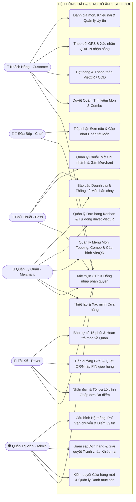
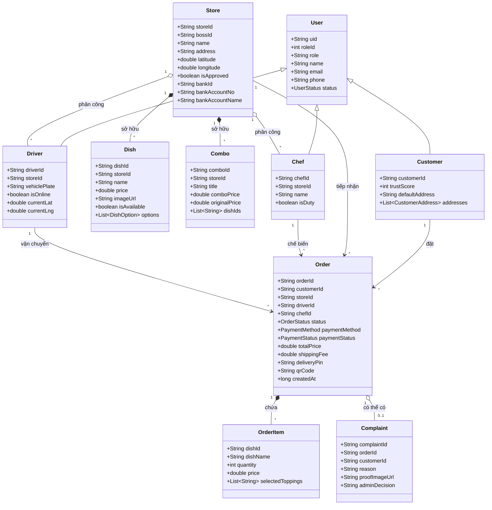
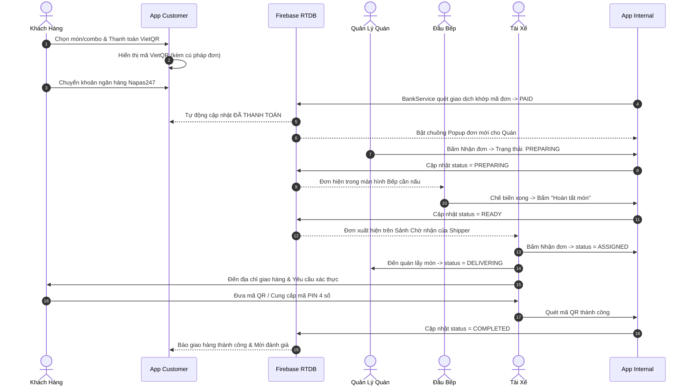
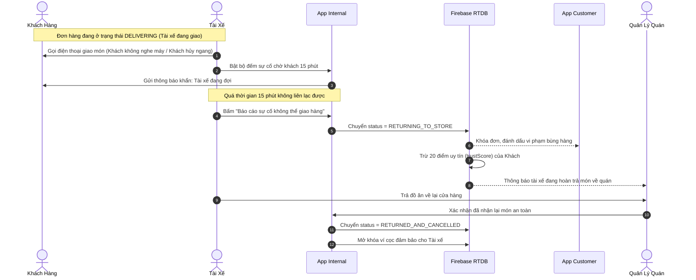
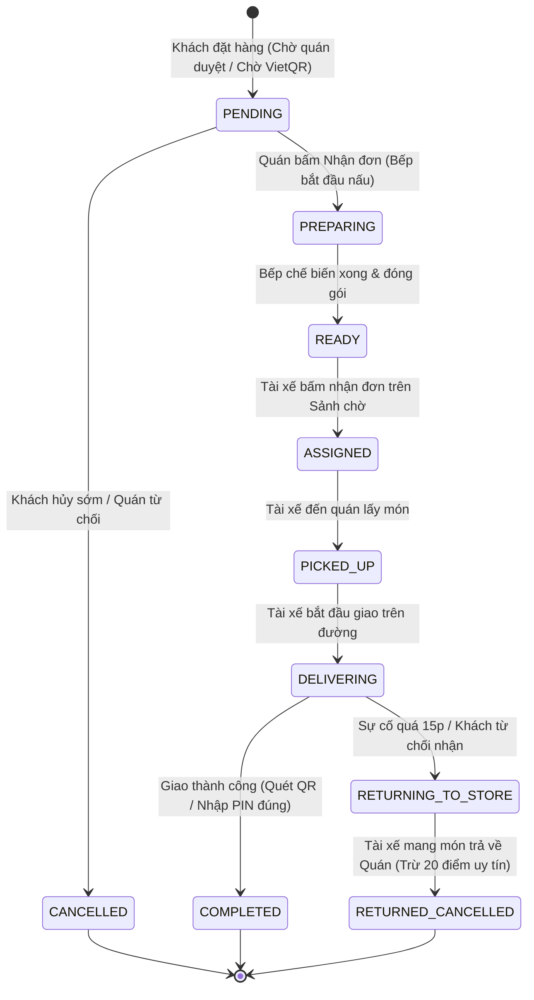

# BÁO CÁO THIẾT KẾ & KIẾN TRÚC TOÀN DIỆN HỆ THỐNG MỚI OISHI FOOD
**Hệ thống Đặt và Giao Đồ Ăn Đa Nền Tảng (Android Multi-Module & Web Admin)**  
**Đơn vị:** Trường Cao đẳng Công nghệ Thủ Đức (TDC) - Khoa Công nghệ Thông tin  
**Học phần:** Chuyên đề Tốt nghiệp 2  
**Năm học:** 2026  

---

## MỤC LỤC TỔNG QUAN

- [CHƯƠNG 1. TỔNG QUAN HỆ THỐNG](#chương-1-tổng-quan-hệ-thống)
  - [1.1 Giới thiệu bài toán & Mục tiêu đồ án](#11-giới-thiệu-bài-toán--mục-tiêu-đồ-án)
  - [1.2 Kiến trúc Công nghệ & Multi-Module](#12-kiến-trúc-công-nghệ--multi-module)
- [CHƯƠNG 2. ĐẶC TẢ YÊU CẦU & 6 ROLES HỆ THỐNG](#chương-2-đặc-tả-yêu-cầu--6-roles-hệ-thống)
  - [2.1 Bảng phân quyền 6 Roles (RBAC Matrix)](#21-bảng-phân-quyền-6-roles-rbac-matrix)
  - [2.2 Sơ đồ 1: Use Case Tổng quát hệ thống (6 Roles)](#22-sơ-đồ-1-use-case-tổng-quát-hệ-thống-6-roles)
  - [2.3 Sơ đồ 2: Luồng vận hành tương tác giữa các phân hệ](#23-sơ-đồ-2-luồng-vận-hành-tương-tác-giữa-các-phân-hệ)
- [CHƯƠNG 3. THIẾT KẾ KỸ THUẬT CHI TIẾT (SDS)](#chương-3-thiết-kế-kỹ-thuật-chi-tiết-sds)
  - [3.1 Thiết kế Cơ sở dữ liệu Firebase Realtime Database Mới](#31-thiết-kế-cơ-sở-dữ-liệu-firebase-realtime-database-mới)
  - [3.2 Sơ đồ 3: Sơ đồ Lớp (Class Diagram Toàn hệ thống)](#32-sơ-đồ-3-sơ-đồ-lớp-class-diagram-toàn-hệ-thống)
  - [3.3 Sơ đồ 4: Sơ đồ Tuần tự Luồng Đặt hàng – Chế biến – Giao nhận](#33-sơ-đồ-4-sơ-đồ-tuần-tự-luồng-đặt-hàng--chế-biến--giao-nhận)
  - [3.4 Sơ đồ 5: Sơ đồ Tuần tự Luồng Hủy đơn & Hoàn trả Bếp (RETURNING_TO_STORE)](#34-sơ-đồ-5-sơ-đồ-tuần-tự-luồng-hủy-đơn--hoàn-trả-bếp-returning_to_store)
  - [3.5 Sơ đồ 6: Sơ đồ Máy trạng thái Đơn hàng (Order State Machine)](#35-sơ-đồ-6-sơ-đồ-máy-trạng-thái-đơn-hàng-order-state-machine)
- [CHƯƠNG 4. DANH MỤC 25 MÀN HÌNH & 6 KỊCH BẢN KIỂM THỬ](#chương-4-danh-mục-25-màn-hình--6-kịch-bản-kiểm-thử)
  - [4.1 Danh mục 25 Ảnh chụp Màn hình Giao diện (Ảnh 1 – Ảnh 25B)](#41-danh-mục-25-ảnh-chụp-màn-hình-giao-diện-ảnh-1--ảnh-25b)
  - [4.2 Danh mục 6 Minh chứng Kiểm thử then chốt (Ảnh KT-1 – KT-6)](#42-danh-mục-6-minh-chứng-kiểm-thử-then-chốt-ảnh-kt-1--kt-6)

---

# CHƯƠNG 1. TỔNG QUAN HỆ THỐNG

## 1.1 Giới thiệu bài toán & Mục tiêu đồ án
Hệ thống **Oishi Food** là giải pháp số hóa toàn diện quy trình chuỗi cung ứng thực phẩm và dịch vụ ăn uống (F&B) từ khâu Khách hàng tìm kiếm/đặt món, Quán ăn quản lý thực đơn và điều phối chuỗi chi nhánh, Đầu bếp chế biến tại chỗ, Tài xế giao nhận định vị GPS thời gian thực, cho đến Quản trị viên sàn giám sát tập trung.

Hệ thống giải quyết triệt để các vấn đề nhức nhối trong ngành giao đồ ăn hiện nay:
1. **Minh bạch thanh toán:** Tích hợp VietQR Napas247 tự động sinh mã kèm nội dung đơn hàng và lắng nghe thông báo biến động số dư để duyệt đơn lập tức không cần chụp màn hình chuyển khoản thủ công.
2. **Loại bỏ vấn nạn "bùng hàng":** Cơ chế chấm điểm uy tín khách hàng (`trustScore`), thu cọc trước và xác thực nhận hàng 2 chiều thông qua quét mã QR động hoặc mã PIN OTP 4 số.
3. **Chống thất thoát khi hủy đơn:** Tự động chuyển đổi quy trình sang `RETURNING_TO_STORE` (Tài xế hoàn món về quán) và trừ 20 điểm uy tín khách hàng vi phạm.
4. **Vận hành Bếp chuyên nghiệp:** Module Bếp (Chef) chuyên dụng tách biệt khỏi quản lý quán, hiển thị danh sách món cần làm và cập nhật tức thời khi chế biến xong.
5. **Mô hình Chuỗi nhà hàng (Chain Management):** Hỗ trợ vai trò Chủ chuỗi (Boss) mở nhiều chi nhánh (Branch) và phân quyền Quản lý (Merchant) độc lập cho từng cửa hàng.

## 1.2 Kiến trúc Công nghệ & Multi-Module
Hệ thống được thiết kế theo mô hình **Multi-Module Gradle** chuẩn Clean Architecture trên nền tảng Android kết hợp Web SPA cho Quản trị viên:

- **Module `:core`:** Thư viện dùng chung chứa toàn bộ Data Models (26 entities), Firebase Repositories (`FirebaseRepository`, `AuthRepository`), Utilities (`OtpSessionManager`, `CccdOcrHelper`, `LocationHelper`), Services nền tảng.
- **Module `:app-customer`:** Ứng dụng Android dành riêng cho Khách hàng trải nghiệm tìm quán, chọn combo, giỏ hàng, thanh toán VietQR, theo dõi GPS tài xế, xác nhận QR nhận hàng và khiếu nại.
- **Module `:app-internal`:** Ứng dụng Android nội bộ phục vụ 4 tác nhân:
  - **Boss (Chủ chuỗi):** `BossDashboardActivity`, quản lý chuỗi, phân nhánh, báo cáo chuỗi.
  - **Merchant (Quản lý quán):** `OrderListFragment` (Kanban 4 tab), `MenuManageFragment`, `StoreProfileFragment` (VietQR), `StoreReportFragment`, `DriverListFragment`.
  - **Chef (Đầu bếp):** `ChefFragment`, `ChefViewModel`, tiếp nhận món cần nấu, đánh dấu hoàn tất.
  - **Driver (Tài xế):** `ShipperFragment`, `DeliveryTripActivity`, nhận đơn, ghép chuyến đa điểm (Batching), dẫn đường Google Maps, quét QR/PIN giao hàng.
- **Phân hệ `:app-admin` (`admin.html`):** Bảng điều khiển Web Quản trị viên thời gian thực kết nối trực tiếp Firebase REST/SDK, quản lý danh mục toàn sàn, kiểm duyệt quán mới, giám sát đơn hàng, xử lý khiếu nại và can thiệp điểm uy tín.

---

# CHƯƠNG 2. ĐẶC TẢ YÊU CẦU & 6 ROLES HỆ THỐNG

## 2.1 Bảng phân quyền 6 Roles (RBAC Matrix)

| STT | Mã Role | Tên Tác nhân | Phân hệ Ứng dụng | Trách nhiệm & Quyền hạn cốt lõi trong hệ thống |
|:---:|:---|:---|:---|:---|
| 1 | `CUSTOMER` | **Khách hàng** | `app-customer` | Đăng ký/đăng nhập OTP, duyệt danh mục, đặt món/combo, thanh toán VietQR/COD/MoMo, chat với quán, theo dõi GPS tài xế, cung cấp mã QR/PIN nhận hàng, đánh giá sao, quản lý điểm uy tín và gửi khiếu nại. |
| 2 | `BOSSMERCHANT` | **Chủ chuỗi (Boss)** | `app-internal` | Cấp cao nhất của chuỗi F&B: Tạo và quản lý nhiều chi nhánh nhà hàng (`stores`), tạo tài khoản và phân quyền cho Quản lý chi nhánh (`Merchant`), xem tổng quan doanh thu toàn chuỗi. |
| 3 | `MERCHANT` | **Quản lý quán** | `app-internal` | Quản lý cửa hàng được phân công: Xác minh quán (Xác minh Cửa hàng & VietQR), cấu hình thông tin quán và ngân hàng VietQR, quản lý menu món/combo/topping, tiếp nhận đơn hàng Kanban, quản lý đội tài xế nội bộ của quán. |
| 4 | `CHEF` | **Đầu bếp** | `app-internal` | Chuyên trách khu vực Bếp: Tiếp nhận tức thời các đơn hàng đang chế biến (`PREPARING`), xem chi tiết số lượng món ăn và ghi chú của khách, cập nhật trạng thái sẵn sàng giao (`READY`). |
| 5 | `DRIVER` | **Tài xế (Shipper)** | `app-internal` | Giao nhận hàng hóa: Xem danh sách đơn sẵn sàng của quán, nhận đơn lẻ hoặc ghép đơn đa điểm (Batching), dẫn đường Google Maps, nhận món từ Bếp, quét QR/nhập PIN giao cho khách, xử lý sự cố hoàn trả quán (`RETURNING_TO_STORE`). |
| 6 | `ADMIN` | **Quản trị viên sàn** | `admin.html` / `app-admin` | Toàn quyền kiểm soát hệ thống: Kiểm duyệt và kích hoạt quán ăn mới, quản lý danh mục ẩm thực dùng chung toàn sàn, giám sát realtime toàn bộ đơn hàng, phán quyết khiếu nại, can thiệp điểm uy tín, cấu hình tham số hệ thống (phí ship, bật/tắt bypass OTP). |

---

## 2.2 Sơ đồ 1: Use Case Tổng quát hệ thống (6 Roles)

Sơ đồ thể hiện trực quan ranh giới hệ thống Oishi Food cùng 6 tác nhân và các Use Case cốt lõi:



---

## 2.3 Sơ đồ 2: Luồng vận hành tương tác giữa các phân hệ

Sơ đồ luồng thể hiện sự phối hợp nhịp nhàng giữa 6 vai trò trong suốt vòng đời của một đơn hàng:

```mermaid
flowchart TD
    subgraph KHACH_HANG [Khách Hàng (Customer App)]
        A1[Duyệt Quán & Chọn Món/Combo] --> A2[Chọn Thanh Toán: VietQR / COD]
        A2 --> A3[Đặt Hàng Thành Công - PENDING]
        A3 --> A4[Theo Dõi GPS Tài Xế Realtime]
        A4 --> A5[Đưa Mã QR / PIN Cho Tài Xế]
        A5 --> A6[Đánh Giá Món & Tích Lũy Điểm Uy Tín]
    end

    subgraph QUAN_AN [Quản Lý Quán (Merchant) & Chủ Chuỗi (Boss)]
        B1[Boss Mở Chi Nhánh & Phân Quyền Merchant]
        B2[Merchant Tiếp Nhận Đơn Mới]
        B2 -->|Nếu Đơn VietQR| B3[Hệ Thống Tự Động Duyệt Tiền Ngân Hàng]
        B2 -->|Chấp Nhận Đơn| B4[Chuyển Trạng Thái: PREPARING]
    end

    subgraph BEP [Khu Vực Bếp (Chef App)]
        C1[Nhận Thông Báo Món Cần Nấu]
        B4 -.-> C1
        C1 --> C2[Đầu Bếp Chế Biến Món & Đóng Gói]
        C2 --> C3[Bấm Hoàn Tất: Chuyển Trạng Thái READY]
    end

    subgraph TAI_XE [Tài Xế (Driver / Shipper App)]
        D1[Xem Danh Sách Đơn Sẵn Sàng READY]
        C3 -.-> D1
        D1 --> D2[Nhận Đơn / Ghép Tuyến Đa Điểm: ASSIGNED]
        D2 --> D3[Đến Quán Lấy Món: PICKED_UP]
        D3 --> D4[Bật Google Maps Di Chuyển: DELIVERING]
        D4 --> D5{Liên Lạc Khách Hàng}
        D5 -->|Thành Công| D6[Quét Mã QR / Nhập PIN Nhận Món]
        D6 --> D7[Hoàn Tất Đơn: COMPLETED]
        D5 -->|Thất Bại Quá 15p| D8[Báo Cố: RETURNING_TO_STORE]
        D8 --> D9[Mang Món Trả Lại Quán & Hệ Thống Phạt 20đ Khách]
    end

    subgraph QUAN_TRI [Quản Trị Viên (Admin Web)]
        E1[Duyệt Quán Mới & Cấu Hình Phí]
        E2[Giám Sát Toàn Sàn Realtime]
        E3[Giải Quyết Tranh Chấp Khiếu Nại]
    end

    A3 -.-> B2
    D7 -.-> A5
    D7 -.-> A6
    E2 -. giám sát .-> A3
    E2 -. giám sát .-> D4
```

---

# CHƯƠNG 3. THIẾT KẾ KỸ THUẬT CHI TIẾT (SDS)

## 3.1 Thiết kế Cơ sở dữ liệu Firebase Realtime Database Mới

Dữ liệu được tổ chức theo cấu trúc JSON phân cấp phi quan hệ (NoSQL) tối ưu cho việc truy vấn và đồng bộ Realtime:

1. `/users/{uid}`: Thông tin tài khoản người dùng, email, phone, roleId, roleCode (`CUSTOMER`, `BOSSMERCHANT`, `MERCHANT`, `CHEF`, `DRIVER`, `ADMIN`), trạng thái khóa.
2. `/customers/{uid}`: Thông tin khách hàng, số điện thoại, điểm uy tín `trustScore` (mặc định 100), avatar, danh sách địa chỉ.
3. `/stores/{storeId}`: Chi nhánh nhà hàng, tên quán, địa chỉ, tọa độ `latitude`/`longitude`, giờ đóng/mở cửa, trạng thái duyệt `isApproved`, thông tin ngân hàng VietQR (`bankId`, `accountNo`, `accountName`), mã `bossId`.
4. `/boss_stores/{bossUid}/{storeId}`: Danh mục các chi nhánh trực thuộc sự sở hữu của một Boss.
5. `/merchants/{uid}`: Liên kết giữa tài khoản Merchant và chi nhánh quán được phân quyền quản lý (`storeId`).
6. `/chefs/{uid}`: Liên kết nhân viên Bếp với chi nhánh nhà hàng (`storeId`).
7. `/drivers/{uid}`: Hồ sơ tài xế, biển số xe, loại xe, trạng thái hoạt động `isOnline`, tọa độ GPS realtime (`latitude`, `longitude`, `bearing`), chi nhánh trực thuộc.
8. `/categories/{categoryId}`: Danh mục món ăn dùng chung toàn sàn (Admin quản lý).
9. `/dishes/{storeId}/{dishId}`: Thực đơn món ăn của quán, tên món, giá bán, hình ảnh, trạng thái còn/hết hàng, nhóm tùy chọn Topping (`DishOption`).
10. `/combos/{storeId}/{comboId}`: Các gói Combo ưu đãi do quán thiết lập.
11. `/orders/{orderId}`: Đơn hàng trung tâm hệ thống:
    - Mã đơn, `customerId`, `storeId`, `driverId`, `chefId`.
    - Danh sách món (`items`), tổng tiền món, phí giao hàng, giảm giá, tổng thanh toán.
    - Phương thức thanh toán: `COD`, `VIETQR`, `MOMO`.
    - Trạng thái thanh toán: `PENDING`, `PAID`, `REFUNDED`.
    - Trạng thái vòng đời đơn: `PENDING` -> `PREPARING` -> `READY` -> `ASSIGNED` -> `PICKED_UP` -> `DELIVERING` -> `COMPLETED` / `CANCELLED` / `RETURNING_TO_STORE`.
    - Mã bảo mật nhận hàng: `deliveryPin` (4 chữ số ngẫu nhiên) và `qrSecretKey`.
12. `/tracking/{orderId}`: Tọa độ GPS trực tiếp của tài xế phục vụ vẽ Polyline trên bản đồ của Khách.
13. `/complaints/{complaintId}`: Đơn khiếu nại của khách hàng (sai món, thái độ, giao trễ) kèm ảnh bằng chứng gửi Admin xử lý.
14. `/dish_reviews/{dishId}/{reviewId}`: Đánh giá sao (1-5 sao) và bình luận món ăn của khách.
15. `/system_config`: Cấu hình sàn tập trung: `bypass_login_otp` (chế độ test/thực tế), `shipping_rules` (bảng cước phí theo vùng).

---

## 3.2 Sơ đồ 3: Sơ đồ Lớp (Class Diagram Toàn hệ thống)



---

## 3.3 Sơ đồ 4: Sơ đồ Tuần tự Luồng Đặt hàng – Chế biến – Giao nhận



---

## 3.4 Sơ đồ 5: Sơ đồ Tuần tự Luồng Hủy đơn & Hoàn trả Bếp (RETURNING_TO_STORE)



---

## 3.5 Sơ đồ 6: Sơ đồ Máy trạng thái Đơn hàng (Order State Machine)



---

# CHƯƠNG 4. DANH MỤC 25 MÀN HÌNH & 6 KỊCH BẢN KIỂM THỬ

## 4.1 Danh mục 25 Ảnh chụp Màn hình Giao diện (Ảnh 1 – Ảnh 25B)

| Mã Ảnh | Tên Màn hình / Hộp thoại | File Giao diện (XML / HTML) | Phân hệ / Vai trò |
|:---:|:---|:---|:---|
| **Ảnh 1** | Màn hình Đăng nhập ứng dụng Khách hàng | `activity_login.xml` | `app-customer` |
| **Ảnh 2** | Màn hình Nhập mã xác thực Email OTP | `activity_otp_verification.xml` | `app-customer` |
| **Ảnh 3** | Màn hình Trang chủ Khách hàng (Banner, Hot, Quán gần đây) | `activity_home.xml` | `app-customer` |
| **Ảnh 4** | Màn hình Chi tiết Thực đơn Quán ăn & Danh mục | `activity_menu.xml` | `app-customer` |
| **Ảnh 5** | Hộp thoại Tùy chọn Topping & Số lượng món ăn | `bottom_sheet_dish_option.xml` | `app-customer` |
| **Ảnh 6** | Màn hình Giỏ hàng & Tùy biến số lượng món | `activity_cart.xml` | `app-customer` |
| **Ảnh 7** | Màn hình Đặt hàng & Chọn phương thức thanh toán | `activity_checkout.xml` | `app-customer` |
| **Ảnh 8** | Màn hình Thanh toán chuyển khoản VietQR Napas247 | `activity_payment.xml` | `app-customer` |
| **Ảnh 9** | Màn hình Theo dõi vị trí Tài xế Google Maps Realtime | `activity_tracking.xml` | `app-customer` |
| **Ảnh 10** | Hộp thoại Cung cấp Mã QR / Mã PIN xác nhận nhận hàng | `dialog_delivery_confirmation.xml` | `app-customer` |
| **Ảnh 11** | Màn hình Lịch sử Đơn hàng & Bộ lọc trạng thái | `activity_order_history.xml` | `app-customer` |
| **Ảnh 12** | Màn hình Hồ sơ Cá nhân, Sổ địa chỉ & Điểm uy tín | `activity_profile.xml` | `app-customer` |
| **Ảnh 13** | Màn hình Đăng nhập / Đăng ký Ứng dụng Nội bộ | `activity_login_internal.xml` | `app-internal` |
| **Ảnh 14** | Màn hình Xác minh Cửa hàng & Quét OCR Căn cước công dân | `activity_store_verification.xml` | `app-internal` (Merchant) |
| **Ảnh 15** | Màn hình Quản lý Chuỗi & Mở Chi nhánh của Boss | `activity_boss_dashboard.xml` | `app-internal` (Boss) |
| **Ảnh 16** | Màn hình Quản lý Đơn hàng Quán ăn Kanban 4 Tab | `fragment_order_list.xml` | `app-internal` (Merchant) |
| **Ảnh 17** | Hộp thoại Popup Báo chuông có Đơn hàng mới | `dialog_new_order_popup.xml` | `app-internal` (Merchant) |
| **Ảnh 18** | Màn hình Quản lý Thực đơn Món ăn & Gói Combo quán | `fragment_menu_manage.xml` | `app-internal` (Merchant) |
| **Ảnh 19** | Màn hình Báo cáo Doanh thu & Thống kê Món bán chạy | `fragment_store_report.xml` | `app-internal` (Merchant) |
| **Ảnh 20** | Màn hình Phân hệ Đầu bếp tiếp nhận món cần nấu | `fragment_chef.xml` | `app-internal` (Chef) |
| **Ảnh 21** | Màn hình Sảnh Nhận đơn & Ghép đơn đa điểm của Tài xế | `fragment_shipper.xml` | `app-internal` (Driver) |
| **Ảnh 22** | Màn hình Hành trình Giao hàng & Điều hướng Google Maps | `activity_delivery_trip.xml` | `app-internal` (Driver) |
| **Ảnh 23** | Màn hình Quét Camera QR / Nhập PIN giao món thành công | `activity_driver_scan_qr.xml` | `app-internal` (Driver) |
| **Ảnh 24** | Bảng điều khiển Web Quản trị viên (Duyệt quán & Cấu hình sàn) | `admin.html` (Tab Stores & Settings) | `app-admin` |
| **Ảnh 25A**| Màn hình Admin Giám sát Đơn hàng Realtime toàn sàn | `admin.html` (Tab Orders) | `app-admin` |
| **Ảnh 25B**| Màn hình Admin Giải quyết Tranh chấp Khiếu nại & Khóa tài khoản| `admin.html` (Tab Complaints & Customers)| `app-admin` |

---

## 4.2 Danh mục 6 Minh chứng Kiểm thử then chốt (Ảnh KT-1 – KT-6)

1. **KT-1 (Xác thực Email OTP & Chế độ Bypass từ xa):** Kiểm tra gửi nhận OTP qua Email và kiểm thử cơ chế công tắc `bypass_login_otp` trên Firebase giúp đăng nhập nhanh mà không bị phụ thuộc quota mạng.
2. **KT-2 (Thanh toán tự động VietQR Napas247):** Kiểm tra sinh mã QR chứa đúng số tiền và mã đơn hàng; dịch vụ `BankNotificationListenerService` bắt biến động số dư và tự động duyệt đơn sang `PREPARING` trong vòng 1-2 giây.
3. **KT-3 (Khu vực Bếp Chef xử lý đơn độc lập):** Kiểm tra đồng bộ đơn hàng tức thời đến màn hình Bếp, chuyển trạng thái đơn hàng sang `READY` khi nấu xong để thông báo cho tài xế.
4. **KT-4 (Định vị GPS Tài xế & Ghép đơn đa điểm Batching):** Kiểm tra `LocationForegroundService` gửi tọa độ GPS xe chạy trực tiếp lên Firebase, vẽ đường Polyline liên tục trên màn hình khách hàng.
5. **KT-5 (Bảo mật giao hàng 2 chiều qua mã QR / PIN OTP):** Kiểm tra tài xế quét mã QR hoặc nhập đúng mã PIN 4 số do khách cung cấp để hoàn tất đơn; chống trường hợp shipper tự ý bấm hoàn thành khi chưa giao.
6. **KT-6 (Xử lý sự cố bùng hàng & Hoàn trả món RETURNING_TO_STORE):** Kiểm tra luồng đếm ngược 15 phút gọi khách, bấm hoàn trả món về quán, hệ thống tự động trừ 20 điểm uy tín của khách vi phạm và bảo toàn tiền cọc cho tài xế.
