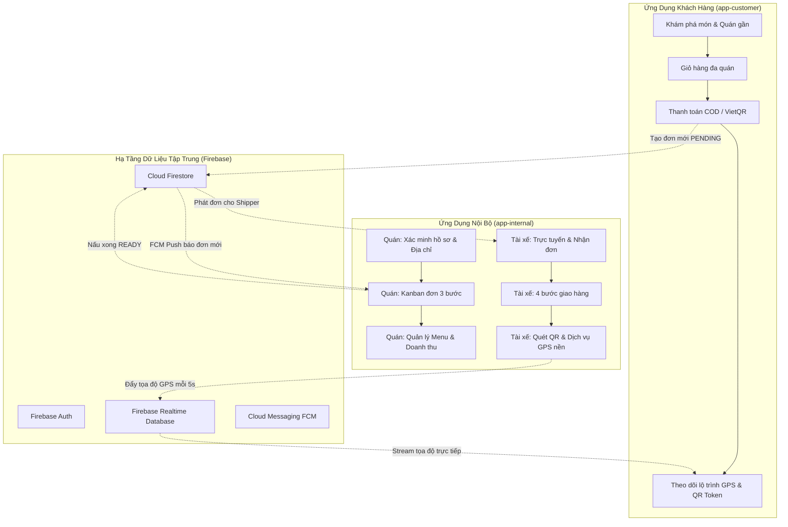

# TÀI LIỆU TOÀN DIỆN: DANH MỤC CHỨC NĂNG & LUỒNG HOẠT ĐỘNG HỆ THỐNG OISHI FOOD

> **Dự án**: Ứng Dụng Đặt & Giao Đồ Ăn Trực Tuyến Đa Nền Tảng (Oishi Food - Chuyên Đề 2)  
> **Cấu trúc Repository**: Multi-module Android (`app-customer`, `app-internal`, `core`) & Firebase Backend.

---

## 1. TỔNG QUAN KIẾN TRÚC HỆ THỐNG & MÔ HÌNH PHÂN QUYỀN (RBAC)

Hệ thống được chia thành 2 ứng dụng Android độc lập kết nối qua nền tảng Firebase (Authentication, Firestore, Realtime Database, Cloud Messaging):

---

## 2. PHÂN HỆ KHÁCH HÀNG (MODULE `app-customer`)

### 2.1. Đăng Nhập & Đăng Ký ([`LoginActivity.kt`](file:///E:/Android/Chuyen-De-2/app-customer/src/main/java/com/chuyen_de_2/foodorder/customer/ui/auth/LoginActivity.kt) / [`RegisterActivity.kt`](file:///E:/Android/Chuyen-De-2/app-customer/src/main/java/com/chuyen_de_2/foodorder/customer/ui/auth/RegisterActivity.kt))
- **Tên chức năng**: Xác thực người dùng Khách hàng (Customer Authentication).
- **Cách hoạt động**:
  - Khách hàng nhập Email, Mật khẩu. Hệ thống xác thực qua Firebase Auth.
  - Tự động kiểm tra trạng thái kích hoạt tài khoản (`isActive`); nếu tài khoản bị khóa bởi Admin (do vi phạm hoặc bùng hàng), hiển thị hộp thoại chặn truy cập kèm lý do.
  - Phân luồng thông minh: Nếu tài khoản mang quyền Quán (`MERCHANT`) hoặc Tài xế (`DRIVER`), hệ thống sẽ hiển thị Dialog gợi ý 1 chạm mở ứng dụng Oishi Internal (`com.chuyen_de_2.foodorder.internal`).
- **Luồng hướng tới**:
  - Tài khoản hợp lệ -> Chuyển vào Trang chủ [`HomeActivity`](file:///E:/Android/Chuyen-De-2/app-customer/src/main/java/com/chuyen_de_2/foodorder/customer/ui/home/HomeActivity.kt).
  - Chưa có tài khoản -> Chuyển sang [`RegisterActivity`](file:///E:/Android/Chuyen-De-2/app-customer/src/main/java/com/chuyen_de_2/foodorder/customer/ui/auth/RegisterActivity.kt).

---

### 2.2. Trang Chủ & Khám Phá Món Ăn ([`HomeActivity.kt`](file:///E:/Android/Chuyen-De-2/app-customer/src/main/java/com/chuyen_de_2/foodorder/customer/ui/home/HomeActivity.kt))
- **Tên chức năng**: Sàn Khám Phá Món Ngon & Tìm Kiếm Quán Ăn (Customer Marketplace).
- **Cách hoạt động**:
  - **Banner & Danh mục**: Phân loại theo biểu tượng: Cơm trưa, Trà sữa, Bún/Phở, Gà rán, Bánh mì, Pizza, Cà phê, Ăn vặt.
  - **Món Hot thịnh hành**: Thanh cuộn ngang hiển thị các món có lượt đặt cao và đánh giá tốt.
  - **Thực đơn toàn hệ thống**: Danh sách món ăn cuộn dọc kèm hình ảnh, giá bán, tên quán trực thuộc.
  - **Tìm kiếm tức thì (Instant Search)**: Lọc kết quả real-time khi khách gõ từ khóa.
  - **Bộ lọc Quán gần đây (`< 1.5 km`)**: Mở BottomSheet tính toán khoảng cách GPS giữa khách và các quán đang mở cửa.
  - **Nút giỏ hàng nổi (Floating Cart)**: Hiển thị nổi góc dưới màn hình, hiển thị số lượng món và tổng tiền tức thời.
- **Luồng hướng tới**:
  - Nhấp vào món/quán -> Mở [`MenuActivity`](file:///E:/Android/Chuyen-De-2/app-customer/src/main/java/com/chuyen_de_2/foodorder/customer/ui/menu/MenuActivity.kt).
  - Bấm nút Giỏ hàng nổi -> Mở [`CartActivity`](file:///E:/Android/Chuyen-De-2/app-customer/src/main/java/com/chuyen_de_2/foodorder/customer/ui/cart/CartActivity.kt).
  - Thanh BottomNav -> Chuyển sang [`OrderHistoryActivity`](file:///E:/Android/Chuyen-De-2/app-customer/src/main/java/com/chuyen_de_2/foodorder/customer/ui/order/OrderHistoryActivity.kt), [`NotificationActivity`](file:///E:/Android/Chuyen-De-2/app-customer/src/main/java/com/chuyen_de_2/foodorder/customer/ui/notification/NotificationActivity.kt), hoặc [`ProfileActivity`](file:///E:/Android/Chuyen-De-2/app-customer/src/main/java/com/chuyen_de_2/foodorder/customer/ui/profile/ProfileActivity.kt).

---

### 2.3. Chi Tiết Thực Đơn Quán ([`MenuActivity.kt`](file:///E:/Android/Chuyen-De-2/app-customer/src/main/java/com/chuyen_de_2/foodorder/customer/ui/menu/MenuActivity.kt))
- **Tên chức năng**: Xem Chi Tiết Menu Quán & Tùy Chọn Món Ăn.
- **Cách hoạt động**:
  - Truy vấn danh sách món thuộc `stores/{shopId}/dishes`.
  - **Top Detail Card**: Nửa trên hiển thị hình ảnh món ăn nổi bật, giá gốc gạch ngang, giá bán thực tế, điểm sao ⭐ trung bình và số lượt đánh giá.
  - **Đánh giá món**: Nút mở BottomSheet [`DishReviewsBottomSheetDialogFragment`](file:///E:/Android/Chuyen-De-2/app-customer/src/main/java/com/chuyen_de_2/foodorder/customer/ui/menu/DishReviewsBottomSheetDialogFragment.kt) xem phản hồi chi tiết từ cộng đồng khách hàng.
  - **Tùy chọn Size/Topping**: Hỗ trợ mở modal chọn mức đường, mức đá, topping thêm nếu món ăn hỗ trợ options.
  - **Thanh đặt hàng chân trang**: Hiển thị tổng số tiền của giỏ hàng hiện tại kèm nút "Xem Giỏ Hàng".
- **Luồng hướng tới**:
  - Bấm thanh đặt hàng -> Chuyển sang [`CartActivity`](file:///E:/Android/Chuyen-De-2/app-customer/src/main/java/com/chuyen_de_2/foodorder/customer/ui/cart/CartActivity.kt).

---

### 2.4. Giỏ Hàng Đa Quán ([`CartActivity.kt`](file:///E:/Android/Chuyen-De-2/app-customer/src/main/java/com/chuyen_de_2/foodorder/customer/ui/cart/CartActivity.kt))
- **Tên chức năng**: Quản Lý Giỏ Hàng Phân Tách Theo Quán (Multi-Store Cart).
- **Cách hoạt động**:
  - Gom nhóm các món ăn đã chọn theo từng quán riêng biệt để tránh tình trạng đơn hàng bị trộn lẫn giữa các cửa hàng khác nhau.
  - Khách hàng có thể tăng/giảm số lượng từng món, xóa cả giỏ của 1 quán.
  - Mỗi quán có nút "Thanh toán" độc lập tương ứng với tổng tiền của quán đó.
- **Luồng hướng tới**:
  - Bấm nút "Thanh toán" của quán -> Mở [`CheckoutActivity`](file:///E:/Android/Chuyen-De-2/app-customer/src/main/java/com/chuyen_de_2/foodorder/customer/ui/checkout/CheckoutActivity.kt).

---

### 2.5. Xác Nhận Thanh Toán & Đặt Đơn ([`CheckoutActivity.kt`](file:///E:/Android/Chuyen-De-2/app-customer/src/main/java/com/chuyen_de_2/foodorder/customer/ui/checkout/CheckoutActivity.kt))
- **Tên chức năng**: Đặt Đơn Hàng & Tính Cước Vận Chuyển Tự Động.
- **Cách hoạt động**:
  - Nhập hoặc chọn thông tin nhận hàng: Tên người nhận, SĐT, Địa chỉ, Quận/Huyện.
  - Hỗ trợ chọn nhanh từ Sổ địa chỉ cá nhân hoặc mở bản đồ vệ tinh [`SelectLocationActivity`](file:///E:/Android/Chuyen-De-2/app-customer/src/main/java/com/chuyen_de_2/foodorder/customer/ui/checkout/SelectLocationActivity.kt) để ghim vị trí chính xác.
  - Tự động tính khoảng cách từ Quán đến Khách để áp biểu phí ship chuẩn xác.
  - Áp dụng mã Voucher giảm giá nếu hợp lệ.
  - Lựa chọn hình thức thanh toán:
    1. **Tiền mặt khi nhận hàng (COD)**.
    2. **Chuyển khoản Ngân hàng (VietQR / Napas)**: Tự động trích xuất STK, Tên ngân hàng, Chủ tài khoản của Quán.
- **Luồng hướng tới**:
  - Chọn COD -> Chuyển sang [`OrderSuccessActivity`](file:///E:/Android/Chuyen-De-2/app-customer/src/main/java/com/chuyen_de_2/foodorder/customer/ui/order/OrderSuccessActivity.kt).
  - Chọn Chuyển khoản -> Chuyển sang [`PaymentActivity`](file:///E:/Android/Chuyen-De-2/app-customer/src/main/java/com/chuyen_de_2/foodorder/customer/ui/payment/PaymentActivity.kt) để quét mã QR thanh toán trước khi chuyển tiếp.

---

### 2.6. Theo Dõi Đơn Hàng & Bản Đồ GPS Realtime ([`TrackingActivity.kt`](file:///E:/Android/Chuyen-De-2/app-customer/src/main/java/com/chuyen_de_2/foodorder/customer/ui/tracking/TrackingActivity.kt))
- **Tên chức năng**: Giám Sát Hành Trình Đơn Hàng Thời Gian Thực.
- **Cách hoạt động**:
  - **Stepper tiến trình 4 giai đoạn**: Đang chờ duyệt -> Quán đang chuẩn bị -> Tài xế đang giao -> Giao hàng thành công.
  - **Bản đồ Google Maps Live Tracking**: Lắng nghe tọa độ GPS từ Firebase Realtime Database `tracking/{orderId}` để vẽ xe máy tài xế di chuyển từng bước.
  - **Mã QR Delivery Token**: Hiển thị mã QR và mã chữ số bảo mật để tài xế quét lúc giao món (chống gian lận/giao nhầm người).
  - **Kênh liên lạc**: Nút gọi điện cho quán, nút gọi điện cho shipper, mở BottomSheet nhắn tin trao đổi với quán [`ChatStoreBottomSheetDialogFragment`](file:///E:/Android/Chuyen-De-2/app-customer/src/main/java/com/chuyen_de_2/foodorder/customer/ui/tracking/ChatStoreBottomSheetDialogFragment.kt).
  - **Đánh giá hoàn tất**: Chấm sao ⭐ và gửi đánh giá chất lượng món ăn khi đơn hoàn thành.
- **Luồng hướng tới**:
  - Bấm quay lại -> Trở về [`HomeActivity`](file:///E:/Android/Chuyen-De-2/app-customer/src/main/java/com/chuyen_de_2/foodorder/customer/ui/home/HomeActivity.kt) hoặc [`OrderHistoryActivity`](file:///E:/Android/Chuyen-De-2/app-customer/src/main/java/com/chuyen_de_2/foodorder/customer/ui/order/OrderHistoryActivity.kt).

---

### 2.7. Lịch Sử Đơn Hàng & Khiếu Nại ([`OrderHistoryActivity.kt`](file:///E:/Android/Chuyen-De-2/app-customer/src/main/java/com/chuyen_de_2/foodorder/customer/ui/order/OrderHistoryActivity.kt) / [`ComplaintActivity.kt`](file:///E:/Android/Chuyen-De-2/app-customer/src/main/java/com/chuyen_de_2/foodorder/customer/ui/complaint/ComplaintActivity.kt))
- **Tên chức năng**: Quản Lý Đơn Hàng Đã Đặt & Xử Lý Tranh Chấp Khiếu Nại.
- **Cách hoạt động**:
  - Phân tab chi tiết: Tất cả, Khẩn cấp (Cảnh báo nhỡ cuộc gọi/Nguy cơ bùng), Đang giao, Đã hoàn thành, Đã hủy.
  - Chức năng "Đặt lại": Tự động mở lại thực đơn quán cũ để khách đặt lại món yêu thích.
  - Chức năng "Xem bằng chứng giao hàng": Hiển thị ảnh tài xế chụp hiện trường khi xảy ra sự cố [`IncidentProofBottomSheetDialogFragment`](file:///E:/Android/Chuyen-De-2/app-customer/src/main/java/com/chuyen_de_2/foodorder/customer/ui/order/IncidentProofBottomSheetDialogFragment.kt).
  - Chức năng "Khiếu nại": Điền biểu mẫu báo cáo sai món, đồ ăn hỏng, tài xế thái độ xấu lên Firestore `complaints` cho Admin xử lý.
- **Luồng hướng tới**:
  - Điều hướng tới [`TrackingActivity`](file:///E:/Android/Chuyen-De-2/app-customer/src/main/java/com/chuyen_de_2/foodorder/customer/ui/tracking/TrackingActivity.kt), [`ComplaintActivity`](file:///E:/Android/Chuyen-De-2/app-customer/src/main/java/com/chuyen_de_2/foodorder/customer/ui/complaint/ComplaintActivity.kt), hoặc [`MenuActivity`](file:///E:/Android/Chuyen-De-2/app-customer/src/main/java/com/chuyen_de_2/foodorder/customer/ui/menu/MenuActivity.kt).

---

### 2.8. Hồ Sơ Cá Nhân & Điểm Uy Tín ([`ProfileActivity.kt`](file:///E:/Android/Chuyen-De-2/app-customer/src/main/java/com/chuyen_de_2/foodorder/customer/ui/profile/ProfileActivity.kt))
- **Tên chức năng**: Quản Lý Thông Tin Khách Hàng, Điểm Tín Nhiệm & Sổ Địa Chỉ.
- **Cách hoạt động**:
  - Cập nhật ảnh đại diện (chọn ảnh từ máy hoặc avatar Emoji), họ tên, số điện thoại.
  - **Điểm uy tín (Trust Score)**: Đánh giá độ tin cậy dựa trên lịch sử nhận hàng thành công vs số lần bùng đơn (boom). Tài khoản có điểm uy tín thấp sẽ bị giới hạn thanh toán COD.
  - **Sổ địa chỉ**: Lưu sẵn nhiều địa chỉ (Nhà riêng, Cơ quan, Người thân) kèm tọa độ ghim bản đồ để đặt hàng nhanh.
- **Luồng hướng tới**:
  - Đăng xuất -> Chuyển về [`LoginActivity`](file:///E:/Android/Chuyen-De-2/app-customer/src/main/java/com/chuyen_de_2/foodorder/customer/ui/auth/LoginActivity.kt).

---

## 3. PHÂN HỆ QUÁN ĂN / MERCHANT (MODULE `app-internal`)

### 3.1. Đăng Ký & Phiếu Xác Minh Quán Bắt Buộc ([`RegisterActivity.kt`](file:///E:/Android/Chuyen-De-2/app-internal/src/main/java/com/chuyen_de_2/foodorder/internal/ui/auth/RegisterActivity.kt) / [`StoreVerificationActivity.kt`](file:///E:/Android/Chuyen-De-2/app-internal/src/main/java/com/chuyen_de_2/foodorder/internal/ui/auth/StoreVerificationActivity.kt))
- **Tên chức năng**: Đăng Ký Đối Tác Kinh Doanh & Xác Minh Hồ Sơ Pháp Lý Quán.
- **Cách hoạt động**:
  - Đối tác tạo tài khoản nội bộ với vai trò `MERCHANT`.
  - **Cơ chế chặn bắt buộc**: Sau khi đăng ký hoặc đăng nhập, hệ thống kiểm tra trường `isVerified` và thông tin địa chỉ trên Firestore. Nếu chưa hoàn tất, người dùng **bắt buộc** phải hoàn thành phiếu xác minh tại [`StoreVerificationActivity`](file:///E:/Android/Chuyen-De-2/app-internal/src/main/java/com/chuyen_de_2/foodorder/internal/ui/auth/StoreVerificationActivity.kt) mới được vào Dashboard.
  - Thu thập hồ sơ chuẩn chỉnh:
    1. Tên Quán ăn, Số điện thoại liên hệ.
    2. Địa chỉ lấy hàng chi tiết & Chọn Quận/Huyện TP.HCM (Hệ thống tự động map tọa độ GPS chuẩn để Shipper định tuyến).
    3. Họ tên chủ hộ kinh doanh & Số CCCD (đúng 12 số).
    4. Giờ mở cửa & Thời gian chuẩn bị món trung bình.
    5. Thông tin Ngân hàng thụ hưởng (Ngân hàng, Số tài khoản, Tên chủ tài khoản, Mã BIN VietQR).
- **Luồng hướng tới**:
  - Xác minh thành công -> Điều hướng trực tiếp vào [`DashboardActivity`](file:///E:/Android/Chuyen-De-2/app-internal/src/main/java/com/chuyen_de_2/foodorder/internal/ui/dashboard/DashboardActivity.kt).

---

### 3.2. Quản Lý Đơn Hàng Kanban 3 Bước ([`OrderListFragment.kt`](file:///E:/Android/Chuyen-De-2/app-internal/src/main/java/com/chuyen_de_2/foodorder/internal/ui/shop/OrderListFragment.kt))
- **Tên chức năng**: Kênh Điều Phối Đơn Hàng Của Quán (Merchant Order Kanban).
- **Cách hoạt động**:
  - **Header Card**: Hiển thị tên quán, địa chỉ thu gọn, công tắc gạt Mở bán/Tạm đóng, thống kê doanh thu và số đơn thành công hôm nay.
  - **Quy trình 3 bước chuẩn thương mại điện tử**:
    1. **Đơn Mới (PENDING)**: Khách vừa đặt. Quán bấm "XÁC NHẬN ĐƠN CỦA KHÁCH" -> Trạng thái chuyển sang `PREPARING` (Bếp bắt đầu nấu, tài xế chưa nhận đơn).
    2. **Bếp Nấu (PREPARING)**: Bếp nấu xong bấm "XÁC NHẬN ĐÃ NẤU XONG" -> Trạng thái chuyển sang `READY` (Món ăn sẵn sàng, hệ thống bắt đầu phát đơn cho tài xế nhận).
    3. **Sẵn Sàng / Đã Gán Tài Xế (READY / ASSIGNED)**: Tài xế tới quầy quẹt nhận đơn. Quán bấm "XÁC NHẬN GIAO CHO TÀI XẾ" -> Trạng thái chuyển sang `DELIVERING` (Tài xế rời quán đi giao cho khách).
    4. **Lịch Sử (COMPLETED / CANCELLED)**: Lưu trữ các đơn thành công hoặc bị hủy.
  - **Cảnh báo đơn mới**: Phát chuông Notification âm thanh lớn và hiển thị Toast nhắc nhở nhân viên khi có đơn phát sinh.
- **Luồng hướng tới**:
  - Cập nhật trực tiếp lên Firestore -> Đồng bộ trạng thái tức thời sang App Khách hàng và App Tài xế.

---

### 3.3. Quản Lý Thực Đơn & Check-in Mở Ca ([`MenuManageFragment.kt`](file:///E:/Android/Chuyen-De-2/app-internal/src/main/java/com/chuyen_de_2/foodorder/internal/ui/shop/MenuManageFragment.kt))
- **Tên chức năng**: Quản Lý Danh Mục Món Ăn & Điểm Danh Mở Cửa Quán.
- **Cách hoạt động**:
  - **Nút Check-in mở ca**: Cho phép nhân viên điểm danh mở cửa đón khách hoặc chuyển sang trạng thái tạm nghỉ.
  - **Banner đơn hàng mới**: Thông báo nổi khi có đơn, bấm vào chuyển ngay sang tab Quản lý đơn hàng.
  - **Thêm món & Sửa món**: Modal hỗ trợ nhập Tên món, Đơn giá, Phân loại danh mục, Mô tả và Ảnh đại diện (hỗ trợ cả link URL lẫn tải ảnh trực tiếp từ thư viện thiết bị được nén Base64 tối ưu).
  - **Xóa món**: Xóa món ăn khỏi Firestore sub-collection `dishes` kèm xác nhận an toàn.
- **Luồng hướng tới**:
  - Món ăn cập nhật trên Firestore -> Khách hàng trên app Customer thấy thực đơn mới ngay lập tức.

---

### 3.4. Quản Lý Đội Ngũ Tài Xế Nội Bộ ([`DriverListFragment.kt`](file:///E:/Android/Chuyen-De-2/app-internal/src/main/java/com/chuyen_de_2/foodorder/internal/ui/driver/DriverListFragment.kt))
- **Tên chức năng**: Quản Trị Đội Xe Giao Hàng Trực Thuộc Quán.
- **Cách hoạt động**:
  - Thống kê tình trạng: Tổng tài xế, Đang rảnh (Available), Đang giao hàng (Delivering), Nghỉ ca (Off-duty).
  - Danh sách tài xế: Hiển thị Mã TX, Họ tên, SĐT, Biển số xe, Dòng xe, Số đơn đã hoàn thành, Điểm đánh giá uy tín.
  - Nút gọi nhanh cho tài xế qua `ACTION_DIAL`.
  - **Tạo tài khoản tài xế mới**: Hộp thoại cho phép chủ quán trực tiếp đăng ký tài khoản cho tài xế mới (cấp mã TX, email, mật khẩu) và tự động gán vào quán.
- **Luồng hướng tới**:
  - Tài xế mới dùng tài khoản vừa được cấp để đăng nhập vào app Shipper và nhận đơn của quán.

---

### 3.5. Báo Cáo Doanh Thu & Hiệu Quả Kinh Doanh ([`StoreReportFragment.kt`](file:///E:/Android/Chuyen-De-2/app-internal/src/main/java/com/chuyen_de_2/foodorder/internal/ui/shop/StoreReportFragment.kt))
- **Tên chức năng**: Phân Tích Chỉ Số Tài Chính & Top Món Bán Chạy (Store Analytics).
- **Cách hoạt động**:
  - Lọc thống kê theo: Hôm nay, Tuần này, Tháng này.
  - Tính toán tự động: Doanh thu thực nhận, Số đơn hoàn tất, Số đơn bị hủy/bùng, Giá trị đơn hàng trung bình (AOV).
  - Điểm đánh giá chất lượng sao ⭐ trung bình của quán.
  - **Bảng xếp hạng Best Sellers**: Thống kê số lượng bán ra và doanh số chi tiết cho từng món ăn.
- **Luồng hướng tới**:
  - Hỗ trợ chủ quán theo dõi tăng trưởng kinh doanh và tối ưu thực đơn.

---

### 3.6. Hồ Sơ Quán & Cài Đặt Thanh Toán ([`StoreProfileFragment.kt`](file:///E:/Android/Chuyen-De-2/app-internal/src/main/java/com/chuyen_de_2/foodorder/internal/ui/shop/StoreProfileFragment.kt))
- **Tên chức năng**: Quản Lý Thông Tin Thương Hiệu & Tài Khoản Ngân Hàng Quán.
- **Cách hoạt động**:
  - Hiển thị đầy đủ thông tin pháp lý, giờ hoạt động, thời gian chuẩn bị món.
  - Badge xác minh hồ sơ: Hiển thị trạng thái "ĐÃ XÁC MINH" hoặc "CHỜ BỔ SUNG".
  - Cho phép mở Dialog chỉnh sửa toàn bộ thông tin quán và tài khoản VietQR bất kỳ lúc nào.
- **Luồng hướng tới**:
  - Lưu trữ lên Firestore -> Đồng bộ sang thông tin quán trên app Khách hàng.

---

## 4. PHÂN HỆ TÀI XẾ / SHIPPER (MODULE `app-internal`)

### 4.1. Nhận Đơn & Trực Tuyến ([`ShipperFragment.kt`](file:///E:/Android/Chuyen-De-2/app-internal/src/main/java/com/chuyen_de_2/foodorder/internal/ui/ship/ShipperFragment.kt))
- **Tên chức năng**: Trung Tâm Điều Phối & Nhận Cuốc Xe Của Tài Xế.
- **Cách hoạt động**:
  - **Công tắc trực tuyến**: Chuyển đổi giữa `🟢 ĐANG TRỰC` (sẵn sàng nhận cuốc) và `⏸️ TẠM NGHỈ`.
  - Hiển thị quán liên kết trực thuộc của tài xế.
  - **Đơn chờ nhận (Pending Orders)**: Danh sách các đơn món đã nấu xong (`READY`) đang chờ tài xế nhận giao.
  - **Đơn đang thực hiện (Active Orders)**: Hiển thị đơn tài xế đang đảm nhận, kèm nút "Tiếp tục giao" và nút "Hủy đơn" (có ghi nhận lý do sự cố).
  - Thống kê tức thì: Số cuốc hoàn thành trong ca và tổng tiền cước giao nhận kiếm được.
- **Luồng hướng tới**:
  - Bấm nhận đơn -> Cập nhật trạng thái sang `ASSIGNED`.
  - Bấm "Tiếp tục giao" -> Mở màn hình dẫn đường GPS [`DeliveryTripActivity`](file:///E:/Android/Chuyen-De-2/app-internal/src/main/java/com/chuyen_de_2/foodorder/internal/ui/ship/DeliveryTripActivity.kt).

---

### 4.2. Chuyến Giao Hàng & Điều Hướng GPS ([`DeliveryTripActivity.kt`](file:///E:/Android/Chuyen-De-2/app-internal/src/main/java/com/chuyen_de_2/foodorder/internal/ui/ship/DeliveryTripActivity.kt))
- **Tên chức năng**: Điều Hướng GPS Lộ Trình & Quy Trình Giao Hàng 4 Bước.
- **Cách hoạt động**:
  - **Bản đồ dẫn đường**: Hiển thị lộ trình qua WebView (Leaflet/OSM) nối từ vị trí tài xế -> Quán lấy món -> Nhà khách hàng.
  - **Quy trình quẹt xác nhận 4 bước (Swipe-to-Confirm)**:
    1. *Bước 1: Đến Quán*: Quẹt xác nhận "Đã đến quán" -> Trạng thái chuyển sang `ARRIVED_AT_SHOP`.
    2. *Bước 2: Lấy Hàng & Kiểm Đếm*: Tích chọn checklist đầy đủ các món theo bill trước khi quẹt "Đã lấy món & Bắt đầu giao" -> Trạng thái chuyển sang `DELIVERING`.
    3. *Bước 3: Đến Điểm Giao*: Di chuyển tới nhà khách và quẹt "Đã đến điểm giao" -> Trạng thái chuyển sang `ARRIVED_AT_CUSTOMER`.
    4. *Bước 4: Xác Thực Nhận Hàng An Toàn*: Quét mã QR trên máy khách hàng hoặc nhập mã Token dự phòng. Xác thực trùng khớp sẽ mở khóa nút hoàn tất đơn hàng -> Trạng thái chuyển sang `COMPLETED`.
  - **Hỗ trợ đơn gộp (Bundle Trips)**: Cho phép giao 2 đơn trên cùng tuyến đường, chuyển đổi qua lại giữa Khách 1 và Khách 2 mượt mà.
  - **Xử lý sự cố tại chỗ**: Ghi nhận cuộc gọi nhỡ (đếm ngược 15 phút nếu khách không nghe máy, chụp ảnh hiện trường báo bom hàng).
- **Luồng hướng tới**:
  - Hoàn tất đơn -> Cập nhật `COMPLETED` lên Firestore -> Quay về [`ShipperFragment`](file:///E:/Android/Chuyen-De-2/app-internal/src/main/java/com/chuyen_de_2/foodorder/internal/ui/ship/ShipperFragment.kt) và cộng cước phí vào ví.

---

### 4.3. Dịch Vụ GPS Nền ([`LocationForegroundService.kt`](file:///E:/Android/Chuyen-De-2/app-internal/src/main/java/com/chuyen_de_2/foodorder/internal/service/LocationForegroundService.kt))
- **Tên chức năng**: Dịch Vụ Định Vị Nền Chống Doze Mode Hệ Điều Hành.
- **Cách hoạt động**:
  - Chạy dưới dạng Android Foreground Service với Notification thường trực (Ongoing).
  - Tự động lấy tọa độ FusedLocationProviderClient với tần suất 5 giây/lần.
  - Bắn trực tiếp dữ liệu tọa độ lên Firebase Realtime Database node `tracking/{orderId}`.
- **Luồng hướng tới**:
  - App Khách hàng [`TrackingActivity`](file:///E:/Android/Chuyen-De-2/app-customer/src/main/java/com/chuyen_de_2/foodorder/customer/ui/tracking/TrackingActivity.kt) bắt tọa độ này để vẽ xe chạy trực tiếp trên bản đồ.

---

### 4.4. Quản Lý Thu Nhập & Hồ Sơ Tài Xế ([`ShipperIncomeFragment.kt`](file:///E:/Android/Chuyen-De-2/app-internal/src/main/java/com/chuyen_de_2/foodorder/internal/ui/ship/ShipperIncomeFragment.kt) / [`ShipperProfileFragment.kt`](file:///E:/Android/Chuyen-De-2/app-internal/src/main/java/com/chuyen_de_2/foodorder/internal/ui/ship/ShipperProfileFragment.kt))
- **Tên chức năng**: Báo Cáo Thu Nhập Cuốc Xe & Cấu Hình Ca Trực.
- **Cách hoạt động**:
  - Tổng hợp danh sách cuốc xe đã giao thành công, tính toán số dư ví và tiền công theo từng ngày/tuần/tháng.
  - Quản lý bật/tắt quyền định vị nền, số điện thoại hotline hỗ trợ khẩn cấp, và đăng xuất ca trực.
- **Luồng hướng tới**:
  - Minh bạch cước vận chuyển cho tài xế.

---

## 5. BẢNG TỔNG HỢP VÒNG ĐỜI TRẠNG THÁI ĐƠN HÀNG (ORDER STATE MACHINE)

| Trạng thái | Mã Status | Bên kích hoạt | Hành động tương ứng | Màn hình tiếp nhận |
| :--- | :--- | :--- | :--- | :--- |
| **Đơn mới** | `PENDING` | Khách hàng | Khách bấm Đặt đơn tại Checkout | Quán nhận chuông báo tại [`OrderListFragment`](file:///E:/Android/Chuyen-De-2/app-internal/src/main/java/com/chuyen_de_2/foodorder/internal/ui/shop/OrderListFragment.kt) |
| **Đang nấu** | `PREPARING` | Quán ăn | Quán bấm "Xác nhận đơn của khách" | Bếp nấu món; Khách thấy Stepper chuyển bước 2 |
| **Nấu xong** | `READY` | Quán ăn | Bếp nấu xong bấm "Xác nhận đã nấu xong" | Đơn xuất hiện trên danh sách chờ của [`ShipperFragment`](file:///E:/Android/Chuyen-De-2/app-internal/src/main/java/com/chuyen_de_2/foodorder/internal/ui/ship/ShipperFragment.kt) |
| **Đã nhận đơn** | `ASSIGNED` | Tài xế | Tài xế bấm "Nhận đơn" | Quán thấy tên tài xế; Tài xế di chuyển tới quán |
| **Đã đến quán** | `ARRIVED_AT_SHOP` | Tài xế | Tài xế quẹt "Đã đến quán" | Quán chuẩn bị giao túi món tại quầy |
| **Đang giao** | `DELIVERING` | Quán / Tài xế | Quán bấm giao hoặc Tài xế quẹt kiểm món xong | Tài xế bật GPS nền; Khách theo dõi live map |
| **Đã đến khách** | `ARRIVED_AT_CUSTOMER` | Tài xế | Tài xế quẹt "Đã đến điểm giao" | Khách hàng mở sẵn mã QR nhận hàng |
| **Hoàn thành** | `COMPLETED` | Tài xế & Khách | Tài xế quét mã QR / Token của khách | Cộng tiền quán, cộng phí shipper, khách đánh giá sao |
| **Hủy / Bùng** | `CANCELLED` / `BOOM` | Các bên / Hệ thống | Hủy do sự cố, hết món hoặc bùng hàng | Ghi nhận trừ điểm uy tín, gửi báo cáo Admin |

---

*Tài liệu được cập nhật tự động đồng bộ theo toàn bộ mã nguồn của dự án Oishi Food.*
